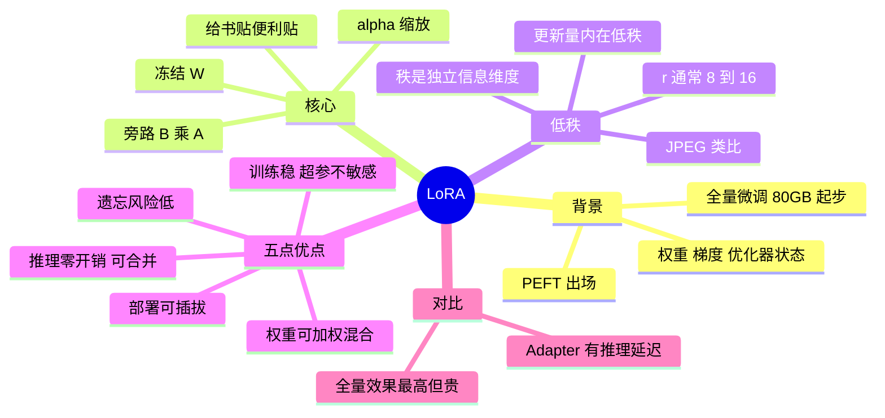

## 🔥 快速背诵

LoRA 就是冻结原权重，在旁边加一条低秩旁路打补丁。原矩阵不动，只训两个小矩阵，参数量降到千分之一量级。它淘汰 Adapter 靠五点叠加：推理时可以把 BA 合并回原权重，零额外延迟；产物几十兆，可以按任务热插拔；没动原权重，遗忘风险低；训练更稳；多个权重还能组合。调参关键是 rank 和作用模块，QLoRA 再叠 4bit 量化就单卡可训。

## 🧠 导图



---

# 📖 背诵稿

> 五段，按顺序背。

### ① 它解决什么

**全量微调太贵，LoRA 是 PEFT 里最成功的一支。**

7B 模型 FP16 权重 14GB，训练还要存梯度 14GB、Adam 一阶二阶矩约 56GB，一次迭代 **80GB+ 显存**；70B 更是几百 GB 起。个人手里顶多一张 24GB 的 4090，根本跑不动。PEFT 的思路就是：不更新全部参数，只训一小部分，同时尽量不损失效果。

### ② 核心思路

**不动原始权重 W，在旁边加两个小矩阵 A、B，只训这两个。**

前向是 `output = x @ (W + α·(B@A))`，W 全程冻结，只有旁路在学习。类比：全量微调是把书重印一遍改掉原文，LoRA 是在空白处贴便利贴，原书一字不动，读的时候原文和便利贴叠加。A 形状 d×r、B 形状 r×d，都是把输入压到 r 维再还原，α 是控制更新强度的缩放因子。

### ③ 低秩是什么意思

**「秩」代表矩阵里真正独立的信息维度，而微调的权重更新量往往只在很低维的子空间里变。**

一个 4096×4096 的矩阵理论秩可以到 4096，但研究发现 ΔW = W微调后 − W原始 的内在秩通常只有 8~16，其余几千维几乎没有有效信息。就像 4K 照片几百万像素，但用几十个主成分就能近似表达——这正是 JPEG 压缩的原理。所以不用存整个 d×d 的大矩阵，用 d×r 和 r×d 两个小矩阵乘积近似就行。算笔账：4096×4096 是 1677 万参数，r=16 只需 13.1 万，**降了约 128 倍**；整个 7B 的可训参数从 70 亿降到 2000 万，不到 0.3%。r 是最重要的超参，8~16 大多数任务就够。

### ④ 五个被低估的优点

**参数少只是第一层，后面五个优点都是从「原权重冻结 + 旁路」这个结构自然推论出来的。**

**推理零开销**：训练完可以把 α·B@A 提前合并进 W 得到 W_merged，推理计算图和原模型完全一样，没有额外延迟。这正是 Adapter 的软肋——它在每层之间插小网络，推理时激活值每层都要多过一遍，32 层叠起来延迟可观。**部署可插拔**：基础模型像操作系统（14GB），LoRA 像 App（10~100MB），一个 7B 底座常驻显存，客服/代码/翻译几套 LoRA 按请求热切换，不用为每个场景各跑一个完整模型。**遗忘风险低**：原权重一个参数都不动，学习全在旁路，像白板旁边贴便利贴而不是擦掉重写；但**不是免测金牌**，数据太偏、rank 太大、学习率过高或合并后继续训仍会退化，微调后要跑通用能力回归。**训练更稳**：可训参数少、梯度空间小，对学习率不敏感，基本只需调 r。**权重可组合**：`W' = W + α₁B₁A₁ + α₂B₂A₂`，调 α 比例就能配比能力，不用重新训——这就是 LoRA Merging。

### ⑤ 一句话收尾

**LoRA 能成为 PEFT 事实标准，是因为这五点恰好把 Adapter 全面比下去了。**

和全量微调比，它效果接近、资源低一个量级；和 Adapter 比，它在推理开销、部署灵活性、稳定性、可组合性上全赢。所以从个人开发者到大型团队，默认第一选择都是 LoRA（配 QLoRA 还能再降显存）。

---

# 🔑 记忆锚

| 记什么 | 内容 | 口诀 |
|---|---|---|
| **1** 个结构 | 冻结 W + 旁路 BA | 「原书不动贴便利贴」 |
| **5** 个优点 | 零开销 / 可插拔 / 不忘 / 稳 / 可组合 | 「零·插·记·稳·合」 |
| **1** 个数字 | r=16 降约 128 倍参数 | 「百万变十万」 |
| **1** 个警示 | 不是免测金牌，要回归评测 | 「贴纸也会错位」 |

> **卡壳急救**：先答结构（冻结 + 旁路），再报五个优点，最后用「对比 Adapter」收尾。

---

# 🎯 追问速查

| 面试官问 | 你答 |
|---|---|
| 低秩为什么成立？ | 微调带来的权重更新只在低维子空间有实质变化 |
| 推理真的没开销吗？ | 把 BA 合并进 W 后与原模型完全一致；训练时旁路有开销，推理可合并 |
| 和 Adapter 最大差别？ | Adapter 推理时每层多过一个小网络，延迟累积；LoRA 可合并消除 |
| r 怎么选？ | 8~16 多数够用；越大越接近全量但更易过拟合/遗忘 |
| LoRA 会灾难性遗忘吗？ | 风险低但非零，数据偏/rank 大/学习率高大仍会退化 |
| 为什么训练更稳？ | 可训参数少、梯度空间小，对学习率不敏感 |
| LoRA Merging 是什么？ | 多套 LoRA 按 α 加权合并，融合能力无需重训 |
| 和 QLoRA 关系？ | QLoRA = 4-bit 量化底座 + LoRA，进一步降显存 |

---

# 🔗 串联

- 上游 → **08（微调方案两轴）**
- 下游 → **10（Post-Training）**：LoRA 是实现方式，DPO/GRPO 是目标
- 量化 → **15（量化）**：QLoRA 的 NF4 来自这里
- 部署 → **20（多 LoRA 热切换的服务化）**
- 收尾金句：**改得少，才能换得快**

---

# 📚 细节（背完再点开）

> [!note]- 三种方案对照
> | 维度 | 全量 | Adapter | LoRA |
> |---|---|---|---|
> | 可训参数 | 100% | ~1% | 0.1%~1% |
> | 推理开销 | 无 | 有（每层） | 无（可合并） |
> | 遗忘风险 | 高 | 低 | 低 |
> | 部署 | 每任务一份 | 中 | 一底座多 LoRA |
> | 可组合 | 否 | 否 | 是（Merging） |

> [!note]- 一基础模型 + 多 LoRA
> ```python
> base = AutoModelForCausalLM.from_pretrained("Qwen2.5-7B")   # 14GB 常驻
> m = PeftModel.from_pretrained(base, "customer_service_lora")  # 几十 MB
> m.load_adapter("coding_lora", adapter_name="coding")
> m.set_adapter(["default", "coding"])                          # 两套叠加生效
> ```

---

# 🎴 自测

> [!question]- Q1 一句话说清低秩？
> 权重更新量只在 8~16 维子空间有实质变化，可用两个小矩阵近似。

> [!question]- Q2 为什么推理零开销？
> α·BA 可预先合并进 W，推理计算图与原始模型相同。

> [!question]- Q3 五个优点？
> 零开销、可插拔、遗忘低、训练稳、可组合。

> [!question]- Q4 LoRA 会遗忘吗？
> 风险低但不为零，需回归评测。

> [!question]- Q5 和 Adapter 的核心差别？
> Adapter 推理每层有额外网络开销，LoRA 可合并消除。
