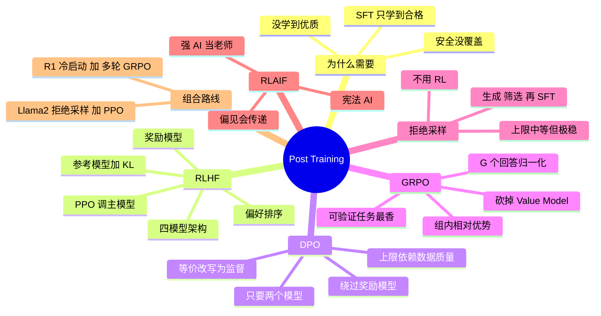

## 🔥 快速背诵

Post-Training 是一族方法，不是一招 RLHF。家族里有 PPO、DPO 这种直接偏好优化、RLAIF 用 AI 代替人工标注、拒绝采样、从强模型蒸馏。趋势是越往后越省，DPO 省掉奖励模型，RLAIF 省掉人工。它们不替代而是组合用，Llama 2 是 SFT 加拒绝采样加 PPO，DeepSeek R1 是 SFT 冷启动加多轮 GRPO。

## 🧠 导图

---

# 📖 背诵稿

> 五段，按顺序背。

### ① 为什么 SFT 之后还要练

**SFT 学到的是「合格」，不是「优质」，也没解决安全。**

同一个问题有很多种合格回答：简洁的、啰嗦的、带代码的、承认不确定的、硬装专家胡说的。SFT 数据里各种风格都有，模型学完会随机挑一种，但用户对质量是有偏好的。更严重的是安全：SFT 数据没覆盖「怎么造毒」「怎么诈骗」这类问题，模型可能一本正经地答。所以 Post-Training 要补两课：**在多种合格回答里学会挑更好的**，以及**知道什么不能说、不知道就说不知道**。它是个上位概念，伞下有很多方法。

### ② RLHF：经典但重

**RLHF 三步：收集偏好数据 → 训奖励模型 → 用 PPO 优化主模型。**

偏好数据是让标注员对同一问题的多个回答**排序**——排序比打绝对分稳定，因为人比较两个东西的相对好坏比给分数容易。奖励模型是个独立小模型，输入（Prompt + 回答）输出分数，学会代替人类批量打分。第三步用 PPO 调主模型往高分走，同时维护一个 **SFT 模型的冻结副本当参考模型**，用 KL 散度约束主模型别跑太远，防止 Reward Hacking——模型学会欺骗奖励模型而不是真的变好。优点是上限高，因为 RL 能探索出 SFT 数据里没有的回答方式；缺点是 4 个模型同时在训（policy / reference / reward / value），显存好几倍，PPO 本身不稳、超参敏感。

### ③ DPO：等价改写，绕开奖励模型

**DPO 的核心是一个数学上的等价转换：RLHF 的目标可以改写成纯监督损失。**

直觉上，「奖励模型」的功能可以被「主模型相对参考模型的概率比值」完全替代。数据简单到不能再简单，就是（prompt, chosen, rejected）三元组，损失函数做的事就是让「好回答的概率比」高于「差回答的概率比」。好处：只需 2 个模型（policy + reference），显存是 RLHF 一半；训练稳定，因为变成监督学习；实现简单。代价：上限略低于精心调过的 PPO，因为它只能往偏好数据分布靠拢，没有 RL 的探索能力；而且强依赖偏好数据质量。**注意别记错**：Llama 2-Chat 不是 DPO 代表，它公开论文里的关键方法是拒绝采样 + PPO/RLHF；DPO 是 Zephyr、部分 Mistral/Qwen 社区版本和大量开源 Instruct 派生模型的选择。

### ④ GRPO：砍掉 Value Model

**GRPO 是 DeepSeek 2024 年在 DeepSeek-Math 里提出的 PPO 改进版，R1 把它推上风口。**

要先懂 PPO 为什么要 Value Model：强化学习里的「优势」是「这个动作比平均水平好多少」，Value Model 就是估计「当前状态的预期奖励」当基线，优势 = 实际奖励 − 预期奖励。但 Value Model 是个和主模型差不多大的独立网络，要单独训、占显存、还要调参，这就是 PPO 显存吃紧的根源之一。GRPO 直接砍掉它：对一个问题 q 采样 G 个回答（典型 G=8），打分后做**组内归一化**当优势：`A_i = (r_i − mean) / std`。好处是 4 个模型变 3 个、显存接近 DPO 但保留 RL 探索力，而且组内归一化天然降梯度方差、更容易训。**最香的是可验证任务**：数学代码「对就是对错就是错」，`r_i` 直接用对错判定，连奖励模型都省了——DeepSeek R1-Zero 就是这么纯 RL 训出推理能力的。**但别一口咬定所有推理模型都用 GRPO**，公开报告怎么写就怎么说。

### ⑤ 拒绝采样与组合路线

**拒绝采样最简单：完全不碰 RL，就是「采样 → 筛选 → 再 SFT」的循环。**

给一批 Prompt，每个生成 K 个候选（典型 8 或 16），用奖励模型/人工/规则打分，筛出每个 Prompt 的最高分回答，把（Prompt, 最高分回答）当新 SFT 数据再训一轮。实现极简、训练极稳、完全可解释。代价是上限不如 RL（只能学自己生成的高分分布，没有探索），而且多轮迭代成本高。它通常当「热身」用：先把模型推到不错起点，再用 DPO 或 GRPO 精修。**最后是 RLAIF**：用更强的 AI 代替人类标注偏好，Anthropic 的 Constitutional AI 就是让模型批评并修正自己的回答。省成本，但依赖有个更强的老师，还可能放大教师偏见。**最关键的一句：这些方法不替代，是组合用。** Llama 2-Chat 是 SFT → 拒绝采样 → PPO/RLHF；DeepSeek R1 是 SFT 冷启动 → GRPO 第一轮 → 拒绝采样 → SFT 第二轮 → GRPO 第二轮。能说出这两条 pipeline，面试官就知道你真读过论文。

---

# 🔑 记忆锚

| 记什么 | 内容 | 口诀 |
|---|---|---|
| **5** 类方法 | RLHF / DPO / GRPO / 拒绝采样 / RLAIF | 「经典·简化·省基·筛·AI 师」 |
| **4** 降 **3** 降 **2** | PPO 4 模型 → GRPO 3 → DPO 2 | 「模型数就是成本」 |
| **1** 个关键公式 | GRPO：A_i=(r_i−mean)/std | 「组内比」 |
| **2** 条真实 pipeline | Llama 2-Chat / DeepSeek R1 | 「组合不是替代」 |

> **卡壳急救**：先说「SFT 只学到合格」，再按模型数量（4→3→2）串五种方法，最后报两条 pipeline。

---

# 🎯 追问速查

| 面试官问 | 你答 |
|---|---|
| 为什么用排序不用打分？ | 人类比较相对好坏比给绝对分数更稳定一致 |
| 参考模型干什么？ | KL 约束主模型别偏离 SFT 太远，防 Reward Hacking |
| DPO 为什么能绕开奖励模型？ | 奖励可被「policy/reference 概率比」隐式表达，目标等价改写 |
| DPO 的短板？ | 上限低于精调 PPO，且强依赖偏好数据质量 |
| GRPO 怎么估优势？ | 同问题采 G 个回答，组内归一化，省掉 Value Model |
| GRPO 为什么适合数学代码？ | 奖励可验证，对了给 1 错了给 0，连 RM 都能省 |
| 拒绝采样算 RL 吗？ | 不算，就是采样-筛选-再 SFT 的监督循环 |
| RLAIF 的风险？ | 依赖更强教师，偏见会传递进数据 |
| 能说 Llama 2 用 DPO 吗？ | 不能，它是 SFT + 拒绝采样 + PPO/RLHF |

---

# 🔗 串联

- 上游 → **06（三阶段）**、**08（SFT vs DPO 两轴）**
- 细节 → **11（DPO vs PPO）**
- 实现方式 → **09（LoRA）**：DPO/GRPO 都能用 LoRA 做
- 推理模型 → **17（CoT）**、大模型能力评测（21）
- 收尾金句：**先对齐格式，再对齐偏好，最后对齐分寸**

---

# 📚 细节（背完再点开）

> [!note]- 五类对照
> | 方法 | 用 RL | 模型数 | 稳定性 | 上限 |
> |---|---|---|---|---|
> | RLHF(PPO) | 是 | 4 | 较差 | 高 |
> | DPO | 否 | 2 | 好 | 中高 |
> | GRPO | 是 | 3 | 好 | 高 |
> | 拒绝采样 | 否 | 2 | 极好 | 中 |
> | RLAIF | 是 | 3~4 | 较差 | 高 |

> [!note]- 两条真实 pipeline
> **Llama 2-Chat**：SFT → 拒绝采样 → PPO/RLHF
> **DeepSeek R1**：SFT 冷启动 → GRPO ① → 拒绝采样 → SFT ② → GRPO ②

---

# 🎴 自测

> [!question]- Q1 Post-Training 要补哪两课？
> 从合格到优质（偏好），以及安全与「不知道就说不知道」。

> [!question]- Q2 RLHF 为什么要参考模型？
> KL 约束防止主模型偏离 SFT 太远、发生 Reward Hacking。

> [!question]- Q3 DPO 的核心转换？
> 奖励函数可由 policy/reference 概率比隐式表达，目标改写为监督损失。

> [!question]- Q4 GRPO 砍掉了什么？
> Value Model，用组内归一化的相对优势替代基线。

> [!question]- Q5 最关键的一句？
> 五类方法组合使用，不是互相替代。
