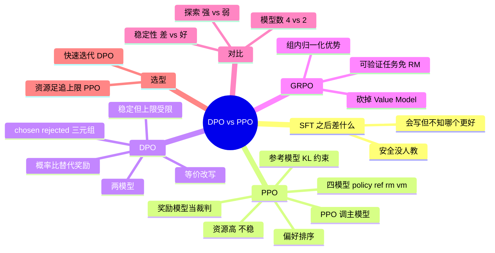

## 🔥 快速背诵

PPO 是先训裁判、再用强化学习训选手，要四个模型：策略、参考、奖励、价值，链路长、不稳定、还贵。DPO 是直接拿比赛录像告诉选手哪个动作对，把带 KL 约束的优化目标在数学上改写成监督学习，只要两个模型，用偏好对做分类损失。所以 DPO 更稳、更省、更容易复现；PPO 上限更高，适合奖励信号复杂、需要在线探索的场景。

> **一句话**：PPO 是「**先训裁判（奖励模型），再用 RL 训选手**」，4 个模型；DPO 是「**直接拿比赛录像告诉选手哪个动作对**」，把带 KL 约束的目标改写成监督学习，2 个模型。

## 🧠 导图



---

# 📖 背诵稿

> 四段，按顺序背。

### ① 共同背景

**两者都在解决 SFT 之后的对齐问题：模型会按格式答了，但不知道哪种答法更好。**

预训练给语言和知识，SFT 让它学会对话格式。但 SFT 本质是「模仿」——学会了某一种写法，却没学会「哪个更好」。同一个「怎么学好 Python」有很多种合格回答：简洁的、详细的、带代码的、承认不熟的、自信胡说的。用户对质量是有排序的，模型不知道。这就是 PPO 和 DPO 要补的同一课，只是路径不同。

### ② PPO：裁判 + 选手

**PPO 是强化学习里的经典算法，被 OpenAI 用在 InstructGPT 的 RLHF 流程里。**

第一步训裁判：人类对同一问题的多个回答**排序**（A 比 B 好、B 比 C 好），用排序数据训一个奖励模型，学会自动打分。第二步用 PPO 训选手：主模型生成回答 → 奖励模型打分 → PPO 按分数调参数，让以后更容易生成高分回答。但只追高分很危险，模型可能钻空子——**生成奖励模型打高分但实际没用的内容，这叫 Reward Hacking**。所以还要维护一个参考模型（SFT 模型的冻结副本），用 KL 散度当绳子拴住主模型，允许往高分方向走但不许走太远。于是训练时要同时加载 **4 个模型**：policy（在优化）、reference（冻结、算 KL）、reward（裁判）、value（RL 辅助、估未来奖励期望）。每个都和主模型差不多大，显存是 SFT 的好几倍，加上 RL 本身超参敏感、曲线震荡，能驾驭的团队凤毛麟角。

### ③ DPO：直接看回放

**DPO 的核心是一个数学等价变换：把带 KL 约束的 RLHF 目标改写成偏好对上的监督学习损失。**

直觉上，奖励模型的功能可以被「主模型相对参考模型的概率比值」完全替代——如果主模型在某个回答上比参考模型提升的概率更多，那这个回答就被认为更受偏好。所以数据格式简单到（prompt, chosen, rejected）三元组，损失函数做的事就是让 chosen 的概率比高于 rejected 的概率比。工程效果：模型从 4 个降到 **2 个**（policy + reference），训练变成普通监督学习，稳定、好调、用现成框架就能写。代价是**表达能力稍弱**：它只能往偏好数据分布靠拢，没有 RL 那种探索数据之外好回答的能力；而且强依赖偏好数据质量。**注意措辞**：DPO 是从带 KL 约束的 RLHF 目标推导出的闭式偏好优化目标，不能说成「和任意 PPO 训练过程完全等价」。

### ④ GRPO 与选型

**GRPO 是 PPO 的进化版：砍掉 Value Model，用组内相对优势当基线。**

PPO 的 Value Model 用来估「当前状态的预期奖励」做基线，优势 = 实际奖励 − 预期奖励；但它是个和主模型差不多大的独立网络。GRPO 换成：同一问题采 G 个回答（典型 8 个），打分后做组内归一化 `A_i = (r_i − mean) / std`，用组内平均分当基线，天然有了、不用训。于是 4 模型变 3 模型，显存接近 DPO 却保留 RL 探索力。杀手级特性是对**可验证任务**（数学、代码）特别友好：对错直接给 0/1，连奖励模型都能省——DeepSeek R1-Zero 就是这么纯 RL 训出推理能力的。选型原则：**想在已有偏好数据分布上把质量提一步，DPO 够用且高效；要探索数据之外的能力边界、追求接近顶级水平的对齐效果，才值得上 PPO/GRPO 的工程成本**。

---

# 🔑 记忆锚

| 记什么 | 内容 | 口诀 |
|---|---|---|
| **4 → 2** 模型 | PPO 四件套 / DPO 两件套 | 「裁·参·奖·价 → 主·参」 |
| **1** 个类比 | 先训裁判 vs 看回放 | 「裁判 vs 录像」 |
| **1** 个公式 | GRPO：A_i=(r_i−mean)/std | 「组内比」 |
| **1** 个取舍 | 探索力 vs 工程成本 | 「贵才探索」 |

> **卡壳急救**：先说「差的是偏好」，再按 4 模型 vs 2 模型讲，最后补 GRPO 砍 Value。

---

# 🎯 追问速查

| 面试官问 | 你答 |
|---|---|
| 最根本差别？ | PPO 是在线 RL，DPO 是等价的监督学习 |
| PPO 四个模型各干什么？ | policy 优化、reference 算 KL、reward 打分、value 估基线 |
| KL 约束干什么？ | 拴住主模型别偏离 SFT 太远，防 Reward Hacking |
| DPO 为什么不需要奖励模型？ | 奖励被 policy/reference 概率比隐式表达 |
| DPO 损失在做什么？ | 让 chosen 的概率提升幅度大于 rejected |
| DPO 短板？ | 探索力弱、上限依赖偏好数据质量 |
| GRPO 砍了什么？ | Value Model，用组内归一化基线替代 |
| 什么时候还要 PPO？ | 资源足、追求极限对齐、需要探索数据外空间 |

---

# 🔗 串联

- 上游 → **06（三阶段）**、**10（Post-Training 家族）**
- 实现 → **08/09（LoRA 做 DPO）**
- 下游 → **21（评测：对齐效果怎么量）**
- 收尾金句：**能比较，就不必再打分**

---

# 📚 细节（背完再点开）

> [!note]- 四模型 vs 二模型
> ```python
> # PPO
> policy = load_sft_model()        # 在优化
> reference = load_sft_model()     # 冻结，算 KL
> reward = load_reward_model()     # 裁判
> value = load_value_model()       # 估基线
> # DPO
> policy = load_sft_model()
> reference = load_sft_model()     # 只算概率比
> ```

> [!note]- 对照表
> | 维度 | PPO | DPO |
> |---|---|---|
> | 奖励模型 | 需要 | 不需要 |
> | 模型数 | 4 | 2 |
> | 稳定性 | 较差 | 好 |
> | 实现难度 | 高（RL 设施） | 低 |
> | 探索能力 | 强 | 弱 |
> | 代表 | InstructGPT、Llama 2-Chat | Zephyr、社区 Instruct |

---

# 🎴 自测

> [!question]- Q1 SFT 之后缺什么？
> 知道怎么写，但不知道哪种更好；安全也没覆盖。

> [!question]- Q2 PPO 为什么需要参考模型？
> KL 约束防止偏离与 Reward Hacking。

> [!question]- Q3 DPO 的等价转换是什么？
> 奖励可由 policy/ref 概率比隐式表达，目标改写为监督损失。

> [!question]- Q4 GRPO 的核心改动？
> 砍 Value Model，用组内归一化优势。

> [!question]- Q5 选型原则？
> 提质量用 DPO，探索极限用 PPO/GRPO。
