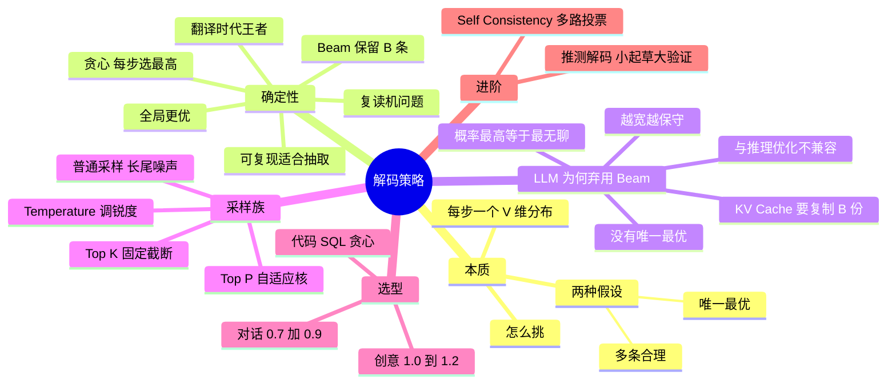

## 🔥 快速背诵

解码就是从 V 维概率分布里挑下一个 token。确定性策略假设有唯一最优答案，贪心每步取最大概率，快但容易进死胡同；Beam Search 保留 k 条候选，质量好但慢，容易生成又平又空的文本。采样族假设有多条合理路径，按分布抽，用温度和 Top-P 控随机性。不是哪个更高级，是任务本质决定选哪个，代码和事实用低温，创作和头脑风暴用采样。

> **一句话**：解码就是「**从一个 V 维概率分布里怎么挑下一个 token**」。确定性策略（贪心/Beam）假设有唯一最优答案，采样族假设有多条合理路径——**任务本质决定选哪个**。

## 🧠 导图

---

# 📖 背诵稿

> 五段，按顺序背。

### ① 本质是什么

**模型每生成一个 token，都会输出一个词表大小（5 万~15 万）的概率分布，解码策略就是「怎么从这个分布里挑一个」。**

不同的规则背后其实是**对生成任务本质的不同假设**：贪心和 Beam Search 假设「存在一个唯一最优答案」，目标是找到它；Temperature / Top-K / Top-P 假设「答案有多种合理可能」，目标是从可能空间里采样。抓住这条主线，后面每种策略的取舍都能推出来。

### ② 贪心

**每步无脑选概率最高的那个。**

优点很实在：时间复杂度 O(V)、几乎没开销、完全确定、相同输入永远相同输出，方便调试复现和单测。但它有个臭名昭著的毛病：**复读机循环**。让 GPT-2 续写「I love my dog because」，常见输出是「he is so cute. He is so cute. He is so cute. ...」——因为某一步生成了这个模式，下一步这个模式在上下文里的概率依然很高，又被选中，一旦走进自我加强的循环就出不来。第二个问题是乏味保守，每步都选最稳的路，结果就是最最大众化的表达。所以它的最佳战场是**精确任务**：代码、SQL、JSON 抽取，输出有标准答案，确定比惊喜重要。

### ③ Beam Search

**贪心的并行版：每步保留 B 条最高概率路径同时推进，最后选整体概率最高的那条。**

做法：设 B=3，第一步保留前 3 个 token；第二步让 3 个前缀各自展开得到 3×V 个候选，挑总概率最高的 3 条；一直生成到 EOS，最后从 3 条最终路径里选概率乘积最大的。好处是全局视野更好，能避开贪心走进死胡同，也有备份路径。**2014~2018 年机器翻译时代它是绝对主流**，Google NMT、fairseq、OpenNMT 全用它——因为翻译有个独特属性：给定源句存在一个或几个「最优译文」，「找概率最高序列」和任务高度匹配。

### ④ 为什么 LLM 时代失宠

**表面是慢（B 倍计算），深层是目标与任务本质不匹配。**

翻译有最优答案，但开放式生成（写故事、对话、回答开放问题）根本没有最优答案，只有「广阔的合理回答空间」。而 Beam Search 优化的「整体概率最高」，往往等价于「每步都选最稳的词」，最稳的词常常是**重复前面已经出现过的内容**——重复模式在分布上特别尖锐。所以它在长文本上会陷入比贪心更严重的复读，实测 B 越大越保守乏味，B=8 比 B=4 还差，这就是「Beam Search 困境」。还有工程硬伤：**KV Cache 假设单前缀往下生成，Beam 要同时维护 B 条前缀，缓存得复制 B 份，显存爆炸**；FlashAttention、PagedAttention 都是为单序列设计的。所以 vLLM/SGLang/TGI 大多支持但默认不开。注意措辞：它不是彻底没用，而是从「默认主角」退回「特定任务工具」，翻译、受约束生成、候选重排仍可能用。

### ⑤ 采样族与选型

**LLM 时代主流是采样，从「找最优」变成「按分布掷骰子」。**

最基础的是普通采样，但模型的分布有长尾：前 20 个词可能占 90%，后面几万个词分摊 10%，偶尔抽到完全不合理的词，整段就毁了。所以有三个调节器：**Temperature** 控锐度，T=0 等价贪心、T=1 用原始分布、T<1 更尖锐更保守、T>1 更平坦更发散；**Top-K** 是固定截断，只从概率前 K 个里采样；**Top-P** 是自适应截断，从高到低累加概率到 P（比如 0.9）为止，分布尖锐时候选集自动变小、平坦时自动变大。选型口诀：**有标准答案 → 贪心或 Temperature=0**（代码、SQL、JSON、翻译）；**有多种合理答案、要稳 → Top-P=0.9 + T=0.7**（日常对话）；**鼓励多样性 → Top-P=0.95 + T=1.0 以上**（创意写作、头脑风暴）。别死记默认值，各家随版本变化，用官方默认做基线再按任务精确度调。进阶两个可以加分：**推测解码**用小模型起草、大模型一次验证多个 token，减少访存次数，速度提升 2~3 倍且结果等价；**Self-Consistency** 对同一道题高温采样 N 条推理路径，取答案多数投票，在 GSM8K 这类任务上比单次贪心高 5~15 个百分点，代价是 N 倍成本。

---

# 🔑 记忆锚

| 记什么 | 内容 | 口诀 |
|---|---|---|
| **2** 种假设 | 唯一最优 / 多条合理 | 「找答案 vs 抽样本」 |
| **3** 个采样调节器 | Temperature / Top-K / Top-P | 「锐度·定截·自截」 |
| **2** 个 Beam 硬伤 | 越宽越无聊 + KV Cache 复制 | 「宽则闷，缓存爆」 |
| **1** 句口诀 | 有标准答案就低温 | 「准的求稳，开的求变」 |

> **卡壳急救**：先讲「两种假设」，再按确定性 / 采样两族展开，最后给选型口诀。

---

# 🎯 追问速查

| 面试官问 | 你答 |
|---|---|
| 贪心和 T=0 采样一样吗？ | 数值上近似等价（T→0 时 softmax 趋于 one-hot），但工程实现不同：贪心是 argmax，T=0 有除零风险，一般用极小 T 或直接 argmax |
| Beam Search 是确定还是随机？ | 确定。相同输入相同输出 |
| 为什么翻译用 Beam？ | 翻译有「最优译文」，与「找最高概率序列」目标契合 |
| 为什么 LLM 不用 Beam？ | 无唯一最优，概率最高≈最无聊；且与 KV Cache/FA 不兼容 |
| B 越大越好吗？ | 不是，B 越大越保守重复，存在 Beam Search 困境 |
| Top-K 和 Top-P 区别？ | 固定数量截断 vs 按累计概率自适应截断 |
| 代码任务用什么？ | 贪心或 Temperature 0~0.2，要求可复现 |
| 数学推理怎么提分？ | 低温 + Self-Consistency 多路采样投票 |
| 推测解码会改变结果吗？ | 不会，等价加速（2~3 倍） |

---

# 🔗 串联

- 上游 → **13（Temperature / Top-P / Top-K 细讲）**
- 工程 → **03（KV Cache）**、**20（推理框架默认不开 Beam）**
- Agent 侧 → 呼应「同一输入为何结果不同」（Agent 第 30 篇）：采样随机性是根因之一
- 收尾金句：**任务有没有标准答案，决定你要不要掷骰子**

---

# 📚 细节（背完再点开）

> [!note]- 选型表
> | 任务 | 策略 | 参数 |
> |---|---|---|
> | 代码 / SQL / JSON | 贪心 | T=0~0.2 |
> | 数学推理 | 贪心或多次采样投票 | T=0 或 0.7 |
> | 日常对话 | Top-P | T=0.7, P=0.9 |
> | 创意写作 | Top-P | T=1.0~1.2, P=0.95 |
> | 头脑风暴 | 高温采样 | T=1.2, P=0.95 |

> [!note]- 为什么长尾是问题
> 前 20 个词累计 90% 概率，剩下几万词分摊 10%。普通采样有概率抽到「@$%」这种词，一个 token 毁掉整段。

---

# 🎴 自测

> [!question]- Q1 解码的本质？
> 从每步的 V 维概率分布里选择下一个 token 的规则。

> [!question]- Q2 贪心的两个毛病？
> 复读机循环、输出乏味保守。

> [!question]- Q3 Beam Search 为什么在 LLM 失宠？
> 无唯一最优 + 概率最高≈最无聊 + 与 KV Cache/FA 不兼容。

> [!question]- Q4 三个采样调节器？
> Temperature 调锐度、Top-K 固定截断、Top-P 自适应截断。

> [!question]- Q5 两个进阶技巧？
> 推测解码（等价加速）、Self-Consistency（多路投票）。
