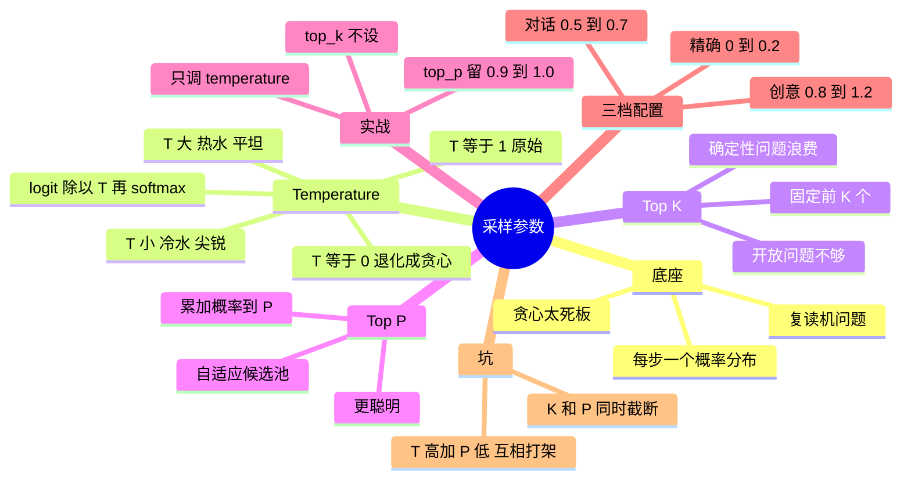

## 🔥 快速背诵

三个参数都在控随机性，但作用位置不同。温度调分布锐度，除以温度再 softmax，低于 1 变尖更确定，高于 1 变平更发散。Top-K 是固定截断，只留概率最高的 K 个。Top-P 是自适应截断，留累积概率刚好到 p 的那一小撮，候选多时砍得多、集中时砍得少。铁律是一次只调一个，三个一起动会互相打架，不知道是哪个起作用。

> **一句话**：**温度调分布锐度，Top-K 固定截断，Top-P 自适应截断**。三者都在控随机性——所以**一次只调一个**，否则互相打架。

## 🧠 导图



---

# 📖 背诵稿

> 四段，按顺序背。

### ① 底座与问题

**模型每生成一个 token 都要在 5 万~15 万词上算概率分布，然后要决定怎么选。**

最省事的是贪心，每次选概率最高的，输出完全确定但过于保守、缺乏多样性，长文本还会陷入重复循环。为了不让它这么死板，业界发展出三个采样调节参数，各自从不同维度调控「怎么从分布里采样」。

### ② Temperature

**温度控制的是分布的锐度：每个 logit 除以 T 再做 softmax。**

名字有物理含义。低温像冷水，分子运动慢、状态稳定，分布变**尖锐**，高概率词更高、低概率趋近于零，模型几乎只选最有把握的词，稳定但单调。高温像热水，分子运动快、状态混沌，分布变**平坦**，原本很低的词也有机会被选中，有创意但更容易跑偏。T=1 是临界点，分布完全不变，就是模型原始采样；T=0 是另一个极端，等价于贪心，相同输入永远相同输出。

### ③ Top-K 与 Top-P

**这两个控的是「候选词范围」，但一个固定、一个自适应。**

Top-K 很直觉：截断到概率最高的 K 个词，其余置零，在这 K 个里按比例采样。它能避免抽到长尾噪声词（那 10 万多个词大部分无用），但问题是 **K 固定、不自适应**。问「中国的首都是__」，模型对「北京」概率 99%，Top-K=50 意味着候选池里还塞了 49 个离谱词；让它写诗时前 50 个词又都很合理，卡在第 50 个反而错过更好的。Top-P（核采样）就是解这个的：按概率从高到低**累加**，超过阈值 P 就停，只在这个「核」里采样。所以问首都时候选池只有「北京」一个词，写诗时自动扩到 30 个——**候选池大小随上下文的确定性自动调整**，这就是它比 Top-K 聪明的地方。

### ④ 实战配置与两个坑

**绝大多数情况只调 Temperature 一个参数，Top-P 保持默认，Top-K 不设。**

原因很实在：三者作用有重叠，都在控随机性，同时调会互相干扰，你根本搞不清是哪个在起作用。OpenAI、Anthropic 官方文档都建议通常只调其中一个。三档配置：**精确任务**（代码、SQL、JSON 抽取、数学）用 T=0~0.2、Top-P=1.0，T=0 等价贪心、可复现；**日常对话 / 摘要 / 翻译**用 T=0.5~0.7、Top-P=0.9；**创意任务**（写作、头脑风暴、角色扮演）用 T=0.8~1.2、Top-P=0.95，允许偶尔跑偏。两个常见坑：一是「T 调高 + Top-P 调低」，比如 1.2 + 0.5，等于「把分布摊平再砍掉一半」，两个参数互相打架、结果不可预测；二是「Top-K 和 Top-P 同时设」，两者都在截断，先 K 后 P（或反过来）会让候选池形状很怪。口诀：**先只调 temperature，top_p 保持 0.9~1.0，top_k 不设置；要调 top_p 就先固定 temperature**。

---

# 🔑 记忆锚

| 记什么 | 内容 | 口诀 |
|---|---|---|
| **3** 个作用 | 锐度 / 固定截断 / 自适应截断 | 「锐·定·自」 |
| **2** 个临界 | T=1 原始、T=0 贪心 | 「一原始，零确定」 |
| **3** 档配置 | 0~0.2 / 0.5~0.7 / 0.8~1.2 | 「精确·日常·创意」 |
| **1** 条铁律 | 一次只调一个 | 「别同时拧三个」 |

> **卡壳急救**：先讲「锐·定·自」，再报三档配置，最后甩出「只调 temperature」这条实战经验。

---

# 🎯 追问速查

| 面试官问 | 你答 |
|---|---|
| 温度到底怎么起作用？ | logit 除以 T 再 softmax，改变分布尖锐度 |
| T=0 是什么？ | 等价贪心，输出完全确定（工程上常用极小 T 或 argmax） |
| Top-K 的毛病？ | K 固定不自适应：确定性场景浪费、开放场景不够 |
| Top-P 为什么更智能？ | 候选池随分布形状自动缩放 |
| 同时调 T 高 + P 低会怎样？ | 互相打架，结果不可预测 |
| Top-K 和 Top-P 能同设吗？ | 不建议，两次截断让候选池形状异常 |
| 代码生成怎么配？ | T=0~0.2，Top-P=1.0 |
| 模型默认值能死记吗？ | 不能，随版本与产品形态变化，用官方默认做基线再调 |

---

# 🔗 串联

- 上游 → **12（解码策略全景）**
- 工程 → **21（评测：参数调了要看跑偏率）**、工具调用线 **16（网关统一参数策略）**
- 和「同一输入不同输出」→ Agent 第 30 篇
- 收尾金句：**分布决定可能性，参数决定你敢走多远**

---

# 📚 细节（背完再点开）

> [!note]- 参考配置
> ```python
> # 精确任务
> temperature=0.0, top_p=1.0
> # 日常对话
> temperature=0.6, top_p=0.9
> # 创意写作
> temperature=1.0, top_p=0.95
> ```

> [!note]- Top-K vs Top-P 的两次对照
> | 场景 | Top-K=50 | Top-P=0.9 |
> |---|---|---|
> | 「首都是__」（北京 99%） | 48 个离谱候选混进来 | 候选池只有「北京」 |
> | 「写一首秋天的诗」 | 卡在第 50 个，可能错过更好词 | 自动扩到前 30 个 |

---

# 🎴 自测

> [!question]- Q1 三个参数各控什么？
> 温度控锐度、Top-K 固定截断、Top-P 自适应截断。

> [!question]- Q2 为什么 Top-P 更智能？
> 候选池大小随当前分布形状自适应。

> [!question]- Q3 三档推荐配置？
> 0~0.2 / 0.5~0.7 / 0.8~1.2，Top-P 分别 1.0 / 0.9 / 0.95。

> [!question]- Q4 两个常见坑？
> 高温 + 低 Top-P 互相打架；Top-K 与 Top-P 同时设置。

> [!question]- Q5 为什么只调一个？
> 三者作用重叠，同调会互相干扰、难定位原因。
