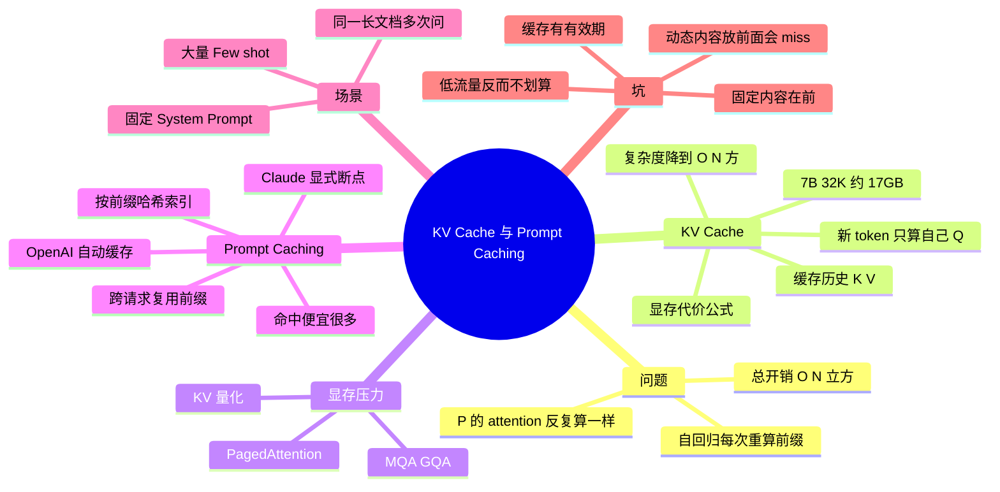

## 🔥 快速背诵

这是同一个机制在两个时间尺度上的应用。KV Cache 在单次推理内，自回归生成时历史 token 的 K 和 V 不变，缓存起来避免每步重算，用显存换时间。Prompt Caching 跨请求，多个请求前缀完全相同时直接复用那段 KV，跳掉预填充。所以 KV Cache 是必须的，Prompt Caching 是锦上添花，前提是前缀逐 token 一致，中间插一个变量就全失效。

> **一句话**：同一个机制在**两个时间尺度**上的应用——**KV Cache 是单次推理内**（token 之间复用），**Prompt Caching 是跨请求**（请求之间复用相同前缀）。

## 🧠 导图

---

# 📖 背诵稿

> 五段，按顺序背。

### ① 问题在哪

**自回归生成的朴素实现有一个巨大的浪费。**

要生成 10 个 token，第 1 步输入 P 算一次，第 2 步输入 [P, t1] 又算一遍，第 3 步 [P, t1, t2] 再算一遍……每一步都把前面所有 token 的 attention 重算。第 i 步要做 i 个 token 的 attention，复杂度 O(i²)，累积起来约 **O(N³)**。而且第 2 步算的「P 的 attention」和第 1 步算的**完全一样**——输入没变、参数没变，纯粹浪费。

### ② KV Cache 怎么做

**把前面所有 token 的 K 和 V 缓存起来，每次新 token 只算自己那一份。**

看注意力公式：新 token 只是一个 Q，它在「问」前面所有 token；而 Q 要乘的 Kᵀ 和加权求和用的 V **全部来自前面的 token，而且它们是固定的**——K/V 由已有 token 的 embedding 算出，新 token 不会改变它们。所以完全可以缓存。工作流程：第一步处理整个 Prompt 把 K/V 全存下；之后每步只算新 token 的 Q、K、V，从缓存里取出 K_all/V_all 拼起来做 attention，再把新的 K/V 追加进缓存。每步开销从 O(i²) 降到 O(i)，总开销从 O(N³) 降到 O(N²)。**这不是锦上添花的优化，是让自回归生成可行的基本盘**，vLLM / SGLang / TGI / llama.cpp 全部默认开启，没人会关。

### ③ 显存代价

**代价是显存：历史 K/V 全要常驻。**

公式是 `2 × B × N × L × H × d_k × 2 字节`。7B 模型（L=32、H=32、d_k=128）跑 B=1、N=32K，约 **17GB**；加上权重 14GB 一共 31GB，一张 4090（24GB）放不下。所以围绕它有一整套优化：MQA/GQA 减少 K/V 份数、KV Cache 量化（FP16→INT8/INT4，但长链路推理对误差更敏感）、PagedAttention（把缓存切成固定 Block，用 Block Table 映射，消碎片，显存利用率从 30~40% 拉到 90%+）。

### ④ Prompt Caching 是什么

**把 KV Cache 的复用范围从「单次推理内」扩展到「不同请求之间」。**

真实场景：客服 AI 的 System Prompt 有 3000 token 的产品知识、规则和 Few-shot，一天 10 万次对话，每次都从零处理这 3000 token，就是巨大的浪费。Prompt Caching 的做法是：API 服务端维护一个缓存池，按**前缀哈希**索引；第一个请求正常算完，把这份 KV Cache 额外保留几分钟；后续请求前缀一致就直接复用，只算新增部分。实现上两派：**Claude 用显式断点**（在内容末尾加 `cache_control: {"type":"ephemeral"}`，你自己决定缓存到哪），**OpenAI 用自动缓存**（前缀超过一定长度就自动尝试，不用改代码）。收益上，命中缓存的输入 token 计费明显更低（Claude 的 ephemeral 缓存读取约为普通输入的 10%，首次写入约 1.25x），首 token 延迟也会下降——但具体比例各厂商不同，别把某一家说成全行业标准。

### ⑤ 场景与坑

**最适合「前面固定、后面变化」的模式。**

三类典型：固定 System Prompt 的应用（客服、助手、代码 Review，收益最大）；基于同一份长文档的多次问答（合同问 10 个问题，后 9 次全命中，法律/金融/医疗 AI 常见）；大量 Few-shot 示例（示例不变、用户问题在变）。**最容易踩的雷是顺序**：缓存要求前缀完全一致，差一个空格就 miss。所以千万别把日期、用户名这种动态内容放在固定内容前面——那样每次都变，缓存永远失效。正确结构是**固定内容在前、动态内容在后，断点放在两者之间**。第二个坑是**时效性**：ephemeral 缓存通常只有 5 分钟左右，高流量应用能自然保持活跃，低流量（几小时一次）频繁失效，反而可能因为 1.25x 写入费用更贵，上之前要评估。

---

# 🔑 记忆锚

| 记什么 | 内容 | 口诀 |
|---|---|---|
| **1** 个因果 | 历史 K/V 固定 → 可缓存 | 「不变的才值得存」 |
| **2** 个复杂度 | O(N³) → O(N²) | 「立方变平方」 |
| **2** 个尺度 | 单次推理 / 跨请求 | 「token 间 vs 请求间」 |
| **1** 条铁律 | 固定在前、动在后 | 「前缀差一字，缓存全 miss」 |

> **卡壳急救**：先说「同一机制两个时间尺度」，再讲 K/V 为什么能缓存，最后落到顺序与时效两个坑。

---

# 🎯 追问速查

| 面试官问 | 你答 |
|---|---|
| 为什么能缓存 K/V？ | K/V 由已有 token 决定，新 token 不会改变它们 |
| 没有 KV Cache 会怎样？ | 总计算量 O(N³)，长回答根本跑不动 |
| KV Cache 和 Prompt Caching 是一回事吗？ | 同一机制不同尺度：单次内 vs 跨请求 |
| 显存怎么估？ | 2×B×N×L×H×d_k×2 字节，7B/32K 约 17GB |
| Claude 和 OpenAI 实现差别？ | 显式 cache_control 断点 vs 自动前缀缓存 |
| 为什么动态内容不能放前面？ | 前缀变了就 miss，每次都从零算 |
| 低流量场景值得用吗？ | 可能不值，缓存 5 分钟过期 + 写入 1.25x 费用 |
| 还有哪些优化？ | GQA/MQA、KV 量化、PagedAttention |

---

# 🔗 串联

- 上游 → **03（MHA/MQA/GQA）**：同样是省 KV Cache
- 下游 → **20（推理框架与 PagedAttention）**
- 工程 → 工具调用线 **16（网关成本 + 语义缓存）**：一个是前缀复用，一个是语义复用
- 收尾金句：**能不变的部分，别算第二遍**

---

# 📚 细节（背完再点开）

> [!note]- 复杂度对照
> | 实现 | 第 i 步 | N 步总计 |
> |---|---|---|
> | 无 Cache | O(i²) | O(N³) |
> | 有 Cache | O(i) | O(N²) |

> [!note]- 正确 vs 错误的 Prompt 结构
> ❌ `今天是 2026-03-07，用户张三` + `[数千字系统提示]` ← 前缀每次都变
> ✅ `[数千字系统提示]` ← 断点 + `今天是 2026-03-07，用户张三` + 问题

---

# 🎴 自测

> [!question]- Q1 为什么自回归要 KV Cache？
> 每步重算前缀使总开销 O(N³)，缓存 K/V 后降到 O(N²)。

> [!question]- Q2 KV Cache 存的是什么？
> 历史所有 token 的 K 和 V 矩阵（每层）。

> [!question]- Q3 Prompt Caching 是什么？
> 跨请求复用相同前缀的 KV Cache，按前缀哈希索引。

> [!question]- Q4 两类实现风格？
> 显式断点（Claude）与自动缓存（OpenAI）。

> [!question]- Q5 最大工程坑？
> 前缀必须完全一致；动态内容放前面会导致永久 miss。
