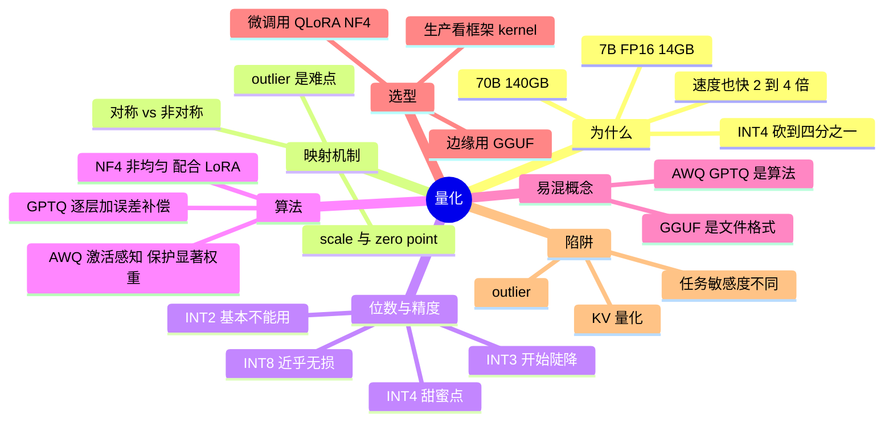

## 🔥 快速背诵

量化就是把 FP16 权重映射到 INT8 或 INT4，核心是 scale 加 zero_point 这组参数，反量化时再乘回去。算法上两条路线，GPTQ 逐层量化、用误差补偿把误差摊到还没量化的权重上；AWQ 是激活感知，找出那 1% 对输出影响最大的显著权重单独保护。GGUF 是文件格式不是量化算法，只是把权重、方案、元数据打包。INT8 接近无损，INT4 是当前甜点。

## 🧠 导图

---

# 📖 背诵稿

> 五段，按顺序背。

### ① 为什么必须量化

**参数量乘字节数就是显存，FP16 太奢侈。**

7B × 2 字节 = 14GB，70B = 140GB，加上 KV Cache、激活值、优化器状态，至少要 4 张 A100 80GB 才跑得动。降到 INT4（0.5 字节）体积砍到 1/4：7B 约 3.5GB、70B 约 35GB，一张 4090 或一张 A100 就够。第二收益是速度：INT4 计算的硬件吞吐通常比 FP16 高 2~4 倍，访存量也是 1/4，对访存受限的推理是极大加速。但这不是免费午餐，16 位连续浮点压到 4 位的 16 个离散整数级必然掉精度——**所有量化算法都在回答同一个问题：怎么在最小精度损失下压下去。**

### ② 映射机制

**最朴素的是线性量化，靠 scale 和 zero_point 把浮点映射到整数。**

假设权重范围 [-2.5, 2.5] 要量化到 INT4（-8~7），`scale = (max-min)/(2^bits-1) ≈ 0.333`，`zero_point ≈ 8`，量化就是 `round(fp/scale)+zero_point-8`，反量化再乘回去。0.7 会变成 2，还原成 0.666，损失 0.034。实际还分两种风格：**对称量化**假设数值围绕 0 对称，不需要 zero_point，适合权重；**非对称量化**适合 ReLU 之后的激活值这种偏分布的数。不同算法的差别就在于：**怎么算 scale、怎么处理 outlier、怎么补偿误差**。

### ③ 位数与精度边界

**位数越低损失越大，但曲线是「先平后陡」。**

INT8 常被叫「接近免费的午餐」，损失很小，但涉及数学、代码、长上下文、工具调用时仍要在自己业务集上评测，别说成绝对无损。INT4 是当前甜蜜点，体积 1/4、还能加速，通用任务上损失可接受。从 INT4 到 INT3 会突然掉很多，INT2 基本就废了。**关键认知：精度损失不是均匀分布的**——简单分类抽取几乎无损，通用对话 1~2%，数学推理可能 5~10%，长链路代码生成 10%+。所以「INT4 只掉 1~3%」是平均值，不能直接当结论。

### ④ 三个主流算法

**GPTQ 靠误差补偿，AWQ 靠权重保护，NF4 靠分布形状。**

**GPTQ** 是逐层量化 + 误差补偿：准备一小批校准数据（典型 128 条）先用 FP16 跑一遍记录每层输入激活，然后逐层量化——用 Hessian 估计每个权重的敏感度，优先量化不重要的，把量化误差反向修正到后面还没量化的权重里。数学严谨（源自 Optimal Brain Surgeon），能撑到 INT3/INT2，不依赖模型结构。代价是量化耗时长（7B 要几小时）、依赖校准数据，而且它**只量化权重、激活值还是 FP16**，所以速度提升不如 AWQ。**AWQ** 的洞见很巧：**约 1% 的权重承担了 99% 的输出贡献**，把这一小撮保护住、其余激进压到 INT4，效果几乎不掉。怎么找？看激活值大小——权重贡献等于 W×X，某些 token 的激活值特别大，那对应的权重列就是显著的。技术上用**逐通道缩放**把重要通道数值放大（量化时占更宽整数区间、损失更小），这是数学等价变换，不改变输出。好处是推理比 GPTQ 快 1.5~2 倍、量化只要几十分钟、精度略好；缺点极端低位不如 GPTQ。**NF4** 则是非均匀量化：模型权重近似均值为 0 的正态分布，所以 16 个刻度也按正态分布排，0 附近密、远处疏，误差更小；配合 LoRA 就是 QLoRA，再加双重量化（连 scale 也量化）和分页优化器，才有了「24GB 4090 微调 7B」这件事。

### ⑤ 选型与陷阱

**选型先看框架和 GPU kernel 支持，别脱离实现谈算法好坏。**

生产部署看速度：优先评估 AWQ / GPTQ / FP8 / 框架原生 INT4，具体看 vLLM、SGLang、TensorRT-LLM 当前版本哪条 kernel 最成熟。追求精度：FP16 或 INT8/FP8，显存吃紧再上 GPTQ INT4。个人微调：QLoRA NF4。边缘设备：GGUF 的 Q4_K_M 或 INT3 GPTQ。CPU 部署：llama.cpp + GGUF。**必须记清：GGUF 是 llama.cpp 的文件格式（容器），里面可以装 Q4_K_M、Q5_K_M、Q8_0 等不同量化的权重；AWQ / GPTQ 是算法，两者不在一个层级。** 四个陷阱：一是 outlier，极端大值会把量化范围拉宽、稀释普通权重的精度，AWQ 的逐通道缩放和 GPTQ 的 Hessian 都是应对；二是 KV Cache 量化才刚起步，长链路推理对它特别敏感，是近两年热点；三是不同任务敏感度差异巨大，上线前必须用自己的业务集压测；四是和其他优化（FlashAttention、Speculative Decoding）的兼容性各框架差异很大。

---

# 🔑 记忆锚

| 记什么 | 内容 | 口诀 |
|---|---|---|
| **2** 个收益 | 显存 1/4 + 速度 2~4 倍 | 「省空间也省时间」 |
| **2** 个参数 | scale / zero_point | 「缩一缩，挪一挪」 |
| **3** 个算法 | GPTQ 补偿 / AWQ 保护 / NF4 形状 | 「补·护·形」 |
| **1** 个别混 | GGUF 是格式不是算法 | 「容器 ≠ 算法」 |

> **卡壳急救**：先讲显存账，再按「补·护·形」报三个算法，最后用 GGUF 这条纠错收尾。

---

# 🎯 追问速查

| 面试官问 | 你答 |
|---|---|
| 16 位降到 4 位精度去哪了？ | 连续浮点映射到 16 个离散级，靠 scale/zero_point 与误差补偿尽量少丢 |
| 对称和非对称区别？ | 数值是否围绕 0 对称；权重常用对称，激活常用非对称 |
| INT4 一定安全吗？ | 不一定，数学/长代码/长上下文可能掉 5~10%+ |
| GPTQ 核心思路？ | 逐层量化 + Hessian 估敏感度 + 误差补偿到后续权重 |
| AWQ 核心洞见？ | 1% 显著权重承担 99% 贡献，按激活值大小保护，逐通道缩放 |
| 为什么 AWQ 更快？ | 权重布局对 GPU kernel 友好，且量化耗时短 |
| QLoRA 的 NF4 特别在哪？ | 按权重近高斯分布做非均匀刻度，0 附近更密 |
| GGUF 是量化算法吗？ | 不是，是 llama.cpp 的文件格式，内部可含多种量化权重 |

---

# 🔗 串联

- 上游 → **09（LoRA / QLoRA）**
- 下游 → **14（KV Cache 量化）**、**20（推理框架与 kernel 支持）**
- 部署 → 工具调用线 **16（网关成本）**
- 收尾金句：**先看 kernel，再谈算法；先跑业务集，再谈位数**

---

# 📚 细节（背完再点开）

> [!note]- 位数对照
> | 位数 | 7B 体积 | 损失 | 用途 |
> |---|---|---|---|
> | FP16 | 14GB | 基线 | 训练 |
> | INT8 | 7GB | 很小 | 高精度部署 |
> | INT4 | 3.5GB | 1~3%（均值） | 主流部署 |
> | INT3 | 2.6GB | 5~10% | 边缘 |
> | INT2 | 1.75GB | 20%+ | 一般不推荐 |

> [!note]- 任务敏感度
> 简单分类抽取 ≈ 无损 → 通用对话 1~2% → 数学推理 5~10% → 长链路代码 10%+

---

# 🎴 自测

> [!question]- Q1 量化的本质？
> 把高精度浮点映射到低精度整数，核心是 scale 与 zero_point。

> [!question]- Q2 INT4 为什么是甜蜜点？
> 体积压到 1/4、速度提升，通用任务损失可接受。

> [!question]- Q3 GPTQ 与 AWQ 各一句话？
> GPTQ 逐层量化 + 误差补偿；AWQ 激活感知保护显著权重。

> [!question]- Q4 QLoRA 的两个额外优化？
> 双重量化（量化 scale）与分页优化器。

> [!question]- Q5 最容易混淆的概念？
> GGUF 是文件格式，AWQ/GPTQ 是量化算法。
