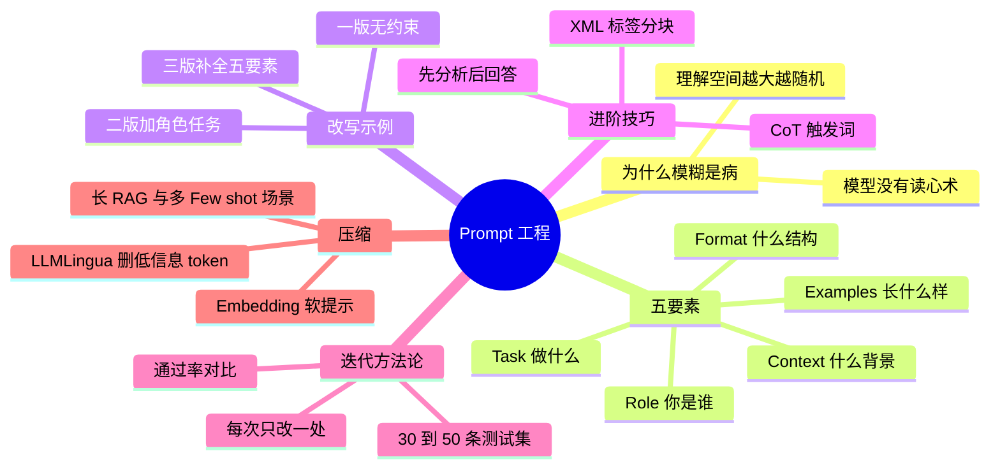

## 🔥 快速背诵

Prompt 写不好，通常不是太短，而是太模糊。五要素是 Role、Task、Context、Format、Examples，分别是你是谁、做什么、什么背景、什么格式、长什么样。最容易忽略的是 Format，输出要被程序解析时它直接决定成败。Prompt 是工程不是手艺，要有三十到五十条测试集，每次只改一处看通过率变化，否则不知道是哪个改动起了作用。

> **一句话**：Prompt 写不好通常不是「太短」而是「**模糊**」。五要素是 **Role / Task / Context / Format / Examples**；而 Prompt 是**工程**——要有测试集和迭代闭环。

## 🧠 导图

---

# 📖 背诵稿

> 五段，按顺序背。

### ① 病根是模糊

**同一个模型同一个任务，好 Prompt 和差 Prompt 的输出质量能差一个数量级。**

原因很朴素：模型没有读心术，只能根据你给的信息推断意图。你的 Prompt 越模糊，它的理解空间越大，输出越随机。新手最常见的三个毛病：**指令不清晰**（「帮我写一篇文章」vs「写一篇面向高中生的 800 字科普文章，解释黑洞如何形成」）、**缺上下文**（模型不知道你什么行业、给谁看）、**没有格式约束**（自由发挥，下游解析直接崩）。这三类问题对应五个要素。

### ② 五要素

**Role、Task、Context、Format、Examples。**

**Role（角色）** 是告诉模型「你是谁」，角色越具体人设越稳、输出越专业。「你是一个助手」和「你是一位有 10 年经验的 Python 后端工程师，专注代码 Review 和性能优化」差别巨大。**Task（任务）** 是「做什么」，用清晰动词把边界说明白，复杂任务拆子步骤，别让它一步做完所有事。**Context（背景）** 是「前提」，「把这段话翻译成英文」和「这是一份面向海外投资者的商业计划书摘要，要求正式商务英语、保留专业术语、不口语化」输出完全不同。**Format（格式）** 是「以什么形式输出」，这是最容易被忽略但最影响实用性的——要被程序解析就必须强约束，明确 JSON 字段和取值。**Examples（示例）** 就是 Few-shot，与其花时间描述风格，不如直接给 1~3 个输入输出例子，模型对齐得更快更准。

### ③ 从差到好

**改造过程能看出「加一层约束，效果跳一个台阶」。**

让模型给技术博客生成摘要：第一版「帮我总结一下这篇文章」几乎没约束——没角色、没字数、没受众、没格式，结果随机发挥、每次都不稳定。第二版加上「你是一位技术文档编辑，请总结以下文章，提炼核心观点」，专业了一些，但「核心观点」还是模糊，多长？什么格式？给谁看？第三版把五要素补全：角色（技术内容编辑）、任务（摘要提炼）、背景（2~3 年经验的后端工程师受众，不用解释入门知识）、格式（一句话结论 20 字内 + 3 条要点每条 30 字内 + 适合人群）、长度（100~150 字）。这一版在不同模型、不同时间执行，输出结构和质量都高度稳定——**好 Prompt 的核心价值就是可预期、可复用、可迭代**。

### ④ 进阶技巧

**CoT 触发、XML 分块、先分析后回答。**

CoT 触发词就是在末尾加「请先分步分析，再给出结论」，对逻辑推理和计算任务往往有效。但 2026 年的工程实践不建议把完整推理链原样展示给最终用户：一是多花 token，二是完整思考链里可能有不稳定或不该暴露的内容。更稳的做法是让模型内部先分析，对外只给简洁依据、关键步骤或可核查的结论。**XML 标签包裹**是 Claude 特别推荐的：Prompt 里有多个部分时，用 `<document>…</document>`、`<task>…</task>` 明确区分，模型理解更准。多步推理任务用「先思考后回答」的结构效果很好。

### ⑤ 迭代与压缩

**Prompt 不是写完就完，它是个「假设 → 测试 → 优化」的循环。**

做法是：先整理 **30~50 条**有代表性的测试用例，覆盖正常和边缘情况；每次改 Prompt 在全量测试集上跑一遍看通过率；如果某些用例变好、另一些变差，就继续拆分，针对不同输入写不同分支。改的时候遵循**每次只改一处**，否则多个变量一起动，你不知道是哪个起的作用。最后是**Prompt 压缩**：长 Prompt 又贵又慢（每多 1000 token，首 token 延迟可能多几十毫秒），而里面常有大量冗余——「请你认真仔细地一步一步分析」可以压成「认真分步分析」，20 个 Few-shot 里的重复模式挑代表性的几个就够。主流方案是 **LLMLingua**（用一个小模型评估每个 token 的信息含量，删掉低信息量的，5000 token 压到 1000 效果只损失 1~3%）和 Embedding 表示（把 Prompt 编成向量，需要模型支持软 Prompt，还在研究阶段）。适合两类场景：长上下文 RAG 和 50+ 个 Few-shot 示例。**压缩一定掉效果，压得越狠掉得越多**，要在自己测试集上找甜蜜点。

---

# 🔑 记忆锚

| 记什么 | 内容 | 口诀 |
|---|---|---|
| **3** 个新手病 | 指令不清 / 缺上下文 / 无格式 | 「糊·空·散」 |
| **5** 个要素 | Role / Task / Context / Format / Examples | 「谁·做·景·形·例」 |
| **1** 条纪律 | 每次只改一处 | 「单变量」 |
| **1** 组数字 | 30~50 条测试集 | 「先立尺子再改」 |

> **卡壳急救**：先点「模糊是病根」，再背五要素，最后补「测试集 + 每次改一处」这条工程纪律。

---

# 🎯 追问速查

| 面试官问 | 你答 |
|---|---|
| 写不好是因为太短吗？ | 不是，是因为模糊——缺角色/任务/上下文/格式/示例 |
| 五要素哪个最易忽略？ | Format。要被程序解析时它决定成败 |
| Few-shot 什么时候必备？ | 格式复杂或风格特殊时，给例子比描述更快更准 |
| CoT 该直接给用户看吗？ | 不建议，多花 token 且可能暴露不稳定内容，对外给简版依据 |
| 为什么用 XML 标签？ | 多段内容分块，模型边界识别更准（Claude 推荐） |
| Prompt 怎么迭代？ | 30~50 条测试集跑通过率，每次只改一处 |
| Prompt 压缩原理？ | LLMLingua 用小模型评估 token 信息量删冗余 |
| 压缩的代价？ | 压越狠损失越大，要在测试集上找平衡点 |

---

# 🔗 串联

- 上游 → **01（一个模型干所有事：Prompt 是统一接口）**
- 下游 → **17（CoT）**、**18（幻觉治理）**、**21（评测）**
- 工程 → 工具调用线 **09（Skill 本质是 Prompt + 脚本的打包）**、**16（网关统一 Prompt 策略）**
- 收尾金句：**Prompt 是可编程的接口，不是随口一问**

---

# 📚 细节（背完再点开）

> [!note]- 三版对比（摘要任务）
> | 版本 | 内容 | 问题 |
> |---|---|---|
> | 一版 | 「帮我总结一下」 | 无约束，输出随机 |
> | 二版 | 加角色与「提炼核心观点」 | 仍无字数/格式/受众 |
> | 三版 | 五要素补全 | 稳定、可复用、可迭代 |

> [!note]- 压缩的适用场景
> 长上下文 RAG（检索文档很长）、Few-shot 50+（示例池大）。短 Prompt 压缩收益有限，别过度优化。

---

# 🎴 自测

> [!question]- Q1 病根是什么？
> 模糊——模型无法读心，理解空间越大输出越随机。

> [!question]- Q2 五要素？
> Role、Task、Context、Format、Examples。

> [!question]- Q3 哪个最影响工程可用性？
> Format，尤其当输出要被程序解析时。

> [!question]- Q4 迭代方法？
> 30~50 条测试集 + 每次只改一处 + 看通过率变化。

> [!question]- Q5 压缩方案与代价？
> LLMLingua 评估 token 信息量删冗余；会掉效果，需找平衡点。
