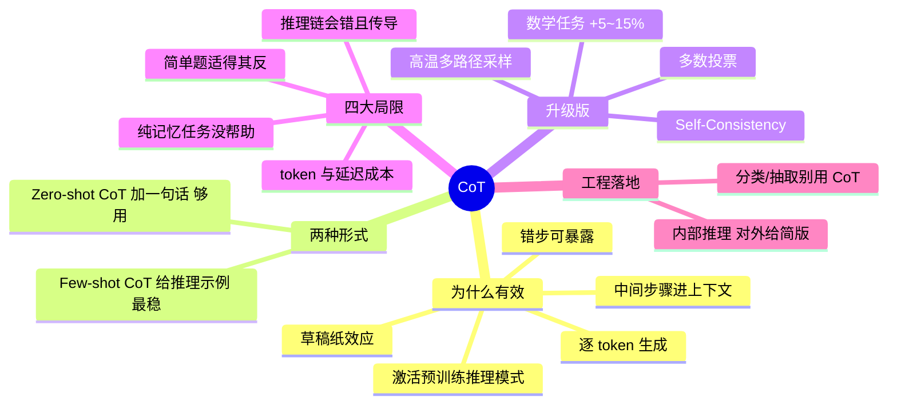

## 🔥 快速背诵

CoT 的本质是给模型一张草稿纸。模型逐 token 生成，每生成一个新 token 都能看见前面所有内容，所以让它先写推理步骤，等于把中间状态显式存进上下文，后面生成答案时就能用上，把直接猜变成推出来。代价要讲全：token 和延迟成本上去了，简单题用它纯属浪费，推理链本身会错而且会沿链传导。所以只在多步推理任务上用。

> **一句话**：CoT 的本质是给模型一张「**草稿纸**」——因为模型是逐 token 生成的，先写出中间步骤，后续生成答案时就能「看见」这些步骤，从而把「直接猜」变成「推出来」。但它有成本也有风险：**token 贵、简单题反受害、推理链本身会错且会传导**。

## 🧠 导图

---

# 📖 背诵稿

> 五段，按顺序背。

### ① 机制：草稿纸

**「让模型一步步想」是表面话，真机制是逐 token 生成 + 上下文可见。**

模型是一个 token 一个 token 往外生成的，每生成一个新 token，它都能「看到」前面所有已生成内容。所以让它先生成推理步骤，等于把这些中间状态显式写进了上下文——复杂的中间结果不用全压进隐状态，后续生成答案时有更多「工作记忆」可用。这就是 CoT 有效最核心的一句。对比一下没有 CoT 的情况：模型像没睡醒凭直觉答题，看到题目直接从记忆里拼一个「听起来合理」的答案，跳过推理。简单题没事，但多步计算、逻辑推导、因果链一上来就容易错——比如「5 个苹果给 2 个又买 3 个」，直接跳答案可能只做了一步运算。而写出「5-2=3，3+3=6」，每步都可验证。

### ② 有效的三个层面

**错步可暴露、隐状态减负、激活预训练能力。**

第一，逐步推理让每一步的错误都暴露出来，而不是把错误藏在一个不透明的「答案」里，模型和人都有机会发现和纠正。第二，中间步骤充当草稿纸，复杂的中间状态通过显式输出记下来，减轻模型隐状态的推理负担。第三，CoT 激活了模型预训练时从大量推理型文本（数学解题、逻辑分析）中学到的推理模式——这是「为什么加一句提示就能激活推理」的解释。

### ③ 两种形式

**Few-shot CoT 给完整推理示例，Zero-shot CoT 只加一句话。**

Few-shot CoT 在 Prompt 里给几个完整的「问题 → 逐步推理 → 答案」示例，模型看到模式后会自动对新问题套用同样格式，**效果最稳定**，适合对准确率要求高的场景，代价是 Prompt 长。Zero-shot CoT 更简单粗暴：在问题末尾加一句「请分步思考后再给结论」，仅仅这一类指令就能激活推理能力，Prompt 更简洁，效果通常略逊于 Few-shot，但很多场景已经够好。**升级版是 Self-Consistency**：对同一问题用较高温度生成多条不同推理路径，取最终答案里出现最多的那个（多数投票）。直觉是正确答案往往有多条路径可达，而错误答案更分散、不易收敛。实验上能在 CoT 基础上再提升 5~15%，数学推理类任务尤其明显，代价是调用次数变多（通常 5~10 次）。

### ④ 四大局限

**成本、简单题、链式错误、纯记忆任务。**

第一，**token 消耗大**：推理链额外生成几百甚至上千 token，API 成本和响应时间都显著上升。第二，**对简单问题适得其反**：让模型对「1+1 等于几」也展开推理，只浪费 token、降低速度，并不提升准确率。第三，**推理链本身也会错**：如果第 2 步推错了，第 3、4 步会基于错误前提继续推导，最终答案大概率也错——**CoT 能减少跳跃性错误，但不能消除推理错误**。第四，**对纯记忆任务没帮助**：像「2020 年奥运会在哪办」这类问题根本不需要推理，CoT 白花 token。所以定位很清晰：CoT 是为「需要多步推理」设计的工具，数学、逻辑、代码调试很有价值；简单问答、分类、信息抽取用普通 Prompt 就好。

### ⑤ 工程落地

**「让模型推理」和「把推理链展示给用户」是两件事。**

现代产品往往让模型内部完成推理，最终只给用户简洁答案、关键依据或可核查步骤——既保留推理收益，又避免输出冗长、不稳定的思考链（思考链里可能有反复自我否定、也可能有不该暴露的内容）。这是被追问「CoT 该不该给用户看」时的标准答法。

---

# 🔑 记忆锚

| 记什么 | 内容 | 口诀 |
|---|---|---|
| **1** 个本质 | 逐 token 生成 → 草稿纸 | 「写下来 = 记得住」 |
| **3** 个原因 | 错步可见 / 隐状态减负 / 激活预训练模式 | 「露·减·激」 |
| **2** 种形式 | Few-shot（稳）/ Zero-shot（快） | 「示例 vs 一句话」 |
| **4** 个局限 | 贵 / 简单题反害 / 链错传导 / 记忆题无用 | 「贵·反·传·无」 |

> **卡壳急救**：先讲「模型逐 token 生成，CoT 等于给草稿纸」，再补三原因，最后主动抛四局限——面试官最想听的是局限。

---

# 🎯 追问速查

| 面试官问 | 你答 |
|---|---|
| 「一步步思考」为什么就有效？ | 逐 token 生成 + 上下文可见，中间步骤成了草稿纸和工作记忆 |
| 模型真的有「想」吗？ | 谈不上意识，但显式输出的中间状态确实参与了后续条件概率计算 |
| CoT 一定有用吗？ | 不是。简单题、分类、抽取、纯记忆任务上纯属浪费 token |
| 推理链错了会怎样？ | 错误沿链累积传导，后面基于错误前提推导，最终答案基本必错 |
| Few-shot 和 Zero-shot CoT 怎么选？ | 准确率优先且格式复杂 → Few-shot；快速试水 → Zero-shot |
| Self-Consistency 是什么？ | 高温多路径采样 + 多数投票，数学任务 +5~15%，代价是 5~10 倍调用 |
| 要不要把 CoT 展示给用户？ | 不建议。内部推理，对外给简要依据或可核查步骤 |
| 什么任务不该用 CoT？ | 简单事实问答、文本分类、信息抽取、格式转换 |

---

# 🔗 串联

- 上游 → **12（解码策略：CoT 本质是「生成更多中间 token」）**、**16（Prompt 工程的进阶技巧）**
- 下游 → **18（幻觉：CoT 治推理性幻觉，治不了参数记错）**、**21（评测：CoT 要按任务类型分别测）**
- 工具调用线 → **08（推理模型为什么不支持 MCP：思考链和工具调用抢上下文）**
- 收尾金句：**CoT 不是让模型变聪明，是让它别偷懒**

---

# 📚 细节（背完再点开）

> [!note]- CoT vs Self-Consistency
> | 维度 | CoT | Self-Consistency |
> |---|---|---|
> | 路径数 | 1 条 | 5~10 条（高温采样） |
> | 决策方式 | 直接取该路径答案 | 多数投票 |
> | 收益 | 显著 | 在 CoT 上再 +5~15% |
> | 成本 | 1 倍 | 5~10 倍 |
> | 适合 | 通用推理 | 数学 / 逻辑等答案可比的题 |

> [!note]- 为什么 2026 年不鼓励展示完整 CoT
> ① token 成本翻几倍；② 完整思考链里有自我否定、试错、甚至不该暴露的内部信息；③ 用户看不懂长链反而降低信任。做法是「内部长推理 + 对外短依据」。

> [!note]- 一个常见误答
> 「CoT 就是让模型输出推理过程，方便我们 debug」——只说了工程副产物，没讲清为什么它能提升准确率。要落到「逐 token 生成 + 中间状态显式化」。

---

# 🎴 自测

> [!question]- Q1 CoT 有效的机制？
> 模型逐 token 生成，先生成推理步骤就把中间状态写进上下文，后续生成答案时有更多工作记忆可用。

> [!question]- Q2 两种 CoT 形式？
> Few-shot CoT（给完整推理示例，最稳）和 Zero-shot CoT（加一句「分步思考」，最省）。

> [!question]- Q3 CoT 的四大局限？
> token/延迟成本高、简单题适得其反、推理链会错且传导、纯记忆任务无帮助。

> [!question]- Q4 Self-Consistency 做什么？
> 高温采样多条推理路径，对最终答案多数投票，数学任务 +5~15%，成本 5~10 倍。

> [!question]- Q5 生产环境怎么用 CoT？
> 内部推理，对外只给简要依据/关键步骤/可核查结论，不暴露完整思考链。
