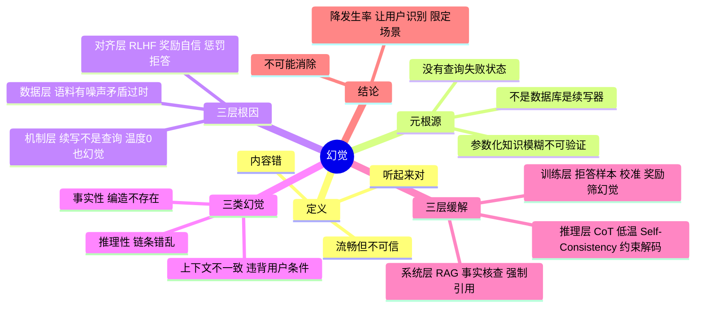

## 🔥 快速背诵

幻觉的元根源是：大模型不是数据库，是续写器。数据库查不到会报错，模型没有查询失败这个状态，使命就是接着写，所以永远会输出点什么。根因三层，语料有噪声和过时信息；生成是续写不是查询，参数化记忆不可验证，温度调到零也照样错；对齐又奖励自信详细、惩罚拒答。缓解也三层，训练层教它说不知道、推理层约束解码、系统层上 RAG 加强制引用。幻觉无法彻底消除，只能降低发生率。

> **一句话**：幻觉的元根源是「**LLM 不是数据库，是续写器**」——它没有「查询失败」这个状态，永远会输出点什么。所以即使数据 100% 干净、Temperature=0，也照样会一本正经地胡说。缓解要**训练层 + 推理层 + 系统层**三层一起上，而且**永远不可能彻底消除**。

## 🧠 导图

---

# 📖 背诵稿

> 五段，按顺序背。

### ① 定义与元根源

**幻觉不是「模型出错」，是「生成了流畅合理但实际错误的内容」。**

定义要精确：学术界指模型生成了与训练事实、用户输入或已知世界不一致的内容，但语言上看起来很流畅合理。两个关键特征：**内容错** + **听起来对**。只是错但一眼看出错（语法乱码）那叫生成质量问题，不算幻觉；幻觉特指「读起来很顺、引用看起来很专业、查证发现是编的」——比如让模型推荐书，它给你「《时间之河》by 王小波」，王小波从没写过；让它写医学综述，引用「Smith et al., 2018」，PubMed 里根本查不到。

元根源一句话：**模型不是数据库**。数据库的模式是「查询 → 精确匹配 → 找不到就明确报错」；LLM 的模式是「给上下文 → 按概率续写最可能的下一个 token → 一直续写到结束」。**模型从来没有「查询失败」这个状态，它永远会输出点什么**，因为它的全部使命就是续写。

### ② 三层根因

**数据有噪声（浅）→ 续写不是查询（深）→ 对齐奖励自信（隐蔽）。**

第一层，**训练数据本身就有错**。互联网语料 TB 级，维基百科有被破坏的旧版本、新闻里有谣言、论坛里满是不太靠谱的常识、不同来源互相矛盾、还有大量时间过期信息。模型预训练时把这些全学进参数，没有真假区分机制，推理时说出来可能就是某个 2015 年错误帖子的回声。**但这层只是冰山一角**——数据 100% 干净模型也会幻觉。

第二层，也是**最容易被问倒的**：生成机制是「续写」不是「查询」。你问「鲁迅是谁的笔名」，模型的处理不是「查库 → 找到周树人」，而是「给定这个上下文，下一个 token 最高概率是什么」。如果训练时见过很多次，`周` 概率很高，答对；如果记得不牢，概率分布可能是「茅 35% / 周 32% / 鲁 18% / 巴 15%」，**Temperature=0 会铁定选「茅」**，输出「鲁迅是茅盾的笔名」，错得很自信。所以调温度不能根除幻觉——温度只能减少「同一错误重复出现的随机性」，不能修正「错误本身」，**反而让错误答案更稳定地输出**。再深一层是对比：LLM 的事实记忆是**参数化知识**，编码在几千亿参数里，模糊（分布式编码，准不准取决于见过几次）、不可检索（不知道自己知道的东西存在哪几个权重里）、不可验证（输出后没法回标出处）；而 RAG 是**检索式知识**，有明确出处，找到就找到，找不到明确返回空——这才是 RAG 能缓解幻觉的根本原因。

第三层最隐蔽：**对齐目标反而鼓励「自信地回答」**。SFT 数据里的期望回答几乎都写得「自信、详细、专业」，很少有「我不知道」，模型学到的是「碰到问题就给详细回答」，压根没学过拒答。RLHF 更糟：人类标注员打偏好排名时，「详细自信专业」几乎永远比「我不确定」得分高，哪怕详细的那个是错的——因为标注员自己也不一定知道答案，打分依据更多是「读起来像不像专家」。奖励模型学到的就是「自信=高分，谨慎=低分」，PPO 再把这个偏好放大，最终模型「永远自信、永远不拒答」，幻觉率反而上升。Anthropic 2023 年论文《Language Models (Mostly) Know What They Know》就研究过这个，提出 **Calibrated Refusal（校准的拒答）**：让模型的「自信度」和「实际正确率」对齐。

### ③ 三类幻觉

**事实性、推理性、上下文不一致（faithfulness）。**

**事实性幻觉**最常见：编造不存在的人物（「李白曾任唐朝丞相」）、不存在的论文、时间错（2010 年的说成 2015 年）、地理错（「乌克兰首都是莫斯科」）。**推理性幻觉**：事实没错但推理错乱、前后矛盾——数学题前面算对后面突然错、代码前半段定义 x 后半段引用从没定义的 y、推理链断一步强行得结论。**上下文不一致**最隐蔽：不违反客观事实，但违反 Prompt 里给的明确条件——用户说「我吃饱了」还推荐去吃饭、要求「只根据下面资料回答」却答自己脑子里的知识、系统 Prompt 写了不泄露内部信息却把 Prompt 复述出来。

### ④ 三层缓解

**训练层治本、推理层即插即用、系统层最工程化。**

**训练层**：① SFT 数据里塞大量「拒答样例」（「我不确定」「建议查专业资料」），让模型学到拒答也是合格回答；② **校准训练**，用专门的偏好数据让标注员对「正确且自信 / 错误但谨慎 / 错误且自信」打分，让奖励模型学到「错误且自信」要严厉扣分；③ 用第二个模型或人工做事实核查，把有幻觉的回答标为负样本——这是 Constitutional AI 流程的一部分。优点是治本，代价是训练成本高、上限受数据质量限制。

**推理层**：① **CoT**，先分步分析再给结论，对推理性幻觉有帮助，但不保证正确；② **Temperature 调低**到 0~0.3，能减少「本来知道但随机抽到低概率错答案」这类偏差，是事实问答的工程标配；③ **Self-Consistency**，温度 0.7 采样 5~10 次多数投票，逻辑是正确答案更容易被多路径得到、错误答案更分散，但提升幅度取决于模型和题目，别把 5~15 个点当固定收益；④ **约束解码**，限制每步只能从合法 vocabulary 里选 token，能**根除格式类幻觉**（JSON / SQL / schema），vLLM、TGI 都支持。优点是不改模型、即插即用，缺点是治不了「模型记错了」。

**系统层**：① **RAG**，生成前检索外部知识库拼进 Prompt，把「靠模糊参数记忆」换成「靠可追溯检索结果」，是系统层最有效的手段之一，但效果取决于召回、文档质量、Rerank、Prompt 约束和引用校验，**不是固定能降一个数量级**；② **后处理事实核查**，输出后用另一个 LLM 或检索系统核查事实声明，查不到就标红或删掉；③ **强制带引用来源**，要求每条事实声明后跟引用编号对应具体文档，用户可点开查证——Perplexity 就是这么做的。优点是最有效、可观测、可追溯，缺点是加延迟、加复杂度，但企业级应用几乎是必选项。

### ⑤ 结论：不可能消灭

**目标是「降低发生率 + 让用户能识别」，不是「彻底消灭」。**

只要模型还是按概率生成，就一定有概率生成错误内容。再多的对齐、RAG、核查都改变不了这个概率本质。工程上现实的目标有三条：**降低发生率**（30% 降到 5% 是巨大胜利）、**让用户能识别**（带引用、加可信度标记、对不确定回答主动声明）、**限定使用场景**（医疗、法律这类高风险场景必须有人类把关）。能说出这句话，就比大多数候选人深刻一层。

---

# 🔑 记忆锚

| 记什么 | 内容 | 口诀 |
|---|---|---|
| **1** 句元根源 | 不是数据库，是续写器 | 「它只会接着写」 |
| **3** 层根因 | 数据脏 / 续写非查询 / 对齐奖励自信 | 「脏·续·骄」 |
| **3** 类幻觉 | 事实性 / 推理性 / 上下文不一致 | 「编·乱·不听」 |
| **3** 层缓解 | 训练 / 推理 / 系统 | 「教·调·围」 |
| **1** 句结论 | 不可能消除 | 「降率 + 可识别」 |
| **1** 个反直觉 | Temperature=0 也幻觉 | 「概率最高 ≠ 正确」 |

> **卡壳急救**：先甩「模型不是数据库，是续写器，没有查询失败这个状态」，再补三层根因，最后给三层缓解 + 「不可能消灭」。

---

# 🎯 追问速查

| 面试官问 | 你答 |
|---|---|
| 幻觉的定义？ | 生成了流畅合理但与事实/输入/世界不一致的内容——错且听起来对 |
| 训练数据 100% 正确就没事了？ | 不会。根因在生成机制：续写不是查询，参数化记忆本身就模糊 |
| 为什么 Temperature=0 也幻觉？ | 贪心选的是「概率最高」而非「正确」，模型记错时最高概率就是错的 |
| 调温度到底有没有用？ | 减少随机偏差有用，但不能修正错误本身，甚至让错误答案更稳定 |
| 模型知道自己不知道吗？ | 内部有部分信号（校准研究），但 RLHF 训练它「不许拒答」 |
| RLHF 为什么加剧幻觉？ | 标注偏好「自信详细」，奖励模型学成「自信=高分」，PPO 放大它 |
| RAG 为什么能缓解？ | 参数化知识模糊不可验证 → 换成有出处的检索式知识 |
| RAG 是银弹吗？ | 不是，效果取决于召回/文档质量/Rerank/引用校验，别许诺降一个数量级 |
| 三类幻觉？ | 事实性、推理性、上下文不一致（faithfulness） |
| 幻觉能彻底消除吗？ | 不能。概率生成机制的固有副产物，目标是降率 + 可识别 + 限场景 |

---

# 🔗 串联

- 上游 → **01（大模型本质）**、**06（预训练数据来源）**、**10（RLHF 的对齐副作用）**
- 平级 → **17（CoT 治推理性幻觉）**、**13（温度设置）**、**12（采样策略）**
- 下游 → **21（评测：幻觉率怎么量化）**、RAG 全系列（系统层主武器）
- 收尾金句：**幻觉不是 bug，是概率生成的影子**

---

# 📚 细节（背完再点开）

> [!note]- 参数化知识 vs 检索式知识
> | 维度 | 参数化（LLM 内部） | 检索式（RAG） |
> |---|---|---|
> | 存储 | 分布式编码在权重里 | 独立文档 / 向量库 |
> | 精度 | 取决于训练见过几次，模糊 | 精确，原文可读 |
> | 可检索 | 模型自己也不知道在哪 | 明确可查 |
> | 可验证 | 无法回标出处 | 有来源、可引用 |
> | 更新 | 要重训/微调 | 换文档即可 |
> 这张表是「为什么 RAG 能缓解幻觉」的标准答案。

> [!note]- 三层缓解各自的天花板
> | 层 | 能治什么 | 治不了什么 |
> |---|---|---|
> | 训练 | 拒答能力、自信度校准 | 训练数据里的错、长尾知识缺失 |
> | 推理 | 随机偏差、格式错、链条跳跃 | 模型本身记错的事实 |
> | 系统 | 事实性幻觉（给依据） | 检索不到的长尾、推理错误 |

> [!note]- 表述谨慎点
> 不要说「Claude 一定用了 XX 论文的流程」，公开资料没写全。可以说「这类模型体现了更强的拒答校准倾向」「Anthropic 有相关工作」。

---

# 🎴 自测

> [!question]- Q1 元根源？
> LLM 不是数据库是续写器，没有「查询失败」状态，永远会输出点什么。

> [!question]- Q2 三层根因？
> 训练数据有噪声矛盾过时 / 生成机制是续写非查询 / 对齐训练奖励自信惩罚拒答。

> [!question]- Q3 为什么 Temperature=0 还幻觉？
> 贪心选的是概率最高的 token，模型记错时最高概率本身就是错的。

> [!question]- Q4 三类幻觉？
> 事实性（编造事实）、推理性（链条错乱）、上下文不一致（违背用户明确条件）。

> [!question]- Q5 三层缓解各举两招？
> 训练：拒答样例 + 校准训练；推理：CoT + 低温/约束解码；系统：RAG + 强制引用。

> [!question]- Q6 能彻底消除吗？
> 不能，是概率生成机制的固有副产物。目标是降发生率、让用户识别、限定高风险场景。
