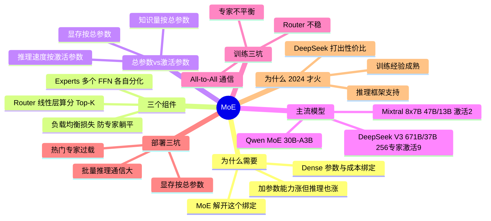

## 🔥 快速背诵

MoE 把每层前馈网络复制成 N 个专家，再加一个 Router 给每个 token 挑 Top-K 个，其余不激活。核心哲学是总参数和激活参数解耦，学的时候用全部参数，跑的时候只用一小撮。DeepSeek V3 是 671B 总参数、37B 激活，激活率约 5.5%。反直觉的一点，显存按总参数走、所有专家都要加载；速度按激活参数走、延迟接近 37B 稠密模型。训练最大的坑是专家不平衡。

## 🧠 导图

---

# 📖 背诵稿

> 五段，按顺序背。

### ① 为什么 Dense 不够用

**Dense 的死穴是「知识量」和「推理成本」绑在一起。**

标准 Transformer 每个 token 推理都要走一遍全部参数：175B 的 GPT-3，每生成一个 token 都要让 175B 个参数全部参与计算。于是陷入两难——想提升能力就得加参数，但参数加倍推理成本（计算量 + 显存 + 延迟）也加倍；一台 8 卡 H100 能跑 70B Dense，跑不动 175B。**MoE 的突破就是把这个绑定解开**：模型有 N 个专家（每个是一份独立 FFN），token 进来时 Router 只挑 K 个处理（K 远小于 N）。总参数 = N × 单专家，知识量很大；激活参数 = K × 单专家，推理成本只有总参数的 K/N。类比一下：Dense 像一本厚百科全书，查一个词得把整本书过一遍；MoE 像图书馆，前台咨询员（Router）听完问题直接告诉你去 3 楼数学区，不用全馆搜索。

### ② 三个核心组件

**Experts、Router、负载均衡损失。**

**多个专家**：把每层 FFN 替换成 N 个结构相同但参数独立的并行 FFN。N 是工程权衡——太小（N=4）专家不够细分，接近 Dense；太大（N=512）每个专家太小太专门，学不到通用能力。业界主流是 N=8（Mixtral）、N=64（早期 GShard）、N=256（DeepSeek V3）。要注意每个专家「擅长什么」**不是预先指定的，是训练中自然涌现的**——训完会发现有的偏数学符号、有的偏代码语法、有的偏常用语言、有的偏稀有词汇。

**Router**：MoE 最关键的组件，结构通常就是一个线性层。token embedding 乘 `W_router` 得到 N 个偏好分数，softmax 归一化，取 Top-K。K 的常见取值：K=1（Switch Transformer，最稀疏、效率最高）、K=2（Mixtral，效果效率折中）、K=8（DeepSeek V3，配合 256 个细粒度专家）。

**负载均衡损失**：解决「专家不平衡」。训练初期 Router 随机，可能偶然几个专家分数高被选中、得到训练；其他专家分数低不被选中、不更新；下一轮还是那几个，恶性循环后整个模型只有 1~2 个专家在工作，其他全躺平。做法是把「专家使用率的方差」作为惩罚加进总损失：`total_loss = main_loss + α × variance(expert_load)`，迫使 Router 均匀分配。DeepSeek V3 更进一步提出 **Auxiliary-Loss-Free Load Balancing**——不加辅助损失，而是动态调整每个专家的偏置项让负载自然均衡，减少对主任务的干扰。

### ③ 总参数 vs 激活参数

**这是 MoE 最容易踩坑、也最该背精确的概念。**

对比一组数字。Dense 70B：推理一个 token 算 70B 参数，FP16 显存 140GB。MoE 671B / 37B（DeepSeek V3）：推理一个 token 只算 37B 参数，但 FP16 显存要 **1.3TB**（量化 INT4 约 350GB），推理速度却**接近 37B Dense**。三个反差：**知识量按总参数算**（671B，专家分化覆盖各种领域）、**显存按总参数走**（所有专家都必须常驻，不然 Router 路由到没加载的专家就没法算）、**推理速度按激活参数走**（每 token 只算 37B）。这套「学得多 + 跑得快」的组合就是 MoE 在 LLM 时代爆发的根本原因：Dense 走到 70B 已是推理成本极限，再往上 175B/500B/1T 几乎跑不起来；MoE 把激活参数压在 37B~100B，总参数却能推到 600B、1T。

### ④ 主流模型与趋势

**专家越来越多、激活率越来越低、共享专家普及。**

DeepSeek V3 / R1：671B 总 / 37B 激活（5.5%），每层 256 routed + 1 shared，每 token 选 Top-8 routed + 1 shared = 9 个激活，创新点是 MLA + Auxiliary-Loss-Free。Mixtral 8x7B：约 47B 总 / 13B 激活（28%），每层 8 专家选 Top-2，哲学是「专家少而精、激活率高保质量」，是 2023 年开源 MoE 的标杆。Qwen MoE 30B-A3B：30B 总 / 3B 激活（10%），走细粒度路线，注重小激活下的性能。Grok 1：314B / 78.5B，激活率 25%，相对保守。趋势很清楚：专家数 8 → 64 → 256，激活率 28% → 10% → 5.5%，共享专家越来越普及（避免常见知识被反复学）。内在逻辑是「**更细粒度稀疏化 = 更高算力性价比**」。

### ⑤ 训练与部署的坑 + 为什么 2024 才火

**训练：不平衡、Router 不稳、All-to-All。部署：显存按总参数、吞吐不如同激活 Dense。**

训练三坑。**专家不平衡**的应对：负载均衡损失、Expert Choice Routing（反过来让专家挑 token，每个专家固定吃 N 个）、Auxiliary-Loss-Free、温度退火（初期高温采样鼓励探索）。**Router 训练不稳定**：梯度要穿过 softmax + topk 两个不可微操作，稳定化靠 Noisy Top-K Gating（加噪声鼓励探索）、Z-loss（限制 logits 范数防极端化）、soft 路由训练 / hard 路由推理切换。**分布式并行复杂**：Dense 用 TP + PP 就够，MoE 还要 **Expert Parallel**——不同专家分到不同 GPU，token 要在卡间路由，靠 **All-to-All 通信**把 token 发到对应 GPU 再发回来，这是 MoE 训练通信开销最大的环节。DeepSeek V3 大量工程优化都在讲怎么把 All-to-All 和计算重叠（DualPipe），是工程实力的体现。

部署三坑。**显存按总参数走**（671B FP16 要 1.3TB，最少 8 卡 H100）。**批量推理通信开销大**：不同 token 选不同专家导致大量跨卡通信，所以 MoE 的**吞吐量往往不如同等激活参数的 Dense**。**专家不均衡导致负载不均**：热门专家所在 GPU 过载、其他 GPU 空闲，要动态负载均衡（专家迁移、复制热门专家）。这也是为什么很多公司喜欢 MoE 的训练性价比，部署时还是选 Dense。

最后是「为什么 2017 年 GShard 就用过 MoE，2024 年才火」。三个原因：**训练经验积累到位**（早期极不稳定，Google/Meta/DeepSeek 攒了整套 know-how，成熟到开源社区能复现）、**推理框架支持完善**（vLLM、SGLang、TensorRT-LLM 都加了 MoE 专家并行和通信优化）、**DeepSeek V3 把成本打下来**（671B/37B 报出极低训练成本和很强效果，让所有人看到 MoE 是真能用，点燃整个开源圈）。但注意别说过头：到 2026 年 MoE 是主流方向之一，不能说「几乎新模型都用」——Dense 在 1B~70B 这类部署稳定、延迟敏感、工程复杂度低的场景依然有强生命力。

---

# 🔑 记忆锚

| 记什么 | 内容 | 口诀 |
|---|---|---|
| **1** 个哲学 | 总参数大、激活参数小 | 「大仓库、小开门」 |
| **3** 个组件 | Experts / Router / 负载均衡损失 | 「专·门·衡」 |
| **1** 组数字 | DeepSeek V3：671B / 37B，256 专家，Top-8 + 1 shared，5.5% | 「671/37/256/9」 |
| **1** 组对照 | Mixtral 8x7B：47B / 13B，8 专家 Top-2，28% | 「47/13/8/2」 |
| **3** 个训练坑 | 不平衡 / Router 不稳 / All-to-All | 「偏·摇·堵」 |
| **1** 句反直觉 | 显存按总参数，速度按激活参数 | 「装得多，跑得快」 |

> **卡壳急救**：先甩「总参数大、激活参数小」，再报 671B/37B 这组数字，然后讲「显存按总参数、速度按激活参数」，最后补专家不平衡这个训练难题。

---

# 🎯 追问速查

| 面试官问 | 你答 |
|---|---|
| MoE 一句话是什么？ | FFN 复制成 N 个专家 + Router 给每 token 选 Top-K，稀疏激活换便宜推理 |
| 为什么 Dense 不行？ | 参数和推理成本绑死，70B 已是推理成本极限 |
| 671B/37B 什么含义？ | 知识量 671B，显存占 1.3TB（FP16），但每 token 只算 37B，延迟接近 37B Dense |
| 专家是谁指定的？ | 不指定，训练中自然涌现分化（数学/代码/语种/稀有词） |
| 专家不平衡是什么？ | Router 偏爱少数专家 → 其他专家不被训练 → 恶性循环，模型实际只用 1~2 个专家 |
| 怎么治不平衡？ | 负载均衡损失、Expert Choice Routing、Auxiliary-Loss-Free（DeepSeek V3）、温度退火 |
| Router 为什么难训？ | 梯度要穿 softmax + topk 不可微操作；靠噪声路由、Z-loss、soft/hard 切换稳定 |
| MoE 部署最大的坑？ | 显存按总参数走；批量推理 All-to-All 通信大，吞吐不如同激活 Dense |
| 为什么 2024 才火？ | 训练经验成熟 + 推理框架支持 + DeepSeek V3 打出性价比 |
| MoE 会完全取代 Dense 吗？ | 不会。Dense 在中小规模、部署稳定、延迟敏感场景仍有优势 |

---

# 🔗 串联

- 上游 → **02（Transformer 的 FFN 就是被替换的对象）**、**03（MLA / GQA 与 MoE 常同框出现）**
- 平级 → **14（KV Cache：MLA 优化的是 attention 侧，MoE 优化的是 FFN 侧）**
- 下游 → **15（量化：MoE 的 350GB INT4 才勉强能部署）**、**20（部署框架：vLLM/SGLang 的专家并行）**、**22（选型：MoE 还是 Dense）**
- 收尾金句：**MoE 是「用显存换算力」，天下没有免费的午餐**

---

# 📚 细节（背完再点开）

> [!note]- 主流 MoE 配置对照
> | 模型 | 总/激活 | 激活率 | 专家配置 |
> |---|---|---|---|
> | DeepSeek V3 / R1 | 671B / 37B | 5.5% | 256 routed + 1 shared，Top-8 |
> | Mixtral 8x7B | 47B / 13B | 28% | 8 专家，Top-2 |
> | Qwen MoE 30B-A3B | 30B / 3B | 10% | 细粒度路线 |
> | Grok 1 | 314B / 78.5B | 25% | 相对保守 |

> [!note]- 共享专家（Shared Expert）为什么有用
> 有些知识（常用语法、通用常识）几乎每个 token 都需要。如果全靠 routed 专家，每个专家都要重复学一遍，浪费容量。加 1 个 shared expert 常驻激活，让 routed 专家专注「差异化知识」——DeepSeek V3 就是这么做的。

> [!note]- 显存估算（面试常问）
> 671B 参数，FP16 每参数 2 字节 ≈ 1.34TB；INT8 ≈ 671GB；INT4 ≈ 335GB。再加 KV Cache 和激活开销。所以「671B 能跑在单机 8×H100（80GB×8=640GB）」必须靠 INT4 量化 + 专家分片。

---

# 🎴 自测

> [!question]- Q1 MoE 核心思想？
> FFN 换成 N 个专家 + Router 选 Top-K，总参数大、激活参数小。

> [!question]- Q2 三个组件？
> Experts（并行 FFN，自然分化）、Router（线性层打分 + Top-K）、负载均衡损失（防躺平）。

> [!question]- Q3 DeepSeek V3 的具体配置？
> 671B 总 / 37B 激活，256 routed + 1 shared，每 token 激活 9 个，激活率 5.5%。

> [!question]- Q4 显存和速度分别按什么算？
> 显存按总参数（1.3TB FP16），推理速度按激活参数（接近 37B Dense）。

> [!question]- Q5 专家不平衡怎么治？
> 负载均衡损失（使用率方差惩罚）、Expert Choice Routing、Auxiliary-Loss-Free、温度退火。

> [!question]- Q6 为什么 2024 年才火？
> 训练 know-how 成熟 + 推理框架（vLLM/SGLang/TRT-LLM）支持 + DeepSeek V3 打出性价比。
