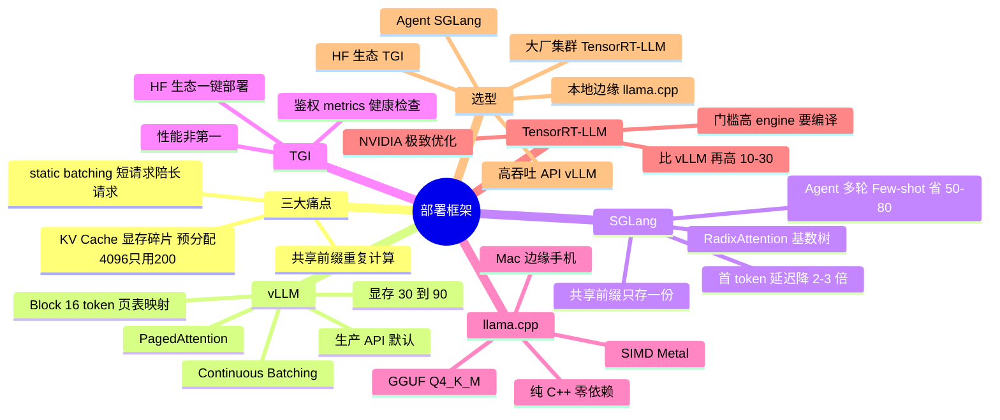

## 🔥 快速背诵

部署框架解决三个痛点：显存碎片、批量调度低效、共享前缀重复计算。vLLM 靠 PagedAttention，把 KV Cache 切成固定块、用页表映射，不用预分配最大长度，显存利用率从三四十拉到九十以上，再加 Continuous Batching 让请求动态进出。SGLang 靠 RadixAttention，把 KV 组织成前缀树，相同前缀只存一份，多轮对话特别省。TGI 卖生态，llama.cpp 卖 CPU 边缘，TensorRT-LLM 卖极致。

## 🧠 导图

---

# 📖 背诵稿

> 五段，按顺序背。

### ① 三个痛点（先讲动机）

**不问「哪个框架好」，先问「直接用 transformers 有什么问题」。**

最朴素的部署就是 `AutoModelForCausalLM` + `model.generate()`，能跑但效率很糟。痛点一，**KV Cache 显存碎片**：每来一个请求就预分配「最大可能长度」（比如 4096 tokens）的 KV 显存，但实际大多只用 200~500 tokens，剩下 3500+ 全空着——一台 80GB H100 理论能跑 100 并发，实际只能跑 30，显存浪费 60~70%。痛点二，**批量调度低效**：static batching 是「凑齐 N 个请求一起跑、一起结束」，但生成长度各不相同，50 token 就完的请求要陪 1000 token 的请求跑到结束，GPU 大量时间在等。痛点三，**重复计算**：所有用户都用同一段 1000 token 的 System Prompt，朴素实现每次都重算这 1000 token 的 KV。所以部署框架的三大优化方向就是：**内存高效（治碎片）+ 批量调度（治吞吐）+ 缓存复用（治重复计算）**。

### ② vLLM：PagedAttention + Continuous Batching

**灵感直接来自操作系统的虚拟内存。**

操作系统不给每个进程预分配大块连续物理内存（会有大量碎片），而是把物理内存切成固定大小的「页」，进程拿逻辑地址，通过页表映射到真实物理页。PagedAttention 把这套搬到 KV Cache：把 GPU 显存切成固定大小的 **Block**（典型 16 个 token 的 KV），每个请求拿到「逻辑 KV 序列」，由一张 **Block Table** 映射到物理 Block；用了 200 tokens 就只占 13 个 Block，用完即释放，没有「预分配 4096 只用 200」的浪费。实测显存利用率从 30~40% 拉到 **90%+**，同硬件并发请求 2~4 倍。

第二个杀手锏是 **Continuous Batching**：请求异步加入和退出，每个 token 步骤动态组 batch。t1 时刻 A/B/C 在跑，t5 时 A 生成完退出、D 立刻加入，t8 时 B 退出、E 加入——GPU 一刻不闲，吞吐比 static batching 高 3~5 倍。所以 **vLLM = PagedAttention（显存高效）+ Continuous Batching（吞吐高效）**，是当前生产部署 LLM API 的事实标准。

### ③ SGLang：RadixAttention

**它的定位不是替代 vLLM，是打 vLLM 没解决好的「共享前缀」场景。**

前缀重复的场景非常常见：所有用户共享几千 token 的 System Prompt、Prompt 里带 5~10 个固定 Few-shot 示例、同一用户多轮对话每轮都带完整历史、Agent 工作流每次调用都从同一 System Prompt 开始。vLLM 的 PagedAttention 虽然显存高效，但**不同请求的 KV Cache 仍然各存各的**——10 个用户用同样 1000 tokens，就存 10 份。

SGLang 用经典数据结构 **Radix Tree（基数树）** 解决：把 KV Cache 组织成一棵树，根节点为空，每个请求的 token 序列从根往下走，开头 N 个 token 相同的请求共享根到第 N 层的同一条路径，第 N+1 层才开始分叉。于是 KV Cache 显存按「所有请求的**并集**」算，而不是「各自长度**求和**」，前缀重复率高时显存省 **50~80%**。更妙的是能自动复用**历史请求**的 KV：1 小时前有人问过同样 System Prompt，那段 KV 还在显存里（LRU 淘汰），新请求直接命中，省掉重新计算的几百毫秒。实测 Agent 场景首 token 延迟降 2~3 倍、吞吐提升 30~50%。但要注意：**纯单请求、无前缀共享时 SGLang 优势不明显**，两者互补。这也是为什么 LangGraph、AutoGen 这类 Agent 框架开始把 SGLang 作为推荐后端。

### ④ TGI 和 llama.cpp

**TGI 卖生态，llama.cpp 卖「没 GPU 也能跑」。**

**TGI**（HuggingFace，2022）核心卖点不是绝对性能，而是**生态集成 + 企业级特性**：直接读 HF Hub 的模型 ID 自动下载部署、支持 safetensors 和量化配置、兼容 transformers 的 tokenizer 和 chat template；企业侧有 HTTP/gRPC 双协议、API Key/JWT 鉴权、Prometheus metrics、健康检查、优雅重启、SSE 流式。性能上也支持连续批处理、量化、流式，但极致吞吐通常不如 vLLM/SGLang。适合「公司本来就用 HF 全家桶」「要快速 POC」「要现成的企业级接口」。

**llama.cpp**（Georgi Gerganov，2023）走完全不同的路：**纯 C++ 重写整个推理栈、零依赖、最大化 CPU 性能**。因为绝大多数个人设备没有像样的 GPU：MacBook Pro（M 系列统一内存）、Windows 核显本、树莓派 / Jetson、手机。三个关键技术：**GGUF 格式**（权重 + 量化方案 + 元数据打包成一个文件，档位 Q8_0 近乎无损、Q5_K_M 平衡、Q4_K_M 最常用压到 1/4、Q3_K_S 极端压缩）、**SIMD 优化**（针对 AVX2/AVX512/ARM NEON 手工优化矩阵乘 kernel，CPU 能跑到 GPU 的 30~50%）、**Metal 后端**（M3 Max 128GB 统一内存能跑 70B，Mac 用户极爱）。不适合高并发生产 API、重 batch、多卡集群。

另外还有 **TensorRT-LLM**：NVIDIA 官方，针对具体 GPU 型号（A100/H100/H200）做硬件级优化，集成 cuBLAS/cuDNN/TensorRT，支持 FP8/INT4，通常比 vLLM 再高 10~30%。代价是工程门槛高（每个模型 × GPU 组合都要先编译 engine）、只支持 NVIDIA、生态不如开源活跃。适合有 NVIDIA 大集群、追极致利用率的大厂。

### ⑤ 怎么选 + 三大上线陷阱

**按场景对号入座，别死记一个框架。**

高吞吐 LLM API → **vLLM**（默认答案）；Agent / 多轮对话 / Few-shot → **SGLang**（更省）；拥抱 HF 生态、要企业级接口 → **TGI**；本地 / Mac / 边缘 / 无 GPU → **llama.cpp**；NVIDIA 集群追极致 → **TensorRT-LLM**。

四个常见误用：用 vLLM 跑 Agent 多轮（前缀重复高，白算 KV）；用 llama.cpp 做高并发服务（批量调度弱，吞吐瓶颈）；用 TGI 追绝对性能（瓶颈在 GPU 吞吐就不该选它）；用 TensorRT-LLM 做快速 POC（要编译 engine，模型一换就得重来）。

三个上线陷阱（加分项）：① **PagedAttention 不是完全消除碎片**，请求长度极不均匀（100 tokens vs 100K tokens）时仍有 5~10% 碎片，要看显存利用率，跌破 70% 就调 `max-model-len` 或加 swap；② **KV Cache 量化的支持差异很大**，权重量化到处都支持，但 KV Cache 量化（FP16→INT8/FP8/INT4）版本迭代快，选型前一定查当前版本文档，别只听「支持」；③ **MoE 模型部署比 Dense 复杂得多**（要专家并行 + All-to-All 优化），vLLM/SGLang 支持但配置复杂、llama.cpp 性能一般、TensorRT-LLM 支持最好但门槛高，先在测试环境跑通再上生产。最后加一句「业内已经有人混用：高吞吐路由走 vLLM，Agent 路由走 SGLang」——这种一线视角很加分。

---

# 🔑 记忆锚

| 记什么 | 内容 | 口诀 |
|---|---|---|
| **3** 个痛点 | 碎片 / 调度 / 重复算 | 「碎·慢·重」 |
| **1** 个类比 | PagedAttention ≈ 操作系统虚拟内存分页 | 「Block 16 + 页表」 |
| **1** 组数字 | 显存利用率 30%→90%+，并发 2~4 倍 | 「三成变九成」 |
| **1** 个数据结构 | RadixAttention = 基数树共享前缀 | 「并集不吃总和」 |
| **2** 组收益 | SGLang 显存省 50~80%，首 token 降 2~3 倍 | 「省一半，快两倍」 |
| **1** 句关系 | vLLM 与 SGLang 互补不替代 | 「高吞吐 vs 高复用」 |
| **1** 个边缘答案 | GGUF Q4_K_M 压到 1/4 | 「Mac 能跑 70B」 |

> **卡壳急救**：先讲三大痛点建立动机，再讲 PagedAttention（分页 + 页表 + 16 token Block），再讲 RadixAttention（前缀树 + 并集），最后给选型一句话。

---

# 🎯 追问速查

| 面试官问 | 你答 |
|---|---|
| 为什么不用 transformers 直接部署？ | 显存碎片（预分配 4096 只用 200）、static batching 短请求陪跑、System Prompt 重复算 |
| PagedAttention 为什么叫 Paged？ | 借操作系统虚拟内存：显存切固定 Block，逻辑序列经 Block Table 映射物理页 |
| Block 多大？ | 典型 16 个 token 的 KV |
| 收益多少？ | 显存利用率 30~40% → 90%+，同硬件并发 2~4 倍 |
| Continuous Batching 解决什么？ | 请求异步进出、每步动态组 batch，吞吐比 static 高 3~5 倍 |
| RadixAttention 是什么？ | 把 KV Cache 组织成基数树，相同前缀共享一条路径，显存按并集算 |
| SGLang 什么时候比 vLLM 强？ | 前缀重复率高：Agent、多轮对话、Few-shot、共享 System Prompt |
| 纯单请求呢？ | 优势不明显，所以两者是互补不是替代 |
| TGI 的定位？ | HF 生态 + 企业级特性（鉴权/metrics/健康检查），不是追极致吞吐 |
| llama.cpp 关键点？ | 纯 C++ 零依赖 + GGUF 量化 + SIMD + Metal，CPU 达 GPU 的 30~50% |
| Q4_K_M 是什么？ | GGUF 4-bit 量化档位，体积约 1/4，最常用 |
| TensorRT-LLM 代价？ | 要按模型×GPU 编译 engine、只支持 NVIDIA、生态弱 |
| 长上下文还有碎片吗？ | 有，5~10%，看显存利用率跌破 70% 就调 max-model-len |
| 部署 MoE 要注意？ | 专家并行 + All-to-All 通信，测试环境先跑通 |

---

# 🔗 串联

- 上游 → **14（KV Cache：PagedAttention 管的就是它）**、**19（MoE 部署要专家并行）**、**15（量化：GGUF / INT4 / FP8）**
- 平级 → **16（网关层做多模型路由）**、**13（采样参数影响框架调度）**
- 下游 → **22（选型：框架选型与模型选型是两件事）**
- 收尾金句：**推理框架的竞争，本质是「谁更会省 KV Cache」**

---

# 📚 细节（背完再点开）

> [!note]- 五框架决策表
> | 框架 | 核心创新 | 最佳场景 | 一句话评价 |
> |---|---|---|---|
> | vLLM | PagedAttention + Continuous Batching | 高吞吐 LLM API | 生产默认答案 |
> | SGLang | RadixAttention（前缀树） | Agent / 多轮 / Few-shot | 高复用场景更省 |
> | TGI | HF 生态集成 | 企业级 + HF 全家桶 | 生态牌不是性能牌 |
> | llama.cpp | C++ + GGUF + Metal | CPU / Mac / 边缘 | 没 GPU 也能跑 |
> | TensorRT-LLM | NVIDIA 硬件极致优化 | 大厂 NVIDIA 集群 | 快 10~30%，门槛高一截 |

> [!note]- 为什么说「互补不替代」
> 两者抢的是不同瓶颈：vLLM 抢「显存碎片 + 调度吞吐」，SGLang 抢「前缀复用」。一个系统里如果既有普通 API 又有 Agent 链路，完全可以按路由分流——这也呼应网关（工具调用线 **16**）的分流思路。

> [!note]- 常见报数提醒
> vLLM 的 2~4 倍、SGLang 的 2~3 倍、TensorRT-LLM 的 10~30% 都是「典型场景的公开对比量级」，会随模型、硬件、量化、batch 策略浮动。面试时说「量级」比说「精确值」更稳。

---

# 🎴 自测

> [!question]- Q1 三个痛点？
> KV Cache 显存碎片、static batching 短请求陪跑、共享前缀重复计算。

> [!question]- Q2 PagedAttention 的类比与机制？
> 操作系统虚拟内存：显存切 16-token Block，逻辑序列经 Block Table 映射物理 Block，用完释放。

> [!question]- Q3 vLLM 两大杀器？
> PagedAttention（显存利用率 30%→90%+）+ Continuous Batching（吞吐 +3~5 倍）。

> [!question]- Q4 RadixAttention 解决什么？
> 多请求共享前缀的 KV 重复存储，用基数树让相同前缀只存一份，显存按并集算。

> [!question]- Q5 llama.cpp 适合谁？
> 个人本地、Mac（M 系列统一内存）、边缘嵌入式、离线与隐私敏感场景。

> [!question]- Q6 三个上线陷阱？
> 长上下文仍有 5~10% 碎片、KV Cache 量化支持差异大、MoE 部署复杂度高。
