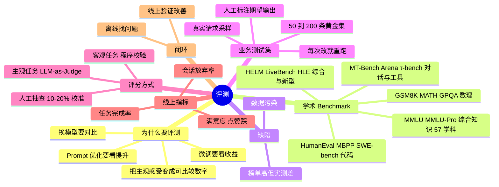

## 🔥 快速背诵

学术 Benchmark 只能当参考，因为数据污染，题目在网上公开流传，模型预训练时可能已经背过，成绩反映的是记忆不是泛化。所以工程上是三层闭环，Benchmark 定能力区间，业务测试集定能不能用，线上指标定是不是真的变好。业务集从真实请求采样、人工标注期望输出，五十到两百条；客观任务程序校验，主观任务用 LLM 当裁判，再人工抽查校准。

> **一句话**：学术 Benchmark 只能当**参考**，因为它有系统性的「**数据污染**」缺陷——模型预训练时可能已经背过题。工程上真正靠得住的是三层闭环：**学术 Benchmark（定能力区间）+ 业务测试集（定能不能用）+ 线上指标（定是否真的变好）**。

## 🧠 导图

---

# 📖 背诵稿

> 五段，按顺序背。

### ① 为什么需要评测

**「感觉还不错」撑不起工程决策。**

大模型能力是多维的。要从 GPT 换到 Claude、要判断该不该微调、要衡量 Prompt 优化到底有没有提升，都需要可比较的数字。评测指标的价值就是把「主观感受」转化成「可比较的数字」。但评测 LLM 比评测传统软件难得多——语言生成是开放任务，「正确答案」的边界往往模糊，这也是为什么这个领域同时存在多种不同侧重的 Benchmark。

### ② 主流学术 Benchmark

**按能力维度分组记，别只背名字。**

**MMLU / MMLU-Pro** 是最广泛引用的综合能力测试，57 个学科（高中数学、历史、法律、医学、计算机）全是四选一单选，Pro 版难度更高、选项更多、更强调推理——可以理解为一套超全面的「文化水平考试」，考知识广度和推理基础。**代码**：HumanEval（OpenAI，164 道题，给函数签名 + docstring，要求生成完整实现，用隐藏测试用例验证）、MBPP、**SWE-bench Verified**（更接近真实软件工程，让模型修真实 GitHub issue，考代码理解、修改、测试）；常见指标 **Pass@k**，即生成 k 个候选至少 1 个通过所有测试的比例。**数理**：GSM8K（小学数学应用题，考四则运算和逻辑）、MATH（竞赛数学，代数/几何/组合）、GPQA（研究生级科学问答，需要物理化学生物知识 + 多步推理）。**对话与 Agent**：MT-Bench（多轮交互场景，用 LLM-as-Judge 打分）、Chatbot Arena（真实用户偏好投票）、τ-bench（工具调用、多轮状态管理、业务流程，最贴近 Agent 应用）。**综合与新型**：HELM（准确率、鲁棒性、公平性、有害性多维）、LiveBench（持续更新题目以降污染）、Humanity's Last Exam（主打更难更广）。

### ③ 缺陷：数据污染

**这是整套学术 Benchmark 最难回避的系统性漏洞。**

现在训练数据规模极大、覆盖互联网绝大部分公开内容，而 MMLU、GSM8K 这些题目的答案本来就公开流传。模型预训练时可能已经「见过」答案，导致测试成绩虚高，**反映的是记忆而不是泛化**。这就解释了那个常见困惑：为什么有些模型排行榜名列前茅，实际用起来却不如名次更低的竞品——因为它可能是「背过题」的，而不是真的更聪明。缓解方向有三条：避免把公开 Benchmark 直接当训练集、用 LiveBench 这种持续更新题库的评测、以及最重要的——**用业务真实数据做评测**。

### ④ 业务测试集（工程标配）

**从真实用户请求里采样，人工标注期望答案，50~200 条黄金集。**

做法就是：从真实用户请求里采样，人工标注期望输出，形成 50~200 条有代表性的「黄金测试集」；之后每次改 Prompt、换模型、调参数，都在这个集合上跑一遍，算通过率或质量分。**评分方式分两类**：客观任务（信息抽取、分类、代码）用程序自动验证——代码就跑测试用例，抽取就比对字段；主观任务（摘要、问答质量）用 **LLM-as-Judge**，让一个更强的模型（如 GPT-4o）按给定标准打分，再**人工抽查 10~20% 样本校准 Judge 是否可信**——这一步不能省，否则 Judge 的偏差会被当真理。这套方法是工业界做 LLM 项目的标配，能讲出来就证明你真做过项目，而不是只会背榜单。

### ⑤ 离线 + 线上闭环

**离线找问题，线上验证是否真改善。**

业务测试集解决的是离线评估，但只有离线不够，生产环境还得监控真实用户体验：**用户满意度**（显式点赞/踩、隐式追问行为）、**任务完成率**（用户是否真的达成了目标）、**会话放弃率**（中途退出说明体验差）。离线评估让你快速迭代、低成本试错；线上指标告诉你优化是否真的改善了体验。两者结合才是完整评估体系。只信离线容易自我感动，只看线上又无法归因。

---

# 🔑 记忆锚

| 记什么 | 内容 | 口诀 |
|---|---|---|
| **1** 个大坑 | 数据污染（背过题） | 「榜单高 ≠ 真的好用」 |
| **5** 组 Benchmark | MMLU / 代码 / 数理 / 对话 Agent / 综合新型 | 「综·码·算·聊·全」 |
| **1** 组数字 | 业务集 50~200 条，人工抽查 10~20% | 「小样本、精标注」 |
| **1** 个指标名 | Pass@k | 「k 个里中一个」 |
| **3** 层闭环 | Benchmark + 业务集 + 线上指标 | 「看区间·看可用·看变好」 |

> **卡壳急救**：先抛「数据污染」这个反常识点立住水平，再按五组讲 Benchmark，最后讲业务测试集怎么建（50~200 条 + LLM-as-Judge + 抽检 10~20%）。

---

# 🎯 追问速查

| 面试官问 | 你答 |
|---|---|
| 主流 Benchmark 有哪些？ | MMLU 综合、HumanEval/SWE-bench 代码、GSM8K/MATH/GPQA 数理、MT-Bench/Arena/τ-bench 对话与工具、HELM/LiveBench/HLE 综合新型 |
| MMLU 测什么？ | 57 学科四选一，考知识广度 + 推理基础；Pro 更难更重推理 |
| HumanEval 怎么判分？ | 给签名 + docstring 生成实现，跑隐藏测试用例；指标 Pass@k |
| SWE-bench 和 HumanEval 差别？ | 后者是算法小题，前者是修真实 GitHub issue，更接近工程 |
| 榜单高但实际差，为什么？ | 数据污染——预训练见过题目答案，考的是记忆不是泛化 |
| 怎么缓解污染？ | 不用公开 Benchmark 当训练集、用 LiveBench 持续更新题库、用业务真实数据 |
| 业务测试集怎么建？ | 真实请求采样 → 人工标注期望输出 → 50~200 条 → 每次改动重跑 |
| 主观任务怎么评？ | LLM-as-Judge 按标准打分，人工抽查 10~20% 校准 Judge |
| 线上看什么？ | 满意度（点赞/踩、追问行为）、任务完成率、会话放弃率 |
| 离线和线上什么关系？ | 离线找问题快速迭代，线上验证优化是否真的改善了体验 |

---

# 🔗 串联

- 上游 → **16（Prompt 迭代需要测试集：本文就是那把尺子）**、**18（幻觉率也是一种评测指标）**
- 平级 → **17（CoT 收益必须在测试集上验证，别信固定 +5~15%）**、**12/13（采样参数影响结果稳定性，评测要固定参数）**
- 下游 → **22（选型：Benchmark 定区间，业务集定能不能上）**
- 收尾金句：**没有测试集的 Prompt 优化，都是玄学调参**

---

# 📚 细节（背完再点开）

> [!note]- Benchmark 速查表
> | 领域 | Benchmark | 形态 | 指标 |
> |---|---|---|---|
> | 综合知识 | MMLU / MMLU-Pro | 57 学科单选 | 准确率 |
> | 代码 | HumanEval / MBPP | 函数实现 | Pass@k |
> | 代码工程 | SWE-bench Verified | 修真实 issue | 解决率 |
> | 小学数学 | GSM8K | 应用题 | 准确率 |
> | 竞赛数学 | MATH | 代数/几何/组合 | 准确率 |
> | 科学推理 | GPQA | 研究生级问答 | 准确率 |
> | 对话质量 | MT-Bench | 多轮 + LLM-as-Judge | 1~10 分 |
> | 人类偏好 | Chatbot Arena | 用户投票 | Elo |
> | Agent / 工具 | τ-bench | 业务流程多轮 | 任务成功率 |
> | 多维安全 | HELM | 准确/鲁棒/公平/有害 | 多维 |
> | 抗污染 | LiveBench | 持续更新题 | 准确率 |

> [!note]- LLM-as-Judge 的三个已知偏差
> ① 位置偏好（偏爱前面那个答案）；② 长度偏好（偏爱更长的回答）；③ 自我偏好（偏爱同族模型的输出）。所以要做**位置交换 + 人工抽检 10~20%**，必要时用多个 Judge 投票。

> [!note]- 一句话区分「离线/线上」
> 离线回答「**改得对不对**」，线上回答「**改得值不值**」。

---

# 🎴 自测

> [!question]- Q1 Benchmark 最大的系统性问题？
> 数据污染——预训练时见过公开题目答案，成绩反映记忆而非泛化。

> [!question]- Q2 MMLU / HumanEval / GSM8K 各测什么？
> 综合知识（57 学科单选）/ 代码（函数实现 + 隐藏用例）/ 小学数学应用题。

> [!question]- Q3 业务测试集怎么建？
> 真实请求采样、人工标注期望输出、50~200 条、每次迭代重跑。

> [!question]- Q4 主观任务怎么评？
> LLM-as-Judge 按标准打分 + 人工抽查 10~20% 校准，注意位置/长度/自我偏好。

> [!question]- Q5 线上看哪三个指标？
> 满意度（点赞踩/追问）、任务完成率、会话放弃率。

> [!question]- Q6 完整评测体系三层？
> 学术 Benchmark 定能力区间 + 业务测试集定能不能用 + 线上指标定是否真变好。
