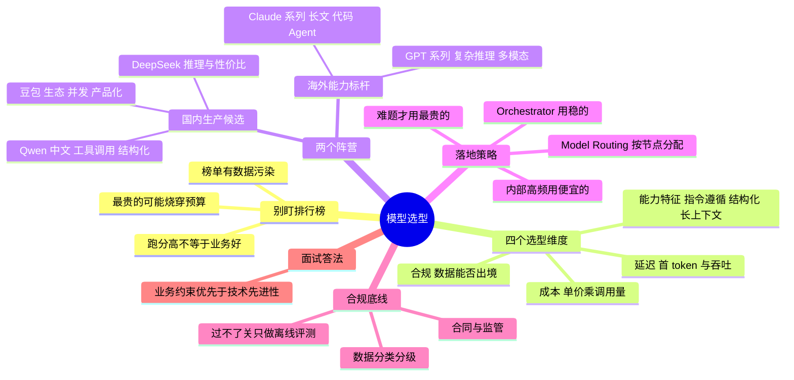

## 🔥 快速背诵

选型不看排行榜，看四个维度跟业务是否匹配：合规、成本、延迟、能力特征。合规常常是一票否决，国内 ToB 项目数据出境就是死线，海外模型再强也进不了核心链路。成本要算单价乘调用量，Agent 一次请求可能触发十次调用，单价差十倍就是成本差百倍。落地也不该死磕一个模型，用 Model Routing，格式严格的节点用结构化输出稳的，高频循环用性价比高的，最难的问题才给最贵的。

## 🧠 导图

---

# 📖 背诵稿

> 五段，按顺序背。

### ① 为什么不能盯排行榜

**跑分高不代表在你的业务里表现好，这是新人最常踩的坑。**

三个具体理由：一，海外标杆模型在多模态、代码、复杂推理上通常很强，但 API 成本、数据出境、网络访问、企业合同支持都可能卡住国内 ToB 项目，压根上不了线；二，有些模型榜单漂亮，但在你的财报格式、行业黑话、内部接口调用上不一定稳定——**Benchmark 测的是通用能力，你的业务是长尾场景**（这跟 **21** 的数据污染是一体两面）；三，如果系统有大量高频的 Agent 内部循环调用，硬上最贵的标杆模型，**一个月就能把项目预算烧穿**。

### ② 选型的四个维度

**合规、成本、延迟、能力特征——四条线一起拉。**

**合规**是能不能上线的问题（一票否决）：国内 ToB 项目数据出境是死线，必须先看数据分类分级、客户合同、监管要求、企业审批流程。**成本**要算「单价 × 调用量」，而不是只看单价——Agent 系统一次用户请求可能触发 10 次模型调用，单价差 10 倍就是成本差 100 倍。**延迟**要看首 token 延迟（用户感知）和吞吐（并发承载），流式输出场景首 token 尤其关键。**能力特征**不是「综合分」，而是具体能力：结构化输出（JSON 稳定性）、Tool Use 准确率、长上下文指令遵循、中文语感。**「稳定」往往比「榜单第一」更重要**——Orchestrator 节点要频繁调用内部 API，JSON、函数参数、字段名一个都不能乱。

### ③ 两个阵营怎么划分

**国内生产候选 + 海外能力标杆。**

**国内生产候选（落地优先看）**：**DeepSeek 系列**推理和性价比突出，适合高频分析、代码辅助、长链路推理这类成本敏感节点（V 系列偏通用生成，R 系列偏推理）；**Qwen 系列**中文语境、工具调用、结构化输出、长上下文适合企业级应用，尤其适合主调度、文档理解、RAG 汇总这类要稳定性的节点；**豆包 / 火山引擎系列**工程生态、并发能力、中文产品化体验是优势，适合高频文本处理、客服、内容生成、批量分类这类吞吐优先场景。

**海外能力标杆（评测与非敏感兜底）**：**GPT-5.5 / o 系列**适合作为复杂推理、代码、多模态的标杆；**Claude Sonnet / Opus 系列**长文本、代码、Agent 调度很强，常被用来做评测基准或兜底。但两者在国内企业项目里都要先过合规、成本、可用性三关。**注意别把具体版本号当固定答案**——2026 年模型迭代极快，讲清选型逻辑比背版本号重要得多。

### ④ 落地：Model Routing

**不死磕一个模型，按节点特性分配。**

我参与的项目是企业级多智能体 RAG 问答系统，链路是：解析长篇企业财报 → 多个 Agent 规划拆解任务 → 频繁调用内部数据库与搜索引擎 → 汇总生成中文报告。基于这个场景我们做了 **Model Routing**：**主调度（Orchestrator）和格式要求严格的节点**优先选结构化输出稳定、Tool Use 准确率高、长上下文指令遵循好的模型——Agent 要频繁调内部 API，字段名不能乱；**逻辑推理与高频数据清洗节点**优先选推理能力和 token 单价更均衡的模型——财报归纳、比对、异常解释很多是 Agent 内部中间步骤，不是给用户看的最终回答，这类节点最怕成本失控，要用便宜且够用的；**特别难的问题**才路由给能力更强但更贵的模型。这套「按任务特性混用多模型」的做法是 2026 年 AI 应用里很常见的工程形态，也天然接在网关（**工具调用线 16**）上。

### ⑤ 合规底线（最加分的收尾）

**业务约束优先于技术先进性。**

国内 ToB 项目里，海外模型不是绝对不能用，但必须先过数据分类分级、客户合同、监管要求、企业审批这几关。**只要过不了，再强的模型也只能做离线评测，不能进核心生产链路。** 一句话总结：敏感商业数据尽量留在合规可控的链路里，这是架构层面的事，不是选型层面的偏好。

---

# 🔑 记忆锚

| 记什么 | 内容 | 口诀 |
|---|---|---|
| **4** 个维度 | 合规 / 成本 / 延迟 / 能力特征 | 「能不能上·贵不贵·快不快·干得好不好」 |
| **2** 个阵营 | 国内生产候选 / 海外能力标杆 | 「上线的 vs 参照的」 |
| **3** 家国内 | DeepSeek 性价比、Qwen 中文与工具、豆包生态并发 | 「深·千·豆」 |
| **1** 个策略 | Model Routing 按节点分配 | 「调度用稳的，内部用便宜的，难题用贵的」 |
| **1** 条死线 | 国内 ToB 数据出境 | 「过不了关只做离线评测」 |

> **卡壳急救**：开口先否掉「看排行榜」，报四个维度，再讲两个阵营，最后用 Model Routing + 合规死线收尾。

---

# 🎯 追问速查

| 面试官问 | 你答 |
|---|---|
| 为什么不选排行榜第一？ | 跑分测通用能力且可能被污染，你的业务是长尾；成本和合规可能直接否掉 |
| 选型的四个维度？ | 合规（能否上线）、成本（单价×调用量）、延迟（首 token/吞吐）、能力特征（结构化/Tool Use/长上下文） |
| 国内项目能用 GPT / Claude 吗？ | 非敏感场景可做兜底或离线评测；核心链路要过数据分类分级、合同、监管、审批 |
| DeepSeek 的优势？ | 推理 + 性价比，适合高频分析、代码辅助、长链路推理 |
| Qwen 的优势？ | 中文语境、工具调用、结构化输出、长上下文，适合主调度与 RAG 汇总 |
| 豆包的优势？ | 工程生态、并发能力、中文产品化，适合客服/内容生成/批量分类 |
| 什么是 Model Routing？ | 按节点特性分配模型：调度用稳定的、内部高频用便宜的、难题用贵的 |
| 为什么 Agent 项目更看重单价？ | 一次请求触发多次调用，单价差被调用量放大 |
| 怎么设计降级？ | 主模型超时/失败切备用模型，关键节点保留双供应商 |
| 选型怎么验证？ | 在 50~200 条业务测试集上跑通过率 + 成本/延迟实测，别只看榜单 |

---

# 🔗 串联

- 上游 → **21（Benchmark 定区间，业务集定能不能用）**、**15（量化与选型：同一模型的部署形态）**
- 平级 → 工具调用线 **16（LLM 网关：Model Routing 的实现位置）**、**06（各模型价格差异的本质是训练成本）**
- 下游 → 面试综合题：「你项目里 AI 部分怎么设计的」
- 收尾金句：**没有最强模型，只有最合适的模型**

---

# 📚 细节（背完再点开）

> [!note]- 选型评分表（可以现场画）
> | 维度 | 权重 | 怎么验 |
> |---|---|---|
> | 合规 | 一票否决 | 数据分类分级、合同、监管、审批 |
> | 结构化稳定性 | 高（Orchestrator 必备） | 100 次调用统计 JSON 解析成功率 |
> | Tool Use 准确率 | 高（Agent 必备） | 函数名/参数正确率 |
> | 成本 | 高 | 单价 × 预估 token × 调用次数 |
> | 首 token 延迟 | 中 | 实测 p50/p95 |
> | 中文语感 | 中 | 人工盲评 |

> [!note]- 为什么版本号不要背死
> 2026 年模型迭代以季度计，背「GPT-5.5 / Claude Sonnet 4.6」这种具体版本很容易过期甚至记错。稳妥说法：「海外第一梯队（GPT / Claude 当前版本）」「国内第一梯队（DeepSeek / Qwen / 豆包）」，重点讲它们的**能力特征与约束**。

> [!note]- 一个真实感的回答结构
> ① 业务是什么（多智能体 RAG，链路四步）→ ② 约束是什么（合规死线、成本敏感、调度要稳）→ ③ 怎么分层（Model Routing 三类节点）→ ④ 怎么验证（业务测试集 + 成本延迟实测）→ ⑤ 兜底（超时降级、双供应商）。

---

# 🎴 自测

> [!question]- Q1 选型四个维度？
> 合规、成本、延迟、能力特征。合规常常是一票否决项。

> [!question]- Q2 国内三家各自主打什么？
> DeepSeek 推理与性价比、Qwen 中文与工具调用和结构化、豆包生态与并发产品化。

> [!question]- Q3 什么是 Model Routing？
> 按节点特性分配模型：调度/格式严节点用稳定模型，内部高频节点用便宜模型，难题用最强模型。

> [!question]- Q4 合规为什么是死线？
> 数据出境受监管，过不了数据分类分级、合同、审批就进不了核心链路，只能离线评测。

> [!question]- Q5 怎么验证选型？
> 业务测试集（50~200 条）跑通过率 + 成本与延迟实测，而不是看榜单。
