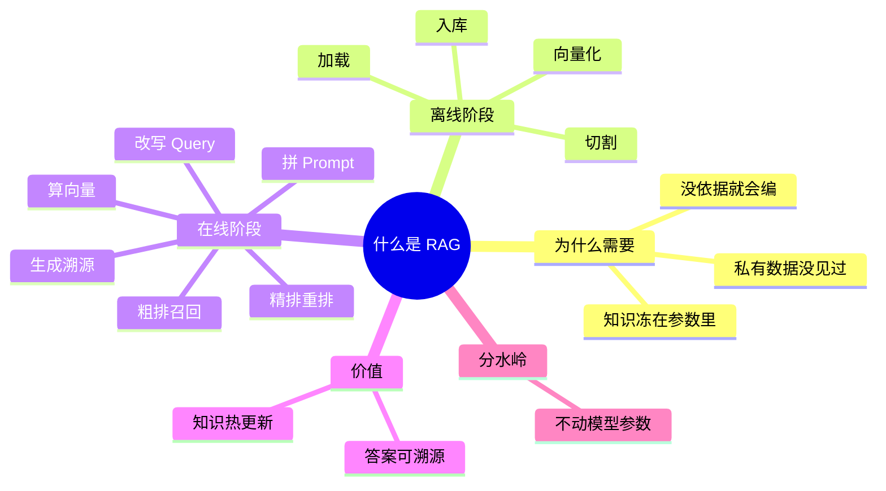

## 🔥 快速背诵

RAG 是让模型带着资料答题：知识不放参数里，放外部库，答题前先查再答。整个流程两段式，离线建库、在线检索生成。离线做加载、切割、向量化、入库；在线做改写、向量化、召回、精排、拼 Prompt、生成溯源。粗排比的是向量距离，精排是把问题和候选放一起读一遍。

> **一句话**：RAG = 让模型带着资料答题。知识不放参数里，放外部库，答题前先查、查完再答。两段式：**离线建库，在线检索生成**。

## 🧠 导图



---

# 📖 背诵稿

> 五段，按顺序背。每段**第一句是主线**，后面是血肉——先只背第一句，再往里加。

### ① 它治什么病

**RAG 治的是「模型知识被冻住了」这个病：训练一结束，世界再变它也不知道，你们公司内部的文档它更没见过。**

没依据的时候它不会说「我不知道」，它会顺着最像的往下编，这就是幻觉。所以问题的根不是模型笨，是它手里没资料。RAG 的思路很朴素——既然记不住，那就允许它开卷。

### ② 为什么不用微调顶

**微调是把知识焊进参数，RAG 是知识留在外面、用的时候递进去，区别就一个字：动不动参数。**

微调能改行为、改风格、改说话语气，但今天改一次政策你就得重训一次，成本扛不住，而且答错了你不知道是哪条知识在坑你。RAG 反过来，往库里加一份文档就生效，答案还能指回原文。

### ③ 离线阶段

**离线只做一次：加载 → 切割 → 向量化 → 入库。**

原始文档各种格式先读进来，然后切成一小块一小块，每块单独算成一个向量，最后连向量带原文一起塞进向量库。这一步的目标只有一个：把知识整理成「以后能被快速找到」的样子。

### ④ 在线阶段

**在线每次提问都跑一遍：改写问题 → 算向量 → 粗排召回 → 精排 → 拼 Prompt → 生成带溯源。**

用户的话往往不能直接拿去搜，先改写成一句完整可检索的话；然后算向量去库里捞 Top-K；捞回来的里面必然有噪音，用 Cross-Encoder 重排一遍只留三五条；最后把这几条编号拼进 Prompt，要求模型只照着资料说，答完标出来源。

### ⑤ 分水岭

**粗排和精排不是一回事：粗排比的是两个向量远不远，精排是把问题和候选放一起读一遍。**

粗排快是因为它能提前算好所有文档的向量，查的时候只算一次；但它没见过「问题」和「文档」同时出现，所以只能判断像不像，判断不了准不准。精排慢是因为每一对都要单独过一次模型，所以只能对几十条做。**先宽后严，是这一层的全部逻辑。**

---

# 🔑 记忆锚

| 记什么 | 内容 | 口诀 |
|---|---|---|
| **2** 个阶段 | 离线建库 / 在线检索生成 | 「建·查」 |
| **4** 步离线 | 加载 / 切割 / 向量化 / 入库 | 「载切转入」 |
| **6** 步在线 | 改写 / 向量化 / 召回 / 精排 / 拼 Prompt / 生成溯源 | 「改算捞筛拼答」 |
| **1** 条分水岭 | 改不改模型参数 | 「不碰参数」 |

> **卡壳急救**：想不起在线有几步，就从「用户敲下回车之后发生了什么」顺着时间线走一遍——他说的话不像人话要先翻译，翻译完才能去查，查完要挑，挑完要喂，喂完要它交代出处。

---

# 🎯 追问速查

| 面试官问 | 你答 |
|---|---|
| 和微调什么区别？ | **改不改参数**。微调烧进权重，RAG 推理时现查；前者擅长「怎么说」，后者擅长「说什么」 |
| 为什么不整篇文档入库？ | 两个原因：向量模型有输入长度上限；整篇压成一个向量，细节会被平均掉，定位不到具体那句话 |
| 为什么模型读了资料就能答？ | 靠的是**阅读理解**，不是记忆。它不需要「知道」，只需要「读懂」 |
| 粗排精排区别？ | **Bi-encoder 各自编码比距离**（快、可预计算）vs **Cross-encoder 拼一起读**（准、只能小批量） |
| 在线向量化能用别的模型吗？ | **不能**。换模型等于换坐标系，维度都可能对不上，整个库必须重建 |
| RAG 最核心的价值？ | 知识**热更新**（加文档即生效）+ 答案**可溯源**（指回原 chunk） |

---

# 🔗 串联

- 讲切割 → 后面必然追问 **语义被切断**（05），再往后是**父子切割**
- 讲向量化 → 展开是 **Embedding 三代算法**（07）和**向量库选型**（08）
- 讲粗排精排 → 就是 **Bi-encoder / Cross-encoder** 的取舍，也是**混合检索**的入口（11）
- 讲在线流程 → 每一步都能单独出一道题（12 改写 / 13 多路召回 / 14 四层优化）
- 收尾金句：**RAG 解决知道，Agent 解决做到**

---

# 📚 细节（背完再点开）

> [!note]- 离线阶段为什么可以「只做一次」
> 因为这一阶段的产出是**可复用的索引**，不是每次请求的中间结果。文档不变，索引就一直有效。
> 代价是知识会「过期」——所以才有第 19 篇的动态更新：文档一变，对应的 chunk 就得重做。真正需要长期维护的，恰恰是这一层。

> [!note]- 在线耗时分布（报得出来很加分）
> Query 改写几十毫秒 → 向量检索几十毫秒 → Rerank 几百毫秒 → Prompt 组装可忽略 → 生成 1~10 秒（看输出长度）。
>
> 两个常见优化：**高频 Query 缓存检索结果**；**向量检索与 BM25 并行**，延迟从相加变成取最大值。

> [!note]- Prompt 模板为什么每句都有讲究
> ```
> 只根据【参考资料】回答，不得引入资料外的知识   # 压住它「想帮忙」的本能
> 资料中没有就说「根据现有资料无法回答」        # 给它一个合法的逃生出口
> 回答时标注来源编号                            # 逼它自检 + 方便溯源
> ```
> 第一句治「超发挥」，第二句治「硬编」，第三句治「说不清」。三句话对应三类失败。

---

# 🎴 自测（遮住上面，先自己说）

> [!question]- Q1 一句话解释 RAG
> 把知识放在模型外面，答题前先检索、再生成。核心是**不碰参数**。

> [!question]- Q2 离线四步？在线六步？
> 载切转入 / 改算捞筛拼答。

> [!question]- Q3 为什么必须切块？
> 长度限制 + 整篇压缩会让细节被平均掉。

> [!question]- Q4 粗排精排的本质区别？
> Bi-encoder 各自编码（可预计算、快、只看像不像）vs Cross-encoder 拼一起读（准、慢、只能对几十条）。

> [!question]- Q5 换 Embedding 模型会怎样？
> 向量空间整个变了，新旧不兼容，必须全量重建知识库。

> [!question]- Q6 最容易被追问倒的点？
> 以为「检索 = 搜索 API」漏掉生成，或者把 RAG 和微调混为一谈。
