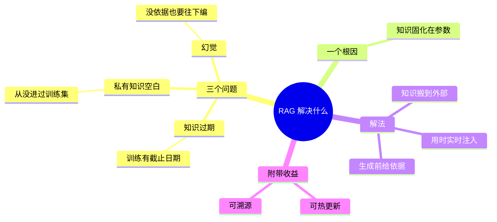

## 🔥 快速背诵

RAG 解决三个问题：知识会过期、私有数据没见过、没有依据时会编。三者同根，根因是知识被焊死在参数里。解法是不动参数，改从外部供料，存到外部库，用的时候实时检索注入 Prompt。顺带还能做到知识热更新和答案溯源。

> **一句话**：三个问题——**知识过期、私有知识空白、幻觉**。三者同根：知识被焊死在参数里。RAG 不动参数，改从外部供料。

## 🧠 导图

---

# 📖 背诵稿

### ① 三个问题一次说完

**RAG 解决的是三件事：知识会过期、私有数据它没见过、没依据的时候它会瞎编。**

前两个说的是「它不知道」，第三个说的是「它不知道自己不知道」。三件事听起来不一样，但往下挖一层，根子是同一个。

### ② 根因只有一句

**根因就一句：知识被固化在模型参数里了，训练一结束就再也进不去新东西。**

参数是预训练时从海量语料里压出来的，压完就定了。世界往前走，参数不跟着走。所以不是它不努力，是这条通路本来就不通。

### ③ 幻觉不是独立 bug

**幻觉不是单独的一个 bug，它是知识不够时的应急表现。**

模型的机制是预测下一个词，它会一直往下接，没有「不确定就停」的开关。参数里没有的东西，它就用手边最像的碎片拼一个听起来合理的出来，而且语气很自信。所以治幻觉不能只治幻觉，要治「没依据」这件事。

> 这句是这一篇最值钱的地方。面试官问「RAG 是不是专门治幻觉的」，标准答案是：幻觉是知识缺失的副产品，RAG 治的是它的上游。

### ④ 解法

**解法是把知识搬出参数：存到外部库，用的时候实时检索、注入 Prompt。**

知识整理成文档、切块、向量化入库；提问时先检索最相关的几段，和问题一起递进去，让模型基于这些材料作答，而不是靠记忆作答。三个问题同时被覆盖：新政策入库即生效、私有文档模型能「看到」、有了依据就不用编。

### ⑤ 附带收益

**顺带还给了两个东西：知识可以热更新，答案可以溯源。**

更新知识不用重训，加文档就行；每条答案能指回具体 chunk，用户自己就能核实，出错了也知道是哪条知识在坑。这两点在企业场景里比「更聪明」有用得多。

---

# 🔑 记忆锚

| 记什么 | 内容 | 口诀 |
|---|---|---|
| **3** 个问题 | 过期 / 空白 / 幻觉 | 「旧·无·编」 |
| **1** 个根因 | 知识固化在参数 | 「焊死了」 |
| **2** 个收益 | 热更新 / 可溯源 | 「能换·能查」 |

> **卡壳急救**：三个问题其实是递进的——**「旧了」→「压根没有」→「没有还要答」**。第三层是前两层撞出来的结果，记住这条链就不会漏。

---

# 🎯 追问速查

| 面试官问 | 你答 |
|---|---|
| 幻觉是 RAG 专门治的吗？ | **不是**。幻觉是知识缺失的副产品，RAG 治的是根源。治标要另外加 Prompt 约束和检索门控（见 17） |
| 那重新训练一遍不行吗？ | 成本千万美元级、周期以月计，而且业务数据每周变，**追不上** |
| 微调注知识行不行？ | 能注一点，但更新要重训、**不可溯源**、容易灾难性遗忘 |
| 私有知识的痛点具体是什么？ | 客服手册、合同模板、内部规范这类**永远不会出现在公开语料**里，问它只能得到编造 |
| 为什么不干脆换个大模型？ | 换模型解决的是「能力」，解决不了「它没有你家数据」这件事 |
| 一句话总结三个问题？ | **旧·无·编**，根源都是「焊死了」 |

---

# 🔗 串联

- 往前接 **01**：三个问题是 RAG 存在的理由，工作流程是它的解法
- 往旁边接 **03**：既然根因是参数，那「改参数」和「不改参数」就成了两条路 → RAG vs 微调
- 往后接 **17**：幻觉有两个来源（检索没找到 / 找到但超发挥），这里只讲了第一个
- 往后接 **19**：知识热更新听起来很美，工程上怎么落地是另一道题
- 金句：**幻觉不是病，是症状；病在知识没有入口**

---

# 📚 细节（背完再点开）

> [!note]- 为什么「重新训练」这条路走不通
> | 维度 | 重新训练 | 微调 | RAG |
> |---|---|---|---|
> | 成本 | 千万美元级 | 中高，需 GPU + 标注数据 | 低，向量库即可 |
> | 周期 | 月级 | 小时到天 | 分钟级（入库即生效） |
> | 可溯源 | 否 | 否 | 是 |
> | 知识更新频率上限 | 极低 | 低 | 随时 |
>
> 关键不是「哪个效果更好」，而是**知识更新的频率根本不匹配**。

> [!note]- 企业落地为什么首选 RAG
> 真实痛点往往不是「模型不够聪明」，而是三件事同时存在：数据天天变、数据不能出境、答错了要能追责。
> 前两条卡住了「上云 + 重训」，第三条卡住了微调——所以剩下的解只有 RAG。

> [!note]- 一句话反例（面试时很好用）
> 知识库写的是「7 天无理由退款」，某次检索没召回这段，模型用自己的常识答了「30 天」。
> 用户照做 → 退款失败 → 投诉。这就是检索层幻觉造成的**真实业务损失**，不是学术问题。

---

# 🎴 自测

> [!question]- Q1 三个问题是什么？
> 知识过期 / 私有知识空白 / 幻觉——**旧·无·编**。

> [!question]- Q2 共同根因？
> 知识固化在模型参数里，训练后不再更新。

> [!question]- Q3 幻觉是独立问题吗？
> 不是，是知识缺失的副产品，是「没有依据还要接着往下生成」的应急表现。

> [!question]- Q4 为什么重训不现实？
> 成本 + 周期 + 更新频率三者都不匹配，业务数据每周变，追不上。

> [!question]- Q5 附带两个收益？
> 热更新、可溯源。

> [!question]- Q6 最容易被追问的点？
> 「RAG 是不是专门治幻觉」——必须答：治的是上游，幻觉只是症状。
