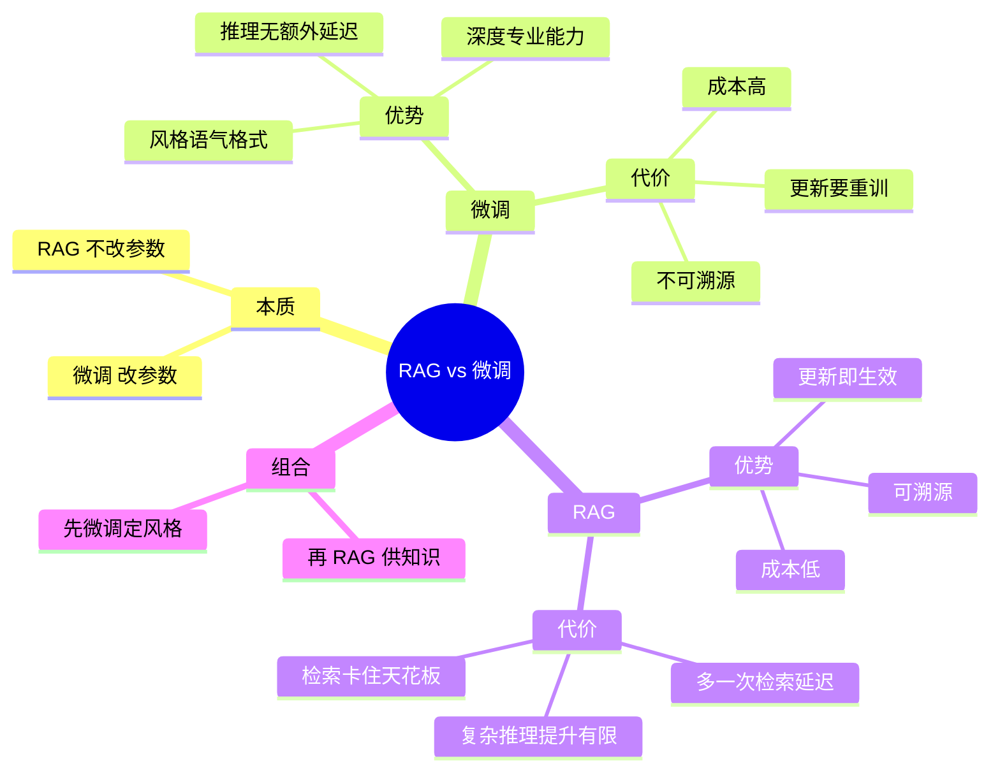

## 🔥 快速背诵

微调和 RAG 的区别只有一条：动没动参数。微调改参数，管怎么说；RAG 不动参数，管说什么。微调能把模型变成另一种模型，代价是改一次要重来；RAG 随时换料，卡在只能答检索到的东西。两者不是二选一，常见组合是先微调学怎么说，再用 RAG 给该说的话。判断看知识变得勤不勤、答错要不要能追责。

> **一句话**：微调改参数，RAG 不动参数。**微调管「怎么说」，RAG 管「说什么」**——不是二选一，是常见组合。

## 🧠 导图

---

# 📖 背诵稿

### ① 一句话切开

**这俩不是一代换一代的关系，区别只有一条：动没动模型参数。**

微调是拿你的数据继续训，把新东西写进权重；RAG 是权重一个字不改，推理的时候把资料塞进上下文。判断一道题该用哪个，先问「我要改的是它的知识，还是它的行为」。

### ② 微调强在哪、贵在哪

**微调强在「变成另一种模型」，贵在「改一次要重来一遍」。**

它能定制输出格式、行业语气、专业术语，推理时也没有额外开销，因为知识已经在里面了。但代价三样：要 GPU 和标注数据；业务一变就得重训，几小时到几天；最要命的是**不透明**——回答是从参数里挤出来的，你不知道它凭哪条知识说的，错了也没法定位。

### ③ RAG 强在哪、卡在哪

**RAG 强在「随时换料」，卡在「只能答检索到的东西」。**

加文档就生效，答案能指回 chunk，小团队用开源模型加个向量库就能跑。但它有两个硬伤：多一次检索，延迟涨几百毫秒到一秒；以及**天花板在检索层**——没召回的内容，模型再强也变不出来。

> 这里有个很多人答错的地方：效果不好第一反应是换更贵的模型。方向错了，**RAG 调优的主战场是检索，不是生成**。

### ④ 组合才是标准答案

**工程上最常见的做法是两个一起用：先微调让它学会怎么说话，再用 RAG 给它该说的话。**

微调负责格式、语气、行业黑话，RAG 负责具体事实。这样既不用为了更新一条政策重训模型，也不用指望一个通用模型能说出你家产品的口径。

### ⑤ 收尾

**所以判断标准很简单：知识变得勤不勤、答错了要不要能追责——要，就 RAG；要改的是风格和能力——那就微调。**

---

# 🔑 记忆锚

| 记什么 | 内容 | 口诀 |
|---|---|---|
| **1** 条本质 | 改不改参数 | 「动不动」 |
| 微调 **3** 代价 | 贵 / 更新慢 / 不可溯源 | 「贵·慢·黑」 |
| RAG **3** 代价 | 多一次延迟 / 检索封顶 / 推理弱 | 「慢·顶·浅」 |
| 组合口诀 | 微调管怎么说，RAG 管说什么 | 「说·什」 |

---

# 🎯 追问速查

| 面试官问 | 你答 |
|---|---|
| 一句话区别？ | **改不改参数**：微调烧进权重，RAG 推理时现查 |
| 知识每周都变选哪个？ | RAG。微调的重训频率根本跟不上业务节奏 |
| 要让模型说自家口吻？ | 微调。这是「行为」问题，不是「知识」问题 |
| RAG 效果差，换更强模型？ | **错方向**。天花板在检索层，该动的是 Chunking / Embedding / 多路召回 / Rerank |
| 微调能溯源吗？ | 不能。答案来自参数，你不知道它用了哪条知识 |
| 两个能一起用吗？ | 能，而且是**生产常态**：微调定风格，RAG 供知识 |

---

# 🔗 串联

- 往前接 **02**：三个问题的根因是「参数焊死」，微调只是换一种焊法
- 往后接 **04~14**：整条检索链路，都是「RAG 的代价怎么补」
- 往后接 **20**：落地最难的三块，本质都是在补 RAG 的短板
- 收尾金句：**微调改的是人设，RAG 改的是口供**

---

# 📚 细节（背完再点开）

> [!note]- 完整对比表（能背下来最好）
> | 维度 | 微调 | RAG |
> |---|---|---|
> | 知识更新 | 需重训，成本高 | 更新知识库即可，实时生效 |
> | 推理延迟 | 低，无额外步骤 | 较高，多一次检索 |
> | 实现成本 | 高，GPU + 标注数据 | 低，向量库 + Embedding |
> | 答案可溯源 | 不支持 | 支持，可指到 chunk |
> | 适合场景 | 定制风格、深度专业能力 | 私有问答、动态数据 |
> | 知识上限 | 受训练数据质量与规模限制 | 受检索质量与 context 长度限制 |

> [!note]- 微调的两个「隐性坑」
> 1. **灾难性遗忘**：新数据训过头，旧能力会掉。要靠数据配比和 LoRA 之类的轻量方案控制。
> 2. **以为它「懂」了**：它学到的其实是训练数据里的**模式**，不一定是你想让它记住的**事实**。记错了你也看不出来。

> [!note]- 为什么「RAG 天花板在检索层」值得反复说
> 生成层做的是「复述 + 整理」，它没有能力凭空造出没给它的知识。所以：
> - 检索召回对了 → 生成差一点也能救
> - 检索召回错了 → 生成再强也是精致的胡说
>
> 这就是为什么调优顺序永远是：**先检索，后生成**。

---

# 🎴 自测

> [!question]- Q1 本质区别一句话？
> 改不改参数。

> [!question]- Q2 微调三个代价？
> 贵、更新慢、不可溯源——贵·慢·黑。

> [!question]- Q3 RAG 三个代价？
> 多一次延迟、检索封顶、复杂推理提升有限。

> [!question]- Q4 「怎么说」和「说什么」分别归谁？
> 微调管怎么说，RAG 管说什么。

> [!question]- Q5 效果不好先换模型，对不对？
> 不对。先查检索层，那才是天花板。

> [!question]- Q6 什么场景必须微调？
> 强格式约束、行业语气、需要深度领域推理——这些检索给不了。
