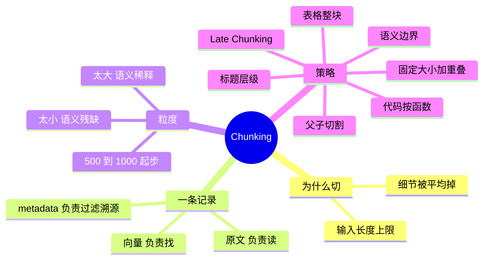

## 🔥 快速背诵

文档不能整篇入库，要先切块。一条记录存三样：向量、原文、metadata，各干各的活。粒度是两头堵的取舍，切大了语义稀释，切小了语义残缺，500 到 1000 token 起步。策略按文档类型选，固定大小加重叠兜底，结构化文档走标题语义边界，要求高就上父子切割。

> **一句话**：文档不能整篇入库，必须先切块。一条记录 = **向量 + 原文 + metadata**。粒度没有银弹，500~1000 token 起步，**按文档类型选策略**。

## 🧠 导图

---

# 📖 背诵稿

### ① 为什么不能整篇存

**整篇存有两个死穴：模型吃不下，细节被平均掉。**

向量模型有输入长度上限，几千字的文档塞不进去。更关键的是第二条——整篇压成一个向量，「退款政策」和「配送时效」混在同一个坐标里，你问退款，它给你一篇笼统的文档，定位不到那句话。

### ② 一条记录装三样

**一条 chunk 记录存三样：向量、原文、metadata。三样各干各的活。**

向量是一串浮点数，模型看不懂，只有检索系统用它来找；原文是纯文字，检索命中了原封不动递进去给模型读；metadata 记来源文件、页码、章节，用来过滤（只搜客服部门）和溯源（这句出自第几页第几行）。

> **向量负责「找到」，原文负责「阅读」**，缺一个系统就转不起来。

### ③ 粒度怎么定

**粒度是个两头堵的取舍：切大了语义稀释，切小了语义残缺。**

chunk 太大，一个向量里混着好几个话题，召回一堆半相关的；chunk 太小，一句话说一半，模型拿到也读不懂。实践起点是 **500~1000 token**，但比数字更重要的是**顺着文档本身的结构走**。

### ④ 六种策略

**基础靠固定大小加重叠，质量靠语义边界，专业内容靠专项处理，要求高就上父子切割。**

- **固定大小 + 重叠**：最保底。overlap 的作用是让跨边界的那句话至少完整地出现在某一块里。
- **语义边界**：优先按段落、句子切，太长了再降级到标点。有标题结构的 Markdown/HTML 直接按标题层级切，还自带结构 metadata。
- **代码按函数/类切**：用 AST 解析边界。从函数中间切断，两个半截都没意义。
- **表格整块保留**：转 Markdown 存。每一行都依赖表头才有意义，「2 小时」单独看什么都不是。
- **父子切割**：小块检索、大块返回。存储翻倍，但精度和上下文能同时拿到。
- **Late Chunking**：先整篇编码、再按边界聚合 token 向量，让每个 chunk 的向量天然带着全文语境。

### ⑤ 实际怎么答

**我实际的做法是分层组合：固定大小加重叠兜底，结构化文档走语义/标题边界，高质量场景再叠父子切割。**

---

# 🔑 记忆锚

| 记什么 | 内容 | 口诀 |
|---|---|---|
| **2** 个切割理由 | 长度上限 / 细节被平均 | 「塞不下·拎不清」 |
| **3** 件套 | 向量 / 原文 / metadata | 「找·读·认」 |
| **1** 个起点 | 500~1000 token + 10~20% 重叠 | 「五百到一千」 |
| **6** 种策略 | 固定 / 语义 / 标题 / 代码 / 表格 / 父子 | 「固语标代表父」 |

> **卡壳急救**：想不起策略，就从「这份文档长什么样」出发——纯文本、有标题、有代码、有表格、要求特别高，五种长相各对应一种切法。

---

# 🎯 追问速查

| 面试官问 | 你答 |
|---|---|
| overlap 设多少？ | chunk_size 的 **10%~20%**。太小保护不到，太大存储涨、重复内容干扰模型阅读 |
| 加了 overlap 就够了吗？ | 不够。它只保证文字不丢，**解决不了「一个完整语义被拆散」**（见 05）|
| 为什么向量和原文都要存？ | 向量用于检索，模型看不懂向量；原文用于生成，没有向量又没法检索 |
| 代码怎么切？ | 按**函数/类**切，用 AST 定位边界。一个函数是最小语义完整单元 |
| 表格怎么切？ | **整块转 Markdown 保留**。按行切会丢掉表头，值就没有意义了 |
| 父子切割代价？ | 存储翻倍 + 索引构建更复杂，换来检索精度和上下文完整两全 |

---

# 🔗 串联

- 直接接 **05**：这一篇讲「怎么切」，下一篇讲「切坏了怎么办」
- 接 **06/07**：chunk 定下来之后才好谈 Embedding 选型和算法
- 接 **14**：父子切割在四层优化里属于「索引层」，是最稳的一层
- 接 **20**：文档预处理 + 切割是落地最难的第一块

---

# 📚 细节（背完再点开）

> [!note]- 六种策略对照表
> | 策略 | 适用 | 优点 | 缺点 |
> |---|---|---|---|
> | 固定 + 重叠 | 纯文本、无结构 | 简单、大小可控 | 可能切断语义 |
> | 语义边界 | 段落分明 | 语义完整 | 大小不均 |
> | 标题层级 | MD / HTML | 天然独立、带结构 metadata | 依赖有清晰标题 |
> | 代码按函数 | 代码文件 | 保留逻辑完整性 | 需 AST，限定语言 |
> | 父子切割 | 通用、求质量 | 精度与上下文两全 | 存储翻倍 |
> | Late Chunking | 通用 | 向量带全文语境 | 需长上下文 Embedding 模型 |

> [!note]- Late Chunking 到底「Late」在哪
> 传统是「先切块 → 每块单独编码」，块与块之间的上下文在编码阶段就断了。
> Late Chunking 反过来：**先整篇过一次长上下文 Embedding 模型**，拿到每个 token 的向量（这些 token 在注意力里已经互相看过了），**再按 chunk 边界做 mean pooling**。
> 好处是代词、背景、对比关系都留在向量里；代价是要模型支持长输入（如 8192 token），且要保留 token 级中间结果。

> [!note]- 一个数字类的面试加分点
> 一篇 5000 字文档按 500 字切 = 10 条记录；100 篇 = 1000 条。
> 这就是为什么「文档数」和「向量条数」不是一回事——**算存储和成本时永远按 chunk 数算**。

---

# 🎴 自测

> [!question]- Q1 为什么不能整篇入库？
> 长度上限 + 细节被平均掉。

> [!question]- Q2 一条记录三件套？
> 向量（找）、原文（读）、metadata（过滤 + 溯源）。

> [!question]- Q3 粒度起点？
> 500~1000 token，重叠 10~20%。

> [!question]- Q4 代码和表格怎么处理？
> 代码按函数/类（AST），表格整块转 Markdown。

> [!question]- Q5 父子切割的核心思路？
> 小块检索保精度，大块返回保上下文，靠 parent_id 关联。

> [!question]- Q6 你的项目实际用什么？
> 固定大小 + 重叠兜底 → 结构化文档走语义/标题边界 → 高质量场景叠父子切割。
