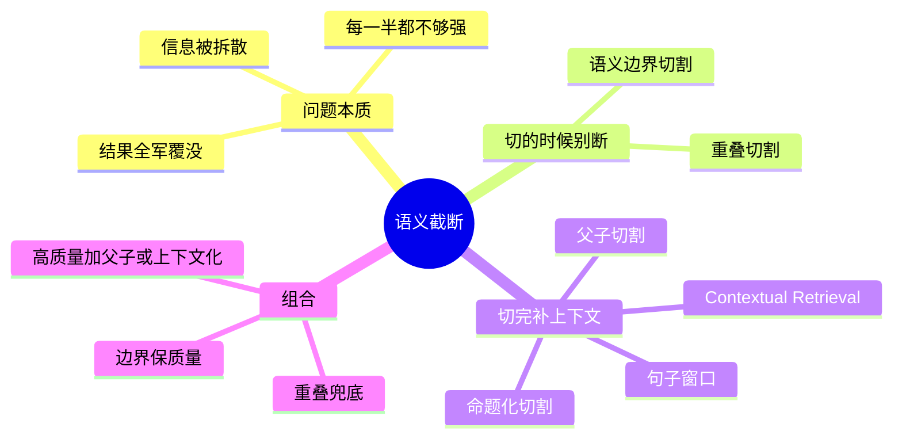

## 🔥 快速背诵

切坏最麻烦的地方不是信息丢了，而是答案被切成两半，两半单独看相关度都不高，于是都没被召回。两个方向补救：切的时候不断，用重叠兜底加语义边界；切完把上下文补回来，检索用小颗粒定位，交给模型时把大上下文还回去。再往上就是父子切割和上下文化重写。

> **一句话**：切坏了不是「信息丢了」，而是**信息被拆成两半、每半都不够强**，两半都召不回来。两个方向救：**切的时候别断**、**切完把上下文补回来**。

## 🧠 导图

---

# 📖 背诵稿

### ① 先看清病

**最坑的情况不是答案丢了，是答案被切成两段，两段单独看相关度都不高，于是两段都没被召回。**

比如「企业用户享有优先客服通道，响应时间是 2 小时，还可申请专属顾问」，边界正好切在「2 小时」后面。前一段没有答案的落点，后一段没有主语。你去搜哪个都不够，结果一条都进不来。

### ② 方向一：切的时候别断

**第一类是预防：重叠兜底，语义边界提高质量。**

重叠是最基础的，overlap 取 10~20%，让跨边界的内容至少完整出现在某一块里。按句子、段落切则更进一步——句子是能独立表达意思的最小单位，从中间切断，前后两半的向量都是扭曲的。

### ③ 方向二：切完补回来

**第二类是补偿：检索的时候只拿小颗粒定位，交给模型的时候把大上下文还回去。**

句子窗口是命中一句、把前后 N 句一起返回；父子切割是同一段内容存两份，小块建索引、大块给模型。两者思路一样——**检索粒度和阅读粒度本来就该分开**。

### ④ 两个「更彻底」的方案

**再往上一层，有从根上动手的两种：一个重写内容，一个补全语境。**

命题化切割让模型把段落拆成一条条自包含的陈述句，每一条单独拿出来都能看懂，语义密度最高，代价是每个 chunk 都要调一次模型。Contextual Retrieval 不动原文，而是在向量化之前，让模型看着整篇文档给每个 chunk 写一两句「这段是在讲什么」，拼在前面一起编码——把 chunk 缺的那层语境补进向量里。

### ⑤ 组合

**工程上不会只用一种：重叠兜底、边界保质量、高质量场景再叠父子切割或上下文化。**

---

# 🔑 记忆锚

| 记什么 | 内容 | 口诀 |
|---|---|---|
| **1** 句本质 | 不是信息丢了，是拆散了 | 「散了两边都不够」 |
| **2** 个方向 | 不断 / 补回来 | 「防·补」 |
| **2+4** 个方案 | 重叠·边界 / 窗口·父子·命题·上下文化 | 「防二补四」 |
| **1** 个原理 | 检索粒度 ≠ 阅读粒度 | 「小找大读」 |

---

# 🎯 追问速查

| 面试官问 | 你答 |
|---|---|
| 加个 overlap 不就完了？ | 不够。overlap 只保证**文字不丢**，管不了「一个完整语义被拆成两半」 |
| 那把 chunk 调大呢？ | 用一个问题换另一个问题：语义变杂，检索精度掉 |
| 句子窗口 vs 父子切割？ | 窗口是**命中后动态扩展**，实现简单；父子是**提前存好关系**，父块大小可控 |
| 命题化切割代价？ | 每个 chunk 都要 LLM 调用，成本高，只用于要求极高的知识库 |
| Contextual Retrieval 贵不贵？ | 用 **Prompt Caching** 把文档部分缓存，成本能降 80~90% |
| 效果数据有吗？ | 原方案实测检索失败率（Top-20 未命中）能降约 **49%**，是目前提升最显著的手段之一 |

---

# 🔗 串联

- 前面是 **04**：切法选错了才会有这篇的问题
- 后面是 **14**：这篇的「父子切割」在四层框架里叫**索引层优化**
- 顺带接 **17**：检索没召回 → 模型硬编 → 幻觉，这条线从这一篇就埋下了
- 金句：**检索要小的，阅读要大的——这是同一件事的两个粒度**

---

# 📚 细节（背完再点开）

> [!note]- 六方案速查表
> | 方案 | 核心思路 | 代价 |
> |---|---|---|
> | 重叠切割 | 相邻块有重叠 | 存储略增 |
> | 语义边界 | 在句/段边界切 | 需 NLP 工具 |
> | 句子窗口 | 细检索 + 扩窗口返回 | 存储大（按句存） |
> | 父子切割 | 小块检索、大块返回 | 存储翻倍 |
> | 命题化切割 | LLM 拆成独立命题 | 调用成本高 |
> | Contextual Retrieval | 编码前补一段语境 | 调用成本（可缓存降本） |

> [!note]- Contextual Retrieval 为什么能降 49%
> 根因：**向量只能编码它「看到」的文字**。一个 chunk 单独编码时，不知道自己在哪篇文档里、讲什么主题，所以「此条款自 2024 年起生效」这句话的向量里没有「企业版客服条款」这层语义。
> 补上那一两句话境之后，向量里就有了主题词，召回自然就对了。
> 数据结构上它还有个额外好处：同一份语境可以同时喂给**向量索引和 BM25 索引**，两路一起改善。

> [!note]- 成本账怎么算（能说出这个很唬人）
> 100 个 chunk 的文档，传统做法要把整篇文档重复处理 100 次。
> 开 Prompt Caching 后：首写入按 1.25 倍计，后续命中按 0.1 倍计 → 文档部分总成本落到原来的一两成。
> 官方参考：8k 文档 + 800 chunk，处理一百万文档 token 大约 1 美元出头。

---

# 🎴 自测

> [!question]- Q1 语义截断的本质问题？
> 不是丢了，是被拆散，每一半都不够强，于是两半都召不回。

> [!question]- Q2 两个方向？
> 切的时候别断（重叠、语义边界）/ 切完补回来（窗口、父子、命题、上下文化）。

> [!question]- Q3 overlap 设多少、为什么不能太大？
> 10~20%。太大存储涨，重复内容还会干扰模型阅读。

> [!question]- Q4 检索粒度和阅读粒度为什么要分开？
> 小的聚焦、召回准；大的完整、模型读得懂。

> [!question]- Q5 Contextual Retrieval 的核心动作？
> 编码前让模型给每个 chunk 写一两句语境，拼上去再向量化。

> [!question]- Q6 最容易被追问倒的点？
> 以为 overlap 是万能解。它只是兜底。
