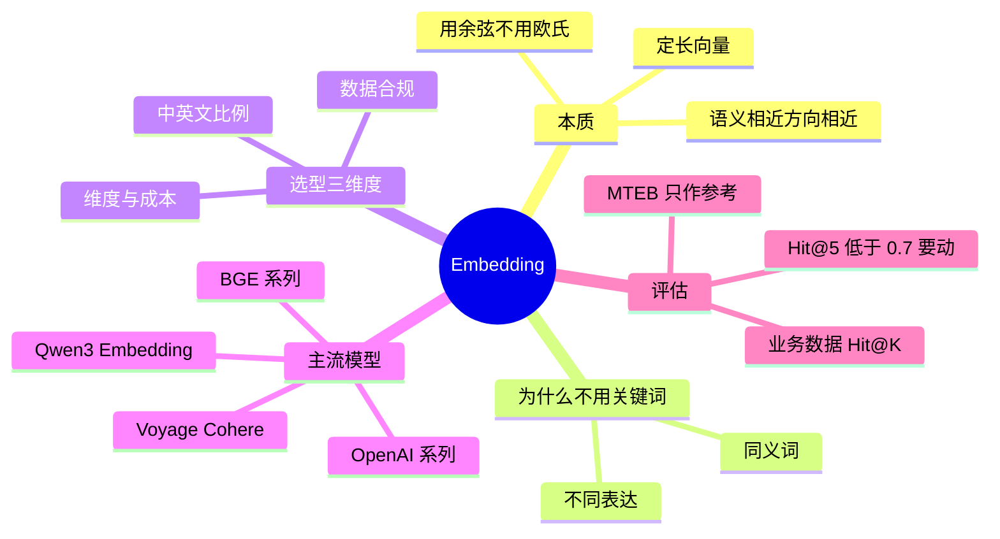

## 🔥 快速背诵

Embedding 是语义压缩，不管输入多长，出来都是定长向量，关键性质是语义相近则向量方向相近，所以比的是余弦不是长度。选型看中文支持、维度成本、输入长度。评估不能只看排行榜，要在自己的业务数据上跑 Hit@K，中文场景一般用 BGE 或 Qwen3-Embedding，Hit@5 到 0.8 以上再定。

> **一句话**：Embedding 是**语义压缩**——把文本压成定长向量，关键性质是**语义相近则向量方向相近**。选型看中文支持、维度、输入长度；评估**只信自己业务数据上的 Hit@K**。

## 🧠 导图

---

# 📖 背诵稿

### ① 它到底在干什么

**Embedding 做的是语义压缩：不管输入十个字还是五百个字，出来都是同一个长度的向量。**

关键不在「变成数字」，而在**语义相近的文本，向量的方向就相近**。这是 RAG 能做语义检索的全部基础——它比的不是字面重没重合，是意思近不近。

### ② 为什么用余弦

**因为要比的是方向，不是长度。**

向量长度会被文本长短、表达强度这些非语义因素影响，直接算直线距离等于把「长短」和「意思」混在一起。余弦只看夹角，把意思从长短里剥出来了——两句话指向同一个方向，箭头多长不重要。

所以「苹果手机怎么截图」和「iPhone 如何截屏」一个字都不重合，余弦能到 0.95；而「苹果手机」和「苹果汁」都有「苹果」，反而离得远。这就是语义检索和关键词匹配的根本差别。

### ③ 怎么选

**三个维度：中文占多少、数据能不能出境、维度扛不扛得住成本。**

中文为主看 BGE 系列和 Qwen3-Embedding；中英混排用 bge-m3（还支持稠密+稀疏+多向量三种模式）；纯英文图省事就 text-embedding-3-small。数据不能出境的，只能走可本地部署的开源模型。

维度是精度和成本的旋钮：越高越准，存储和检索也越贵。百万量级的知识库，1024 维是个合理平衡点。有些模型支持 Matryoshka 降维，可以截断维度来调这个平衡。

### ④ 怎么评估

**别只看排行榜，一定要在自己的业务数据上跑 Hit@K。**

MTEB 用的是通用语料，你做医疗问答、法律咨询，分布差得远，榜一不一定适合你。正确做法是准备几百条「问题 + 正确 chunk」的配对，分别用候选模型检索，看正确答案有没有进前 K 条。

**Hit@5 = 0.8** 的意思是：80% 的问题，答案都出现在前 5 条结果里。低于 0.7 就该考虑换模型或者改 Chunking 了。

### ⑤ 收尾

**所以我的回答是：中文场景用 BGE 或 Qwen3-Embedding，在自己的数据上把 Hit@5 测到 0.8 以上，再定最终选型。**

---

# 🔑 记忆锚

| 记什么 | 内容 | 口诀 |
|---|---|---|
| **1** 条性质 | 语义相近则方向相近 | 「义近向近」 |
| **1** 个度量 | 余弦（比方向不比长度） | 「看夹角」 |
| **3** 个选型维度 | 语种 / 合规 / 维度 | 「语·规·维」 |
| **1** 个阈值 | Hit@5 低于 0.7 要动 | 「七十分线」 |

---

# 🎯 追问速查

| 面试官问 | 你答 |
|---|---|
| 为什么用余弦不用欧氏？ | 模长受文本长度影响，余弦只比方向，把「长短」和「语义」剥开 |
| OpenAI 的中文一定最好？ | 不一定。中文场景 BGE、Qwen3-Embedding 实测常更强，且可本地部署 |
| MTEB 榜一能不能直接用？ | 不能。**通用分布 ≠ 你的业务分布**，必须自己测 |
| Hit@K 怎么算？ | 正确 chunk 是否出现在前 K 条结果里，统计命中比例 |
| 维度越高越好吗？ | 精度更好，但存储和检索成本线性上升，百万级 1024 维够用 |
| 换模型有什么代价？ | 整个知识库必须**重建**，新旧向量不在同一坐标系 |

---

# 🔗 串联

- 往前是 **04/05**：切出来的 chunk 才轮到 Embedding
- 往后是 **07**：为什么必须用「句子级」模型，是三代算法演进的结果
- 往后是 **08**：向量有了，得有地方存和快查
- 往后是 **18**：Hit@K 既是选型指标，也是评估体系的第一层

---

# 📚 细节（背完再点开）

> [!note]- 主流模型速查
> | 模型 | 维度 | 中文 | 开源 | 场景 |
> |---|---|---|---|---|
> | text-embedding-3-small | 1536（可降维） | 一般 | 否 | 英文、快速上手 |
> | text-embedding-3-large | 3072（可降维） | 一般 | 否 | 英文、高精度 |
> | bge-large-zh-v1.5 | 1024 | 很好 | 是 | 中文知识库经典 |
> | bge-m3 | 1024 | 好 | 是 | 中英混合、多模式 |
> | Qwen3-Embedding | 多种 | 很好 | 是 | 中文新一代 |
> | Voyage-3-large | 1024 | 一般 | 否 | 英文高精度 |

> [!note]- Matryoshka（俄罗斯套娃）降维
> 训练时就让「前 N 维」本身能表达有意义的语义，于是你可以直接把向量截断到 256/512 维，精度只掉一点，存储省一大截。
> 面试里提这个，说明你关注的是**成本结构**而不只是效果。

> [!note]- 一个容易忽略的纪律
> **建库和查询必须用同一个模型、同一个版本。** 换了模型 = 换了坐标系，甚至维度都对不上，距离计算直接失去意义。
> 这条纪律会在第 10 篇（在线流程）再考一次。

---

# 🎴 自测

> [!question]- Q1 Embedding 的关键性质？
> 语义相近的文本，向量方向相近（余弦相似度高）。

> [!question]- Q2 为什么用余弦？
> 模长受文本长度干扰，余弦只比方向。

> [!question]- Q3 选型三个维度？
> 语种比例 / 数据合规 / 维度成本。

> [!question]- Q4 为什么不能只看 MTEB？
> 通用数据集分布和你的业务分布不一样。

> [!question]- Q5 Hit@5 = 0.8 是什么意思？
> 80% 的问题，正确答案出现在前 5 条检索结果里。

> [!question]- Q6 Hit@5 低于多少要动？
> 0.7。
