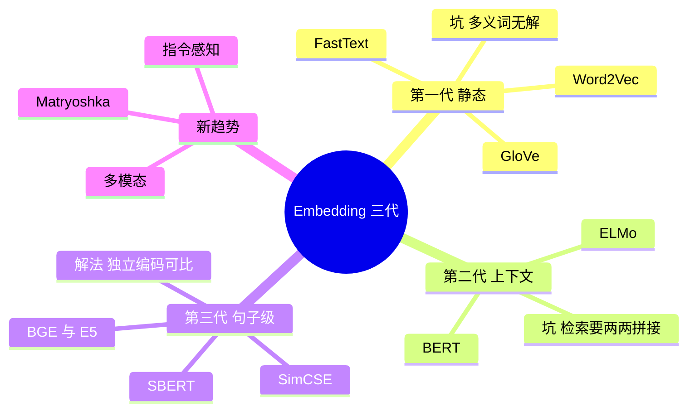

## 🔥 快速背诵

Embedding 有三代：静态词向量、上下文向量、句子级对比学习。第一代一个词一个固定向量，第二代让向量随上下文变，第三代让每个句子自己生成向量、直接比余弦。每一代都在补上一代的坑，RAG 只用第三代。2025 之后是在第三代上做增强，不算第四代。

> **一句话**：静态词向量 → 上下文向量 → **句子级对比学习**。每一代都在补上一代留下的坑，RAG 只用第三代。

## 🧠 导图

---

# 📖 背诵稿

### ① 起点问题

**最开始的难题很朴素：怎么让机器知道「苹果手机怎么截图」和「iPhone 如何截屏」是一回事。**

关键词一个都对不上，所以只能走「把词变成向量、用距离表达语义」这条路。三代算法都在干这件事，区别在于每一代踩的坑不一样。

### ② 第一代：静态

**第一代给每个词配一个固定向量，词义靠「周围的词」学出来。**

Word2Vec 是代表，CBOW 用周围词猜中心词，Skip-gram 反过来；Skip-gram 更常用，因为它一个词能生出多个训练样本，对低频词更友好。GloVe 走共现矩阵分解的路子，效果差不多。FastText 把词拆成字符 n-gram 子词，解决了「没见过的新词就没向量」的问题。

**但它们的死穴是「静态」**：不管上下文是什么，一个词永远同一个向量。「我吃了苹果」和「苹果发布了新手机」里的苹果长得一模一样，多义词根本没法区分。

### ③ 第二代：上下文

**第二代让向量随上下文变：同一个词，在不同句子里长得不一样。**

ELMo 用双向 LSTM，BERT 换成了 Transformer 加掩码语言模型，能力全面超过前者，成了里程碑。这个词级别的表达能力终于够用了。

**但它在检索场景里是废的**：要比两句话相似，必须把它们拼在一起过一遍模型，让 [CLS] 来判。百万条文档就要跑百万次前向，每次几十毫秒——几个小时才出结果，用户不可能等。

### ④ 第三代：句子级对比学习

**第三代的回答是：让每个句子自己就能生成一个向量，然后直接比余弦。**

SBERT 用 bi-encoder：两句各自独立编码，只比向量。代价是牺牲了交叉注意力（编码时看不到对方），精度比 Cross-Encoder 低一点；换来的是**所有文档向量可以提前算好**，查询时只算一次，毫秒级返回。

SimCSE 用对比学习把质量又拉了一截：同一句话跑两次 dropout 得到两个向量当正样本，同 batch 里其他句子当负样本，一拉一推，不需要人工标注。它顺手还解决了一个隐蔽问题——BERT 原生的句向量分布是「各向异性」的，全挤在一个窄锥里，空间没用满；对比学习把空间撑开了。BGE 则是在大规模中英数据上用同样的思路专门为检索训练，还同时提供 bi-encoder 和 reranker 两种形态。

### ⑤ 新趋势

**2025 之后不是第四代，是在第三代上加的三个增强。**

指令感知（同一段文本，问「找相似问题」和「找答案」会给不同向量）、Matryoshka 降维（截断维度换成本）、多模态（文本图像同一空间）。

---

# 🔑 记忆锚

| 记什么 | 内容 | 口诀 |
|---|---|---|
| **3** 代 | 静态 / 上下文 / 句子级 | 「静·境·句」 |
| 第一代坑 | 处理不了多义词 | 「一词一向量」 |
| 第二代坑 | 检索要两两拼接 | 「百万次」 |
| 第三代解 | bi-encoder 独立编码 + 对比学习 | 「各编各的」 |

> **卡壳急救**：三代的演进逻辑就一句话——**能表达语义 → 能区分语境 → 能被快速检索**。每一步都是补前一步的短板。

---

# 🎯 追问速查

| 面试官问 | 你答 |
|---|---|
| Word2Vec 能做 RAG 吗？ | 不能。词级静态向量，多义词无解，也不是句子级表示 |
| BERT 效果那么好，为什么不用？ | 检索要「问题 × 每条文档」两两拼接过模型，**复杂度不可接受** |
| SBERT 精度不是更低吗？ | 是，牺牲交叉注意力。但换来向量可预计算，速度差几个数量级，检索场景这个取舍值 |
| SimCSE 解决了什么隐藏问题？ | 句向量的**各向异性**——分布挤在窄锥里，空间没撑开 |
| 第三代只能用 bi-encoder？ | 不。BGE 同时提供 bi-encoder（召回）和 reranker（精排），是标准的两段式 |
| RAG 该用哪一代？ | 只有第三代。第一二代在检索场景不成立 |

---

# 🔗 串联

- 前面是 **06**：Embedding 的性质，这里讲它是怎么被做出来的
- 往后是 **11/14**：bi-encoder 做粗排、Cross-encoder 做精排，源头都在这
- 往后是 **08**：句子级向量 + 可预计算 = 才有可能做向量库
- 金句：**表达能力靠上下文，检索能力靠解耦**

---

# 📚 细节（背完再点开）

> [!note]- 三代对照表
> | 世代 | 代表 | 核心特点 | 局限 | RAG 适用 |
> |---|---|---|---|---|
> | 一 | Word2Vec / GloVe / FastText | 词级静态向量 | 多义词无解、词级非句级 | 不适用 |
> | 二 | ELMo / BERT | 上下文动态向量 | 检索需两两拼接，极慢 | 不适用实时检索 |
> | 三 | SBERT / SimCSE / BGE / E5 | 句子级 bi-encoder + 对比学习 | 精度略低于 cross-encoder | **标配** |

> [!note]- 为什么 bi-encoder 能「提前算」
> 因为编码过程与「对方是谁」无关——文档向量的计算不依赖查询。
> 这是它能离线建库的唯一原因。Cross-encoder 依赖成对输入，所以永远只能在线算，且只能算小批量。
> 一句话：**能解耦所以能预计算，能预计算所以能上规模。**

> [!note]- 面试里最容易露怯的地方
> 把 Word2Vec 当成「Embedding 算法」的全部，或者把 BERT 当成检索方案。
> 这两句话一说出口，面试官就知道你只背了名词，没理解「检索场景对结构的要求」。

---

# 🎴 自测

> [!question]- Q1 三代分别是什么？
> 静态词向量 / 上下文向量 / 句子级对比学习。

> [!question]- Q2 第一代的死穴？
> 一词一向量，多义词无法区分。

> [!question]- Q3 第二代为什么不能用于检索？
> 必须两两拼接过模型，百万文档跑百万次，延迟不可接受。

> [!question]- Q4 第三代的关键结构？
> bi-encoder：各自独立编码，只比余弦。

> [!question]- Q5 SimCSE 的两个贡献？
> 对比学习提升句向量质量 + 缓解各向异性。

> [!question]- Q6 三个新趋势？
> 指令感知、Matryoshka 降维、多模态。
