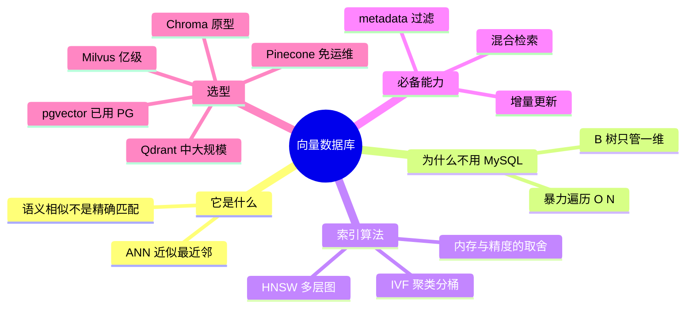

## 🔥 快速背诵

向量库的核心是 ANN 近似最近邻，不是数据库加个向量字段，因为高维的近用 B 树算不了。索引算法必答两个：HNSW 是图，一层层往下导航；IVF 是分桶，先聚类再只搜几个桶。只有 ANN 不够，生产还要元数据过滤、增量更新和混合检索。选型看规模，原型用 Chroma，中等用 Qdrant，亿级用 Milvus，不想运维用 Pinecone。

> **一句话**：向量库的核心是 **ANN（近似最近邻）**，不是「数据库加个向量字段」。选型看**规模、部署方式、要不要混合检索**。索引算法必答 **HNSW 和 IVF**。

## 🧠 导图

---

# 📖 背诵稿

### ① 它不是什么

**向量库不是「MySQL 加个向量字段」，两者解决的根本不是一件事。**

关系库存结构化数据，查的是「等于」；向量库存语义向量，查的是「最像」。前者是精确匹配，后者是相似度排序。用 LIKE 做语义检索是彻底跑偏了。

### ② 为什么要专门一个库

**因为高维向量的「近」，B 树算不了。**

暴力遍历的话，100 万条就要算 100 万次相似度，延迟不可接受。那为什么不能建索引？B 树处理的是「一个维度上的有序」，而 1024 维的「近」是所有维度一起综合判断的，没有哪个维度能单独排序。

所以向量库的价值就是：用专门的索引结构，**用一点精度换几个数量级的速度**。

### ③ 两种索引算法

**HNSW 是图，一层层往下导航；IVF 是分桶，先聚类再只搜几个桶。**

HNSW 建的是多层图，从最稀疏的顶层往下收窄，复杂度接近 O(log N)，相同延迟下召回能到 95% 以上，代价是内存跟向量数成正比。IVF 先聚类，查询只扫最相关的几个桶，内存省、能扛超大规模，但精度略低，还要调 nlist / nprobe 两个参数。

**为什么有了 HNSW 还要 IVF？** 因为到亿级，内存扛不住。IVF 是用精度和调参换内存。

### ④ 三个必备能力

**光有 ANN 不够，生产级还要三样：元数据过滤、增量更新、混合检索。**

元数据过滤要注意顺序——**先过滤再搜**，不能搜完再筛，否则 Top-K 里可能大半不满足条件，名额白白浪费。增量更新是指新数据能在线写入、后台建索引，不用停服重建。混合检索是因为纯向量对型号、专有名词不敏感，得和 BM25 搭着用。

### ⑤ 怎么选

**原型用 Chroma，中小到大规模上 Qdrant，亿级上 Milvus，不想运维用 Pinecone，已经在 PG 上就装 pgvector。**

千万别拿 GitHub Star 数当选型依据。

---

# 🔑 记忆锚

| 记什么 | 内容 | 口诀 |
|---|---|---|
| **1** 个核心能力 | ANN 近似最近邻 | 「近似」 |
| **2** 种索引 | HNSW 图 / IVF 桶 | 「图·桶」 |
| **3** 个必备能力 | 过滤 / 增量 / 混合 | 「滤·增·混」 |
| **5** 个选项 | Chroma / Qdrant / Milvus / Pinecone / pgvector | 「克·Q·M·P·pg」 |

---

# 🎯 追问速查

| 面试官问 | 你答 |
|---|---|
| MySQL 加个向量字段行不行？ | 行在「存」，不行在「查」。相似度排序 B 树做不了 |
| HNSW 和 IVF 怎么选？ | 要召回率、内存够 → HNSW；亿级、内存紧 → IVF |
| HNSW 的 M 和 ef 是什么？ | M = 每个节点最多几个邻居（16~32）；ef = 查询时候选集大小（50~200），越大越准越慢 |
| 为什么先过滤再 ANN？ | 先搜后筛会浪费 Top-K 名额，召回的有效结果变少 |
| Star 数能当选型依据吗？ | 不能。看规模、部署方式、混合检索需求 |
| 数据不能出境怎么办？ | 排除 Pinecone 这类 SaaS，走自托管（Qdrant / Milvus / pgvector） |

---

# 🔗 串联

- 前面是 **06/07**：向量怎么来的，这里讲存到哪、怎么快查
- 后面是 **09**：这里讲选型，下一篇讲真跑起来的数据和坑
- 接 **11**：混合检索里 BM25 那一路，很多向量库已经原生支持
- 接 **14**：向量库能力属于「召回层」的基础设施

---

# 📚 细节（背完再点开）

> [!note]- 选型对照表
> | 库 | 部署 | 规模 | 优势 | 劣势 |
> |---|---|---|---|---|
> | Chroma | 本地 / C-S / 云 | 中小 | 零配置、生态好 | 超大规模稳定性待验证 |
> | Qdrant | 自托管 / 云 | 中大规模（亿级） | 性能好、API 简洁、Rust | 超大规模需调优 |
> | Milvus | 自托管分布式 | 亿级 | 可水平扩展、读写分离 | 部署运维复杂 |
> | Pinecone | 全托管 | 中大规模 | 免运维 | 费用高、数据出境 |
> | pgvector | PG 插件 | 中小 | 无新组件、可 JOIN | 性能弱于专用库 |

> [!note]- HNSW 三个参数，一次记清
> - **M**：每个节点的邻居数。越大图越密、越准、越吃内存。16~32。
> - **ef_construction**：建图时每个节点考察多少候选。越大越精确、建得越慢。100~200。
> - **ef / search_ef**：查询时候选集大小。越大越准、越慢。50~200。
>
> 类比：M 是「你认识多少人」，ef_construction 是「交朋友时考察多少人」，ef 是「办事时问多少人」。

> [!note]- 为什么「先过滤后搜索」这么重要
> 假设库里 90% 是 A 部门的文档，你只想搜 B 部门的。
> 先 ANN 搜 Top-20 → 可能 18 条都是 A 部门 → 过滤完只剩 2 条，答案很可能就在被挤掉的那批里。
> **过滤条件应该下推给索引，而不是在结果上做减法。**

---

# 🎴 自测

> [!question]- Q1 向量库的核心能力？
> ANN 近似最近邻搜索。

> [!question]- Q2 为什么 B 树不行？
> B 树管一维有序，高维的「近」是多维综合判断。

> [!question]- Q3 HNSW 的原理和代价？
> 多层图逐层导航，召回高速度快，内存随规模线性涨。

> [!question]- Q4 IVF 什么时候用？
> 亿级、内存受限，用聚类换内存，精度略低。

> [!question]- Q5 三个必备能力？
> 元数据过滤、增量更新、混合检索。

> [!question]- Q6 五个选项怎么对号入座？
> Chroma 原型 / Qdrant 中大规模 / Milvus 亿级 / Pinecone 免运维 / pgvector 已有 PG。
