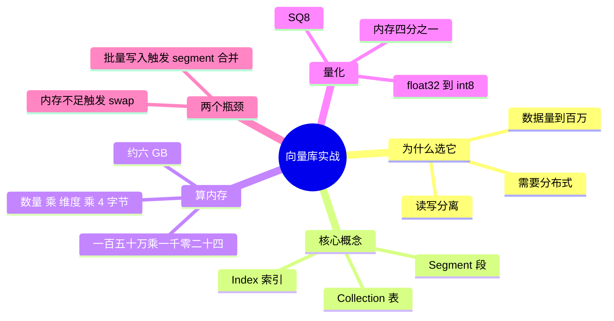

## 🔥 快速背诵

这题考的不是用了什么，是知不知道数字。要报得出量级、维度、索引参数、P50 和 P99，还有至少一个真踩过的坑。内存估算就是条数乘维度乘 4 字节。比如 150 万条 1024 维，HNSW 的 M 取 16、ef 取 100，16 核 32G 单机，P50 约 20 毫秒、P99 约 60 毫秒。常见坑是内存不够被 swap，和批量写入触发段合并。

> **一句话**：这题考的不是「你用了什么」，是**你知不知道数字**。量级、维度、索引参数、P50/P99、以及至少一个你真踩过的坑。

## 🧠 导图



---

# 📖 背诵稿

### ① 选型理由要说清

**我们选 Milvus，是因为数据量到了百万级，单机撑不住，需要分布式和读写分离。**

读写分离在这里不是玄学：知识库每天都有增量写入，如果写和读挤在一个节点上，一次批量导入就能把查询延迟顶上去。分开之后，写入抖动不会直接砸到线上。

### ② 先把概念对齐

**Milvus 里三个词要会：Collection 是表，Segment 是数据管理单位，Index 是加速结构。**

Segment 这个概念最关键：新写入的数据先进「增量段」，像一个接收缓冲区；攒到一定量触发合并，变成「封存段」并建好索引，之后查询走索引就很快。但**合并本身很吃 CPU 和磁盘**——它相当于在后台做一次碎片整理，这时候查询会被抢资源。

### ③ 内存账要会算

**原始向量内存 = 条数 × 维度 × 4 字节。**

150 万条 × 1024 维 × 4 字节 ≈ **6GB**，这只是纯向量。整个 Milvus 进程实际要 10~12GB，多出来的是 HNSW 图结构、metadata、Collection 管理开销和系统缓存。你可能会说 32G 的机器又不贵——但同一台机器上还跑着应用、Redis、日志，内存是要抢的。

### ④ 两个真实瓶颈

**第一个是内存不够被 swap，第二个是批量写入触发 Segment 合并。**

内存那个最典型：索引一加载，留给系统的空间就很小，稍微一压就开始换页，查询延迟从 20ms 直接飙到 2 秒。**很多人以为是索引算法慢，其实是内存被强行换到磁盘了。** 解法是开 SQ8 标量量化，float32 压成 int8，内存掉到四分之一，召回率通常只掉不到一个点，性价比最高。

第二个是写入引发的抖动：一次导入几十万条，后台合并一启动，P99 从 60ms 涨到 300ms+。解法两个方向——**时间上错峰**（挪到凌晨），**量上化整为零**（每批 500~1000 条，批间隔几秒），把一次大冲击拆成多次小冲击。

### ⑤ 报数字要给背景

**150 万条 1024 维，HNSW（M=16，ef_construction=128），ef=100，单机 16 核 32G：P50 约 20ms，P99 约 60ms，100 QPS 稳定。**

报性能一定要带上硬件和参数，否则数字没有意义——同样的库换 8 核机、或把 ef 调到 200，结果能差一个量级。

---

# 🔑 记忆锚

| 记什么 | 内容 | 口诀 |
|---|---|---|
| **1** 个公式 | 条数 × 维度 × 4 字节 | 「乘四」 |
| **2** 个瓶颈 | swap / Segment 合并 | 「换页·整理」 |
| **2** 个解法 | SQ8 量化 / 错峰 + 分批 | 「压·挪」 |
| **3** 个数字 | P50 20ms / P99 60ms / 100 QPS | 「二十六一百」 |

---

# 🎯 追问速查

| 面试官问 | 你答 |
|---|---|
| 数据量多大？ | 150 万 chunk，1024 维，HNSW 索引（M=16，ef_construction=128） |
| P99 多少？ | 约 60ms，P50 约 20ms，ef=100，16 核 32G 单机 |
| 遇到什么瓶颈？ | 内存不足触发 swap（延迟 20ms→2s）；批量写入触发 Segment 合并导致 P99 抖动 |
| SQ8 是什么？ | 标量量化，float32 → int8，内存降到 1/4，召回通常只掉 1 个点以内 |
| 还能量化得更狠吗？ | 可以，但精度损失会明显上升。SQ8 是「几乎无代价」的那一档 |
| 写入抖动怎么彻底避免？ | 物理上做不到，只能**错峰 + 分批 + 读写分离**，让它落在低峰且规模可控 |

---

# 🔗 串联

- 前面是 **08**：选型讲「该选谁」，这里讲「选完怎么跑」
- 接 **14**：这是「召回层」的真实成本结构
- 接 **18**：P50/P99 是线上指标的一部分，不能只会说「感觉挺快」
- 接 **19**：批量写入的时机，直接影响更新策略怎么设计

---

# 📚 细节（背完再点开）

> [!note]- 内存账（面试里能算一遍最好）
> ```
> 150 万 × 1024 维 × 4 字节 ≈ 6 GB     # 纯向量
> 进程实际占用             ≈ 10~12 GB  # + HNSW 图 + metadata + 缓存
> 开 SQ8 之后              ≈ 3 GB      # 向量部分降到 1/4
> ```
> 为什么开了量化不是 6/4=1.5G？因为**量化的是向量本体，图结构和元数据还在**。这个细节说出来很显功底。

> [!note]- Segment 合并为什么会影响查询
> 合并是「读多个小段 → 写一个大段 → 建索引」的重活，会同时吃 CPU 和磁盘 IO。
> 而查询也在抢这两样，于是 P99 被拉高。它不是 bug，是设计上必然会发生的后台任务——**所以只能调度，不能消灭**。

> [!note]- 另一个省内存的手段
> Milvus 支持把**原始向量放磁盘（mmap）**，内存只留索引。
> 因为原始向量只在需要精排/回表时才读，对查询延迟影响不大。
> 一句话：**热数据放内存，冷数据放盘，中间用索引过渡。**

---

# 🎴 自测

> [!question]- Q1 选 Milvus 的理由？
> 百万级、需要分布式和读写分离。

> [!question]- Q2 内存怎么算？
> 条数 × 维度 × 4 字节，1.5M × 1024 ≈ 6GB 纯向量。

> [!question]- Q3 第一个瓶颈和根因？
> 内存不足触发 swap。不是索引慢，是内存不够。

> [!question]- Q4 SQ8 的效果？
> 内存降到 1/4，召回通常只掉 1 个点以内。

> [!question]- Q5 第二个瓶颈和两个解法？
> 批量写入触发 Segment 合并 → 错峰 + 小批次。

> [!question]- Q6 报性能要注意什么？
> 必须带上硬件、索引类型和 ef 参数，否则数字无意义。
