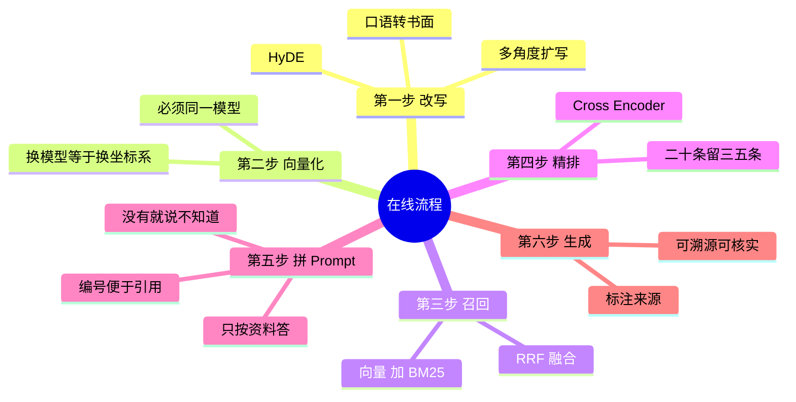

## 🔥 快速背诵

用户敲下回车之后要走六步：改写、向量化、召回、精排、拼 Prompt、生成溯源。只答检索加生成等于什么都没答。改写要和建库用同一个 embedding 模型，这条例律不能破。单路向量一定漏，要多路召回。粗排是扫一眼像不像，精排是翻开读一遍。最后一步要让它交代出处。

> **一句话**：用户敲下回车之后要走**六步**：改写 → 向量化 → 召回 → 精排 → 拼 Prompt → 生成溯源。只答「检索 + 生成」等于什么都没答。

## 🧠 导图



---

# 📖 背诵稿

### ① 一句话交代结构

**从提问到出答案是一条流水线：先把问题修好，再去库里捞，捞完筛，筛完拼，最后才生成。**

为什么不能直接把问题丢给模型？两个原因：上下文装不下整个知识库；没有外部依据时它只能靠参数里的记忆答，容易编。

### ② 第一步：改写

**用户的原始提问通常不能直接拿去检索，得先翻译成「检索语言」。**

「上次那个方案怎么样了」这种话，离开对话历史根本没法搜——「上次」是什么时候、「那个方案」是哪个，检索系统全不知道。所以先用小模型改写成一句完整、可独立检索的话。

三种常用手法：**直接改写**（口语转书面、补全指代）、**HyDE**（先让模型编一个假设答案，用答案的向量去搜——因为答案和答案更像，比问题和答案更像）、**多角度扩写**（一个问题变 3~5 个问法，分别搜了合并）。

### ③ 第二步：向量化

**这一步本身没技术含量，但有一条例律：必须和建库时用同一个模型。**

模型不同，训练数据、目标函数、维度、空间的形状全不一样。A 模型把「苹果手机」和「iPhone」放在某个方向，B 模型可能放在另一个方向，甚至维数都对不上。**用 A 建的库拿 B 来查，等于在两个坐标系里量距离，结果毫无意义。** 这也是为什么换 Embedding 模型必须重建整个知识库。

### ④ 第三步：多路召回

**单独一路向量检索一定会漏，所以要同时开几条路。**

向量负责语义——「退货」和「申请售后」是邻居，能互相命中。BM25 负责精确词——「M4 Pro」「RTX 4090」这种型号、缩写、数字，向量反而不敏感。两路结果用 **RRF** 合并：不看各自分数（量纲不同没法比），只看排名，排名越靠前贡献越大。

### ⑤ 第四步：精排

**粗排是「扫一眼觉得像」，精排是「翻开读一遍」。**

Top-20 里必然混着噪音。Rerank 用 Cross-Encoder 把「问题 + 候选」拼成一对送进模型，真正读懂两者的关系再打分，只留 Top-3 到 Top-5。为什么不直接用精排检索？因为它每一对都要跑一次模型，百万条根本跑不动。**先宽后严，两段式是速度和精度的唯一解。**

### ⑥ 第五步 + 第六步：拼 Prompt、生成溯源

**拼 Prompt 的每一句都在治一种病，最后一步是让它交代出处。**

「只根据资料回答」治它想帮忙的本能，「资料里没有就说不知道」给它一个合法的逃生出口，「标注编号」逼它自检。生成之后要求标出「根据资料[1]」，用户能自己回原文核实——**这一步很多人省了，但它才是 RAG 可信度的来源**。

---

# 🔑 记忆锚

| 记什么 | 内容 | 口诀 |
|---|---|---|
| **6** 步 | 改写 / 向量化 / 召回 / 精排 / 拼 / 生成 | 「改算捞筛拼答」 |
| **1** 条铁律 | 建库和查询必须同一模型 | 「同一坐标系」 |
| **3** 种改写 | 直接 / HyDE / 多角度 | 「改·假·多」 |
| **2** 段式 | 粗排求全、精排求精 | 「宽进严出」 |

---

# 🎯 追问速查

| 面试官问 | 你答 |
|---|---|
| 就这六步？ | 每步都能单独出题：改写有 4 种方法（12），召回有多路（13），精排是 Cross-encoder，Prompt 有 4 条规则 |
| HyDE 为什么要用「假答案」搜？ | 答案和答案的向量距离，比问题和答案更近。假设答案不需要准，只要文体像文档 |
| 换 Embedding 会怎样？ | 坐标系变了，旧库必须全量重建 |
| 为什么不用精排直接检索？ | 每对都要过一次模型，百万级跑不动 |
| RRF 为什么用排名不用分数？ | 余弦是 0~1，BM25 是任意正数，量纲不同，加权无意义 |
| 溯源有什么用？ | 用户可核实；出错了能定位是哪条知识的问题 |

---

# 🔗 串联

- 往前接 **01**：这里是把离线四步的成果用起来
- 往后接 **12/13/14**：三个环节各自展开成一篇
- 往后接 **17**：Prompt 的约束和溯源，就是幻觉治理的方案一和方案四
- 金句：**离线决定上限，在线决定兑现**

---

# 📚 细节（背完再点开）

> [!note]- 耗时分布（线上优化全靠这个）
> | 环节 | 量级 | 优化手段 |
> |---|---|---|
> | Query 改写 | 几十 ms | 用小模型；简单问题跳过 |
> | 向量检索 | 几十 ms | 和高频 Query 缓存配合 |
> | BM25 | 几十 ms | **与向量检索并行**，延迟取最大值 |
> | Rerank | 几百 ms | 控制候选数（20~30） |
> | 生成 | 1~10 s | 流式输出、控制长度 |

> [!note]- Prompt 模板里的四句话分别治什么
> ```
> 只能使用【参考资料】中的信息          # 治「想帮忙」的本能
> 没有足够信息就说无法回答              # 给一个合法的逃生出口
> 标注信息来源编号                      # 逼它自检
> 不要推断、不要补充                    # 治「超发挥」
> ```
> 注意这四条只压得住**生成层幻觉**，压不住检索层——那要靠质量门控（见 17）。

> [!note]- 一个容易被忽略的细节
> Prompt 里给资料**编号**不只是为了好看：有了编号，第六步才能要求模型输出引用，后面的引用核查（17 的方案三、四）才有落点。
> 这一处设计把「生成」和「可验证」连在了一起。

---

# 🎴 自测

> [!question]- Q1 六步是什么？
> 改写 → 向量化 → 召回 → 精排 → 拼 Prompt → 生成溯源。

> [!question]- Q2 为什么必须同一个 Embedding 模型？
> 不同模型空间形状和维度都不同，距离不可比，等于换坐标系。

> [!question]- Q3 三种改写手法？
> 直接改写 / HyDE / 多角度扩写。

> [!question]- Q4 为什么两段式检索？
> 精排准但慢（成对输入），只能对小候选集做；粗排快可预计算，用来筛。

> [!question]- Q5 Prompt 的约束治的是什么幻觉？
> 生成层幻觉（检索到了但超发挥）。检索层幻觉要靠门控。

> [!question]- Q6 溯源为什么重要？
> 可信度来源 + 出错可定位。
