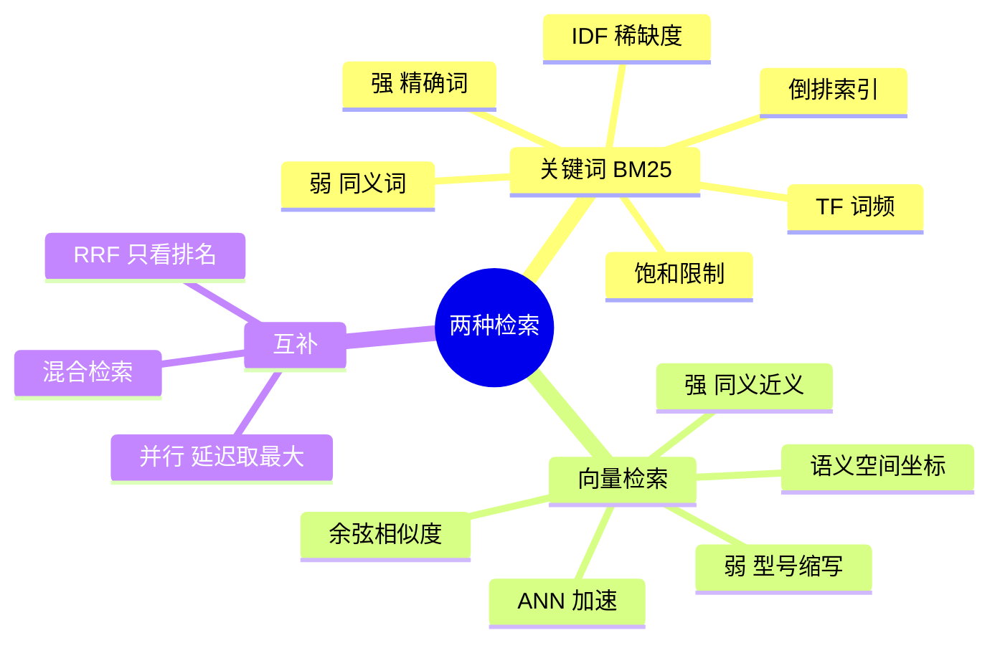

## 🔥 快速背诵

检索有两种相关：字面重合和意思接近。BM25 靠词频统计，精确命中强，同义词无解；向量靠语义距离，同义词能过，精确词容易漏。两边盲区刚好互补，所以生产上跑混合检索加 RRF 融合。正确答案不是向量更好，而是两条腿走路。

> **一句话**：BM25 靠词频统计，精确命中强、同义词无解；向量靠语义距离，同义词能过、**精确词容易漏**。盲区刚好互补，所以生产上跑**混合检索 + RRF**。

## 🧠 导图

---

# 📖 背诵稿

### ① 一句话切开

**检索这件事有两种「相关」：字面重合，和意思接近。BM25 管前者，向量管后者。**

理解这一点，后面所有比较都顺了——它们不是新老交替，是在回答两个不同的问题。

### ② BM25 怎么打分

**BM25 看两件事：这个词在这篇文档里出现得多不多，在整个库里稀不稀罕。**

词频高说明相关；稀缺度高说明它有区分力。「的」「是」「在」这些词哪篇都有，如果只看词频，每篇都会得高分，所以要用 IDF 给常见词降权、给罕见词加权。BM25 在 TF-IDF 之上又加了饱和限制，防止一个词重复太多次把分数刷上天。

它的底层是**倒排索引**——不是记「这篇文档有哪些词」，而是记「这个词出现在哪些文档里」。所以「iPhone 15 Pro Max」「LSTM」这种精确词，它一找一个准。

**但它的死穴是没词就为零。** 你搜「手机截图」，文档写「iPhone 截屏教程」，一个字都不重合，分数直接是 0，哪怕它正是你要的。

### ③ 向量检索怎么工作

**它把文本钉到语义空间的坐标上，然后找最近的几个点。**

「苹果手机怎么截图」和「iPhone 如何截屏」余弦能到 0.95，这是它比关键词强的地方——跨表达、跨同义词。但它对**精确词不敏感**：型号、版本号、字段名这些东西在语义空间里挨得挺近，容易被混在一起。

> 面试官最爱问的那句：「M4 Pro 芯片参数」为什么召不回来？因为这不是模型不行，是**向量检索只看语义、不看字面**的固有局限，换多贵的模型都在。

### ④ 所以混合

**既然盲区互补，那就两路都跑，用 RRF 合并。**

RRF 不看原始分数，只看排名：一个文档在多路里都排得靠前，综合分就高。为什么不能加权平均？因为余弦是 0~1，BM25 是任意正数，量纲不同——**就像摄氏度和华氏度直接相加，加出来没有意义**。

工程上还有个好处：两路可以并行，总延迟取两者的最大值而不是相加，几乎不额外花时间。

### ⑤ 收尾

**所以正确答案不是「向量更好」，是「两条腿走路」。**

---

# 🔑 记忆锚

| 记什么 | 内容 | 口诀 |
|---|---|---|
| **2** 种相关 | 字面重合 / 意思接近 | 「字·义」 |
| BM25 **2** 要素 | TF 词频 / IDF 稀缺度 | 「多·稀」 |
| 两路盲区 | BM25 无同义词 / 向量漏精确词 | 「反着漏」 |
| **1** 个融合 | RRF 只看排名 | 「排名是通用语言」 |

---

# 🎯 追问速查

| 面试官问 | 你答 |
|---|---|
| 向量检索哪里比 BM25 强？ | 同义词、近义、不同表达——**词不重合也能命中** |
| BM25 哪里比向量强？ | 型号、缩写、错误码、专有名词——**字面命中极准** |
| 为什么不能分数加权？ | 量纲不同，归一化也不稳定，工程上更复杂 |
| RRF 的 k 取多少？ | 通常 60，作用是平滑，防止第一名权重过大 |
| RRF 之后还要精排吗？ | 要。RRF 本质仍是粗排，最终精度靠 Cross-encoder |
| 中文用 BM25 要注意什么？ | 必须先分词（如 jieba），再建索引和检索 |

---

# 🔗 串联

- 前面是 **08**：很多向量库已原生支持混合检索
- 往后是 **13**：多路召回就是把这篇的思路扩到三路
- 往后是 **14**：这在四层框架里属于「召回层」
- 金句：**BM25 找「说过这个词的」，向量找「说的是这个意思的」**

---

# 📚 细节（背完再点开）

> [!note]- 对照表
> | 维度 | BM25 | 向量检索 |
> |---|---|---|
> | 匹配方式 | 词汇重叠统计 | 语义空间距离 |
> | 索引结构 | 倒排（稀疏） | 向量（稠密） |
> | 同义词 | 无法处理 | 天然支持 |
> | 精确词 | 极好 | 容易漏 |
> | 可解释性 | 高（能说清为什么） | 黑盒 |
> | 适合 | 专有名词、代码、精确查询 | 语义问答、模糊表达 |

> [!note]- RRF 公式和直觉
> `score = Σ 1 / (k + rank)`，k 常取 60。
> - rank 从 0 开始，所以第 1 名得 1/60 ≈ 0.0167
> - k 的作用是平滑：不让第 1 名的分数比第 2 名高出太多，避免某一路的排名波动主导结果
>
> 直觉：**多位评委都给你高分，你才排前面**。只有一路看好你，也不会被完全丢掉。

> [!note]- 为什么说「并行」是白送的好处
> 串行：向量 50ms + BM25 50ms = 100ms
> 并行：max(50, 50) = 50ms
> 召回质量上升而延迟不涨——这是工程里少见的「免费午餐」，所以生产系统几乎默认都开。

---

# 🎴 自测

> [!question]- Q1 两种「相关」？
> 字面重合 / 语义接近。

> [!question]- Q2 BM25 的两个打分因素？
> TF（词频）和 IDF（稀缺度）。

> [!question]- Q3 各自盲区？
> BM25 遇同义词为零；向量漏精确词。

> [!question]- Q4 为什么用 RRF 不用加权？
> 量纲不同，分数不可比；排名是通用语言。

> [!question]- Q5 k=60 的作用？
> 平滑，防止头名权重过大。

> [!question]- Q6 RRF 是粗排还是精排？
> 粗排。后面还要接 Cross-encoder。
