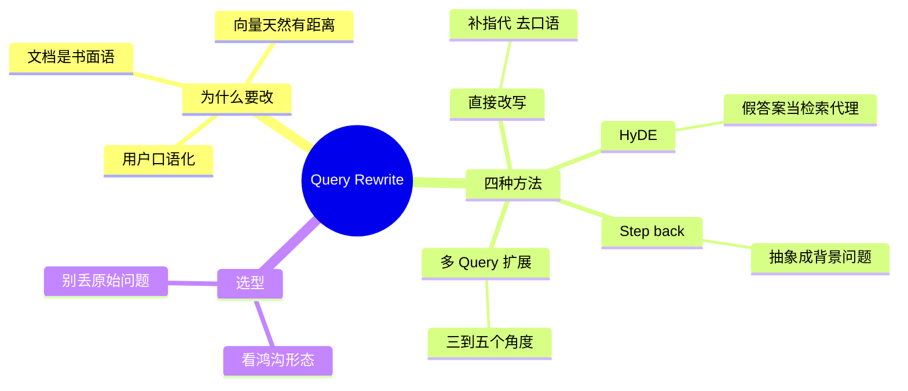

## 🔥 快速背诵

改写的目的是弥合用户怎么说和文档怎么写之间的鸿沟，四种方法对应四种鸿沟。最基础的是把口语、缩写、指代翻成完整书面语；HyDE 是先伪造一个答案，用答案去找文档；问题太具体、库里只有背景原理时，往上抽象一层再搜；角度单一就改成三到五个角度分别搜，最后合并去重。

> **一句话**：改写的目的是**弥合「用户怎么说」和「文档怎么写」之间的鸿沟**。四种方法对应四种鸿沟：口语 / 文体 / 太具体 / 角度单一。

## 🧠 导图

---

# 📖 背诵稿

### ① 先说为什么

**用户说的话和知识库写的字，天生不是一种语言。**

用户问「这东西坏了咋整」，文档写的是「产品故障排查与维修指南」。意思一样，但在向量空间里坐标差得不少——尤其短文本，信息量本来就少，表达差异被放大了。改写就是在出发前先校准导航：**目的地没变，路线更准。**

### ② 方法一：直接改写

**最基础的一种，把口语、缩写、指代，翻成一句完整可检索的书面语。**

「上次说的那个退款的事，流程是啥」→「申请商品退款的完整操作流程是什么」。这一步还顺手处理了多轮对话里的指代——「这个功能」到底指哪个，得靠对话历史补全。

### ③ 方法二：HyDE

**它不修问题，它先伪造一个答案，用答案去找文档。**

为什么有效？因为**答案到答案的距离，比问题到答案的距离近**。问题天然是疑问句，文档天然是陈述句，两种文体在空间里就有隔阂。让模型先编一段「大概长这样的答案」，这段假答案和真文档是同一类文体，坐标自然更近。

关键认知：假设答案**不需要准确**，它的任务是扮演文档，不是回答问题。不过在领域边界清晰的库里效果更稳，方向错了会把检索带偏。

### ④ 方法三：Step-back

**问题太具体、库里只有背景原理时，先往上抽象一层再搜。**

比如问「Qdrant 的 HNSW ef 参数设多少合适」，库里没有这条直接答案，但有「HNSW 参数调优原则」。后退成「HNSW 索引的参数调优原则是什么」，先拿到原理，再结合原理回答具体问题。像做数学题——不是直接套公式，是先想这道题属于哪个定理。

### ⑤ 方法四：多 Query 扩展

**一个问题改写成 3~5 个不同角度，分别去搜，最后合并去重。**

只要有一个版本和文档表述对上了，就能捞回来。撒网越宽，捕到鱼的概率越高。代价是 N 次模型调用。

> **一个纪律**：原始问题必须保留在检索列表里，不能只用改写版本。改写过程可能丢掉原始细节，而原始问题往往是最准的那一个。

---

# 🔑 记忆锚

| 记什么 | 内容 | 口诀 |
|---|---|---|
| **4** 种鸿沟 | 口语 / 文体 / 太具体 / 角度单一 | 「口·体·具·角」 |
| 对应 **4** 法 | 改写 / HyDE / Step-back / 多 Query | 「改假退多」 |
| **1** 条纪律 | 原始问题别丢 | 「原题必留」 |
| **1** 句原理 | 答案找答案，比问题找答案近 | 「同类相亲」 |

---

# 🎯 追问速查

| 面试官问 | 你答 |
|---|---|
| 改写到底解决什么？ | 弥合用户表述与文档表述的语义鸿沟，提高召回 |
| HyDE 为什么用假答案？ | 文体一致、坐标更近。假答案不用准，只要像文档 |
| HyDE 有什么风险？ | 模型编偏了会把检索带偏，领域边界清晰的场景更稳 |
| Step-back 什么时候用？ | 问题极具体、库里只有通用原理时 |
| 多 Query 代价？ | N 次 LLM 调用 + N 次检索，要控制变体数量 |
| 最容易被扣分的点？ | 只答「口语转书面语」——那只覆盖了四种里的一种 |

---

# 🔗 串联

- 前面是 **10**：这是在线流程的第一步
- 往后是 **13**：多 Query 扩展本身就是多路召回的一路
- 往后是 **14**：这是四层框架里的「查询层」
- 金句：**改写不是把话说漂亮，是把话说成能搜到的那句**

---

# 📚 细节（背完再点开）

> [!note]- 四种方法对照表
> | 方法 | 治什么 | 开销 | 适用 |
> |---|---|---|---|
> | 直接改写 | 口语、指代、上下文丢失 | 1 次调用 | 多轮对话 |
> | HyDE | 问题与文档文体差异 | 1 次调用 | 专业知识库 |
> | Step-back | 问题太具体、缺背景 | 1 次调用 | 技术文档 |
> | 多 Query | 单一角度覆盖不全 | N 次调用 | 复杂多维度问题 |

> [!note]- 改写 Prompt 的两个要点
> 1. **只输出改写后的问题，不要解释**——否则模型会把解释一起塞进检索
> 2. **给对话历史**——否则指代补不全，「那个方案」还是那个方案

> [!note]- 一个反直觉的取舍
> 改写本身也会引入误差：模型可能把用户的限定条件改掉（比如「不含税」被改没了）。
> 所以成熟做法是**改写的版本和原始问题一起检索**，用多路召回兜住改写带来的风险——这正好把 12 和 13 串起来了。

---

# 🎴 自测

> [!question]- Q1 改写的目的是什么？
> 弥合用户表述和文档表述之间的语义鸿沟。

> [!question]- Q2 四种方法分别治什么？
> 口语 / 文体差异 / 太具体 / 角度单一。

> [!question]- Q3 HyDE 的核心直觉？
> 答案和答案的向量距离比问题到答案更近。

> [!question]- Q4 Step-back 举例？
> 「ef 参数设多少」→「HNSW 参数调优原则」。

> [!question]- Q5 一定要保留原始问题吗？
> 要。改写可能丢细节，原始问题往往最准。

> [!question]- Q6 只答一种会怎样？
> 面试官会认为你只会背一个方向，不知道不同鸿沟要不同解法。
