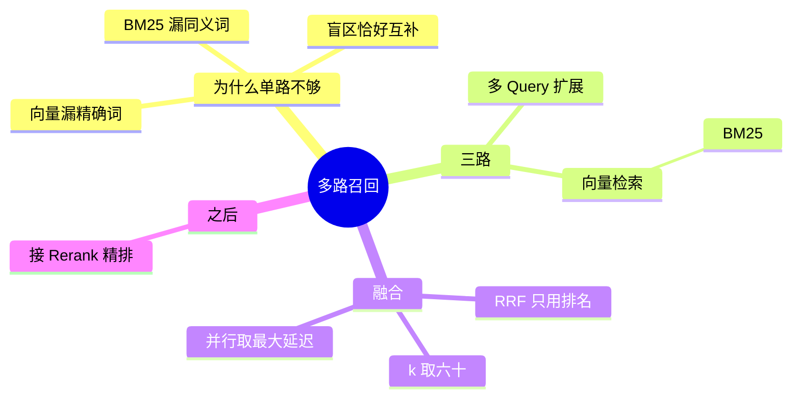

## 🔥 快速背诵

没有任何一种检索是全能的，因为它们的盲区恰好错开。所以同时开几条路：向量管语义覆盖，BM25 管字面必须对上，多 Query 管表述角度差异。三路的分数没法直接比，所以只比排名，用 RRF 融合，再接精排。

> **一句话**：没有任何一种检索是全能的，所以**同时开几条路**：向量管语义、BM25 管精确词、多 Query 管表述差异，结果用 **RRF** 融合，再接精排。

## 🧠 导图

---

# 📖 背诵稿

### ① 为什么单路不够

**因为每种检索方式都有自己的死角和盲区，而它们的盲区恰好错开。**

向量检索对「RTX 4090 显卡功耗」这种精确组合不敏感，它认的是语义；你把 Top-K 从 20 调到 200 也没用——**向量相似度在尾部是很平的**，多召回来的只是更多几乎无关的 chunk，正确答案照样进不来，还顺带把模型的注意力稀释了。

反之，BM25 遇到「退货」和「申请售后」就没辙，词不重合，分数为零。**换更贵的 Embedding 模型也治不了第一种，因为那不是模型能力问题，是检索范式的固有边界。**

### ② 第一路：向量

**向量这一路负责「听起来是同一件事」的覆盖。**

同义词、近义词、不同的说法，在语义空间里是邻居，能互相召回。这是基础盘，几乎所有系统都有这一路。

### ③ 第二路：BM25

**BM25 这一路负责「字面必须对上」的场景。**

产品型号、错误码、缩写、专有名词、数字——这些是向量的盲区。中文场景要先分词再建索引。它纯文本匹配，速度极快。

### ④ 第三路：多 Query 扩展

**前两路都假设「用户问的角度」和「文档写的角度」大体一致，第三路打破这个假设。**

用户问「产品多久能送到」，文档写「配送时效说明」，这不是同义词问题，是视角不同。做法是把问题改写成 3~5 个角度的版本，各自检索一遍，结果合并去重。召回覆盖率通常能提 10~20%。

### ⑤ 怎么合并：RRF

**三路的分数根本没法比，所以只比排名。**

余弦是 0~1，BM25 是任意正数，量纲不同，归一化也不稳。RRF 的公式是 `Σ 1/(k + rank)`，k 取 60 做平滑，排名越靠前贡献越大。一个 chunk 在多路都排前面，综合分就高。

**注意 RRF 还是粗排**，融合完要接 Cross-encoder 精排才把精度做到天花板。

---

# 🔑 记忆锚

| 记什么 | 内容 | 口诀 |
|---|---|---|
| **3** 路 | 向量 / BM25 / 多 Query | 「义·字·角」 |
| **1** 个融合 | RRF，只看排名 | 「排名是通用语言」 |
| **1** 个参数 | k = 60（平滑） | 「六十」 |
| **1** 个收尾 | RRF 后必须接精排 | 「粗排不终局」 |

---

# 🎯 追问速查

| 面试官问 | 你答 |
|---|---|
| 调大 Top-K 能不能替代多路？ | 不能。向量排序尾部很平，多召回的是噪音，还稀释注意力 |
| 三路都要上吗？ | 不必。有大量型号/数字 → 向量+BM25 标配；提问风格多变 → 加多 Query；极高质量 → 三路 + Rerank |
| RRF 为什么不用分数加权？ | 量纲不同、分布差异大，归一化不稳定 |
| 并行会不会增加延迟？ | 不会。两路并行，总延迟取最大值而非相加 |
| RRF 之后还要精排吗？ | 要，RRF 只是候选集合并 |
| 多 Query 的结果怎么去重？ | 按 chunk id 合并，同一个 chunk 被多个变体召回只留一份 |

---

# 🔗 串联

- 前面是 **11**：两路互补的原理，这篇扩到三路
- 前面是 **12**：多 Query 扩展就是改写方法之一
- 往后是 **14**：四层框架里的「召回层」
- 往后是 **17**：召回不全 → 模型硬编 → 幻觉，这条因果链的起点在这里

---

# 📚 细节（背完再点开）

> [!note]- 三路对照表
> | 召回方式 | 擅长 | 短板 | 场景 |
> |---|---|---|---|
> | 向量检索 | 语义相似、同义词 | 精确词、数字、型号 | 通用语义 |
> | BM25 | 精确词、专有名词 | 同义词、语义相关但词不重叠 | 型号多的库 |
> | 多 Query | 覆盖不同表述角度 | 增加 LLM 调用开销 | 提问风格多变 |

> [!note]- 为什么「尾部很平」这句话很有杀伤力
> 向量相似度排序在头部区分度大，越往后分数越挤在一起。
> 所以 Top-20 和 Top-200 的差别，往往不是「多召回了好东西」，而是「多塞了一堆差不多无关的东西」。
> 这也解释了为什么**纵深要靠精排，不能靠加深召回**。

> [!note]- 一个工程细节
> RRF 的 k 不是玄学：k 越大，排名差异被压得越平，各路的「第一名」优势越小。
> 取 60 是实践中的稳定值；如果你的某一路特别可信，可以把 k 调小，让它的话语权更大。

---

# 🎴 自测

> [!question]- Q1 为什么单路不够？
> 每种检索都有盲区，且盲区互补。

> [!question]- Q2 为什么调大 Top-K 没用？
> 向量排序尾部很平，多召回的是噪音。

> [!question]- Q3 三路分别管什么？
> 语义 / 精确词 / 表述角度。

> [!question]- Q4 RRF 的核心思想？
> 不看分数只看排名，`Σ 1/(k+rank)`。

> [!question]- Q5 k=60 的作用？
> 平滑，压住头名权重。

> [!question]- Q6 最后一步是什么？
> Cross-encoder 精排，把融合结果再排一遍。
