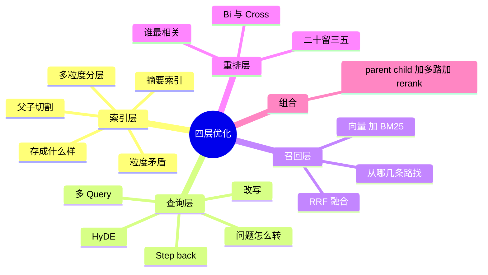

## 🔥 快速背诵

检索优化要报框架：索引层管怎么存，查询层管怎么转，召回层管从哪找，重排层管谁最相关。检索是整个系统的天花板，没找到的内容模型再强也答不出来。索引层要解决检索要小、阅读要大的矛盾；召回层单路一定漏；重排层是因为候选二三十条里必然有噪音。典型生产组合是父子切割加多路召回加 Rerank。

> **一句话**：别罗列零散手段，要报框架——**索引层管怎么存、查询层管怎么转、召回层管从哪找、重排层管谁最相关**。

## 🧠 导图

---

# 📖 背诵稿

### ① 为什么先讲框架

**检索是整个系统的天花板：没找到的内容，模型再强也答不出来。**

生成层的优化是锦上添花，检索层的优化是抬上限。所以检索效果不好时，不能只说「换个模型、调调参数」——那是零散手段，面试官要的是体系。

### ② 第一层：索引层

**索引层解决的是一个天然矛盾：检索要小，阅读要大。**

chunk 得小，语义才聚焦，向量才定位得准；但模型又需要上下文完整，碎片化的几句话它读不懂。这就是 Small-to-Big 要解决的问题，三种做法：

- **父子切割**：子块建索引、父块给模型，靠 parent_id 关联。
- **摘要索引**：用模型给每段生成摘要，摘要建索引（语义更聚焦），命中后返回原文。
- **多粒度分层**：同时建章节级、段落级、句子级，按问题类型选粒度。

### ③ 第二层：查询层

**即使索引建得再好，用户怎么问和文档怎么写之间还是有鸿沟。**

四种手段：**改写**（口语转书面、补指代）、**多 Query**（一题多角度）、**HyDE**（用假答案去搜）、**Step-back**（抽象成背景问题）。这一层什么时候必做？**用户提问质量差的时候。**

### ④ 第三层：召回层

**单路一定会漏，所以要开多扇门。**

向量管语义、BM25 管精确词，两路并行，用 RRF 融合。这一层是**低成本高收益**的典型——延迟几乎不涨，召回质量明显上升。

### ⑤ 第四层：重排层

**候选二三十条里必然有噪音，直接全塞进去有两个坏处：token 涨、模型跑偏。**

上下文一长，模型容易只关注开头和结尾，中间的被忽略（Lost in the Middle）。所以要用 Cross-encoder 从 20~30 条里挑 3~5 条。

这里必须能讲清两种结构：**Bi-encoder 各自编码，快但只知道像不像；Cross-encoder 拼成一对读，准但只能小批量。** 打个比方——前者是只看两份简历就判断两人合不合得来，后者是把两人关一个屋看他们怎么聊。

### ⑥ 组合

**典型生产组合：父子切割 + 向量/BM25 多路召回 + Rerank。**

提问质量差再叠 Query 改写。四层的记忆口诀：**索引保证「存进去的能被找到」，查询保证「搜的姿势对」，召回保证「不漏」，重排保证「送进去的都有用」。**

---

# 🔑 记忆锚

| 记什么 | 内容 | 口诀 |
|---|---|---|
| **4** 层 | 索引 / 查询 / 召回 / 重排 | 「存·转·找·排」 |
| 索引 **1** 个矛盾 | 检索粒度 vs 阅读粒度 | 「小找大读」 |
| 查询 **4** 法 | 改写 / 多 Query / HyDE / Step-back | 「改多假退」 |
| 重排 **2** 结构 | Bi / Cross | 「简历 vs 面谈」 |

---

# 🎯 追问速查

| 面试官问 | 你答 |
|---|---|
| 检索不好怎么优化？ | 按四层报：索引 / 查询 / 召回 / 重排，别零散罗列 |
| 哪一层收益最高？ | **Rerank**，成本效益最直接；其次是多路召回，几乎零延迟代价 |
| 为什么不能把 30 条全给模型？ | token 涨 + Lost in the Middle，模型忽略中间内容 |
| 什么时候必须做查询优化？ | 用户提问口语化、指代多、和文档表述差异大时 |
| Small-to-Big 三种实现？ | 父子切割 / 摘要索引 / 多粒度分层 |
| 精排为什么不能替代粗排？ | Cross-encoder 每对都要过模型，全量跑不动 |

---

# 🔗 串联

- 这一篇是 **04~13** 的收口：所有手段都能归到四层里
- 往前接 **05**（索引层）、**12**（查询层）、**13**（召回层）
- 往后接 **18**：四层对应不同指标，指标低就知道该动哪层
- 金句：**先保召回，再保精度，最后才谈生成**

---

# 📚 细节（背完再点开）

> [!note]- 四层 ↔ 指标 对照（这个映射特别好用）
> | 层 | 症状 | 指标 |
> |---|---|---|
> | 索引层 | 切得太碎或太杂 | Context Recall 低 |
> | 查询层 | 问法和文档不匹配 | Context Recall 低 |
> | 召回层 | 精确词召不回 | Hit@K 低 |
> | 重排层 | 好内容排在后面 / 噪音多 | MRR 低、Context Precision 低 |
>
> 有了这张表，你就能从「指标低」直接推到「该动哪一层」，这是从「会背」到「会用」的分界。

> [!note]- Lost in the Middle 是什么
> 长上下文里，模型对开头和结尾的信息利用得更好，中间段落容易被忽略。
> 所以「多给点总没坏处」是错的——**塞得越多，关键那条越可能沉在中间被跳过**。
> 这也是 Rerank 存在的第二个理由（第一个是精度）。

> [!note]- 推荐的落地顺序（面试时按这个答很稳）
> 1. 先把 Chunking 做对（索引层）
> 2. 上向量 + BM25 多路召回
> 3. 加 Rerank
> 4. 最后才根据提问质量决定要不要加 Query 改写
>
> 前三步覆盖 80% 的场景，第四步是锦上添花——**顺序错了会事倍功半**。

---

# 🎴 自测

> [!question]- Q1 四层分别管什么？
> 怎么存 / 怎么转 / 从哪找 / 谁最相关。

> [!question]- Q2 索引层的核心矛盾？
> 检索要小粒度、阅读要大粒度。

> [!question]- Q3 Small-to-Big 三种实现？
> 父子切割、摘要索引、多粒度分层。

> [!question]- Q4 为什么要重排？
> 候选有噪音 + 长上下文 Lost in the Middle。

> [!question]- Q5 哪一层性价比最高？
> Rerank；其次是多路召回（几乎零延迟代价）。

> [!question]- Q6 典型生产组合？
> 父子切割 + 多路召回 + Rerank（提问差再加改写）。
