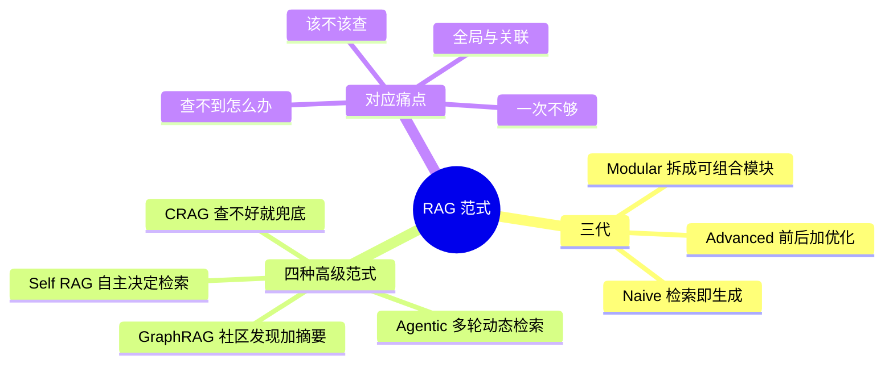

## 🔥 快速背诵

RAG 分三代：Naive、Advanced、Modular；再往上四种范式各治一个痛点，Self-RAG 治要不要查，CRAG 治查不到，GraphRAG 治全局问题，Agentic 治查一次不够。前三代都假设流程固定，只是把每一步做得更好；范式这一层改的是流程本身。

> **一句话**：三代是 Naive → Advanced → Modular；再往上四种范式各治一个痛点：**Self-RAG 治「要不要查」、CRAG 治「查不到」、GraphRAG 治「全局」、Agentic 治「查一次不够」**。

## 🧠 导图

---

# 📖 背诵稿

### ① 三代怎么分

**Naive 是「检索完就喂」，Advanced 是「喂之前和喂之后各加工序」，Modular 是「拆成模块随便拼」。**

Advanced 加的是：检索前做 Query 改写扩展，检索后做 Rerank 和内容压缩。改动小、效果明显，**现在大多数生产系统还是这一形态**。Modular 换了思路，把改写、召回、生成都做成可替换的模块，LangGraph / LlamaIndex Workflow 是这类实现。

### ② 为什么还需要高级范式

**因为前三代都有一个隐含假设：流程是固定的，只是每一步做得更好。**

但真实场景要的是**流程本身能变**：这个问题要不要查？查回来质量差怎么办？一次不够要不要再查？这些决策得系统自己做。三个痛点——**检索质量参差、所有问题走同一套流程、知识库有覆盖盲区**——就催生了下面四种范式。

### ③ Self-RAG：要不要查

**它训练了四个特殊的判断信号，让模型自己决定「查不查、这条相关吗、有没有胡编、答得好不好」。**

流程是：先判断这个问题需不需要外部知识（常识题直接答）→ 逐条评估召回内容相关性，不相关的跳过 → 每条相关 chunk 各生成一个候选答案 → 给每个候选打两个分（有没有文档支撑、对用户有没有用）→ 选最优。

**关键前提别漏**：这四种 token 不是现成模型自带的，得在专门构造的数据集上做监督微调。所以不能拿个通用模型直接套，要么用论文开源的微调版本，要么自己造数据训。

### ④ CRAG：查不好怎么办

**它在检索后加了一道质量评估，分三档路由。**

评估「相关」→ 直接用本地结果；「不相关」→ 说明知识库没覆盖，丢掉，降级走网络搜索；「模糊」→ 两边合起来用。评估器可以用轻量分类模型，也可以用 Rerank 分数近似。

价值就在**兜底**：知识库覆盖不到的问题不会硬编，而是自动去外面找。**知识库当主力，网络搜索当备胎。**

### ⑤ GraphRAG：全局怎么答

**它先用模型从文档里抽实体和关系建图，再用社区发现把紧密关联的实体聚成「社区」，给每个社区生成摘要。**

查询分两种：局部问题（某公司 CEO 是谁）直接图里查实体和关系；全局问题（这批文档的主要主题是什么）用 Map-Reduce，先让模型分别读各社区摘要，再汇总。

**为什么向量检索搞不定全局问题？** 因为它本质是一对一匹配，擅长「找到和问题直接相关的片段」，理解不了整个库的宏观结构。GraphRAG 是把全局信息**提前蒸馏**好了。代价是构图和摘要的 LLM 调用成本很高。

### ⑥ Agentic RAG：一次不够怎么办

**把 RAG 塞进 Agent 循环，模型自己决定下一轮搜什么、搜够了没有。**

拿到问题 → 判断信息够不够 → 不够就指定关键词再搜 → 把新结果追加到上下文 → 每轮重新评估 → 够了就生成。必须设最大迭代次数防死循环。

适合「帮我分析 A 公司三年财报，找营收放缓的根因」这类需要多维度、多轮检索的问题。和前面几种的区别：**流程不是写死的，是运行时决定的。**

---

# 🔑 记忆锚

| 记什么 | 内容 | 口诀 |
|---|---|---|
| **3** 代 | Naive / Advanced / Modular | 「朴·进·模」 |
| **4** 范式 | Self / CRAG / Graph / Agentic | 「自查图代」 |
| **4** 痛点 | 该不该查 / 查不到 / 全局 / 一次不够 | 「要不要·有没有·全不全·够不够」 |
| **1** 个坑 | Self-RAG 需要专门微调 | 「不是开箱即用」 |

---

# 🎯 追问速查

| 面试官问 | 你答 |
|---|---|
| Advanced 和 Modular 区别？ | Advanced 是在**固定流程**上加工序；Modular 是**拆成可组合模块** |
| Self-RAG 能直接用在 GPT-4 上吗？ | **不能**。四种 reflection token 需要专门微调进词表 |
| CRAG 和 Self-RAG 的区别？ | Self-RAG 决定**要不要查**；CRAG 决定**查得不好怎么办** |
| GraphRAG 的成本在哪？ | 实体关系抽取 + 社区摘要，都是大规模 LLM 调用，预处理很贵 |
| Agentic RAG 怎么防死循环？ | 最大迭代次数 + token 预算 + 超时，三重兜底 |
| 什么时候用 GraphRAG？ | 实体关系复杂、需要跨文档全局归纳时（金融关系、医疗、供应链） |

---

# 🔗 串联

- 往前接 **14**：四层优化就是 Advanced / Modular 的具体手段
- 往后接 **16**：GraphRAG 的工程简化版就是「图数据库增强」
- 往后接 **22/23**：Agentic 那一路延伸出「长上下文 vs 检索」「RAG vs 自主文件检索」
- 金句：**Advanced 修每一步，高级范式修整个流程**

---

# 📚 细节（背完再点开）

> [!note]- 四范式对照表
> | 范式 | 核心创新 | 场景 | 复杂度 |
> |---|---|---|---|
> | Advanced | 改写 + Rerank | 大多数生产 | 低 |
> | Self-RAG | 模型自主决定检索 | 问题类型混杂 | 高（需微调） |
> | CRAG | 质量差时降级搜索 | 知识库覆盖不全 | 中 |
> | GraphRAG | 社区发现 + 层次摘要 | 实体关系复杂 | 高（构图成本大） |
> | Agentic | 多轮动态检索 | 复杂多步问题 | 中（Agent 框架） |

> [!note]- Self-RAG 的四个信号（能报出名字很加分）
> - **Retrieval token**：要不要检索
> - **Relevance token**：这条召回相关吗
> - **Support token**：答案有没有被文档支撑（防幻觉）
> - **Utility token**：答案对用户有用吗
>
> 前两个管「输入」，后两个管「输出」——**输入侧过滤，输出侧打分**，这个结构本身就是很好的答题框架。

> [!note]- GraphRAG 的「社区」是什么意思
> 用 Leiden 之类的算法把图上联系紧密的实体聚成一簇，就是社区。
> 社区摘要 = 这一簇实体之间是什么关系、整体在讲什么。
> 多层摘要从细到粗，于是「全局问题」可以靠读摘要回答，不用遍历全部原文——**这就是它的全部魔法**。

---

# 🎴 自测

> [!question]- Q1 三代分别是什么？
> Naive / Advanced / Modular。

> [!question]- Q2 四种范式各治什么？
> 要不要查 / 查不到 / 全局 / 一次不够。

> [!question]- Q3 Self-RAG 的前提是什么？
> 需要专门微调，四种 reflection token 不是自带的。

> [!question]- Q4 CRAG 的三档路由？
> 相关→用本地；不相关→走网络；模糊→合并。

> [!question]- Q5 GraphRAG 为什么能答全局问题？
> 提前把社区摘要蒸馏好，查询时读摘要而非遍历原文。

> [!question]- Q6 Agentic RAG 的本质区别？
> 流程不是写死的，运行时由模型决定。
