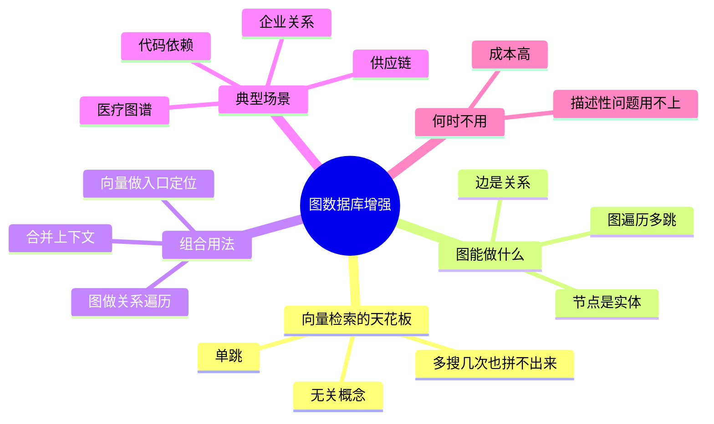

## 🔥 快速背诵

向量检索是单跳的，只能找和问题直接相关的内容，没有关系这个概念。多跳推理和跨实体关联得靠图：节点是实体，边是关系，可以顺着边走。做法是向量做入口、图做遍历，最后合并。图也有代价，实体关系抽取要用模型，成本高易出错，维护比向量库复杂。

> **一句话**：向量检索是**单跳**的，只能找「和问题直接相关」的内容，**没有「关系」这个概念**。多跳推理、跨实体关联，得靠图。

## 🧠 导图



---

# 📖 背诵稿

### ① 向量的天花板在哪

**向量检索一次只能走一步：找和问题直接相关的片段。它不知道实体之间有边。**

你问「A 公司的投资方和 B 公司有什么交集」，答案不在任何一段文档里，而藏在多个节点之间的关系上。向量检索每次只能找「和这句话像的内容」，**第二跳就断了**。

### ② 为什么多搜几次不行

**因为多搜的前提是「你知道下一步该搜什么」，而向量检索给不出下一步。**

它没有关系这个概念，不知道 A 和 B 之间有一条边，更不知道该沿哪条边走。就像在陌生城市问路，人家只告诉你「附近有家店」，不会告诉你「从那家店往东 200 米还有一家」——你靠反复问「附近有什么」，永远拼不出完整路线。

### ③ 图凭什么能

**图把世界表示成一张网：节点是实体，边是关系，于是可以顺着边走。**

三个真实问题的共同特征：**答案不在某一篇文档里，而在节点之间的关系上**。「小米的竞争对手的 CEO 是谁」「治 A 病的药和治 B 病的药有没有相互作用」「这个函数直接和间接依赖的库有哪些漏洞」——每一个都要沿边一跳一跳地走。

### ④ 怎么配合

**向量做入口，图做遍历，最后合并。**

用户问「小米竞争对手的 CEO 是谁」→ 先用向量检索找到和「小米」相关的片段，识别出关键实体，定位到图里那个节点 → 然后图沿着「竞争关系」走到 OPPO/vivo/荣耀，再沿「CEO 关系」走到人名 → 两边结果合并喂给模型。

一个比喻：**向量是定位「我在哪」，图是规划「能到哪」**。

### ⑤ 什么时候不该上

**图有自己的代价：实体和关系抽取要用模型做，成本高、易出错，图结构维护比向量库复杂得多。**

判断标准很简单：**问题里是否同时出现多个具体实体名，并且在问它们之间「有什么关系」**。如果是，值得上；如果只是查某段描述性内容（「充电慢怎么办」），向量 + Rerank 就够了，上图是过度设计。

---

# 🔑 记忆锚

| 记什么 | 内容 | 口诀 |
|---|---|---|
| **1** 个局限 | 向量只能单跳 | 「一跳就断」 |
| **1** 句本质 | 答案在「边」上，不在「点」上 | 「找关系不是找段落」 |
| **2** 个角色 | 向量定位入口，图做遍历 | 「定位·路线」 |
| **1** 个判断 | 问题里有没有多个实体 + 问关系 | 「多实体+关系」 |

---

# 🎯 追问速查

| 面试官问 | 你答 |
|---|---|
| 多检索几次能不能替代图？ | 不能。不知道边在哪，就不知道该往哪跳 |
| 图能替代向量吗？ | 不能。Cypher 擅长精确关系查询，不擅长语义模糊匹配 |
| 典型场景有哪些？ | 企业股权/竞争关系、医疗（病-症-药-基因）、代码依赖、供应链溯源 |
| 成本主要在哪？ | 实体关系抽取（LLM 调用）+ 图结构维护 |
| 什么时候不值得？ | 问题只是找某段描述性内容时，向量够了 |
| Neo4j 有向量索引了，还要分开吗？ | 那是把向量能力嫁接进图里，本质是两种检索并存，不是图遍历在做语义匹配 |

---

# 🔗 串联

- 前面是 **15**：GraphRAG 是它的重装版（多了社区发现和摘要）
- 前面是 **11**：向量与关键词互补；这里是向量与图互补，逻辑同源——**每种检索都有能力边界**
- 往后接 **22**：多跳关系正是「检索容易漏」的典型场景
- 金句：**向量找「像的」，图找「连着的」**

---

# 📚 细节（背完再点开）

> [!note]- 三个「向量答不了」的典型问题
> | 问题 | 缺的能力 |
> |---|---|
> | 小米的主要竞争对手的 CEO 是谁 | 实体跳转（两跳） |
> | 治 A 病的药和治 B 病的药有没有相互作用 | 多节点路径（药→靶点→相互作用） |
> | 这个函数直接和间接依赖的库有哪些漏洞 | 依赖链展开（每跳都是新查询） |
>
> 共同点：**没有一篇文档会把这个结论直接写出来**。

> [!note]- 图增强的完整链路
> ```
> 问句 → 向量检索定位相关片段 → 抽取/识别关键实体 → 定位图节点
>      → 沿边多跳遍历 → 收集沿途节点属性 → 与向量结果合并 → LLM 生成
> ```
> 注意中间那步「实体识别」是成败关键：实体没认对，入口就错了，后面全白搭。

> [!note]- 什么时候「不值得」
> 判断口诀：**描述性内容用向量，关系型问题用图**。
> 另外注意成本结构——建图是一次性重投入，维护是长期成本。**如果图会频繁变，维护成本可能超过收益。**

---

# 🎴 自测

> [!question]- Q1 向量检索的根本局限？
> 单跳，且没有「关系」概念。

> [!question]- Q2 为什么不能靠多检索拼出来？
> 不知道边在哪，就不知道下一跳该搜什么。

> [!question]- Q3 两者怎么配合？
> 向量定位入口实体，图做关系遍历，结果合并。

> [!question]- Q4 典型场景四个？
> 企业关系、医疗图谱、代码依赖、供应链。

> [!question]- Q5 判断要不要上图的标准？
> 问题里是否同时有多个实体、且在问它们之间的关系。

> [!question]- Q6 主要成本？
> 实体关系抽取 + 图维护。
