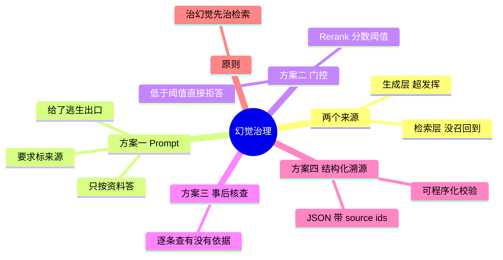

## 🔥 快速背诵

幻觉有两个来源：检索没找到，模型就用自己的记忆编；检索到了，模型超发挥。四个方案按成本递进：Prompt 约束、质量门控、生成后核查、强制溯源。底线是治幻觉先治检索。普通企业知识库做前两个就够，成本极低且能解决大半；高可信场景再加溯源。

> **一句话**：幻觉有**两个来源**——检索没找到（模型硬编）、检索到了但模型超发挥。四个方案按成本递进：**Prompt 约束 → 质量门控 → 生成后核查 → 强制溯源**。底线：**治幻觉先治检索**。

## 🧠 导图



---

# 📖 背诵稿

### ① 幻觉有两个来源

**第一个是没查到：检索失败，Prompt 里是空的或全不相关，模型就用自己的记忆编。**

它不会说「我不知道」，它会顺着最像的往下接，还说得特别自信。你知识库写「7 天无理由」，它答「30 天」，用户照着做，退款失败——**这就是检索层幻觉造成的真实损失**。

**第二个是查到了但没照说：** 相关 chunk 确实塞进去了，模型却在此基础上加了自己的推断、补了原文没有的细节，甚至把两段无关信息拼成一个「更完整」的答案。这种更隐蔽。

> 所以「检索做好了就不会幻觉」是错的，「Prompt 里加一句请根据资料回答」也远远不够——**两者治的是不同来源**。

### ② 方案一：Prompt 约束

**成本最低、立刻见效，但只压得住生成层。**

四条规则各有分工：只能使用资料内容（治它想帮忙的本能）、没有就说无法回答（给它一个合法的逃生出口）、标注来源（逼它自检）、不要推断补充（治超发挥）。

> 关键认知：**约束不改变「资料里本来就没有」这个事实**，所以必须配方案二。

### ③ 方案二：质量门控

**检索质量不达标时，直接拒答，别让模型在低质量上下文上硬撑。**

做法：Rerank 给每条候选打 0~1 的相关度，看最高分。低于阈值就返回「知识库无相关信息，建议联系人工」。阈值没有通用值，拿「答案在库里」和「不在库里」两批测试集跑一遍，找能分开两类的切点；经验区间 0.3~0.6，金融医疗偏高、闲聊型偏低。

**「拒答」看起来笨，但答错比不答危险得多。**

### ④ 方案三：生成后核查

**让另一个模型当编辑，逐条检查答案里的每个声明在 chunk 里有没有依据。**

没依据的标「无法核实」或直接删。代价是多一次模型调用，延迟和成本都翻倍，**只用在容错率极低的场景**（医疗、法律、合规）。方案一是事前约束作者，方案三是事后审稿。

### ⑤ 方案四：强制溯源

**让它输出结构化 JSON，每条结论必须填来自哪条资料。**

```json
{"answer": "...", "statements": [{"claim": "...", "source_ids": [1,2]}], "confidence": "high"}
```

为什么有效？两个原因：一是构建 JSON 时它必须想「这条我从哪看到的」，这个动作本身就减少了瞎编；二是系统可以程序化校验——source_ids 对应的 chunk 和 claim 明显不相关，就自动过滤。

### ⑥ 怎么组合 + 底线

**普通企业知识库：方案一 + 二（必做，成本极低，解决大半）。高可信场景加方案四。极高容错要求四个全上。**

底线一句话：**检索质量是幻觉最大的来源，治幻觉先治检索。**

---

# 🔑 记忆锚

| 记什么 | 内容 | 口诀 |
|---|---|---|
| **2** 个来源 | 没查到 / 没照说 | 「缺·偏」 |
| **4** 个方案 | 约束 / 门控 / 核查 / 溯源 | 「约·门·查·源」 |
| **1** 个阈值区间 | 0.3~0.6，按业务调 | 「三到六」 |
| **1** 句底线 | 治幻觉先治检索 | 「先治检索」 |

---

# 🎯 追问速查

| 面试官问 | 你答 |
|---|---|
| 检索做好了还会幻觉吗？ | 会。检索到了但模型超发挥，这是生成层幻觉 |
| 加一句 Prompt 够吗？ | 不够。只治生成层，治不了「资料里压根没有」 |
| 阈值怎么定？ | 用两类测试集跑分数分布，找切点；经验 0.3~0.6 |
| 拒答会不会显得很笨？ | 答错比不答危险。宁可转人工 |
| 方案三代价？ | 多一次模型调用，延迟和成本翻倍 |
| 方案四为什么有效？ | 逼它想来源 + 可程序化校验 |

---

# 🔗 串联

- 往前接 **02**：幻觉是知识缺失的副产品，这里讲怎么分来源治理
- 往前接 **14**：门控依赖 Rerank 分数，所以重排层是幻觉治理的基础设施
- 往后接 **18**：治理效果要用 Faithfulness 量化
- 往后接 **21**：知识冲突时不能偷偷二选一，那也是一种「编」

---

# 📚 细节（背完再点开）

> [!note]- 四方案对照表
> | 方案 | 治哪层 | 成本 | 场景 |
> |---|---|---|---|
> | Prompt 约束 | 生成层 | 极低 | 全部，必做 |
> | 检索门控 | 检索层 | 低 | 全部，必做 |
> | 事后核查 | 生成层 | 高（多一次调用） | 医疗、法律 |
> | 结构化溯源 | 两者兼顾 | 低 | 高可信场景 |

> [!note]- 门控阈值的调法（这段答出来很像做过）
> 1. 准备两批集：A「答案确定在库里」、B「答案确定不在库里」
> 2. 各跑一遍 Rerank，看两组最高分的分布
> 3. 找两类分布的分界点，先取中间值上线
> 4. 按线上误判样例微调：误拒多了往下调，误答多了往上调
>
> 关键：**这个阈值是业务参数，不是技术常数。**

> [!note]- 一个容易被忽略的点
> 方案一会让模型「变保守」——Prompt 收太死，Faithfulness 上去了，但用户会觉得「怎么老说不知道」。
> 所以治理幻觉要同时盯两个指标：**Faithfulness（别编）和 Answer Relevancy（别躲）**，只压一头会把系统调废。

---

# 🎴 自测

> [!question]- Q1 两类幻觉？
> 检索没召回到（硬编）/ 召回到但超发挥。

> [!question]- Q2 Prompt 约束治哪一类？
> 只治生成层，治不了「资料里没有」。

> [!question]- Q3 门控怎么做？
> Rerank 最高分低于阈值就拒答。

> [!question]- Q4 阈值区间？
> 0.3~0.6，按业务调，不是固定值。

> [!question]- Q5 方案四为什么有效？
> 强迫模型思考来源 + 系统可程序化校验。

> [!question]- Q6 基本配置是什么？
> Prompt 约束 + 检索门控，上线前必做。
