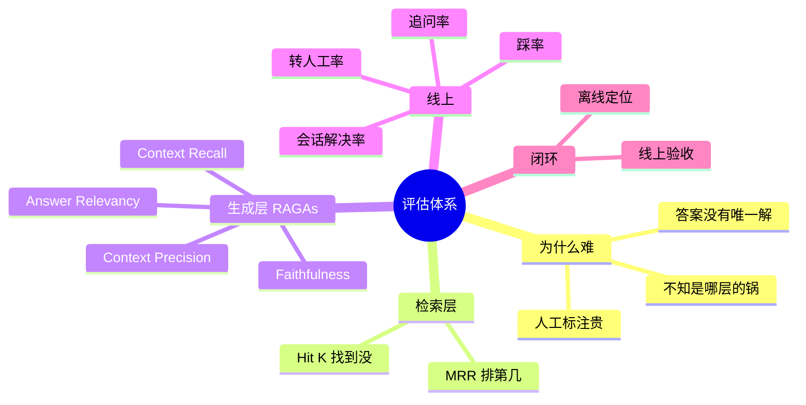

## 🔥 快速背诵

评估分两层离线加一层线上。检索层看 Hit@K 和 MRR，回答找到没、排第几；生成层看 RAGAs 四指标，用 LLM 当裁判自动打分；线上看踩率、追问率、转人工率。这套体系的价值不在数字本身，而在于数字低能直接指向该修哪一层。

> **一句话**：两层离线 + 一层线上。检索层看 **Hit@K / MRR**，生成层看 **RAGAs 四指标**，线上看 **踩率 / 追问率 / 转人工率**。指标低 → 直接推到该修哪一层。

## 🧠 导图

---

# 📖 背诵稿

### ① 为什么必须做

**没有评估就是在盲飞：改完不知道变好还是变坏，出了问题不知道查哪。**

RAG 评估的难点在于三条：答案是自然语言，没有唯一标准答案；出了问题分不清是检索的锅还是生成的锅；人工标注成本高，没法持续做。所以解法是**分层**——把「好不好」拆成能定位的数字。

### ② 检索层：Hit@K 和 MRR

**Hit@K 回答「找到没」，MRR 回答「排第几」。**

Hit@5 = 0.8 的意思是：80% 的问题，正确 chunk 出现在前 5 条里。**低于 0.7 说明检索层有问题**，该换 Embedding 或改 Chunking；高于 0.8 而答案还差，问题就在生成层。

MRR 是对每个问题算 `1/排名` 再平均，第 1 名得 1 分、第 2 名 0.5、第 5 名 0.2。**MRR 低通常说明 Rerank 不行**——召回到了，但没排到前面。

> 这两个指标的差别要能一口说清：**Hit@5 = 0.9 而 MRR = 0.3，意思是「都找到了，但全在第 4、第 5 位」**。

### ③ 生成层：RAGAs 四指标

**核心思路是 LLM-as-a-Judge：用模型当裁判自动打分，省掉人工标注。**

- **Faithfulness（忠实度）**：答案里每句话在检索内容里有没有出处？衡量幻觉。目标 > 0.8。
- **Answer Relevancy（答案相关性）**：有没有回答用户问的那个问题？目标 > 0.8。注意它和 Faithfulness 是两件事——**一个答案可以字字有据但完全跑题**。
- **Context Recall（上下文召回率）**：答这道题需要的信息，检索结果覆盖了多少？衡量漏没漏。目标 > 0.7。
- **Context Precision（上下文精确率）**：检索结果里相关的内容有没有排在前面？

### ④ 线上指标才是终审

**离线指标再好，用户不满意也是白搭。**

踩率最直接；追问率反映答非所问；转人工率衡量系统放弃的频率（**因门控而上升不一定是坏事**）；空回答率过高说明知识库要扩；会话解决率最贴近真实体验。

### ⑤ 指标 → 定位 → 动作

**这是这套体系真正的价值：数字低不是结论，指向哪里才是。**

| 指标低 | 说明 | 动哪 |
|---|---|---|
| Context Recall | 漏了必要信息 | 换 Embedding / 改 Chunking / 加多路召回 |
| Context Precision | 噪音多 | 加强 Rerank / 减少送进去的条数 |
| Faithfulness | 在编 | Prompt 约束 / 引用核查 / 质量门控 |
| Answer Relevancy | 跑题 | Prompt 指令不够明确 |

---

# 🔑 记忆锚

| 记什么 | 内容 | 口诀 |
|---|---|---|
| **2** 层离线 | 检索层 / 生成层 | 「查得到·答得对」 |
| **2** 检索指标 | Hit@K / MRR | 「找到没·排第几」 |
| **4** RAGAs 指标 | 忠实 / 相关 / 召回 / 精确 | 「忠·关·召·精」 |
| **3** 线上指标 | 踩率 / 追问 / 转人工 | 「踩·追·转」 |

---

# 🎯 追问速查

| 面试官问 | 你答 |
|---|---|
| 靠用户投诉评估行不行？ | 不行，那是亡羊补牢；而且不投诉不代表好，可能直接不用了 |
| Hit@K 和 MRR 差别？ | 找到没 vs 排第几 |
| Faithfulness 和 Answer Relevancy 差别？ | 说的是不是真的 vs 说的是不是用户要的 |
| RAGAs 成本高怎么办？ | 抽样 200~500 条；裁判模型从 GPT-4o 降到 mini，成本降 10 倍 |
| 离线好线上一定好吗？ | 不一定。测试集可能不代表真实分布，指标优化过头也会伤体验 |
| 最容易被扣分的答法？ | 「看用户反馈」「人工抽查几十条」 |

---

# 🔗 串联

- 往前接 **06**：Hit@K 既是选型指标也是评估指标
- 往前接 **14**：四层优化 ←→ 四类指标，一一对应
- 往前接 **17**：幻觉治理的效果就靠 Faithfulness 量化
- 往后接 **20**：评估困难是落地三大难点之一

---

# 📚 细节（背完再点开）

> [!note]- 指标全表
> | 指标 | 层 | 衡量 | 低了说明 |
> |---|---|---|---|
> | Hit@K | 检索 | 正确 chunk 是否召回 | Embedding / Chunking 有问题 |
> | MRR | 检索 | 排名是否靠前 | Rerank 差 |
> | Context Recall | 生成输入 | 覆盖了多少必要信息 | 多路召回不足 |
> | Context Precision | 生成输入 | 噪音多不多 | Rerank 没过滤干净 |
> | Faithfulness | 生成 | 有没有编 | Prompt 约束不足 / 检索差 |
> | Answer Relevancy | 生成 | 有没有跑题 | Prompt 写法 |
> | 踩率 / 转人工 | 线上 | 真实满意度 | 综合 |

> [!note]- 典型的错误用法
> 只看 Faithfulness 不管 Answer Relevancy：把 Prompt 收得极死，模型什么都不敢说，忠实度满分、用户全跑光。
> **指标一定要成对看**——忠实度配相关性，召回配精确。

> [!note]- 完整闭环（这句话能让答案显得很成熟）
> 离线测评 → 上线 → 线上观测 → 发现问题 → 离线复现 → 修复 → 再上线。
> 关键是**离线负责定位和快速迭代，线上负责最终验收**，两者要定期交叉对照；发现偏差时往往该更新测试集或调整指标权重，而不是继续调模型。

---

# 🎴 自测

> [!question]- Q1 为什么评估难？
> 无唯一答案、难定位层级、人工标注贵。

> [!question]- Q2 Hit@K 和 MRR 分别答什么？
> 找到没 / 排第几。

> [!question]- Q3 RAGAs 四指标？
> Faithfulness / Answer Relevancy / Context Recall / Context Precision。

> [!question]- Q4 Faithfulness 低怎么修？
> Prompt 约束 + 引用核查 + 质量门控。

> [!question]- Q5 Context Precision 低说明什么？
> 召回了但噪音多，Rerank 要加强。

> [!question]- Q6 线上核心指标？
> 踩率、追问率、转人工率、会话解决率。
