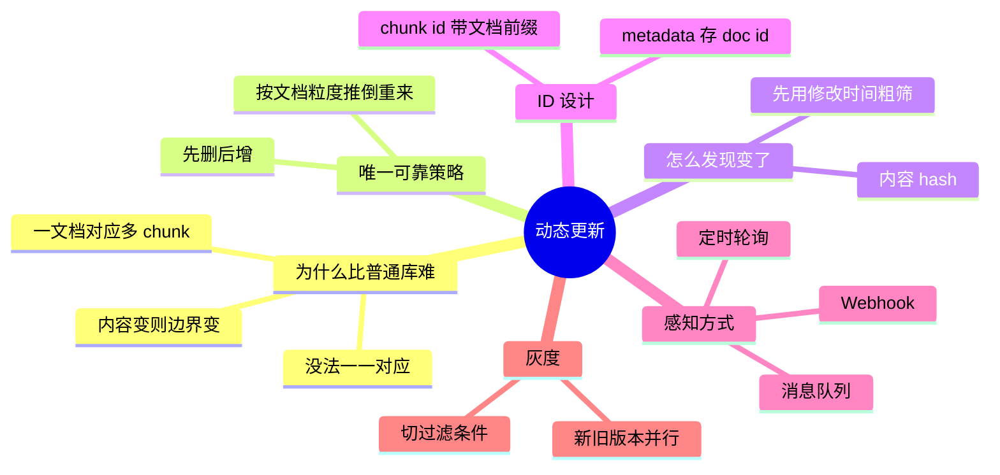

## 🔥 快速背诵

文档一变 chunk 边界就变了，没法做局部更新。正确姿势是先删后增：给每篇文档算内容 hash 做变更检测，变了就把这篇的所有 chunk 删掉，重新切重新入库。所以元数据必须存 doc_id，才能快速找出属于它的 chunk。增量感知低频用轮询、高频用事件。核心库再叠灰度切版本，本质是知识库的蓝绿部署。

> **一句话**：文档一变，chunk 边界就变了，**没法做局部更新**。正确姿势是 **hash 检测变更 → 先删后增 → 增量感知（轮询 / 事件）**，核心库再叠灰度切版本。

## 🧠 导图

---

# 📖 背诵稿

### ① 为什么不能 UPDATE

**普通库改一条记录就是改一条，RAG 里一篇文档对应几十上百个 chunk。**

文档内容一变，切割结果可能完全不同：原来第 3 块的内容现在散在第 3、第 4 块里。你**没法把旧 chunk 和新 chunk 一一对应起来打补丁**——就像把一堵墙拆了重建，不能指望插座还在原来的位置。

### ② 所以只有一条路

**先删后增：把这篇文档之前入库的所有 chunk 全删掉，再按新内容重新切、重新入库。**

暴力，但可靠。三种变更类型里：新增最省事（走完整流程）；删除要清干净（不留僵尸 chunk，否则用户还能搜到失效内容）；**修改最容易踩坑**，记住上面那条——永远不要尝试局部更新。

### ③ 怎么发现变了

**给每个文档算内容 hash，存下来，下次比对。**

MD5/SHA256 都行，改一个标点 hash 就完全不同，成本极低。工程上再优化一层：**先用「最后修改时间」粗筛**，只对时间戳变了的文档算 hash——上百万篇里真改的可能只有几千篇，这样能过滤掉 99%。

### ④ ID 设计（最容易忽视、最容易后悔）

**删除一篇文档的所有 chunk 时，你得能快速找出「哪些 chunk 属于它」。**

两种做法：chunk id 带文档 id 前缀（`product_manual_v3_chunk_001`），按前缀批量删；或者在 metadata 里存 `source_doc_id`，按字段过滤批量删。**关键是入库那天就把这个关联设计好**——等到要更新时再临时想办法，会很狼狈。

### ⑤ 怎么感知 + 怎么发布

**低频用轮询，高频用事件驱动，核心库用灰度切版本。**

- **定时轮询**：实现简单、无依赖，但有延迟，适合一周改几次的内部知识库。
- **Webhook**：Confluence / Notion / 语雀 保存时推一条 HTTP，秒级生效，不用上消息队列。
- **消息队列（Kafka 等）**：大规模、高并发的生产首选。
- **全量重建**：只在文档量很小、或者换了 Embedding 模型 / 改了 Chunking 策略（新旧向量不兼容）时才用。

**灰度**：新版本打 `version=new` 标签，旧版本留着；拿一批测试问题对比新旧答案，确认没退化后再把检索的版本过滤条件切过去；出问题秒级切回。**本质就是知识库的蓝绿部署。**

---

# 🔑 记忆锚

| 记什么 | 内容 | 口诀 |
|---|---|---|
| **1** 条铁律 | 不做局部更新，先删后增 | 「推倒重来」 |
| **1** 个检测 | 内容 hash（先用时间粗筛） | 「先筛后算」 |
| **3** 种感知 | 轮询 / Webhook / MQ | 「慢·快·大」 |
| **1** 个兜底 | 全量重建（换模型才用） | 「换模型才重建」 |

---

# 🎯 追问速查

| 面试官问 | 你答 |
|---|---|
| 只更新变了的那个 chunk 行不行？ | 不行。内容一变边界就变，无法一一对应 |
| 怎么知道文档变了？ | 内容 hash 比对；先用最后修改时间粗筛降开销 |
| 修改和新增有什么不同？ | 新增直接入库；修改要先把旧 chunk 全删掉 |
| 为什么 chunk id 要带文档前缀？ | 便于按前缀批量查找和删除 |
| 秒级入库怎么做？ | Webhook 或 Kafka 事件驱动 |
| 更新出错怎么回滚？ | 版本标签 + 检索过滤条件切换，秒级回滚 |

---

# 🔗 串联

- 往前接 **01**：离线阶段「只做一次」这个假设，在这里被打破
- 往前接 **04**：更新时重切，切法要和之前一致，否则向量规模会漂
- 往前接 **06**：换 Embedding 模型 = 必须全量重建
- 往后接 **09**：批量写入会触发 Segment 合并，更新时机要避开高峰
- 往后接 **21**：版本、生效区间这些元数据，正是冲突裁决的基础

---

# 📚 细节（背完再点开）

> [!note]- 四种方案对照
> | 方案 | 延迟 | 复杂度 | 场景 |
> |---|---|---|---|
> | 定时轮询 | 分钟~小时 | 低 | 更新频率低 |
> | Webhook | 秒级 | 中 | 数据源支持（Notion/语雀） |
> | 消息队列 | 秒级 | 中高 | 大规模生产首选 |
> | 全量重建 | 分钟~小时 | 低 | 量小 / 架构大改 |

> [!note]- 推荐的组合（可以直接背）
> **事件驱动 + hash 变更检测 + 先删后增 + 版本灰度**
> 兼顾实时性、一致性和可回滚性。缺任何一环都会在某次事故里暴露。

> [!note]- 一个真实的坑
> 删了旧 chunk 但没删干净（比如漏了某个分批写入的批次），会留下「僵尸 chunk」。
> 用户偶尔搜到一条已经废止的政策——这种 bug 极难复现，排查成本很高。
> 所以删除要**按文档 id 做幂等清理**，并定期做一次「孤儿 chunk」巡检。

---

# 🎴 自测

> [!question]- Q1 为什么不能局部更新？
> 内容变了边界就变，新旧 chunk 无法一一对应。

> [!question]- Q2 正确策略？
> 先删后增，按文档粒度推倒重来。

> [!question]- Q3 怎么检测变更？
> 内容 hash + 修改时间粗筛。

> [!question]- Q4 三种感知方式？
> 轮询 / Webhook / 消息队列。

> [!question]- Q5 什么时候用全量重建？
> 文档量很小，或换了 Embedding 模型、改了 Chunking 策略。

> [!question]- Q6 灰度怎么做？
> 打版本标签 → 新旧对比 → 切过滤条件 → 出问题切回。
