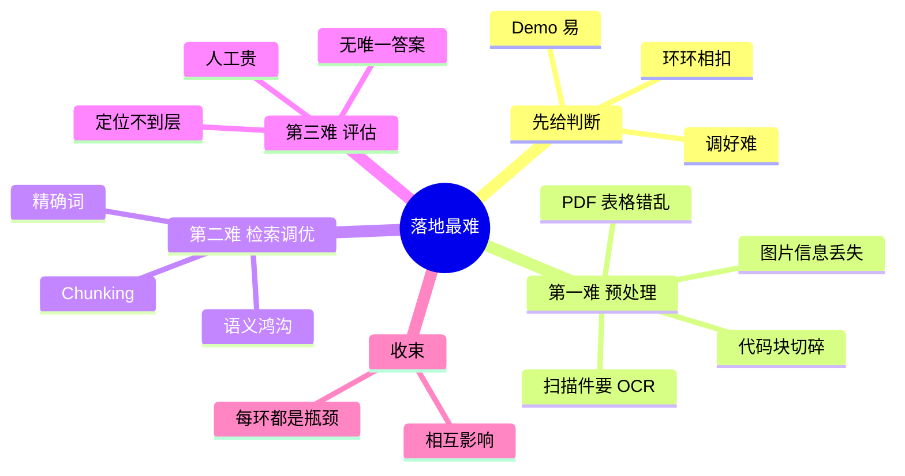

## 🔥 快速背诵

Demo 一两天，调到能用往往要几周几个月。难点有三块：文档预处理是地基，检索调优是天花板，效果评估给方向。要分层说，不能东一榔头西一棒槌。总结一句，难在环环相扣，没有单点突破这回事。

> **一句话**：Demo 一两天，调到能用要几周几个月。难点有三块：**文档预处理（地基）、检索调优（天花板）、效果评估（方向）**。答这题要**分层**，不能东一榔头西一棒槌。

## 🧠 导图

---

# 📖 背诵稿

### ① 先给判断，别急着列

**最难的不是跑起来，是调好。Demo 一两天，达到生产可用往往要几周甚至几个月。**

因为这条链路上**每个环节都可能成为瓶颈，而且相互影响**——改 Chunking 会影响 Embedding 的表现，加多路召回会改变 Rerank 的输入分布，没有哪个参数是孤立可调的。

### ② 第一难：文档预处理

**这是地基型难点：地基歪了，上面盖得再漂亮也塌。**

现实文档格式五花八门。**PDF 表格**最典型：通用文本提取库（如 pypdf）的定位是抓文本流，不是复杂排版，一张三列表（型号/内存/价格）解析出来会变成一串没有行列关系的乱码——「型号内存价格iPhone 158GB5999」。这种东西进库，Embedding 再好也救不回来：**进去的是垃圾，出来的也是垃圾。**

解法是换专门工具（pdfplumber 处理表格、unstructured 做多格式专项），高价值文档可以用多模态模型直接看截图——但**成本是普通 Embedding 的几十到上百倍**，只适合合同、财报、专利这种量可控的。

此外还有扫描件（要 OCR）、图片里的文字（提取不到）、代码块（切碎了逻辑就断了）。**真实系统里，预处理代码量常常比 RAG 核心逻辑还多。**

### ③ 第二难：检索调优

**因为它是天花板，而且原因多、难定位。**

三个典型源头：**Chunking**——退款内容被切散在十几个 chunk 里，每个单独看相关度都不高；**语义鸿沟**——用户说「这个功能怎么用不了」，文档写「系统故障排查指南」；**精确词**——型号、缩写、专有名词，纯向量天然不敏感，得靠 BM25 补。

三个问题交织在一起，所以「效果不好」这四个字几乎没法直接对应到一个动作。

### ④ 第三难：效果评估

**没有量化体系，优化就变成瞎猜。**

单条答案对错人工判断成本高、标准还不统一；端到端指标（满意度、解决率）反馈周期太长；出了问题不知道是切分、检索还是生成的锅。

实用解法就是分层：**检索层看 Hit@K 定位检索是不是瓶颈，端到端用 RAGAs 三个指标（Faithfulness / Answer Relevancy / Context Recall）定位是检索漏了还是模型编了。**

### ⑤ 收尾

**所以我的总结是：难在「环环相扣」——不是某个技术点难，是没有单点突破这回事。**

---

# 🔑 记忆锚

| 记什么 | 内容 | 口诀 |
|---|---|---|
| **3** 难 | 预处理 / 检索 / 评估 | 「地基·天花板·方向盘」 |
| **1** 句判断 | Demo 快，调好慢 | 「一两天的 Demo，几个月的活」 |
| **2** 个典型 | PDF 表格乱码 / 切散导致召不回 | 「乱码·切散」 |

> **卡壳急救**：把三难按「数据进 → 数据找 → 数据评」的时间线排——进的时候脏，找的时候偏，评的时候糊。

---

# 🎯 追问速查

| 面试官问 | 你答 |
|---|---|
| 最难的是 Embedding 选型吗？ | 是一个点，但不是整体答案。要分层讲 |
| 预处理为什么这么难？ | 格式太杂，通用库不是为复杂排版设计的 |
| PDF 表格怎么处理？ | pdfplumber / unstructured；高价值文档可用多模态模型读截图，但成本高 |
| 检索调优从哪查起？ | 先 Chunking，再语义鸿沟（改写），最后精确词（BM25） |
| 评估怎么落地？ | Hit@K 定位检索瓶颈，RAGAs 定位生成问题 |
| 一句话总结？ | 环环相扣，没有单点突破 |

---

# 🔗 串联

- 三难分别对应 **04/05**（切）、**12/13/14**（检索）、**18**（评估）
- 往前接 **03**：RAG 的代价（检索封顶）在这里具象化了
- 往后接 **21**：知识冲突是「预处理 + 治理」交叉出来的新难点
- 金句：**RAG 的难点不在算法，在数据工程**

---

# 📚 细节（背完再点开）

> [!note]- 预处理的各种坑
> | 类型 | 问题 | 解法 |
> |---|---|---|
> | PDF 表格 | 行列关系丢失 | pdfplumber |
> | 双栏排版 | 左右栏文字混在一起 | 版面分析 / unstructured |
> | 扫描件 | 没有文字层 | OCR |
> | 图片内文字 | 提取不到 | 多模态模型 |
> | 代码文件 | 按字符切破坏逻辑 | AST 按函数切 |
>
> 共性：**这些问题都不会报错，只会安静地把垃圾塞进知识库。**

> [!note]- 为什么「几个月」这个说法可信
> 因为它对应的是真实迭代循环：发现问题 → 定位到层 → 改一版 → 用测试集验证 → 回归检查有没有伤到别的场景。
> 每轮都是这个流程，而 RAG 的环节太多，一轮往往只能动一个变量。**说得出这个过程，比说「很难」有说服力得多。**

---

# 🎴 自测

> [!question]- Q1 三难是什么？
> 文档预处理 / 检索调优 / 效果评估。

> [!question]- Q2 为什么预处理是「地基型」难点？
> 输入是垃圾，后面所有环节都救不回来。

> [!question]- Q3 PDF 表格解析为什么会乱？
> 通用库抓的是文本流，不是版面结构。

> [!question]- Q4 检索调优的三个源头？
> Chunking、语义鸿沟、精确词召回。

> [!question]- Q5 评估怎么落地？
> Hit@K 定位检索 + RAGAs 定位生成。

> [!question]- Q6 一句话总结难点？
> 环环相扣，没有单点突破。
