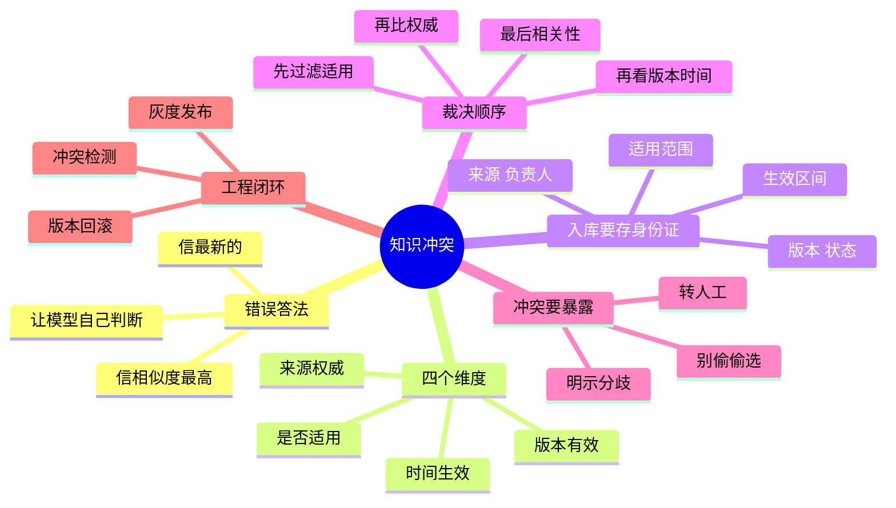

## 🔥 快速背诵

不能信相似度最高那份，相似只说明相关，不等于权威、有效、适用。裁决顺序是先看适用范围，再比来源权威，再看版本状态，再看生效时间，最后才用相关性排序。元数据要在入库那天就存好，冲突发生时再想办法已经晚了。裁不出来就明说冲突，不要偷偷二选一。

> **一句话**：不能信相似度最高那份——**相似只说明相关，不等于权威、有效、适用**。裁决顺序：**适用范围 → 来源权威 → 版本状态 → 生效时间 → 最后才比相关性**。裁不出来就**明说冲突**，别偷偷二选一。

## 🧠 导图

---

# 📖 背诵稿

### ① 先说错误答案

**「信相似度最高的」是最典型也最危险的答法：相似只说明内容和问题像，不说明它权威、有效、适用于这个人。**

看个真实场景：问「今年婚假多少天」。群里有人说「听说改成 15 天了」，正式制度写「10 天」，上海地区细则写「上海员工 15 天」。如果问题里正好有「15 天」，群聊那条相似度可能最高——但它是传闻。而就算制度更权威，问的人是上海员工，地区细则又比总部通用规则更**适用**。

**检索分数回答的是「像不像」，从来没回答「该不该信」。**

### ② 三个错误答法

**信相似度（相关性≠正确性）、信最新的（新不代表适用）、让模型自己判断（你既没给权威等级也没给生效状态，它拿什么判断）。**

第三个尤其要驳：**别把知识治理的责任，甩给一次随机生成。**

### ③ 入库就要存「身份证」

**冲突发生时再想办法已经晚了，元数据要在入库那天就存好。**

要存的：来源系统（source_id）、负责人（owner）、版本号、状态（草稿/生效/废止）、发布时间、**生效区间**、适用范围（地区/产品/客户等级/部门/租户/权限）、原文链接、内容 hash、审批记录。

**发布时间和生效时间必须分开**：下个月才生效的新制度，发布最新但今天不能执行；去年发布但仍在有效期的地区细则，也不该被今天刚发的通用通知盖掉。

### ④ 裁决顺序

**先判断适用，再比权威，再看版本时间，最后才用相关性排序。**

1. 按用户身份、地区、产品、时间，把**不适用、已过期、未生效**的全部过滤掉
2. 比来源权威：审批过的正式制度 > 内部知识文章 > 群聊和个人笔记
3. 同一层级里看版本状态和生效时间：标了「已废止」的不能因为字更像就返回
4. 合格的候选里，才轮到相关性分数排序

> 一个纪律：**权威等级不能由开发拍脑袋写成全局常量**。财务、法务、产品各有知识负责人，应该维护一张**来源注册表**，由业务定义各领域的等级和覆盖关系。

### ⑤ 冲突要被发现，也要被暴露

**离线入库和在线检索两个阶段都要查冲突，查出来要明示，不能偷偷选一个。**

- **离线**：按实体/主题/适用范围聚类，抽关键事实；同一适用范围、同一有效期内出现「10 天」和「15 天」这种互斥取值，就标待审核，别直接进正式索引。数字、日期、状态这类结构化内容，**规则比模型可靠**；模型输出只能当告警线索，不能自动裁决。
- **在线**：如果多条高分片段对同一事实给出互斥结论，要把「存在冲突」作为一个**正式状态**传给生成层，而不是混在 Prompt 里赌模型选对。

生成时的正确姿势：高权威资料已给出唯一结论，就引用它并说明旧资料已废止；如果两份同等权威、同范围、确实裁不出来，就**诚实呈现分歧**——「A 文档规定 10 天，B 文档规定 15 天，暂时无法确认」，附原文链接，请用户补充信息或转人工。

**在医疗、金融、法务、内部制度场景，「不知道」是一种必要能力。**

### ⑥ 工程闭环

**新版本别直接覆盖：进影子索引，对比评测，灰度切流，出问题秒级回滚。**

回滚之后错误版本也不能消失，要保留变更记录、审批人、受影响问题和修复原因——**知识治理做得好不好，就看系统能不能回答：这条知识从哪来、什么时候生效、谁批的、出错能不能撤回。**

评测也要专门造冲突样本：同时放入正式制度和群聊传闻、废止版和现行版、总部规则和地区细则，再变换用户地区和身份，看它选得对不对、敢不敢说不知道。

---

# 🔑 记忆锚

| 记什么 | 内容 | 口诀 |
|---|---|---|
| **1** 句核心 | 相关 ≠ 权威 ≠ 有效 ≠ 适用 | 「四个不等于」 |
| **4** 个维度 | 适用 / 权威 / 版本 / 时间 | 「适·权·版·时」 |
| **1** 个顺序 | 先过滤，再排序 | 「先筛后比」 |
| **1** 条底线 | 裁不出来就明说 | 「不许偷偷选」 |

---

# 🎯 追问速查

| 面试官问 | 你答 |
|---|---|
| 信相似度最高的？ | 不行。相关不等于正确、权威、适用 |
| 信发布日期最新的？ | 不行。下月生效的不能用，总部通用也盖不住地区细则 |
| 让模型自己判断呢？ | 不行。没给权威等级和生效状态，等于把治理甩给一次随机生成 |
| 发布时间和生效时间为什么要分？ | 发布 ≠ 可执行，未来生效的制度和已废止的版本都要靠这两个字段区分 |
| 裁不出来怎么办？ | 明示冲突、分别引用、附原文、转人工 |
| 怎么防止错误知识扩散？ | 影子索引 + 灰度切流 + 版本回滚 + 记录受影响答案 |

---

# 🔗 串联

- 往前接 **19**：版本、生效区间这些字段，更新时就要维护好
- 往前接 **17**：含糊地二选一，本质也是一种「编」
- 往前接 **18**：冲突场景要专门造测试集，普通测试集测不出来
- 金句：**这题表面问选哪段文字，实际问知识怎么被治理**

---

# 📚 细节（背完再点开）

> [!note]- 元数据清单（能报全很加分）
> | 字段 | 作用 |
> |---|---|
> | source_id | 从哪个系统同步 |
> | owner | 谁负责 |
> | version | 版本号 |
> | status | 草稿 / 生效 / 废止 |
> | published_at | 发布时间 |
> | effective_from / to | 生效区间 |
> | scope | 地区 / 产品 / 部门 / 租户 / 权限 |
> | hash | 变更检测 |
> | link | 原文可追溯 |
> | approval | 审批记录 |

> [!note]- 为什么「规则优先于模型」
> 数字、日期、状态、版本号这类内容，字段解析 + 数据库约束能做到确定性判断。
> 让模型去比「10 天 vs 15 天」谁对，它没有依据，只会给你一个看起来合理的答案——**这恰恰是我们要消灭的东西。**
> 模型在这里的合适角色是：**发现可疑冲突（召回线索），不负责裁决。**

> [!note]- 评测要看哪五类结果
> 1. 该回答是否选了正确来源
> 2. 是否误用过期文档
> 3. 关键结论引用是否准确
> 4. 无法裁决时有没有明确暴露冲突
> 5. 本该拒答时有没有胡乱给结论

---

# 🎴 自测

> [!question]- Q1 为什么不能信相似度最高？
> 相关不等于权威、有效、适用。

> [!question]- Q2 四个判断维度？
> 适用 / 权威 / 版本 / 时间。

> [!question]- Q3 裁决顺序？
> 先按适用范围硬过滤 → 比权威等级 → 看版本和生效时间 → 最后才用相关性排序。

> [!question]- Q4 发布时间和生效时间的区别？
> 发布不代表可执行，未来生效和已废止都要靠区间区分。

> [!question]- Q5 裁不出来怎么办？
> 明示冲突、分别引用、附原文、转人工。

> [!question]- Q6 权威等级谁来定？
> 业务负责人维护来源注册表，不能让开发写死常量。
