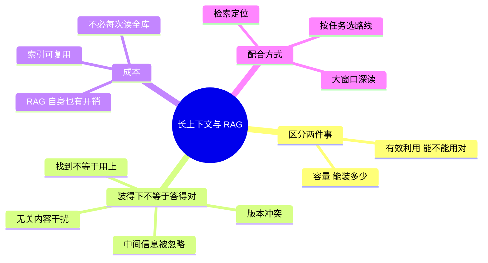

## 🔥 快速背诵

窗口大解决的是能装多少，RAG 解决的是该用哪些。装得下不等于每份都相关、都有效、都会被用对。成本上也不划算，库有 30 万 token，相关问题只占 5000，全量输入等于每次都重复处理那 29.5 万。正确关系是检索缩小范围，大窗口在这个范围里读得更完整。所以是按任务选路线，不是互相替代。

> **一句话**：窗口大解决的是**能装多少**，RAG 解决的是**该用哪些**。装得下 ≠ 每份都相关、都有效、都会被用对。两者不替代，**大窗口反而让 RAG 读得更完整**。

## 🧠 导图

---

# 📖 背诵稿

### ① 先拆两件事

**上下文窗口决定「一次能读多少」，RAG 决定「这次该读哪些」。**

窗口变大，你能把更多章节、更多文件塞进一次请求，这对整体理解确实有帮助。但**窗口本身不会挑资料**——文件要靠应用去读，业务数据要靠系统去取，进来之后模型还得自己判断哪条相关、哪条适用。

所以：**容量是「能接收多少」，有效利用是「能不能得出符合要求的结果」，前者变大不等于后者自动达标。**

### ② 装得下为什么还是答不对

**因为材料多不等于证据充分，甚至可能更糟。**

三个具体原因：

1. **无关内容会干扰**：它增加了模型要区分的负担，重复说法、相近主题、不同版本，都会让它混用条件。
2. **位置会影响利用**：关键信息放在中间，往往比放在开头结尾更难被可靠利用（Lost in the Middle）。
3. **找到不等于用上**：定位一个数字，和「同时应用另一处的限定条件」，是两种不同难度的任务。

举个示意：一份说明里写着「上传上限 20MB」，另一处写着「接口 B 上限 5MB」。问接口 B 时两条都相关，但**特殊规则决定答案**。全塞进去，模型完全可能只抓到通用规则，答成 20MB。

### ③ RAG 的真正价值

**把资料选择提前到生成之前，让「取什么、取哪个版本、给什么依据」变成可显式控制的事。**

它做三件窗口做不到的事：按问题缩小范围（减少无关干扰）、复用索引处理（不必每次重读全库）、把来源和适用范围管起来（版本、权限、可追溯）。

> 注意一个细节：**相关和应用是两回事**。相似度高说明聊的是同一主题，它没法告诉你这条规则是否已生效、是否适用于当前对象。
> 还有：**索引不会自动保鲜**，原文件更新了索引没刷，它还会继续召回旧内容。

### ④ 成本账不能只算一次请求

**如果资料库 30 万 token，而每次问题相关的只有 5000 token，全量输入就等于每次都重复处理那 29.5 万。**

RAG 把一部分处理提前做完，后续多个问题复用。**但 RAG 自己也有开销**：解析、建索引、在线检索、排序、追加读取，资料变得勤还要不断更新。所以比较要看整条链路，不是单次 token 数。

资料很少、只处理一次时，建复杂检索链路未必划算。

### ⑤ 正确的关系：配合

**检索负责缩小查找范围，大窗口负责在这个范围内读得完整。**

具体做法：命中一个片段，把它当**位置线索**，再读所属的完整章节；正文引用了附件或另一条规则，就继续补读。这样能避免「只拿一段孤立文字下结论」。

但要说清边界：**读全文也补不回「完全没被召回的另一份材料」**。所以检索之后还得检查证据够不够，缺条件就继续补查——不能因为已经有几段文字就认为够了。

### ⑥ 收尾

**所以不是「窗口大了就不需要 RAG」，而是「按任务选路线」。**

少量资料要通读总结 → 直接长上下文；大库里的局部事实 → 检索后组织证据；需要跨段条件 → 检索定位再扩大阅读。**判断标准是证据完整性和总成本，不是输入长度。**

---

# 🔑 记忆锚

| 记什么 | 内容 | 口诀 |
|---|---|---|
| **2** 件事 | 容量 / 有效利用 | 「装得下 ≠ 用得上」 |
| **3** 个原因 | 干扰 / 位置 / 用不上 | 「扰·中·用」 |
| **1** 句关系 | 检索定位，窗口深读 | 「小定位·大阅读」 |
| **1** 个边界 | 读全文也补不回没召回的 | 「漏了就是漏了」 |

---

# 🎯 追问速查

| 面试官问 | 你答 |
|---|---|
| 窗口够大还需要 RAG 吗？ | 需要。装得下 ≠ 都相关、都有效、都用对 |
| 全塞进去效果不是更好吗？ | 材料多不等于证据充分，无关内容和版本冲突会干扰 |
| Lost in the Middle 是什么？ | 长上下文里中间位置的信息更难被可靠利用 |
| 大窗口和 RAG 怎么配合？ | 检索定位片段 → 再读完整章节 → 缺证据继续补查 |
| 什么时候直接读全文？ | 资料少、需要通读总结或整体比较时 |
| 成本怎么比？ | 算整条链路：准备 + 检索 + 模型处理 + 补读，不是单次 token |

---

# 🔗 串联

- 往前接 **01**：RAG 的价值不止「省窗口」
- 往前接 **16**：需要跨文档关系时，比的是「能不能跳」，不是「装不装得下」
- 往后接 **23**：再往前走一步，就是「预建索引 vs Agent 现场探索」
- 金句：**窗口解决容量，检索解决选择**

---

# 📚 细节（背完再点开）

> [!note]- 路线选择表
> | 任务特点 | 更合适的方式 |
> |---|---|
> | 少量资料，需通读/总结/整体比较 | 直接长上下文 |
> | 大资料库，问题集中在局部事实 | 检索后组织证据 |
> | 需要跨段条件或文档关系 | 检索定位，再扩大阅读范围 |
> | 资料少且只看一次 | 别建复杂链路 |

> [!note]- 一个反直觉的结论
> 大窗口降低了「必须切碎资料」的压力，但它**没有让「资料获取」和「证据选择」失去意义**。
> 反而因为能装更多，**「怎么选」变得更关键了**——这大概是这道题最漂亮的一句收尾。

> [!note]- 验证时看什么
> 同样模型和资料下：全文能做对而 RAG 做错 → 查召回遗漏；全文混用了不同版本 → 查输入范围和资料组织。
> 也就是说，**对比两种路线的失败模式，比比较平均分更能定位问题。**

---

# 🎴 自测

> [!question]- Q1 窗口和 RAG 分别解决什么？
> 容量 / 证据选择。

> [!question]- Q2 装得下为什么还答不对？
> 干扰、位置（Lost in the Middle）、找到不等于用上。

> [!question]- Q3 RAG 三个窗口做不到的事？
> 缩小范围、复用索引、管来源与适用范围。

> [!question]- Q4 大窗口怎么和 RAG 配合？
> 检索定位，再读完整章节，缺证据继续补查。

> [!question]- Q5 什么任务直接读全文？
> 资料少、需要通读或整体比较。

> [!question]- Q6 一个关键边界？
> 读全文补不回完全没召回到的材料。
