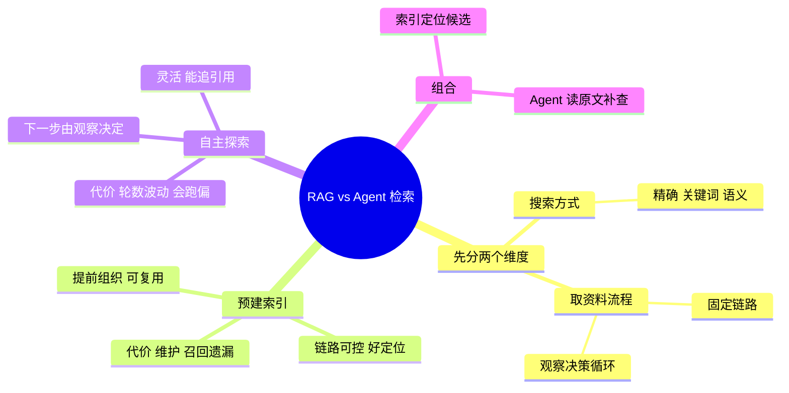

## 🔥 快速背诵

两者不是语义对关键词的对立，那只是搜索方式。真正的区别是取资料的流程：RAG 预建索引走固定链路，Agent 是下一步搜什么由上一步看到什么决定的循环。两者都能用任何搜索方式，也可以组合。选型看两件事，证据能不能提前确定，以及重复处理成本有多高。

> **一句话**：别把两者当成「语义 vs 关键词」的对立——那是**搜索方式**。真正的区别是**取资料的流程**：预建索引走固定链路，Agent 走「观察到什么决定下一步」的循环。两者都能用任何搜索方式，也可以组合。

## 🧠 导图

---

# 📖 背诵稿

### ① 先纠正一个混淆

**很多人一开口就是「RAG 做语义，文件搜索查关键词，所以优先用 RAG」——这是把工具当成了方案。**

RAG 的本义是「取外部证据再生成」，它不要求只用向量，也不要求只查一次。Agent 也完全可以调用语义检索。所以要分开两个维度：

- **搜索方式**：精确字符串、正则、关键词索引、语义索引——决定**怎么匹配**
- **取资料流程**：固定链路，还是「读到什么再决定下一步」的循环——决定**谁来选、什么时候停**

**不能因为用了 grep 或向量库，就推断整个任务怎么运行。**

### ② 预建索引这条路

**把资料组织成本提前做掉，然后多个问题复用。**

解析 → 组织成章节/片段 → 建索引（关键词定位明确名称，语义找「说法不同但意思接近」）→ 收到问题先查候选 → 筛选排序 → 交给模型。

它的价值是**复用**：解析和建索引服务很多请求，不用每个问题都重新探索。而且流程固定，**出问题容易定位**——找不到材料查查询和索引，候选多但选错查排序和范围。

但要说清两个代价：**候选只是「值得读的材料」，不是答案**（相似度高不等于适用，摘要也可能省略条件）；**索引要维护**，原文件变索引没刷就会返回旧内容。

### ③ 自主探索这条路

**关键特征是：下一次搜什么，由上一次看到什么决定。**

列目录 → 搜索 → 读命中内容 → 读到新名称/引用/异常 → 据此继续查 → 直到证据够，或者确认这个范围内做不到。

灵活性就来自这个反馈环：有些问题开始时只能描述症状，具体要读哪些文件，得拿到部分材料才知道。比如一份说明引用了另一份配置，配置又指向实际实现——**下一份材料的入口来自刚读到的东西，不一定出现在用户最初的问题里。**

代价也很实在：多轮工具+模型调用，延迟和读取量会波动；而且**主动搜不天然完整**——猜错关键词、漏看目录、找到一份相关就提前停，都可能让关键证据一直没被读到。

### ④ 选型看什么

**核心看两件事：证据能不能提前确定，以及重复处理成本有多高。**

- 大量资料上的**高频局部问答** → 预建索引（可复用、链路可控）
- 需要**沿线索追查**、下一步取决于上一步 → 自主探索
- 大范围里**入口难找、找到还要深核** → 索引定位 + 继续探索
- 少量资料要**通读** → 直接读全文

另外两个常被忽略的因素：**更新方式**（常变的工作区建索引要处理同步成本；直接读文件能拿到当前内容，但目录可能是旧副本或错误分支）；**响应要求**（固定链路好设上限；自主探索要限制轮数、读取量和总预算）。

### ⑤ 组合才是常见答案

**索引负责找候选入口，Agent 负责读原文、核版本、追引用。**

索引结果要保留来源路径、位置和版本，Agent 才能从候选回到真实材料，检查摘要有没有省掉条件、文件是不是已经变了。读完如果出现引用或新的未知点，再调文件搜索或语义检索补查。

**但第一批候选不能变成探索的围墙**——它解释不了问题时，要允许改查询、换目录，而不是在候选文件里反复找一个并不存在的答案。

### ⑥ 收尾

**所以选的不是「RAG 还是 Agent」，而是「这类任务该用哪种取资料流程」，以及要给它配哪些搜索入口。**

---

# 🔑 记忆锚

| 记什么 | 内容 | 口诀 |
|---|---|---|
| **2** 个维度 | 搜索方式 / 取资料流程 | 「怎么匹配 vs 谁来选」 |
| 索引 **2** 收益 | 复用 / 可控可定位 | 「省·稳」 |
| 自主 **2** 代价 | 轮数波动 / 会跑偏 | 「慢·偏」 |
| **1** 个组合 | 索引定位 + Agent 深读 | 「先找后读」 |

---

# 🎯 追问速查

| 面试官问 | 你答 |
|---|---|
| RAG 语义强所以优先用？ | 混了维度。RAG 也能用关键词，Agent 也能调语义检索 |
| 让 Agent 全自己找行不行？ | 可以，但会漏目录/关键词，轮数和成本波动大 |
| 什么时候必须预建索引？ | 资料多、同类问题多、答案范围相对明确 |
| 什么时候必须自主探索？ | 下一步取决于上一步（追引用、追配置、追代码依赖） |
| 两种能组合吗？ | 能，而且是常见做法：索引找候选，Agent 读原文补查 |
| 常用的判断标准？ | 证据能否提前确定 + 重复处理成本 + 更新方式 |

---

# 🔗 串联

- 往前接 **22**：都是「检索还值不值得」这一族问题
- 往前接 **14**：预建索引就是四层框架的产物
- 往前接 **15**：Agentic RAG 就是这条路线的范式化
- 收尾金句：**RAG 是被编排好的检索，Agent 是现场决定的检索**

---

# 📚 细节（背完再点开）

> [!note]- 路线对照表
> | 需求 | 更值得评估的路线 |
> |---|---|
> | 大量资料上的高频局部问答 | 预建索引 + 固定链路 |
> | 依赖新观察、需追踪关联 | Agent 自主探索 |
> | 入口难找、找到还要深核 | 索引定位 + 继续探索 |
> | 少量资料、需完整阅读 | 直接读全文 |

> [!note]- 一个特别容易被追问的点
> 「让模型生成同义词再交给 grep」——这是**模型改变了搜索策略**，不是 grep 获得了语义理解。
> 把这两层分清，你才知道「找不到资料」时到底该改什么：改工具，还是改策略。

> [!note]- 两条共同的底线
> 1. **证据完整性**：查到一个答案 ≠ 证明所有文件都看过了。取前几个候选、或者 Agent 转了几轮，都不能自动证明没遗漏。
> 2. **权限**：不随方案变化。索引检索、路径搜索、原文读取，都该由程序按当前身份控制——**文件能被搜到，不代表用户有权读**。

---

# 🎴 自测

> [!question]- Q1 两个维度分别是什么？
> 搜索方式（怎么匹配）/ 取资料流程（谁决定下一步）。

> [!question]- Q2 预建索引的两个收益和两个代价？
> 收益：复用、可控可定位；代价：维护成本、召回遗漏。

> [!question]- Q3 自主探索的核心特征？
> 下一步由上一次观察决定。

> [!question]- Q4 什么时候用自主探索？
> 需要沿引用/配置/代码关系追踪，证据无法提前确定时。

> [!question]- Q5 组合怎么做？
> 索引定位候选 → Agent 读原文、核版本、补查。

> [!question]- Q6 两条共同底线？
> 证据完整性、权限控制。
