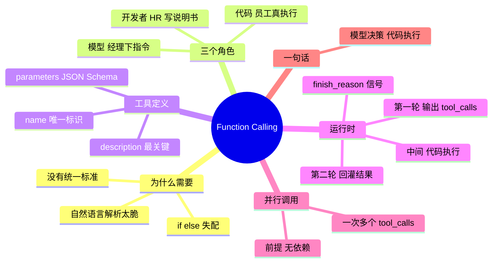

## 🔥 快速背诵

Function Calling 就一句话：模型只负责决策，代码负责执行。开发者用 JSON Schema 给工具写说明书，模型需要调工具时不说话，直接输出结构化的 tool_calls，finish_reason 也是 tool_calls；代码拿到这段 JSON 去跑，把结果以 tool 消息回灌，模型才给最终答案。整件事就是两轮对话加中间执行，核心是决策和执行分离。

> **一句话**：模型只输出结构化的 `tool_calls` JSON，代码负责真正执行——**决策与执行分离**，全程就是「两轮对话 + 中间执行」。

## 🧠 导图



---

# 📖 背诵稿

> 五段，按顺序背。每段**第一句是主线**，后面是补充。

### ① 是什么

**Function Calling 就是让模型用结构化 JSON 表达「我要调哪个工具、参数是什么」，而不是用自然语言说话的一套机制。**

开发者先用 JSON schema 把工具描述好传给模型。模型判断需要调工具时，不输出自然语言，而是输出一段 `tool_calls`，里面写着函数名和参数。你的代码拿到这段 JSON 去真正执行，把结果塞回对话，模型再生成最终答案。这套机制 2023 年由 OpenAI 推出，现在主流模型都支持。

### ② 解决什么

**它解决的是「靠 if/else 解析模型说的话」这种土办法太脆的问题。**

以前模型输出「我需要查一下北京的天气」，你写一堆 if/else 判断它是不是要查天气，换个说法就失配，也没法标准化。Function Calling 把这件事固定下来：格式统一、机器好解析、准确率大幅提升。

### ③ 三个角色

**理解它的关键是搞清楚谁做什么：开发者是 HR，模型是经理，代码是员工。**

HR 写职位说明书，也就是工具的 JSON schema，告诉模型有哪些工具、能干什么、要什么参数。经理读完说明书，决定这个任务调哪个工具、参数填什么，然后下指令。员工真正去跑函数、访问网络、查数据库，把结果汇报回来。**模型全程只下指令，不亲自执行，也没有访问网络的权限。**

### ④ 运行时两轮

**运行时本质是两轮对话加中间执行。**

第一轮，你把工具列表和用户问题一起传进去。模型判断要调工具时，返回的 `finish_reason` 是 `tool_calls`，告诉你「我需要工具，还没准备好回答」。中间这一环交给代码：解析工具名和参数、执行、拿结果。第二轮，把结果以 `role: "tool"` 的消息塞回历史再调一次，这次模型有了信息才给出最终答案。

### ⑤ 并行与边界

**如果一次需要多个工具，模型可以在一次响应里返回多个 tool_calls，前提是这些调用之间没有依赖。**

比如「查北京、上海、广州三个城市的天气」，并行执行三个请求，一轮就拿到全部结果，比串行三轮快得多。但「先查订单号再查物流」有依赖，必须串行，模型也会正确地分两轮输出。

---

# 🔑 记忆锚

| 记什么 | 内容 | 口诀 |
|---|---|---|
| **3** 个角色 | HR（写说明书）/ 经理（下指令）/ 员工（真执行） | 「招·派·干」 |
| **2** 轮对话 | 决策轮 / 结果轮 | 「一决二答」 |
| **3** 个 schema 字段 | name / description / parameters | 「名·述·参」 |
| **1** 条铁律 | 模型决策，代码执行 | 「脑动不了手」 |

> **卡壳急救**：任何细节想不起来，回到「两轮对话」——第一轮讲 tool_calls 和 finish_reason，第二轮讲 role:tool 回灌。

---

# 🎯 追问速查

| 面试官问 | 你答 |
|---|---|
| 模型能自己联网执行吗？ | **不能**。模型只输出 JSON 决策，执行永远是宿主代码，这也是安全边界所在 |
| 工具 schema 哪个字段最关键？ | **description**。它是模型判断要不要调的唯一依据；写得含糊模型就瞎猜、参数乱填 |
| 怎么知道模型要调工具？ | `finish_reason == "tool_calls"`，这是「我还没答完」的明确信号 |
| 工具结果怎么回灌？ | 以 `role: "tool"` 消息追加，`tool_call_id` 必须和请求里的 id 对上 |
| 并行调用怎么实现？ | 一次响应多个 tool_calls → `asyncio.gather` / 多线程并发 → 结果一起回灌 |
| 并行有什么前提？ | **调用之间无依赖**。有依赖（先查单号再查物流）必须串行 |
| 怎么强制它调工具？ | `tool_choice: "required"`；默认 `auto` 让模型自己判断 |
| 和 MCP 什么关系？ | FC 管「模型怎么表达意图」，MCP 管「应用怎么接入工具」——两个层次 |

---

# 🔗 串联

- 讲 schema → 顺势到 **工具调用规范化** → 工具一多就引出 **MCP**（M×N 变 M+N）
- 讲「模型决策、代码执行」→ 呼应 **Agent 三支柱**里的「工具是手」
- 讲并行 → 展开 **Agent 并行工具调用**与延迟优化
- 讲 description 重要 → 引出 **Prompt / 工具描述工程**，同属「给模型写说明书」
- 总纲收尾：**FC 是语法，MCP 是插头，Agent 是会用工具的脑子**

---

# 📚 细节（背完再点开）

> [!note]- 最小可用代码骨架
> ```python
> msg = client.chat.completions.create(
>     model="gpt-4o", messages=messages, tools=tools, tool_choice="auto"
> ).choices[0].message
>
> if msg.finish_reason == "tool_calls":
>     call = msg.tool_calls[0]
>     args = json.loads(call.function.arguments)      # {"city": "北京"}
>     result = run_tool(call.function.name, args)     # 代码真正执行
>     messages.append(msg)
>     messages.append({"role": "tool", "tool_call_id": call.id, "content": result})
>     final = client.chat.completions.create(model="gpt-4o", messages=messages, tools=tools)
> ```
> 记住三个必须对齐的点：`tool_call_id` 对齐、`role` 必须是 tool、第二轮要**再带一次 tools**。

> [!note]- description 写不好会怎样
> | 写法 | 模型表现 |
> |---|---|
> | 「获取天气」 | 英文城市名也照样调、时间跨度不对也硬塞，返回数据对不上 |
> | 「查询指定城市的实时天气，含气温/天气状况/风向风速，仅支持中国大陆城市」 | 边界清晰，不该调的会拒 |
>
> 参数 description 同样要吃透：格式要求、示例值、限制条件都要写进去。

> [!note]- 并行调用的收益账
> 串行：模型推理 → 执行 → 模型推理 → 执行 → 模型推理（3 次推理）
> 并行：模型推理（一次输出 N 个 call）→ 并发执行 → 模型推理（2 次推理）
> 省下的是**模型推理次数**，而推理往往比工具执行贵得多。

---

# 🎴 自测（遮住上面，先自己说）

> [!question]- Q1 一句话说清 Function Calling
> 模型输出结构化 `tool_calls` JSON 表达调用意图，代码执行后回灌结果——决策与执行分离。

> [!question]- Q2 三个角色分别是谁？
> 开发者写 schema（HR）、模型做决策（经理）、代码去执行（员工）。

> [!question]- Q3 运行时几轮？每轮干什么？
> 两轮：第一轮输出 tool_calls（finish_reason 标记），中间代码执行，第二轮带 role:tool 结果再问。

> [!question]- Q4 为什么 description 最关键？
> 它是模型判断「要不要调、参数怎么填」的唯一依据，含糊就会瞎猜。

> [!question]- Q5 并行调用的前提？
> 工具间无依赖；有依赖的必须串行，否则参数拿不到。

> [!question]- Q6 最容易答错的点？
> 说「模型自己调 API/联网」。实际模型只下指令，执行在代码侧。
