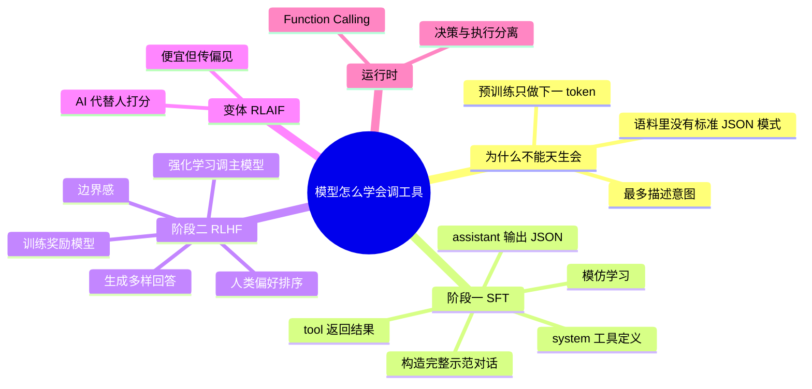

## 🔥 快速背诵

工具调用不是预训练自然涌现的，是专项训练出来的。预训练只学下一个 token，模型本身不知道该在什么时候输出一段 JSON。SFT 负责教怎么调，喂大量工具描述加正确调用样本，让它学会输出格式；RLHF 负责教什么时候该调、什么时候不该调，用奖励模型把乱调用和该调不调压下去。

> **一句话**：**SFT 教会怎么调，RLHF 教会什么时候调**。工具调用不是涌现出来的，是专项训练出来的。

## 🧠 导图



---

# 📖 背诵稿

> 四段，按顺序背。

### ① 为什么不是天生的

**工具调用能力不是预训练的自然产物，因为预训练只做一件事：预测下一个 token。**

模型读过的语料里有代码、有文档，但几乎不存在「给定一组工具 schema，该在什么场景输出什么 JSON」这种成对样本。所以哪怕你在 prompt 里写「你可以调天气 API」，没训练过的模型也只会说「我需要调用天气 API 来回答你」——它在描述意图，不是输出可被程序解析的调用请求。这两者有本质差距。

### ② SFT 教怎么调

**SFT 的做法很直接：给模型看大量正确的工具调用示范，让它模仿。**

一条样本把整条链路都写全：system 里放工具定义，user 是问题，assistant 的「正确答案」不是自然语言而是结构化 JSON，然后是 tool 返回的执行结果，最后 assistant 再给出自然语言答案。模型在几十万条这样的样本上反向传播，就学会了「看到工具定义 + 看到问题 → 输出规范 JSON」这套模式。数据来源两条路：人工标注做种子，强模型批量生成再抽查。

### ③ RLHF 教该不该调

**SFT 有个明显短板：它知道怎么调，但不知道什么时候不该调。**

示范样本里「该调」占了绝大多数，模型会过拟合这种积极调用，问它「1+1 等于几」也想去调计算器。RLHF 就是来补这个边界感的：同一问题让模型生成多种回答，人类给这些回答排序打分，用打分数据训一个专门的奖励模型当裁判，再用 PPO 拿裁判的分数去调主模型，让它越来越倾向于输出人类喜欢的处理方式。选 PPO 是因为它稳定，且内置 KL 约束，防止模型为了讨好奖励模型把语言能力训废。

### ④ 运行时分工

**训练完之后，运行时靠 Function Calling 把能力兑现出来。**

应用把工具 schema 和问题一起发给模型，模型判断要调就输出 structured tool_calls，然后停下——它不会执行。代码解析、执行、把结果塞回对话，模型再组织成一句话回答。**模型负责决策，代码负责执行**，这样既灵活又安全：权限控制、参数校验、执行沙箱都能放在代码这一侧。

---

# 🔑 记忆锚

| 记什么 | 内容 | 口诀 |
|---|---|---|
| **2** 个阶段 | SFT（会不会）/ RLHF（该不该） | 「会·该」 |
| **5** 段样本结构 | system 定义 / user 问题 / assistant JSON / tool 结果 / assistant 回答 | 「定·问·调·果·答」 |
| **4** 步 RLHF | 生成多样 / 人类排序 / 训奖励模型 / RL 调主模型 | 「生·排·裁·调」 |
| **1** 个变体 | RLAIF（AI 当裁判） | 「省钱但传偏」 |

> **卡壳急救**：只要记住「SFT 教动作，RLHF 教判断」，其余细节都能顺着推。

---

# 🎯 追问速查

| 面试官问 | 你答 |
|---|---|
| 参数量大了就会调工具吗？ | **不会**。涌现是语言能力，工具调用要输出特定格式 JSON，语料里没有这个模式 |
| SFT 解决什么？ | 「会不会调」——识别工具定义、判断要不要调、输出规范 JSON |
| RLHF 解决什么？ | 「该不该调」——避免简单问题也去调工具，建立行为边界 |
| 为什么用 PPO？ | 稳定 + 内置 KL 散度约束，防止新模型偏离旧模型太远、语言能力退化 |
| 奖励模型是什么？ | 用人类偏好排序数据训出来的打分器，只打分不回答，等于把人的判断蒸馏进模型 |
| RLAIF 是什么？ | 用强模型代替人类打分，成本低 10~100 倍，但 AI 的偏见也会被学进去 |
| 为什么执行必须放代码侧？ | 模型不该有直接操作系统资源的权限；代码侧才能做授权、校验、沙箱 |

---

# 🔗 串联

- SFT → 顺接 **微调 / LoRA / Post-Training**（大模型工程线）
- RLHF → 顺接 **DPO vs PPO**、**GRPO / 拒绝采样**
- 边界感 → 呼应 **Agent 的「不该调就别调」**与成本控制
- 运行时 → 直接引出 **Function Calling**（01）→ 再引出 **MCP**（04）
- 一句话收尾：**能力靠训练，落地靠协议**

---

# 📚 细节（背完再点开）

> [!note]- 一条 SFT 样本长什么样
> ```
> system: 你有工具 get_weather(city)，返回实时天气
> user:   北京今天天气怎么样？
> assistant: {"tool_calls":[{"name":"get_weather","arguments":{"city":"北京"}}]}
> tool:   晴，15°C，东北风 3 级
> assistant: 北京今天晴，15°C，体感舒适，适合外出。
> ```
> 注意 assistant 那一行**不是自然语言**，这是整条样本的训练目标。

> [!note]- SFT 为什么会「过度热情」
> 1. 样本里正例压倒性占多数，反例（不该调）太少
> 2. 训练信号只告诉「这是对的」，没告诉「不调也是对的」
> 3. 结果：边界感弱、工具失败后不知道怎么处理

> [!note]- RLHF 比 SFT 多出的那点东西
> SFT 是**模仿**：只有一条标准答案。
> RLHF 是**比较**：A 比 B 好，模型学到的是偏好方向，能覆盖 SFT 样本没覆盖到的边界情况。

---

# 🎴 自测

> [!question]- Q1 为什么预训练学不会工具调用？
> 只做下一个 token 预测，语料里没有「schema → 该输出什么 JSON」的成对模式，最多学会描述意图。

> [!question]- Q2 SFT 和 RLHF 各解决什么？
> SFT 解决「会不会调」，RLHF 解决「该不该调」。

> [!question]- Q3 一条训练样本的五个部分？
> system 工具定义 / user 问题 / assistant JSON 调用 / tool 执行结果 / assistant 最终回答。

> [!question]- Q4 RLHF 四步？
> 生成多样回答 → 人类偏好排序 → 训奖励模型 → PPO 调主模型。

> [!question]- Q5 为什么执行不能交给模型？
> 模型没有执行能力，也不该有系统权限；代码侧才能做授权、校验、沙箱。

> [!question]- Q6 RLAIF 的代价？
> 成本低但会把 AI 评委的偏见一并学进模型。
