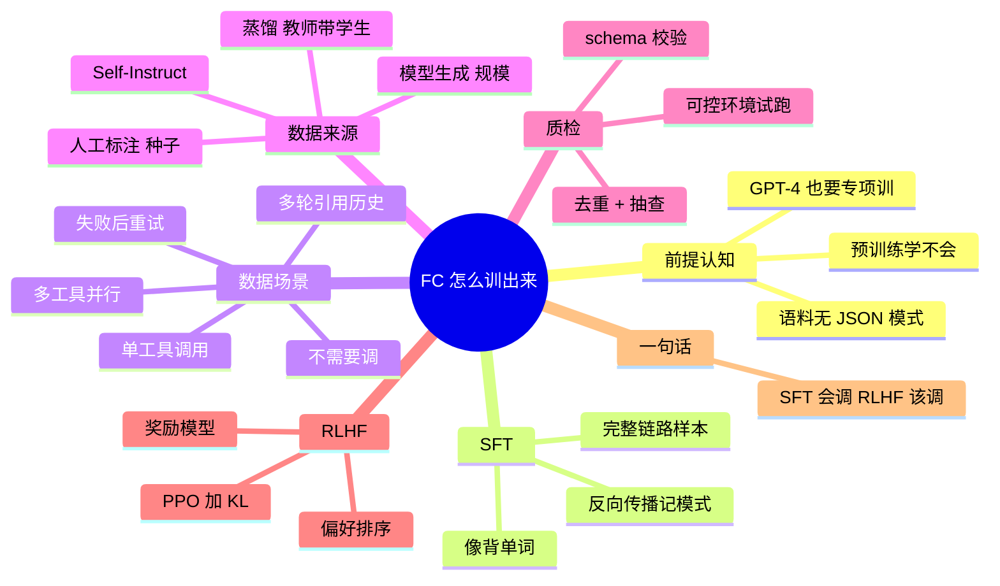

## 🔥 快速背诵

Function Call 的训练，核心不是喂多少样本，而是样本覆盖了哪些场景。按五类铺：单工具调用、并行调用、失败重试、不该调时拒绝、多轮上下文引用。缺哪一类，上线就在那个场景翻车。数据来源是先人工写种子，再用强模型批量生成，合成数据必须过三关，schema 校验、真跑一遍工具、人工抽查。

> **一句话**：训练的核心不是「喂样本」，而是**样本覆盖哪些场景**——单工具、并行、失败重试、不该调、多轮引用，缺哪个就在哪个场景翻车。

## 🧠 导图

---

# 📖 背诵稿

> 五段，按顺序背。

### ① 先破一个误解

**Function Call 不是模型聪明了自然就会的，连 GPT-4 不做专项训练也只会「描述意图」。**

它可能输出「我需要查询天气数据」，那是在说人话，不是在输出可被程序解析的 JSON。根本原因是预训练语料里压根没有「给定一组工具 schema，该在什么场景输出什么 JSON」这种成对模式，权重里没这个经验。

### ② SFT 怎么教

**SFT 的做法是构造完整链路的对话样本，让模型通过模仿学会整套流程。**

一条样本从 system 的工具定义开始，到 user 问题、assistant 的结构化 JSON 调用、tool 执行结果、assistant 最终回答结束。模型通过反向传播学习：输出偏离正确 JSON 就有损失惩罚，梯度回去调参数，大量样本反复训练，最后形成类似肌肉记忆的模式。这一阶段解决的是「会不会」。

### ③ 数据场景才是分水岭

**训练数据的上限决定能力上限，只覆盖「正常调一个工具」远远不够。**

至少五类场景都要有：单工具调用是入门款；多工具并行调用，否则模型不知道可以一次返回多个请求；工具调用失败后的处理，API 超时、参数错、权限不足都要能识别并换方式；**不需要工具直接回答**这一类最容易被忽略，缺了模型就会形成「遇事就调」的惯性；还有多轮对话里引用已有工具结果，不能无视历史重新调。

### ④ 数据从哪来

**两条路：人工标注和模型生成，各自解决质量和规模。**

人工标注适合构造种子数据和复杂场景，质量可控但扩不动。模型自动生成是主流：给工具定义和少量示例批量生成问题、参数和轨迹，再筛。但要小心两个概念别混：Self-Instruct 是让模型生成指令和回答再筛，用强模型生成轨迹训小模型是蒸馏，两者都可能用合成数据但不等号。生成多了一定要质检——编造工具名、填错参数、虚构执行结果，这些错误混进去学生模型就一起学歪了，入库前要做 schema 校验、可控环境试跑、去重和人工抽查。

### ⑤ RLHF 补边界

**SFT 的样本都是正例，模型容易学得过激，所以还要 RLHF 教它什么时候不该调。**

流程四步：同一问题生成多种回答（直接答的、调了工具的、参数错的）→ 人类排序 → 用排序数据训奖励模型 → 用 PPO 拿奖励信号调主模型。PPO 胜在两个地方：更新稳定不会把模型调废，内置 KL 约束防止新模型偏离太远、语言能力退化。

---

# 🔑 记忆锚

| 记什么 | 内容 | 口诀 |
|---|---|---|
| **5** 类场景 | 单工具 / 并行 / 失败重试 / 不该调 / 多轮引用 | 「单·并·败·不·轮」 |
| **2** 条数据来源 | 人工标注 / 模型生成 | 「人做种，机做量」 |
| **3** 步质检 | schema 校验 / 试跑验证 / 去重抽查 | 「校·跑·抽」 |
| **2** 个易混概念 | Self-Instruct ≠ 蒸馏 | 「都合成，不等号」 |

> **卡壳急救**：被问「训练数据怎么造」，先背「单并败不轮」，再补「人做种、机做量、校跑抽」。

---

# 🎯 追问速查

| 面试官问 | 你答 |
|---|---|
| 为什么预训练学不会？ | 只有下一 token 目标，语料里没有 schema→JSON 成对模式 |
| 最容易被忽略的场景？ | **不需要调工具直接回答**。缺了模型就「遇事就调」，画蛇添足 |
| 为什么必须有多工具并行样本？ | 没见过这个模式模型就不知道可以一次返回多个 call，只能一个个串行 |
| 工具失败怎么训？ | 样本里放超时/参数错/权限不足的错误返回，教模型读错误信息换策略而不是重试到底 |
| 合成数据最大风险？ | 编造工具名、填错参数、虚构执行结果，错误会被学生模型继承 |
| Self-Instruct 和蒸馏区别？ | 前者让模型自造指令数据，后者是强模型生成轨迹训弱模型；都不等于合成数据 |
| PPO 为什么被选中？ | 稳定 + KL 约束防退化，在「追奖励」和「保语言能力」间走钢丝 |

---

# 🔗 串联

- 场景覆盖 → 呼应 **Agent 评测集设计**（第 19 篇），两者都是「样本决定上限」
- 失败重试 → 呼应 **Agent 容错 / 循环稳定性**
- 不该调 → 呼应 **工具选择与成本控制**、**何时的 Agent 请求人工确认**
- RLHF → 展开 **DPO / GRPO / 拒绝采样**
- 收尾金句：**SFT 管动作规范，RLHF 管判断分寸**

---

# 📚 细节（背完再点开）

> [!note]- 五类场景对应的翻车姿势
> | 场景 | 缺了会怎样 |
> |---|---|
> | 单工具调用 | 连基础格式都输出不对 |
> | 多工具并行 | 三个城市查天气变成三轮串行，延迟翻倍 |
> | 失败后重试 | API 一超时就重复同一个错调用，或者直接崩 |
> | 不需要调 | 问「1+1」也去调计算器，白烧 token 和延迟 |
> | 多轮引用历史 | 无视上一轮的工具结果，重新调一遍 |

> [!note]- 合成数据流水线
> 1. 用强模型按 schema 生成「问题 + 调用轨迹」
> 2. schema 校验：工具名存在？参数类型/枚举对？
> 3. 沙箱试跑：真执行一遍，拿到真实结果而不是模型编的
> 4. 去重 + 人工抽查，只保留轨迹合理、结果真实的
> 5. 按场景配比抽样，避免「全是正例」

---

# 🎴 自测

> [!question]- Q1 一句话说清两个阶段？
> SFT 教会怎么调，RLHF 教会什么时候调。

> [!question]- Q2 五类训练场景？
> 单工具 / 并行 / 失败重试 / 不需要调 / 多轮引用，口诀「单并败不轮」。

> [!question]- Q3 数据来源两条路各适合什么？
> 人工标注做种子和复杂场景，模型生成扩规模，配 schema 校验 + 试跑 + 抽查。

> [!question]- Q4 最容易翻车的场景？
> 训练集全是正例 → 模型「遇事就调」，该直接答的也调工具。

> [!question]- Q5 PPO 的两个好处？
> 更新稳定 + KL 约束防语言能力退化。
