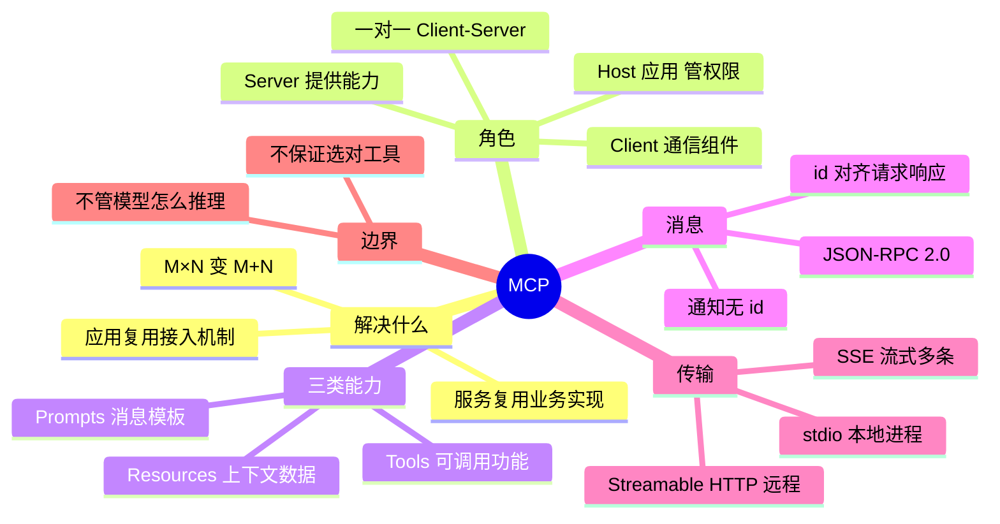

## 🔥 快速背诵

MCP 是 AI 应用和外部工具、数据之间的开放接入协议。它解决重复适配，把 M 乘 N 压成 M 加 N，5 个应用接 8 个工具从 40 份对接变成 13 份。结构是三层角色，Host 管权限和上下文，Client 一对一对接，Server 提供能力；Server 对外暴露 Tools、Resources、Prompts 三类东西。消息走 JSON-RPC 2.0，本地 stdio，远程 Streamable HTTP。

## 🧠 导图



---

# 📖 背诵稿

> 五段，按顺序背。

### ① 解决什么

**MCP 解决的是「每接一个新服务，每个应用都要重写一遍适配」这件事。**

假设你给助手 A 接了 GitHub 查询，另一个团队的助手 B 也想查 GitHub，业务代码能复用，但工具注册方式、调用接口、返回格式都得重新适配。服务一多、应用一多，就变成 M×N 套专用代码。MCP 把每个服务封装成标准 Server，应用只要实现一次 MCP 接入，就能对接所有兼容 Server——**M×N 变成 M+N**。它标准化的是「应用与服务之间的交互」，不会替你写业务逻辑。

### ② 三层角色

**架构上三个角色：Host 是 AI 应用，Client 是通信组件，Server 提供能力。**

Host 负责和模型交互、管上下文、管用户授权和权限，比如 Claude Desktop、Cursor。要连一个 Server 就创建一个 Client，**每个 Client 一对一对接一个 Server**，所以一个 Host 可以管多个 Client 接入多个 Server。Server 负责提供并执行具体能力，比如封装搜索仓库、查 Issue、建 Issue。远程 Server 可以同时服务多个 Client，这跟「一对一」不矛盾——一个说的是 Client 侧，一个说的是 Server 侧。

### ③ 三类能力

**Server 对外提供三类能力：Tools 是可调用的功能，Resources 是上下文数据，Prompts 是消息模板。**

Tools 比如 `search_code(query)`、`create_issue(title, body)`，关键是「能调用某个功能」，**副作用只是这个功能的属性，不能拿来分类**——搜索代码也是 Tool，只是它只读。Resources 用 URI 标识，比如 `repo://demo/README.md`，Host 读了放进上下文让模型了解背景。Prompts 是参数化的模板，比如代码审查模板，展开成一组消息交给模型。常见交互方式是 Tools 由模型选、Resources 由应用决定何时塞、Prompts 由用户选，但这不是协议强制。

### ④ 一次调用的完整链路

**一次工具调用是这样走的：Host 先取工具清单，模型决定调哪个，Host 检查授权，Client 发请求，Server 执行，结果回灌给模型。**

Host 通过 `tools/list` 拿到工具名、说明和 `inputSchema`，转成模型认识的格式。模型输出调用请求——注意它只是提出请求，执行的是应用和 Server。Host 检查工具可用性和用户授权，通过 Client 发出 `tools/call`。Server 收到后调用真实 API，把结果返回。Host 再把结果交给模型生成回答，如果不够模型还会提出下一次调用，这就是工具调用循环。**FC 负责模型怎么表达意图，MCP 负责应用怎么发现和调用工具**，Host 负责把两边格式衔接起来。

### ⑤ 消息与传输

**消息用 JSON-RPC 2.0，分请求、响应、通知三类；传输有 stdio 和 Streamable HTTP 两种。**

请求带 `id`，响应带相同 `id` 好对上号；通知没有 `id`，不用回。要区分 `tools/call` 是协议方法、`search_issues` 是具体工具。传输上，stdio 适合本地进程——Client 起子进程，走 stdin/stdout，**日志必须写 stderr**，否则会被当成协议消息。Streamable HTTP 适合远程独立部署，可以返回单个 JSON，也可以返回 SSE 流一条条推。失败要分两层：协议不合法返回 JSON-RPC error，业务失败则在 result 里用 `isError: true`。

---

# 🔑 记忆锚

| 记什么 | 内容 | 口诀 |
|---|---|---|
| **3** 层角色 | Host / Client / Server | 「应·通·服」 |
| **3** 类能力 | Tools / Resources / Prompts | 「能做·能读·能套」 |
| **2** 种传输 | stdio（本地）/ Streamable HTTP（远程） | 「管道·端点」 |
| **1** 个公式 | M×N → M+N | 「各实现一次协议」 |

> **卡壳急救**：从「一次调用」倒推——取清单（Host+Client）、模型选（FC）、检查授权（Host）、执行（Server）、回灌（Host）。

---

# 🎯 追问速查

| 面试官问 | 你答 |
|---|---|
| MCP 和 FC 什么关系？ | **两个层次**：FC 是模型表达调用意图的格式，MCP 是应用接入工具/数据的协议；Host 负责衔接 |
| Claude Desktop 是 Client 吗？ | 是 **Host**。Host 管多个 Client，每个 Client 对一个 Server |
| Tools 和 Resources 按副作用分？ | **不行**。搜索代码是只读 Tool；区别在接口职责——可调用功能 vs 上下文数据 |
| 同一份 README 能同时是两者吗？ | 能。内容相同但接口职责不同，看 Server 用哪个接口暴露 |
| 执行失败怎么报？ | 分两层：协议错误回 JSON-RPC error；业务失败在 result 里 `isError: true` |
| stdio 有什么坑？ | stdout 只能走协议消息，日志必须写 stderr，否则被误解析 |
| SSE 一定要用吗？ | 不一定。一次 JSON 能返回就不用；SSE 用于同一次响应里推多条（进度 + 结果） |
| MCP 能保证模型选对工具吗？ | **不能**。它只标准化发现与调用，选不选对是模型的事 |
| 安全上要注意什么？ | 授权要按具体操作和数据设计；Server 返回的文档不可信，不能当高优先级指令照办 |

---

# 🔗 串联

- MCP → 前置是 **Function Calling**（01），区别见 **06 / 07**
- MCP ↔ Agent：**MCP 是让 Agent 伸手拿工具的插头**
- MCP vs **A2A**：前者 Agent↔工具，后者 Agent↔Agent（12）
- MCP vs **Skill**：协议 vs 打包好的方法论（09 / 10 / 11）
- 传输 → 展开 **SSE vs WebSocket**（14）、**WebRTC**（15）
- 收尾金句：**工具一多，协议先立**

---

# 📚 细节（背完再点开）

> [!note]- 一次 tools/call 的消息骨架
> ```json
> {"jsonrpc":"2.0","id":7,"method":"tools/call",
>  "params":{"name":"search_issues","arguments":{"repository":"demo","query":"is:open login"}}}
> ```
> 响应：`{"jsonrpc":"2.0","id":7,"result":{"resultType":"complete","content":[{"type":"text","text":"找到 2 条…"}],"isError":false}}`

> [!note]- 协议版本演进（能说出这句就赢一半）
> | 版本 | 特点 |
> |---|---|
> | 2024-11-05 | 早期 HTTP+SSE 双端点，已弃用 |
> | 2025-03 ~ 2025-11 | 单端点 Streamable HTTP，保留 initialize 握手、会话、独立 GET SSE |
> | 2026-07-28 | 每个请求在 `_meta` 带版本与能力，移除握手与 HTTP 会话；通知走 `subscriptions/listen` |
>
> 新版「无状态」指请求不依赖连接上的隐式会话，但业务状态仍可显式携带任务标识。

> [!note]- 三类能力对照
> | 能力 | 用途 | 方法 | 例子 |
> |---|---|---|---|
> | Tools | 执行可调用功能 | `tools/list` / `tools/call` | 搜代码、建 Issue |
> | Resources | 提供上下文数据 | `resources/list` / `resources/read` | 读 README |
> | Prompts | 可复用消息模板 | `prompts/list` / `prompts/get` | 代码审查模板 |

---

# 🎴 自测

> [!question]- Q1 用一句话解释 MCP 的价值
> 统一 AI 应用与工具的接入协议，M×N 适配变成 M+N。

> [!question]- Q2 三层角色谁管权限？
> Host。它管模型交互、上下文、用户授权与权限控制。

> [!question]- Q3 三类能力分别是什么？
> Tools 可调用功能、Resources 上下文数据、Prompts 消息模板。

> [!question]- Q4 Tools 和 Resources 怎么分？
> 按接口职责：能调用的 vs 提供上下文的；不能按副作用分（只读也可能是 Tool）。

> [!question]- Q5 两种传输方式？
> stdio（本地子进程，走 stdin/stdout）与 Streamable HTTP（远程服务，可 JSON 也可 SSE）。

> [!question]- Q6 MCP 不管什么？
> 不管模型怎么推理、不保证选对工具、不替你实现业务逻辑。
