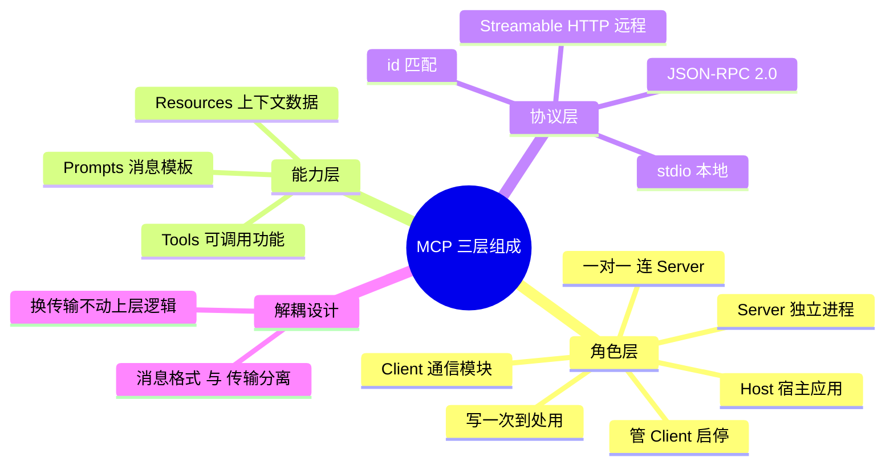

## 🔥 快速背诵

MCP 分三层看。角色层是 Host、Client、Server，一个 Host 挂多个 Client，每个 Client 对一个 Server。能力层是 Tools、Resources、Prompts，分别是可执行函数、可读数据、预置提示模板。协议层是 JSON-RPC 2.0 加传输方式，本地 stdio、远程 Streamable HTTP。关键设计是格式和传输解耦，换传输不动上层逻辑。

## 🧠 导图



---

# 📖 背诵稿

> 四段，按顺序背。

### ① 三层骨架

**MCP 由三层组成：谁和谁通信、能暴露什么、消息怎么传。**

第一层角色架构，Host / Client / Server；第二层能力类型，Tools / Resources / Prompts；第三层传输协议，JSON-RPC 2.0 加两种传输方式。这三层互相独立、不耦合，合起来才是完整骨架。很多人第一次被一堆名词砸懵，就是因为没分层次。

### ② 角色层

**角色层三个角色各有分工：Host 是调度中心，Client 是驻场联络员，Server 是供应商。**

Host 就是你在用的 AI 应用，比如 Claude Desktop、Cursor、Windsurf，它负责启动和管理所有 Client，决定连哪些 Server、什么时候断开。Client 是 Host 内部的连接模块，一个 Client 只对接一个 Server，干三件事：连上、问对方「你有什么能力」、把调用请求转发出去再把结果带回来。Server 是工具方实现的独立进程，不关心上面是谁在用，按协议响应就行——这正是 MCP 的价值：**写一次，任何支持 MCP 的 Host 都能用**。

### ③ 能力层

**Server 能暴露三类东西：Tools、Resources、Prompts。**

Tools 是可调用的功能，比如 `read_file`、`create_issue`，由模型主动触发，对应 FC 里「函数」的概念，只是被标准化打包了。Resources 是用 URI 标识的上下文数据，比如 `repo://demo/README.md`，不改变任何东西，是给模型看的资料。Prompts 是带参数占位符的提示模板，把团队的最佳实践模板化，调用时传参就能展开。一句话记：**Tools 能做事、Resources 给资料、Prompts 套模板**。

> [!warning] 一个常见说法要改口
> 「Tools 有副作用、Resources 只读」是简化说法，**严格按它分类会被追问打脸**：搜索代码是只读的，但它也是 Tool。正确表述是——Tools 提供可调用的功能（可读可写），Resources 提供上下文数据，区别在**接口职责**，风险看具体操作和数据。

### ④ 协议层

**消息格式统一用 JSON-RPC 2.0，传输支持 stdio 和 Streamable HTTP，这两层是解耦的。**

JSON-RPC 每条消息都是 JSON 对象：请求说清方法、参数、id，响应带同样的 id 好对上号；好处是可读、可调试、任何语言都能实现。传输上，stdio 让 Server 作为本地子进程跑，走管道，延迟极低、不占端口，Claude Desktop 接本地 Server 走的就是它；Streamable HTTP 让 Server 独立部署成 HTTP 服务，多 Client 共享。历史上早期是「HTTP + SSE」双端点，2025 年 3 月改成单端点 Streamable HTTP——不是抛弃 SSE，而是短请求回普通 JSON、长请求把响应升级成 SSE 流。**消息格式和传输方式解耦**，同一套 JSON-RPC 能跑在任何传输上，这是 MCP 灵活性的来源。

---

# 🔑 记忆锚

| 记什么 | 内容 | 口诀 |
|---|---|---|
| **3** 层结构 | 角色 / 能力 / 协议 | 「谁·啥·怎么传」 |
| **3** 个角色 | Host / Client / Server | 「司·联·供」 |
| **3** 类能力 | Tools / Resources / Prompts | 「能做事·给资料·套模板」 |
| **2** 种传输 | stdio / Streamable HTTP | 「管道·端点」 |

> **卡壳急救**：先说三层（谁·啥·怎么传），再每层展开三个词，最后补解耦设计收尾。

---

# 🎯 追问速查

| 面试官问 | 你答 |
|---|---|
| Host 和 Client 的区别？ | Host 是宿主应用本身；Client 是 Host 内部负责和某个 Server 通信的模块，一个 Host 管多个 Client |
| 一个 Server 能接多个 Client 吗？ | 能。远程 Server 天然多租户；「一对一」描述的是 Client 侧 |
| Tools 和 Resources 的本质区别？ | 接口职责：可调用功能 vs 上下文数据。**别用副作用分类** |
| Prompts 解决什么？ | 把团队优质 prompt 模板化，带参数复用，不用每次重写 |
| 消息格式和传输是什么关系？ | **解耦**。JSON-RPC 2.0 管内容，stdio / HTTP 管通道，可任意组合 |
| 早期 HTTP+SSE 为什么被换掉？ | 双端点（GET 收 SSE、POST 发请求）复杂，单端点 + 按需升级 SSE 更适配 LB 和 serverless |
| 为什么 Server 能到处复用？ | 它不关心 Host 是谁，只按协议响应，所以 Claude Desktop、Cursor 都能接 |

---

# 🔗 串联

- 三层 → 上一层是 **什么是 MCP**（04），下一层展开 **MCP vs FC**（06）
- 传输 → **SSE vs WebSocket**（14）→ **WebRTC**（15）
- 能力层 → 和 **Skill** 对比（09/10/11），Skill 更像 Prompt + 脚本的方法论打包
- 收尾金句：**角色定分工，能力定边界，协议定通道**

---

# 📚 细节（背完再点开）

> [!note]- 三条 JSON-RPC 消息
> ```jsonc
> // 查工具列表
> {"jsonrpc":"2.0","id":1,"method":"tools/list","params":{}}
> // 调用工具
> {"jsonrpc":"2.0","id":2,"method":"tools/call",
>  "params":{"name":"read_file","arguments":{"path":"/tmp/log.txt"}}}
> // 响应（id 对上）
> {"jsonrpc":"2.0","id":2,"result":{"content":[{"type":"text","text":"..."}],"isError":false}}
> ```

> [!note]- 两种传输对照
> | | stdio | Streamable HTTP |
> |---|---|---|
> | 部署 | 本地子进程 | 独立服务 |
> | 通道 | stdin/stdout 管道 | HTTP 端点 POST |
> | 优点 | 低延迟、不占端口、无网络风险 | 多 Client 共享、可远程 |
> | 坑 | 日志必须写 stderr | 需要鉴权与限流设计 |

---

# 🎴 自测

> [!question]- Q1 三层分别是什么？
> 角色层 Host/Client/Server、能力层 Tools/Resources/Prompts、协议层 JSON-RPC + 传输。

> [!question]- Q2 Host 的职责？
> 启动管理 Client、决定连哪些 Server、管上下文与授权，是调度中心。

> [!question]- Q3 三类能力区别？
> Tools 可调用功能、Resources 上下文数据、Prompts 消息模板（按职责不按副作用）。

> [!question]- Q4 协议层为什么说解耦？
> 消息格式与传输独立，同一套 JSON-RPC 可跑 stdio 或 HTTP。

> [!question]- Q5 Streamable HTTP 和 SSE 的关系？
> 单端点下按需升级为 SSE 流，不是抛弃 SSE 而是合并双端点。
