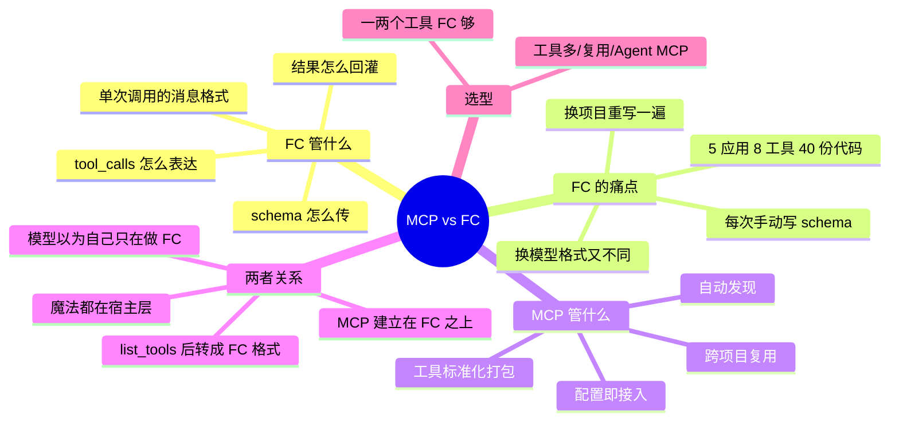

## 🔥 快速背诵

这两个不是竞品，是上下层。Function Calling 是调用语言，模型用什么格式表达我要调哪个函数；MCP 是工具生态协议，工具怎么被标准化、被发现、被复用。MCP 底层还是靠 FC 驱动，模型根本感知不到 MCP 的存在，转换和路由全在宿主层做。FC 是语法，MCP 是插头标准。

> **一句话**：**FC 是「调用语言」，MCP 是「工具生态协议」**。MCP 底层仍靠 FC 驱动，模型根本感知不到 MCP 的存在。

## 🧠 导图



---

# 📖 背诵稿

> 五段，按顺序背。

### ① 先破关系

**MCP 不是 Function Calling 的替代品或升级版，两者不在一个抽象层次。**

Function Calling 是「调用语言」，管一次函数调用请求长什么样；MCP 是「工具生态协议」，管一堆工具怎么被标准化打包、注册、发现和复用。就像 HTTP 解决了「怎么传」，REST 规范解决「怎么组织和管理」——不同层次，谁也不能替代谁。

### ② FC 只管一次调用

**Function Calling 回答的就三个问题：工具定义怎么传给模型、模型怎么表达要调哪个、结果怎么喂回去。**

它定义的是单次调用的消息格式，仅此而已。没有工具管理、没有发现机制、没有跨项目复用。每次用，开发者都得手写 schema、手写对接逻辑、手写结果处理。

### ③ FC 的痛点在复用

**真正的痛点不是写一次麻烦，而是同一件事要重复写很多遍。**

A 项目定义了 10 个工具，B 项目要用就得复制 schema 加重写对接；A 用 Claude API、B 换 GPT-4，FC 格式不完全一样，还得各维护一套适配。算笔账：5 个应用 × 8 个工具 = 40 份对接代码，某天 GitHub API 改个字段，要在 5 个地方同步改，漏一处就是凌晨报警。**工具一多、项目一多，一次性手工活就成了债。**

### ④ MCP 怎么解

**MCP 的思路很自然：把工具做成独立的标准化服务，谁要用就来连。**

工具方实现一个 MCP Server，独立进程对外暴露「我有哪些工具、怎么调」。任何支持 MCP 的客户端连上来就自动发现、直接使用，不用写对接代码。GitHub 官方 Server 写好后，Claude Desktop、Cursor、自己写的 Agent 都能连。

### ⑤ 关键是底层靠 FC 驱动

**MCP 建立在 Function Calling 之上，不是取代它。**

Client 连上 Server 后先 `list_tools` 拉工具定义，再**转成模型原生的 FC 格式**传给模型；模型照旧输出 `tool_calls`，Client 把请求路由到对应 Server 执行，结果以 tool 消息回灌。所以从模型视角看，它以为自己只是在做普通 FC，**MCP 的魔法全发生在宿主层**：自动发现、格式转换、调用路由、结果返回。反过来说，模型不支持 FC，MCP 就用不了，这层翻译失效了。

---

# 🔑 记忆锚

| 记什么 | 内容 | 口诀 |
|---|---|---|
| **2** 个层次 | FC 是格式，MCP 是生态协议 | 「语言·规范」 |
| **3** 个 FC 痛点 | 手写 schema / 换项目重写 / 换模型再适配 | 「写·抄·再适配」 |
| **4** 步 MCP 魔法 | 发现 / 转换 / 路由 / 回灌 | 「现·转·路·回」 |
| **1** 条硬依赖 | 模型不支持 FC，MCP 就没法用 | 「底下那层还在」 |

> **卡壳急救**：只要说出「MCP 在 FC 之上，模型感知不到 MCP」这一句，其余细节顺着推就行。

---

# 🎯 追问速查

| 面试官问 | 你答 |
|---|---|
| 有 FC 了为什么还要 MCP？ | FC 只管单次格式，不管工具管理、发现、复用；工具一多就变成重复劳动 |
| MCP 会淘汰 FC 吗？ | **不会**。MCP 底层靠 FC 驱动，模型不支持 FC 时 MCP 直接失效 |
| 模型知道自己在用 MCP 吗？ | 不知道。它以为只是普通 FC，转换和路由都在宿主层 |
| 用 HTTP/REST 类比怎么说？ | HTTP 管「怎么传」，REST 管「怎么组织」；FC 管格式，MCP 管生态 |
| 什么时候只用 FC？ | 临时接一两个工具、单项目、不打算复用 |
| 什么时候该上 MCP？ | 工具多、跨项目复用、想直接用社区现成 Server、做 Agent 系统 |
| 接入 MCP Server 要写多少代码？ | 配置文件加几行（command + args）即可，Claude Desktop 重启后自动发现 |
| 自己写 Server 难吗？ | 三步：`list_tools` 声明、`call_tool` 实现、stdio 启动；SDK 把通信封好了 |

---

# 🔗 串联

- FC 原理 → **01**；MCP 组成 → **04 / 05**
- 使用场景怎么分 → **07（FC vs MCP 选型）**
- 和 Skill 三方对比 → **11（FC / Skill / MCP）**
- 和 A2A 的区别 → **12**（MCP 连工具，A2A 连 Agent）
- 收尾金句：**FC 让模型能说，MCP 让工具能装**

---

# 📚 细节（背完再点开）

> [!note]- 一次性手工活的账
> | 场景 | 成本 |
> |---|---|
> | 5 个应用 × 8 个工具 | 40 份对接代码 |
> | 某个 API 字段变更 | 5 处同步改，漏一处就线上报警 |
> | 从 Claude 迁到 GPT-4 | 40 份代码的 FC 格式全部重适配 |
> | 换成 MCP | 每方各实现一次协议，接入 = 配置几行 |

> [!note]- 接入 Claude Desktop 的最小配置
> ```json
> {"mcpServers":{"filesystem":{"command":"npx",
>   "args":["-y","@modelcontextprotocol/server-filesystem","/Users/me/Documents"]}}}
> ```
> `command` + `args` 就是启动 Server 进程的命令行，Client 把它作为子进程拉起，通过 stdio 通信。

> [!note]- 自己写 Server 的三步
> ```python
> app = Server("calculator")
>
> @app.list_tools()
> async def list_tools(): return [Tool(name="add_numbers", description="两数相加",
>     inputSchema={"type":"object","properties":{"a":{"type":"number"},"b":{"type":"number"}},
>                  "required":["a","b"]})]
>
> @app.call_tool()
> async def call_tool(name, arguments): return [TextContent(type="text", text=str(...))]
> # 再用 stdio_server() 启动
> ```

---

# 🎴 自测

> [!question]- Q1 一句话说清两者关系
> FC 是调用格式，MCP 是工具生态协议；MCP 建立在 FC 之上，模型感知不到 MCP。

> [!question]- Q2 FC 的三个痛点？
> 手写 schema、换项目重写、换模型格式再适配。

> [!question]- Q3 MCP 的四步「魔法」？
> 自动发现工具 → 转成 FC 格式 → 路由调用 → 结果回灌。

> [!question]- Q4 什么情况只用 FC？
> 临时接一两个工具、单项目、无复用需求。

> [!question]- Q5 为什么说 MCP 不能脱离 FC？
> 模型要靠输出 tool_calls 表达调用意图，这个翻译层失效，MCP 整条链路断掉。
