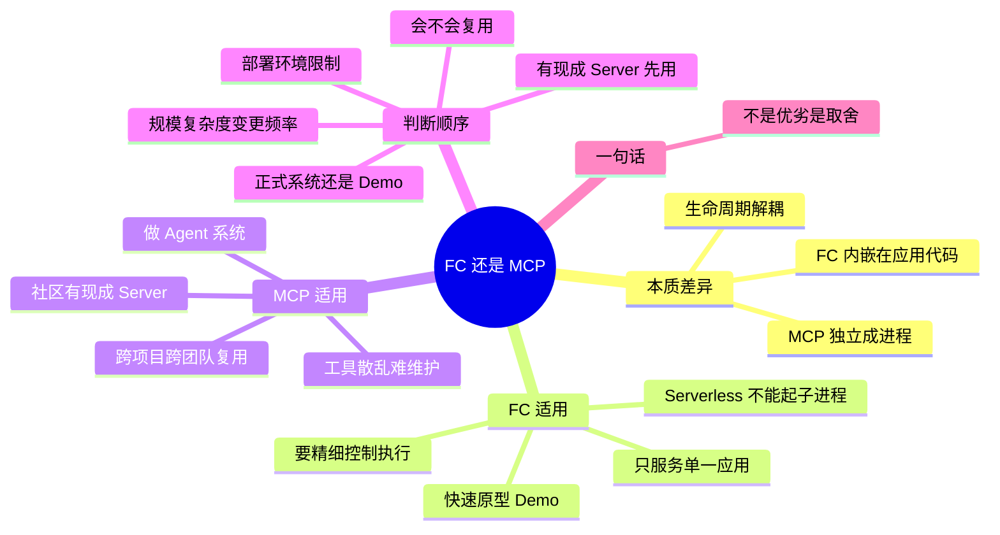

## 🔥 快速背诵

判断标准只有一条：这个工具会不会在这个应用之外被用到。只用自己、只用一次、不需要复用，直接 FC，快、可控、依赖少。其余情况先看社区有没有现成的 MCP Server，有就直接上；没有再按规模判断，工具多、要跨应用复用、要统一权限和审计，就自己写一个。

> **一句话**：**「只用自己、只用一次、不需要复用」→ FC；其余先看社区有没有现成 Server，有就上 MCP**。判断核心是「这工具会不会在这个应用之外被用到」。

## 🧠 导图

---

# 📖 背诵稿

> 四段，按顺序背。

### ① 本质差异在内嵌还是独立

**两者的真正区别不是功能，是工具的生命周期跟不跟应用绑在一起。**

Function Calling 的工具是内嵌的：schema 和调用逻辑都写在项目代码里，应用一换就得重写。MCP 的工具是独立的：封装成独立进程对外暴露标准接口，任何支持 MCP 的客户端连上就能用，可以独立部署、独立维护、一次实现到处复用。这个「内嵌 vs 独立」直接决定了适用边界。

### ② 什么时候 FC 就够

**四种情况用 FC 更合适：轻量、临时、独占、受限。**

快速原型和 Demo，目标是跑通想法，搞 MCP 搭 Server 的时间可能超过原型本身的价值。工具只服务这一个应用，比如查公司私有库，别人根本不会用到，写在项目里更清晰。需要对执行逻辑精细控制，比如加权限校验、参数二次处理、链路追踪，写在调用代码里最方便，独立进程反而要额外约定。还有部署环境受限，某些 Serverless 平台不允许起子进程，stdio 模式直接跑不起来，那 FC 反而是最稳的。

### ③ 什么时候该上 MCP

**只要工具不是「自己用、用一次就扔」，MCP 基本都值得考虑。**

最核心的是跨项目跨团队复用：同一套 GitHub 工具，你的 Claude Desktop、同事的 Cursor、CI 里的 Agent 都要用，FC 就是三份维护，接口一改漏一处就是 bug；MCP 是封装一次、谁要谁配置。其次特别务实的一条：社区已经有现成 Server 了，GitHub、Slack、PostgreSQL、Puppeteer 都有，改几行配置就能用，还手写 API 对接就是造轮子。第三是工具规模上来后 FC 会散乱：schema 和调用逻辑散在各处，加工具要动主程序，出问题定位链长；MCP 主程序不感知具体工具，加实现只改 Server 侧。第四，做 Agent 系统几乎必选 MCP，工具来源杂，靠 FC 维护会变成最难维护的部分。

### ④ 判断顺序

**别纠结，按顺序过五个问题就行。**

第一，社区有没有现成 Server？有就直接用。第二，要不要在多个项目或多人之间复用？要就 MCP。第三，工具数量、复杂度、团队规模、变更频率综合看，感觉到「散乱」那个拐点就该统一管理了——**但不给死数字门槛**，5 个复杂工具天天改比 10 个简单工具更该上 MCP。第四，是正式 Agent 系统还是 Demo？正式系统利于长期维护选 MCP，Demo 选 FC 上手快。第五，部署环境允许起子进程吗？不允许就退回 FC。

---

# 🔑 记忆锚

| 记什么 | 内容 | 口诀 |
|---|---|---|
| **4** 个 FC 场景 | 原型 / 独占 / 精控 / 受限 | 「快·独·控·限」 |
| **4** 个 MCP 场景 | 复用 / 现成 / 散乱 / Agent | 「复·现·乱·体」 |
| **5** 步判断 | 现成 → 复用 → 规模 → 形态 → 环境 | 「现·复·规·形·境」 |
| **1** 句判据 | 会不会在这个应用之外被用到 | 「出得去就 MCP」 |

> **卡壳急救**：一句话答「只用自己、只用一次就 FC，其余优先 MCP」，再补五步判断。

---

# 🎯 追问速查

| 面试官问 | 你答 |
|---|---|
| 大项目一定用 MCP 吗？ | 不一定。工具只在内部用、不复用，FC 写在项目里更清晰 |
| 有数字门槛吗（几个工具以上）？ | **没有**。看数量 × 复杂度 × 团队规模 × 变更频率，感觉到散乱就该上 |
| 只有 1 个工具要不要 MCP？ | 社区有现成 Server 就用 MCP，配置几行比手写对接划算 |
| Serverless 环境怎么办？ | 不能起子进程就退回 FC；或用远程 Streamable HTTP Server |
| 要加权限校验和链路追踪？ | FC 更方便，逻辑直接嵌在调用代码里 |
| Demo 阶段怎么选？ | FC。搭 Server 的成本可能超过原型价值 |
| 两者是竞争关系吗？ | 不是。MCP 底层靠 FC 驱动，选型看工程需求不是技术优劣 |

---

# 🔗 串联

- 前置概念 → **01（FC）**、**04/06（MCP）**
- 反过来问「怎么不用 MCP」→ 呼应 **Agent 手搓还是用框架**（Agent 第 13 篇）
- Agent 系统选型 → 与 **30 篇 Agent 工程题**里的工具治理呼应
- 收尾金句：**先问复用，再问现成，最后问环境**

---

# 📚 细节（背完再点开）

> [!note]- 「内嵌 vs 独立」带来的四个后果
> | 维度 | FC（内嵌） | MCP（独立） |
> |---|---|---|
> | 换应用 | 重写 | 配置即用 |
> | 接口变更 | 多处同步改 | 改 Server 一处 |
> | 定制逻辑 | 直接嵌代码 | 需额外约定 |
> | 部署 | 随主进程 | 独立进程/服务 |

> [!note]- 一个反向思考题
> 「工具很多所以用 MCP」不成立的条件是什么？
> ——工具虽多但都很简单、稳定、且只服务这一个应用。这时 MCP 只是多了一层进程和协议开销，收益不足以覆盖运维成本。

---

# 🎴 自测

> [!question]- Q1 一句话判据？
> 这个工具会不会在这个应用之外被用到？会就用 MCP。

> [!question]- Q2 FC 的四个适用场景？
> 快速原型 / 只服务单一应用 / 需精细控制 / 部署环境受限。

> [!question]- Q3 MCP 的四个适用场景？
> 跨项目复用 / 社区有现成 Server / 工具散乱难维护 / 做 Agent 系统。

> [!question]- Q4 为什么不给数字门槛？
> 数量不是唯一变量，复杂度和变更频率高时 5 个工具就够痛。

> [!question]- Q5 Serverless 为什么影响选型？
> 不能起子进程，stdio MCP 跑不起来。
