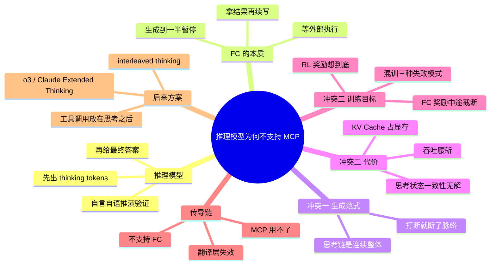

## 🔥 快速背诵

根因是两种生成范式冲突。推理模型的思考链必须一口气连续生成，中间不能停；工具调用天然要求暂停、等结果、再继续。让它在思考中途停下来等外部返回，就得存盘再恢复，KV Cache 占着显存，状态一致性也没法保证。而且 MCP 底层靠 FC，FC 断在这，MCP 自然也用不了。后来的做法是把工具调用挪到思考阶段之后。

> **一句话**：**思考链必须一口气连续生成，工具调用却要中途暂停**——两种生成范式冲突；而 MCP 底层靠 FC，FC 不支持 MCP 自然用不了。

## 🧠 导图

---

# 📖 背诵稿

> 五段，按顺序背。

### ① 推理模型怎么工作

**推理模型的特别之处是先想再说：给答案之前先跑一大段 thinking tokens。**

它在思考里自言自语地推演、验证、甚至推翻自己重来，想清楚了才输出面向用户的答案。o1/o3、DeepSeek-R1、Claude Extended Thinking 都是这个路子。这套机制正是它在数学、代码、复杂推理上更强的根本原因，也正是它和工具调用冲突的源头。

### ② 工具调用要中途暂停

**工具调用天然不是一次性生成，它需要在生成到一半时强制暂停。**

完整流程是：输出调用请求 → 停下来等宿主执行 → 拿到结果 → 继续生成。核心就在「暂停」这一步。普通模型没问题，因为它状态轻量，随时截断重启都行。

### ③ 核心冲突：连续性

**但思考链是一个依赖完整上下文的连续生成过程，每步都建立在前面的推理之上，是个有机整体。**

中途打断，之前建立的推理状态就断了，模型没法从中间接着想，只能整个重来。就像你写一篇复杂的推理论文，思路正顺的时候被电话打断二十分钟，回来细节想不起来，只能重新梳理。

### ④ 为什么不能「存盘再恢复」

**有人会问暂停时保存状态、执行完再恢复行不行——技术代价受不了。**

模型推理的中间状态是庞大的 KV Cache，一暂停就得原封不动占着 GPU 显存，工具执行几秒几十秒，这块显存就一直占着不能用，吞吐量腰斩、延迟飙升。对要同时服务成千上万请求的在线系统，这代价承受不了。更难的是**思考状态一致性**：之前的思路基于「我还不知道工具结果」，现在结果突然来了，可能和已经建立的推理链矛盾，怎么融合没有简单解。训练层面也冲突：推理模型的 RL 奖励「想到底」，FC 训练却要模型学会「在合适时机截断自己」，混着训常见三种坏结果——思考到一半跳出个坏 JSON、彻底偏向一边、融合处推理断裂答非所问。

### ⑤ 传导链与后来的解法

**MCP 底层完全依赖 Function Calling，所以不支持 FC 就用不了 MCP。**

Client 拉工具定义 → 转成 FC 格式给模型 → 模型输出 tool_calls → 路由执行 → 结果回灌。这个「转成 FC 格式」就是翻译层，模型不支持 FC，翻译层直接失效，整条链从中间断掉。这不是 MCP 的问题，是底层能力缺失的连锁反应。后来的解法是**让工具调用发生在思考阶段结束之后**：先把推理链完整跑完，进入输出阶段才触发 FC。代价是思考阶段看不见工具结果。o3 和 Claude Extended Thinking 走的都是这条路，Claude 还加了 interleaved thinking，允许在多次工具调用之间穿插思考，缓解了这个局限——但本质权衡还在。

---

# 🔑 记忆锚

| 记什么 | 内容 | 口诀 |
|---|---|---|
| **2** 种范式 | 连续思考 vs 中途暂停 | 「一口气 vs 断点」 |
| **3** 层原因 | 生成范式 / 显存与一致性代价 / 训练目标 | 「范·价·训」 |
| **3** 种混训失败 | 坏 JSON / 偏一边 / 融合断裂 | 「坏·偏·断」 |
| **1** 条传导链 | 不支持 FC → 翻译层失效 → 不能用 MCP | 「底层断了」 |

> **卡壳急救**：先答「范式冲突」，再答「所以 FC 不行」，最后答「MCP 靠 FC 所以也不行」，三层说完就完整了。

---

# 🎯 追问速查

| 面试官问 | 你答 |
|---|---|
| 是没来得及适配吗？ | 不是进度问题，是**结构性冲突**：连续思考 vs 中途暂停 |
| 上下文窗口不够？ | 不是核心矛盾。真问题是生成连续性，不是容量 |
| 保存状态恢复不行吗？ | KV Cache 占显存导致吞吐腰斩，且思考状态一致性无解 |
| 训练上怎么冲突？ | RL 奖励「想到底」，FC 奖励「适时截断」，混训会两边都学不好 |
| 后来怎么解决的？ | 工具调用挪到思考阶段之后；Claude 用 interleaved thinking 缓解 |
| 代价是什么？ | 思考阶段感知不到工具结果，没法带着结果深度推理 |
| o1 到底支不支持？ | o1-preview 明确不支持；2024 年 12 月正式版 o1 已支持，要区分版本 |

---

# 🔗 串联

- 前置 → **01（FC）**、**06（MCP 靠 FC 驱动）**
- 训练目标冲突 → 承接 **03（RLHF 教边界感）**
- 推理模型 → 大模型工程线的 **CoT（17）**、**Post-Training（10）**
- 收尾金句：**能想透的脑子，不好被打断；要被打断的活，只好等它想完**

---

# 📚 细节（背完再点开）

> [!note]- 三种混训失败模式长什么样
> | 现象 | 说明 |
> |---|---|
> | 思考中跳出坏 JSON | 两边都没干好，格式还错 |
> | 彻底偏向一边 | 要么思考变浅退化成普通模型，要么根本不会调工具 |
> | 融合处断裂 | 工具结果回来了，后续推理接不上，答非所问 |

> [!note]- 时间线上的事实（别答错版本）
> | 时间 | 事件 |
> |---|---|
> | 2024-09 | o1-preview 发布，明确不支持 Function Calling |
> | 2024-12 | 正式版 o1 加上 FC 支持 → 说明找到了兼容方案 |
> | 之后 | o3 / Claude Extended Thinking 支持工具调用；Claude 引入 interleaved thinking |

---

# 🎴 自测

> [!question]- Q1 一句话根因？
> 思考链要连续生成，工具调用要中途暂停，范式冲突。

> [!question]- Q2 为什么不能保存状态恢复？
> KV Cache 占显存拖垮吞吐，思考状态一致性无解。

> [!question]- Q3 训练层面的冲突？
> RL 奖励「想到底」，FC 奖励「适时打断」，混训两边都学不好。

> [!question]- Q4 传导到 MCP 的逻辑？
> MCP 靠 FC 做格式翻译，FC 不支持，翻译层失效，链路断掉。

> [!question]- Q5 后来的折中方案？
> 工具调用放到思考阶段结束后；interleaved thinking 允许调用之间穿插思考。
