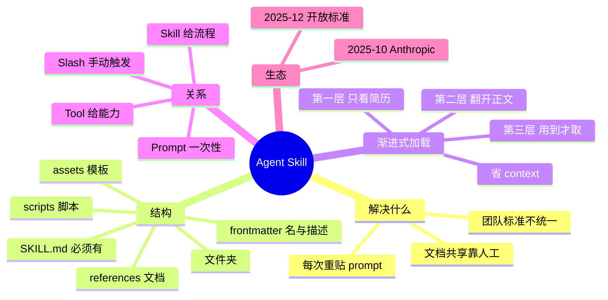

## 🔥 快速背诵

Skill 就是一个文件夹，核心是带 frontmatter 的 SKILL.md，还可以带脚本、参考文档、模板，Agent 能自动发现、按需加载。它和普通 prompt 最大的差别是渐进式加载，启动时只读名字和描述，大概三五十个 token；判断相关了才读正文；真用到某个资源才去取。所以它是一份能自己翻的手册，不是一段被复制进上下文的 prompt。

> **一句话**：Skill 是把**指令 + 脚本 + 模板**打包成的可复用能力包，Agent **能自动发现、按需加载**——它是一份能自己翻的手册，不是一段被复制的 prompt。

## 🧠 导图



---

# 📖 背诵稿

> 五段，按顺序背。

### ① 解决什么

**Skill 解决的是「同一套指令反复贴、团队各贴各的」这个问题。**

每次让 AI 做代码审查，你都要贴一大段指令；第二次第三次就烦了，漏一个细节输出质量就飘。团队十个人各贴各的，标准根本不统一。写进共享文档让大家复制？那还是人工维护，更新了文档还有人用旧的。Skill 就是把反复在用的指令、流程、模板打包成标准模块，Agent 自己知道什么时候用、怎么用，不再依赖你手动粘贴。

### ② 结构长什么样

**一个 Skill 就是一个文件夹，核心是 SKILL.md，可选带脚本、参考文档和模板。**

SKILL.md 分两部分：顶部 YAML frontmatter 声明 name 和一句话 description，下面是 Markdown 写的具体指令和步骤。文件夹里还可以有 `scripts/` 放可执行脚本、`references/` 放团队标准文档、`assets/` 放输出模板。所以它跟普通 prompt 的区别立刻出来了：prompt 是一段用完就没的文字，Skill 是能持续维护、能被版本管理的完整目录。

### ③ 渐进式加载

**Skill 最聪明的设计不是能打包，而是按需加载。**

如果启动就把所有 Skill 全读进来：20 个 Skill × 2000 token = 4 万 token 打底，占掉 20 万窗口的五分之一，而其中大部分这次任务根本用不上。所以它分三层：第一层只加载 name 和 description，每个约 30~50 token，像扫一遍简历标题；第二层当 Agent 判断某个 Skill 和任务相关，才加载 SKILL.md 正文；第三层执行中真要用到某个模板或脚本了，才去读那个文件。就像入职手册——先看目录，要报销了才翻那一章。**本质是：让 Agent 只在需要时获取需要的知识**，这和人类工作方式一样。

### ④ 和 Tool / Prompt 的关系

**Tool 是给 Agent 配的电脑和权限，Skill 是发给它的操作手册和 SOP。**

有了 Tool，Agent 能做事——查库、调 API、读文件。但新人拿到电脑和全部权限，也不知道代码审查该先查什么后查什么、用什么格式出报告，这就是 Skill 补的知识和流程。Prompt 是口头一句话，说完就没，是临时一次性；Skill 是持久可复用。还有一个容易混的 Slash Command：它也是保存指令复用，但必须你手动敲 `/code-review` 才触发，而 Skill 能被 Agent **自动发现**——这是它比斜杠命令更进一步的核心理由。

### ⑤ 生态

**Agent Skills 由 Anthropic 在 2025 年 10 月推出，12 月把规范作为开放标准发布。**

一开始只在 Claude Code、Claude API、claude.ai 三处用。开放的原因是设计足够简单：一个文件夹加一份 Markdown，不需要特殊运行时，不需要学新语言，任何有文件系统的 Agent 平台理论上都能实现。好处是写一份 Skill 有机会跨平台复用，像 USB-C 一样不用每个设备买一根线——现在主要还是 Claude 生态，社区在探索兼容。

---

# 🔑 记忆锚

| 记什么 | 内容 | 口诀 |
|---|---|---|
| **3** 层加载 | 元数据 / 正文 / 资源 | 「简·正·资」 |
| **4** 个可选目录 | scripts / references / assets + SKILL.md | 「码·档·板·MD」 |
| **3** 个对比对象 | Tool / Prompt / Slash Command | 「手册 vs 电脑 vs 一句话 vs 手动」 |
| **2** 个时间点 | 2025-10 推出 / 2025-12 开放标准 | 「十月出，十二月开」 |

> **卡壳急救**：先答「文件夹 + SKILL.md + 自动发现 + 按需加载」，再补渐进式三层。

---

# 🎯 追问速查

| 面试官问 | 你答 |
|---|---|
| Skill 就是保存的 prompt 吗？ | 不是。是含指令/脚本/模板的文件夹，能自动发现、按需加载、可版本管理 |
| 为什么不全部加载？ | 20 个 Skill 就吃掉 4 万 token，大部分当下用不上，还稀释注意力 |
| 渐进式加载三层？ | 元数据（30~50 token）→ 相关才加载正文 → 用到才取资源文件 |
| 和 Slash Command 区别？ | 斜杠要人手敲触发，Skill 由 Agent 自动判断并加载 |
| 和 Tool 关系？ | Tool 给能力，Skill 给流程和标准，互补 |
| 为什么能成为标准？ | 结构极简：文件夹 + Markdown，无特殊运行时，任何平台都能实现 |
| Skill 缺点？ | 自动发现依赖 description 写得好；脚本有执行风险，需权限管控 |

---

# 🔗 串联

- Skill 是「上下文工程」的落地形态 → 呼应 **Agent 上下文工程（17）**
- 与 MCP → **10（MCP vs Skill）**、**11（FC/Skill/MCP 三方）**
- description 的重要性 → 同 **FC 工具描述**逻辑一致：模型只靠这段判断用不用
- 收尾金句：**Tool 让它能做，Skill 让它会做**

---

# 📚 细节（背完再点开）

> [!note]- 一个最小 Skill
> ```
> code-review/
> ├── SKILL.md
> ├── scripts/check_security.py
> ├── references/review_standards.md
> └── assets/report_template.md
> ```
> ```markdown
> ---
> name: code-review
> description: 对代码进行全面审查，检查 bug、安全漏洞和性能问题，输出结构化报告
> ---
> ## 第一步：理解上下文 …
> ## 第二步：逐项检查（正确性 / 安全 / 性能 / 可读性）…
> ## 第三步：用 assets/report_template.md 输出报告
> ```

> [!note]- 三层加载的账
> | 方案 | 启动开销 |
> |---|---|
> | 全量加载 20 个 Skill | ≈ 4 万 token |
> | 只加载元数据 | ≈ 600~1000 token |
> | 按需加载 1 个正文 | +2000 token |
>
> 省下来的窗口留给任务本身，输出质量才稳。

---

# 🎴 自测

> [!question]- Q1 Skill 的本质？
> 指令 + 脚本 + 模板打包的可复用能力包，Agent 自动发现、按需加载。

> [!question]- Q2 渐进式加载三层？
> 元数据 → 正文 → 资源文件，逐层深入。

> [!question]- Q3 和 Prompt 的区别？
> Prompt 一次性、临时；Skill 持久、可复用、可版本管理。

> [!question]- Q4 和 Slash Command 的区别？
> 手动触发 vs Agent 自动发现。

> [!question]- Q5 Tool 和 Skill 的分工？
> Tool 提供做事的能力，Skill 提供做事的流程和标准。
