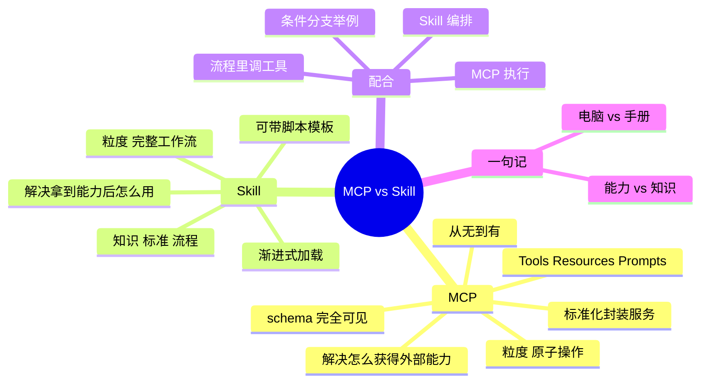

## 🔥 快速背诵

MCP 是给 Agent 配电脑和权限，Skill 是发给它操作手册和 SOP。MCP 解决能不能连上、能不能调，粒度是原子操作；Skill 解决拿到工具之后按什么步骤做，粒度是完整工作流。一个给能力，一个给知识和流程，互补不竞争。实际项目最常见的组合是 Skill 编排流程、MCP 执行动作。

> **一句话**：**MCP 给 Agent 配电脑和权限，Skill 发给它操作手册和 SOP**。一个给能力，一个给知识与流程，互补不竞争。

## 🧠 导图

---

# 📖 背诵稿

> 四段，按顺序背。

### ① 定位不同

**两者解决的不是同一个问题：MCP 解决「怎么获得外部能力」，Skill 解决「拿到能力之后怎么用」。**

没有 MCP 之前，Agent 只是个会说话的语言模型，让它查库、读文件、调 API 都不行。MCP 把这些外部工具标准化封装成服务，Agent 连上就能用，**这是从无到有的问题**。但有了能力之后，面对「帮我做代码审查」这种任务，它该先做什么后做什么、检查哪些维度、用什么格式输出？这套知识和流程就是 Skill 提供的。类比一下：MCP 是给新员工配电脑、装软件、开权限；Skill 是那份告诉他先查什么后查什么、按什么标准判断的操作手册。

### ② MCP：给 Agent 一双手

**MCP 提供的是粒子度很细的原子操作。**

它通过 Tools / Resources / Prompts 暴露外部能力，模型用 FC 触发，执行完结果回灌。`read_file(path)` 是一个 Tool，`query_database(sql)` 是一个 Tool，每次调用做一件明确完整的事，结果立刻返回。而且模型能看到每个 Tool 的完整 schema——叫什么、收什么参数、返回什么，这种精确可见性正是它能准确判断「该调哪个」的基础。所以 MCP 让 Agent 从「只会聊天」变成「能真正干活」，这是一切上层能力的前提。

### ③ Skill：给 Agent 一本手册

**Skill 提供的是粗粒度的工作流定义。**

一个 Skill 是一个文件夹，核心是 SKILL.md：frontmatter 声明名字和描述，正文写步骤。还可以带脚本、参考文档、输出模板。它和 prompt 的区别在两个地方：**能被 Agent 自动发现**（判断哪个 Skill 和任务相关后主动加载，不用你指定），以及**渐进式加载**（启动只读名字和描述约 30~50 token，相关才加载正文，用到才取资源）。所以粒度差得很远：MCP 是单个函数调用，Skill 是「代码审查」这种完整流程，内部可能好几步、调好几个工具。

### ④ 怎么配合

**Skill 当编排者，MCP 当执行者。**

用户说「审查这次提交」，Agent 扫描 Skill 列表，发现 `code-review` 匹配，加载它的 SKILL.md 读到三步流程：第一步读代码文件 → 这里需要 MCP 的文件系统 Server 提供 `read_file`；第二步做安全检查 → 执行 Skill 自带的 `check_security.py`；第三步出报告 → 读 `assets/report_template.md` 模板。再复杂一点，指令里还可以写条件分支：「如果改动涉及数据库表结构，额外做权限合规检查」，Agent 就先调一个 MCP Tool 扫描有没有改 schema，拿到布尔值再决定是否走那条分支、再调另一个 Tool 查规则。**缺了 Skill，Agent 拿着一堆工具不知道什么时候用；缺了 MCP，Skill 再详细的流程也是纸上谈兵。**

---

# 🔑 记忆锚

| 记什么 | 内容 | 口诀 |
|---|---|---|
| **2** 个定位 | MCP 给能力 / Skill 给流程 | 「手 vs 手册」 |
| **2** 种粒度 | 原子操作 / 完整工作流 | 「一步 vs 一套」 |
| **2** 个 Skill 特性 | 自动发现 / 渐进加载 | 「自己找·按需读」 |
| **2** 个角色 | Skill 编排 / MCP 执行 | 「导演 vs 演员」 |

> **卡壳急救**：一句话「电脑 vs 手册」，再展开粒度与配合。

---

# 🎯 追问速查

| 面试官问 | 你答 |
|---|---|
| 为什么要两套，一套不够？ | 层次不同：能力接入是标准化的，流程知识因任务而异，混在一起无法复用 |
| 粒度差别？ | MCP 是单个函数调用；Skill 是一整个工作流，内部可调多个工具 |
| Skill 会取代 MCP 吗？ | 不会。Skill 只定义流程，真正动手还得靠 MCP 的工具 |
| 缺了各自会怎样？ | 缺 Skill：有工具不知何时用；缺 MCP：流程再细也落不了地 |
| Skill 怎么调 MCP？ | SKILL.md 指令里明确某一步要调哪个工具，Agent 自行发起调用 |
| 谁能表达条件分支？ | Skill。指令里写「如果…就额外…」，Agent 先调工具取判断结果再分支 |
| 两者的可控性差异？ | MCP 工具 schema 完全暴露、可校验；Skill 是自然语言流程，更灵活但更依赖模型理解 |

---

# 🔗 串联

- Skill 的细节 → **09**；MCP 的细节 → **04 / 05**
- 三方对比 → **11（FC / Skill / MCP）**
- 编排视角 → 呼应 **Agent 的 Workflow vs Agent 边界**（控制权在谁手里）
- 收尾金句：**MCP 解决「做得到」，Skill 解决「做得对」**

---

# 📚 细节（背完再点开）

> [!note]- 代码审查场景的分工表
> | 步骤 | 谁定义 | 谁执行 |
> |---|---|---|
> | 读代码文件 | Skill 说要读 | MCP `read_file` |
> | 安全扫描 | Skill 指向脚本 | Skill 自带 `check_security.py` |
> | 出报告 | Skill 指定模板 | 读 `assets/report_template.md` |
> | 条件分支判断 | Skill 写规则 | MCP Tool 取判断依据 |

> [!note]- 一个反例：只有 MCP 会怎样
> Agent 手里有 20 个工具，用户说「审查这段代码」。
> 它可能随机调几个、可能漏掉安全扫描、可能输出格式每次都不一样——**有能力但没有方法论**，结果不可复现。

---

# 🎴 自测

> [!question]- Q1 一句话区分？
> MCP 给 Agent 能力和手脚，Skill 给 Agent 知识和流程。

> [!question]- Q2 粒度差异？
> 原子操作（一次一个函数）vs 完整工作流（多步多工具）。

> [!question]- Q3 配合方式？
> Skill 编排流程，流程里调 MCP 工具完成具体动作。

> [!question]- Q4 缺任一会怎样？
> 有工具没方法 → 乱调；有方法没工具 → 空谈。

> [!question]- Q5 为什么 Skill 不能取代 MCP？
> 它不提供执行能力，只提供知识、标准与顺序。
