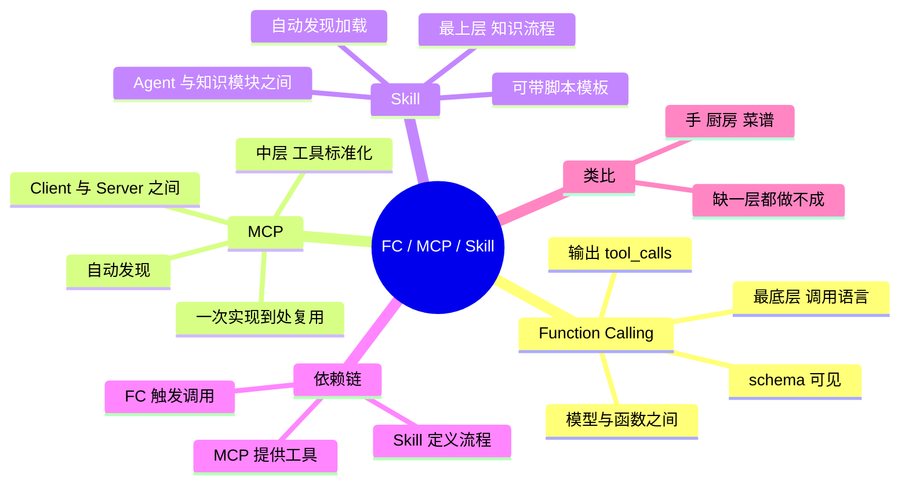

## 🔥 快速背诵

这三层不是三个竞品。Function Calling 是语言，模型用它表达要调哪个函数；MCP 是工具箱，把工具标准化、可复用、可插拔；Skill 是操作手册，告诉 Agent 这类活儿的正确流程。依赖链自上而下，Skill 定流程、MCP 供工具、FC 触发调用。记法是手、厨、谱，FC 是手，MCP 是厨房的工具箱，Skill 是菜谱。

> **一句话**：三层架构不是三个竞品——**FC 是语言，MCP 是工具箱，Skill 是操作手册**。`Skill（定流程）→ MCP（供工具）→ FC（触发调用）`。

## 🧠 导图

---

# 📖 背诵稿

> 五段，按顺序背。

### ① 破误区

**这三个不是不同公司的竞争方案，而是从底到顶的三层架构，可以同时在一个系统里跑。**

判断方法很简单：看每句话的主语是谁。Function Calling 是「模型说：我要调这个函数」；MCP 是「工具服务说：我能提供这些函数」；Skill 是「操作手册说：用这些工具按这个流程做」。主语不同、对象不同、粒度不同，本质差异就在这。

### ② 出现顺序也是层次顺序

**三者是先后出现的，因为痛点是一层层冒出来的。**

最先是 FC：核心问题是模型只会生成文本，怎么让它触发外部调用。FC 普及后又发现新痛点——每个应用都要自己写代码对接数据库、文件系统、各种 API，重复劳动太多，MCP 就把接入标准化了，一次实现到处复用。工具有了、接入也标准化了，又冒出第三个问题：Agent 手握一堆工具，面对复杂任务不知道该按什么流程和标准用，Skill 就是来封装知识和流程的。

### ③ 从「谁和谁通信」定位

**每个机制发生在哪两个角色之间，位置一下就清楚了。**

FC 发生在模型和函数之间，是最底层的调用语言，模型出 tool_calls、宿主执行、结果以 tool 消息回灌，全在单个 Agent 内部。MCP 发生在 AI 客户端和工具服务之间，Client 连上 Server 自动发现工具，把定义转成 FC 格式喂给模型，所以 **MCP 本质是对 FC 的封装和管理**。Skill 发生在 Agent 和知识模块之间，Agent 扫列表、判断相关性、主动加载 SKILL.md 和资源，粒度比工具粗得多——「代码审查」是一个 Skill，内部可能好几步、调好几个 MCP 工具。

### ④ 依赖关系与类比

**依赖方向是单向的：Skill 靠 MCP 提供工具，MCP 靠 FC 触发调用。**

用做菜类比：FC 是你的手，能拿刀点火翻锅，是最基础的操作能力；MCP 是厨房，刀在抽屉、调料在架上、食材在冰箱，走进去就知道有什么能用；Skill 是菜谱，告诉你先热锅凉油、再爆香、再下主料、最后调味。试着跳过一层：没有手，站在厨房拿着菜谱什么都干不了；没有厨房，有手有菜谱也没厨具；没有菜谱，有手有满厨房厨具，面对食材不知道先切什么后炒什么，只能瞎折腾。

### ⑤ 完整故事串三层

**用户说「分析最近三个月销售数据，找出下滑产品线，给改进建议」，三层依次登场。**

Skill 层先动：Agent 扫到「数据分析报告」Skill 匹配，加载正文，读到三步流程——先从数据库取数、再用 Python 做趋势分析、再按模板写报告。MCP 层跟上：执行第一步时，Client 已经连着数据库 Server 和 Python 执行器 Server，自动知道有 `query_database` 和 `run_python`。最底层 FC 发力：模型输出 `tool_calls: query_database(sql=...)`，Client 路由到 Server 执行，结果回来继续；再输出调用 Python 执行器做趋势分析；最后按 Skill 里的模板整理成结构化报告。**Skill 编排、MCP 管工具、FC 通信，缺哪层都不完整。**

---

# 🔑 记忆锚

| 记什么 | 内容 | 口诀 |
|---|---|---|
| **3** 层 | FC 语言 / MCP 工具箱 / Skill 手册 | 「手·厨·谱」 |
| **3** 组通信对象 | 模型↔函数 / Client↔Server / Agent↔知识 | 「内·纵·外」 |
| **1** 条依赖链 | Skill → MCP → FC | 「上靠下」 |
| **1** 个主语判据 | 谁在说话：模型 / 服务 / 手册 | 「换主语就分层」 |

> **卡壳急救**：先说三个类比（手/厨房/菜谱），再讲依赖链，最后用销售分析故事收尾。

---

# 🎯 追问速查

| 面试官问 | 你答 |
|---|---|
| 三者能互相替代吗？ | 不能。是三层依赖，同一系统里同时存在 |
| 为什么 MCP 依赖 FC？ | Server 的工具定义最终要转成 FC 格式给模型，模型靠 tool_calls 触发 |
| Skill 和 MCP 的分界？ | 粒度与职责：一个定义完整工作流，一个提供原子能力 |
| 用一句话概括三者？ | FC 是语言，MCP 是工具箱，Skill 是操作手册 |
| 缺 Skill 会怎样？ | 工具一堆但不知道何时用、按什么标准用，结果不可复现 |
| 时间线能说出吗？ | FC 最早（2023 OpenAI）→ MCP（2024-11 Anthropic）→ Skill（2025-10 Anthropic） |
| 哪个层级最容易被跳过？ | Skill。很多项目只有 FC/MCP，流程写在 prompt 里，无法复用和统一 |

---

# 🔗 串联

- 各篇细节 → **01（FC）**、**04/05（MCP）**、**09（Skill）**
- 与 A2A 的四层全图 → **12**
- 编排层视角 → 呼应 **Workflow vs Agent**：Skill 本质是「可复用的半结构化 workflow」
- 收尾金句：**语言通、工具全、手册清，Agent 才算能干活**

---

# 📚 细节（背完再点开）

> [!note]- 三维对照表
> | 维度 | Function Calling | MCP | Skill |
> |---|---|---|---|
> | 解决 | 怎么触发调用 | 工具怎么封装发现 | 按什么流程做 |
> | 通信双方 | 模型 ↔ 函数 | Client ↔ Server | Agent ↔ 知识模块 |
> | 粒度 | 单次调用 | 单个工具 | 完整工作流 |
> | 复用范围 | 同一应用内 | 跨应用跨语言 | 跨任务跨团队 |
> | 类比 | 手 | 厨房 | 菜谱 |

> [!note]- 跳过一层的后果
> - 无 FC：模型无法表达调用意图，上层全部失效
> - 无 MCP：工具要逐个手写对接，跨项目重复劳动
> - 无 Skill：有工具没方法论，流程散落在 prompt 里，不可复用

---

# 🎴 自测

> [!question]- Q1 三层顺序？
> FC（语言）→ MCP（工具箱）→ Skill（手册）。

> [!question]- Q2 三者分别在谁和谁之间？
> 模型↔函数、Client↔Server、Agent↔知识模块。

> [!question]- Q3 依赖关系？
> Skill 靠 MCP 供工具，MCP 靠 FC 触发，单向向下。

> [!question]- Q4 用类比说清三者？
> 手 / 厨房 / 菜谱，缺一层都做不成菜。

> [!question]- Q5 为什么不能只留一个？
> 各管一层，替代会造成能力断层。
