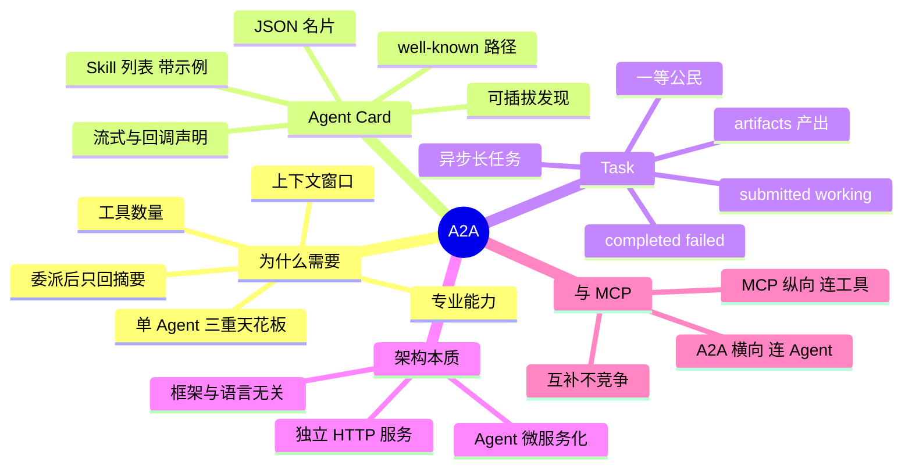

## 🔥 快速背诵

MCP 是纵向连工具，A2A 是横向连 Agent。A2A 的本质是把 Agent 微服务化，每个 Agent 用 Agent Card 发名片，声明自己会什么、接口在哪；任务用 Task 状态机管，从 submitted 到 working 到完成。它解决的是一堆 Agent 之间怎么互相发现、怎么派活、怎么等长任务。MCP 连工具，A2A 连同事。

## 🧠 导图



---

# 📖 背诵稿

> 五段，按顺序背。

### ① 为什么单 Agent 不够

**一个 Agent 本质就是「LLM + 一组工具 + 一段上下文」，这三个维度都有天花板。**

工具装不了 100 个，模型处理起来混乱、效率极低；上下文窗口再大也会被中间产物塞满，搜索结果、草稿、反思记录很快吃掉注意力；专业能力也有边界，一个 Agent 既做代码审查又做市场分析，不如各配一个专业的。比如让它做一份竞品分析报告，要行业趋势、技术对比、商业模式、SWOT——等写到 SWOT 时，前面的趋势分析早被挤出有效注意力范围了。

### ② 拆开后的关键收益

**把任务拆给专业 Agent，最大的收益其实在上下文隔离。**

调度 Agent 把「做行业趋势分析」委托给市场 Agent，市场 Agent 自己搜几十个网页、写草稿、反复迭代，这些中间过程全在它自己的上下文里。做完只把几百字结论通过 A2A 返回。调度 Agent 的上下文里只多了一份摘要，而不是几十个网页原文。**调研过程的上下文压力被隔离在子 Agent 内部，调度方保持轻量**——这才是多 Agent 协作在上下文层面的核心收益。

### ③ Agent 之间怎么互相认识

**靠 Agent Card：每个 Agent 在约定位置发布一张 JSON 名片。**

写死配置太脆，B 的能力一变 A 的代码就得改。所以 A2A 让 B 主动发名片：JSON 放在 `/.well-known/agent-card.json`（早期叫 `agent.json`），里面写清自己叫什么、能做哪类任务（**Skill 列表，每个带示例输入**）、支不支持流式返回、支不支持 push notification 异步回调。调度 Agent 先拿名片，再决定要不要委托。这样系统就是可插拔的：新加一个 Agent 只要发名片，调度方代码一行都不用改。

### ④ Task 是一等公民

**任务协作的基本单位是 Task，而且带完整状态机。**

委托就是创建一个 Task，接收方执行，完成后把产出（artifacts，文本或文件）返回。状态从 `submitted`（已提交待处理）→ `working`（执行中）→ `completed` 或 `failed`。为什么要有状态机？因为 A2A 专为长任务设计：一个竞品分析可能跑几分钟，不能让调度方同步干等。所以提交完可以去做别的，靠轮询或 push notification 得知完成。调度方视角很干净——只知道提交和取结果，不知道对方用了什么工具、调了几次模型，**完全黑盒**，这正是解耦的意义。

### ⑤ 架构本质与和 MCP 的关系

**A2A 就是 Agent 世界的微服务架构，和 MCP 一纵一横。**

每个 Agent 对外就是一个独立 HTTP 服务的形态：Agent Card 相当于 API 文档，Task 状态机相当于异步消息队列，`.well-known` 相当于注册中心的一条记录，不绑框架、不绑语言。和 MCP 的关系看方向就懂：MCP 是 Agent **向下**连工具和数据（纵向），A2A 是 Agent **向外**连其他 Agent（横向）。类比：MCP 是每个员工的工具箱，A2A 是跨岗位的协作流程。复杂的多 Agent 系统里两者同时用，缺一不可。

---

# 🔑 记忆锚

| 记什么 | 内容 | 口诀 |
|---|---|---|
| **3** 重天花板 | 工具数 / 上下文 / 专业性 | 「数·窗·专」 |
| **4** 态状态机 | submitted / working / completed / failed | 「提·干·成·败」 |
| **2** 个核心机制 | Agent Card / Task | 「名片·工单」 |
| **1** 组方向 | MCP 纵向 / A2A 横向 | 「一纵一横」 |

> **卡壳急救**：先答「一纵一横」，再答「名片 + 工单」，最后补「微服务化」。

---

# 🎯 追问速查

| 面试官问 | 你答 |
|---|---|
| A2A 是 MCP 竞品吗？ | 不是。MCP 连工具，A2A 连 Agent，方向不同 |
| 为什么要多 Agent？ | 单 Agent 工具数、上下文、专业性三处天花板 |
| 拆开后上下文真的变小了吗？ | 是。子 Agent 内部的调研过程留在自己上下文，只回摘要 |
| Agent 怎么互相发现？ | Agent Card 发布在 `.well-known/agent-card.json`，含 Skill 列表与示例 |
| 长任务怎么办？ | Task 状态机 + 轮询 / push notification 回调，异步执行 |
| Agent 间怎么解耦？ | 黑盒委托，调度方不知道对方内部实现 |
| 和后端什么概念对应？ | 微服务：Card≈API 文档、Task≈异步队列、well-known≈注册中心 |

---

# 🔗 串联

- 前提 → **10/11**（MCP 是纵向那层）
- Agent 协作细节 → **Agent 第 16 篇（多 Agent 协作与切换）**、**22（容错与并发冲突）**
- 上下文隔离 → 呼应 **Agent 记忆 / 上下文工程**：子 Agent 是「上下文分区」的天然实现
- 收尾金句：**MCP 让它有手，A2A 让它有同事**

---

# 📚 细节（背完再点开）

> [!note]- Agent Card 的核心字段（示意）
> ```json
> {"name":"market-analyst",
>  "description":"市场与行业趋势分析",
>  "skills":[{"id":"trend-analysis","description":"行业趋势分析","examples":["分析AI编程工具趋势"]}],
>  "capabilities":{"streaming":true,"pushNotifications":true}}
> ```
> 关键在 `skills`：调度方靠它做任务路由，靠 `examples` 判断匹配度。

> [!note]- 两种等待方式
> | 方式 | 适用 | 代价 |
> |---|---|---|
> | 轮询 Task 状态 | 实现简单 | 有延迟、有无效请求 |
> | push notification | 实时、省请求 | 需要回调地址与鉴权 |

---

# 🎴 自测

> [!question]- Q1 一句话区分 MCP 与 A2A？
> MCP 向下连工具，A2A 向外连 Agent，一纵一横。

> [!question]- Q2 单 Agent 三重天花板？
> 工具数量、上下文窗口、专业能力。

> [!question]- Q3 Agent Card 是什么？
> 约定路径发布的 JSON 名片，含 Skill 列表、流式与回调能力声明。

> [!question]- Q4 Task 有哪些状态？
> submitted → working → completed / failed，支持异步长任务。

> [!question]- Q5 为什么说 A2A 是微服务化？
> Agent 成独立服务，Card 是 API 文档，Task 是异步工单，well-known 是注册中心。
