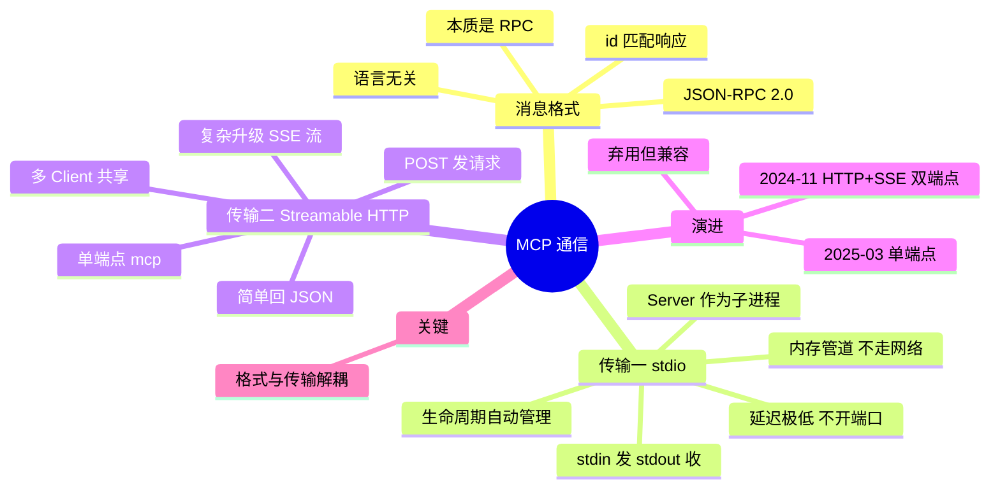

## 🔥 快速背诵

MCP 的通信就两件事：消息格式和传输方式，而且两者解耦。消息统一走 JSON-RPC 2.0，请求、响应、通知都是这个格式。传输上本地用 stdio，就是父子进程管道，不走网络；远程用 Streamable HTTP，单端点，需要服务端推流时按需升级成 SSE。好处是换传输不动上层逻辑，同一套 Server 代码本地能跑、远程也能跑。

> **一句话**：**本地 stdio（管道，不走网络），远程 Streamable HTTP（单端点，按需升级 SSE）**；消息格式统一 **JSON-RPC 2.0**，格式与传输解耦。

## 🧠 导图



---

# 📖 背诵稿

> 四段，按顺序背。

### ① 先讲消息格式

**不管哪种传输，消息格式都是同一套：JSON-RPC 2.0。**

为什么选它？因为 MCP 需要的就是「Client 调 Server 的方法、Server 返回结果」，本质是 RPC，而 JSON-RPC 2.0 是现成的、足够轻量的 RPC 规范。用 JSON 好读好调试，任何语言都能实现，Python 写的 Server 和 TypeScript 写的 Server 消息格式完全一样。每条消息就是一个 JSON 对象：请求带 `jsonrpc`、`id`、`method`、`params`，响应带相同 `id` 和 `result`。JSON-RPC 只定义消息长什么样，不关心怎么传输。

### ② stdio

**本地工具走 stdio：Client 把 Server 当子进程启动，靠标准输入输出通信。**

「管道」可以理解成操作系统在内存里给两个进程分配的一段先进先出缓冲区：Client 塞一行 JSON，Server 从另一头读出来；处理完再往另一条管道塞回去。**全程不经过网卡、不走 TCP/IP，数据在 RAM 里走一趟就到了**，所以延迟天然低。优点是延迟低、不开端口没有网络安全问题、生命周期随 Client 起停自动管理。配置上只要告诉 Client「用什么命令启动 Server」就行。

### ③ Streamable HTTP

**远程走 Streamable HTTP：Server 作为独立 HTTP 服务，用单个端点同时处理请求和响应。**

Client 用 POST 发 JSON-RPC 消息，Server 按需选择返回方式：同步操作直接回普通 JSON，需要流式的就返回 SSE 流持续推。好处是能部署云端、多个 Client 共享同一个 Server（团队共用一套数据库 Server），支持跨机器。代价是多了网络开销，还要处理认证、断线重连这些本地不用管的事。

### ④ 演进与解耦

**早期是「HTTP + SSE」双端点，2025 年 3 月改成单端点 Streamable HTTP，旧方案标记弃用但保留兼容。**

为什么换？双端点的尴尬在于：Client 发请求走 POST，Server 推数据走另一条 SSE 长连接，同一个对话拆成两条通道。Client POST 之后网络断了，这条消息到底处理了没、结果会不会推回来，没有简单办法判断，排查链路很长。Streamable HTTP 把两条通道合成一个端点：照样 POST，Server 自己决定回 JSON 还是 SSE 流。**注意它没有抛弃 SSE**，流式部分底层仍是 `text/event-stream`，只是端点从两个变成一个，对负载均衡和 serverless 更友好。而这一切之所以能自由切换，是因为消息格式和传输方式是解耦的。

---

# 🔑 记忆锚

| 记什么 | 内容 | 口诀 |
|---|---|---|
| **2** 种传输 | stdio / Streamable HTTP | 「管道·端点」 |
| **1** 套格式 | JSON-RPC 2.0 | 「一套消息跑两边」 |
| **3** 个 stdio 优点 | 低延迟 / 不开端口 / 生命周期自动 | 「快·安·省心」 |
| **1** 次演进 | 双端点 → 单端点（2025-03） | 「两条线并一条」 |

> **卡壳急救**：先答「本地 stdio，远程 Streamable HTTP，底层 JSON-RPC」，再补演进原因。

---

# 🎯 追问速查

| 面试官问 | 你答 |
|---|---|
| MCP 用 WebSocket 吗？ | **不用**。本地 stdio 走管道，远程 Streamable HTTP，流式部分用 SSE |
| 为什么本地不用 HTTP？ | 同机进程通信不需要网络，管道延迟更低、也不用开端口 |
| stdio 的管道是什么？ | 操作系统在内存里的 FIFO 缓冲区，不经过网卡和 TCP/IP |
| Streamable HTTP 一定用 SSE 吗？ | 不一定。简单请求回普通 JSON，需要流式才升级为 SSE |
| 旧 HTTP+SSE 为什么被换掉？ | 双端点状态管理复杂，断连时无法判断请求是否被处理 |
| 传输变了要改代码吗？ | 上层逻辑不用改，因为格式与传输解耦 |
| 远程部署要注意什么？ | 认证鉴权、限流、断线重连、多 Client 隔离 |

---

# 🔗 串联

- 前置 → **04/05（MCP 组成）**
- 下一层展开 → **14（SSE vs WebSocket）**、**15（WebRTC）**
- 部署视角 → 呼应大模型工程线的 **部署方案（20）**
- 收尾金句：**同机走管道，跨机走端点，消息永远一条格式**

---

# 📚 细节（背完再点开）

> [!note]- 两种传输对照
> | | stdio | Streamable HTTP |
> |---|---|---|
> | 位置 | 同机子进程 | 独立服务 |
> | 通道 | stdin/stdout 管道 | POST 单端点 |
> | 延迟 | 极低 | 略高（网络） |
> | 安全 | 不开端口 | 需鉴权、限流 |
> | 共享 | 单 Client | 多 Client |

> [!note]- 消息骨架
> ```json
> {"jsonrpc":"2.0","id":1,"method":"tools/call",
>  "params":{"name":"take_screenshot","arguments":{"url":"https://example.com"}}}
> ```
> 响应 `{"jsonrpc":"2.0","id":1,"result":{"content":[{"type":"image","data":"..."}]}}`，id 必须对上。

---

# 🎴 自测

> [!question]- Q1 两种传输方式？
> stdio（本地子进程管道）与 Streamable HTTP（远程单端点）。

> [!question]- Q2 消息格式是什么？为什么？
> JSON-RPC 2.0，因为需求本质是 RPC，它轻量、语言无关、好调试。

> [!question]- Q3 stdio 为什么不走网络？
> 同机进程通过内存管道通信，不经过网卡和 TCP/IP。

> [!question]- Q4 单端点怎么同时处理同步和流式？
> 简单请求回 JSON，需要流式时把响应升级为 SSE 流。

> [!question]- Q5 旧方案被弃用的原因？
> 双端点导致状态管理复杂、断连时无法判断请求状态。
